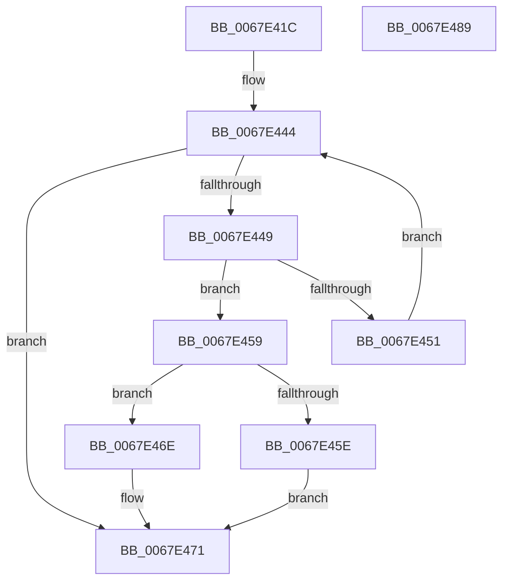

# MiRemoveVadEvent

- RVA: `0x0067E41C`–`0x0067E48A` (길이 `110` bytes)
- VA: `0x000000014067E41C`
- 실행 섹션: `.text`
- PDB 이름 있음: `예`; PDB Function 태그: `아니요`
- unwind 정보 RVA: `0x00060BC4`
- 디코드: `36`개 명령, `110/110` bytes 표시
- 미해석 바이트: `0` (있으면 어셈블리에 `.byte`로 보존)

> 이 문서는 커널 이미지의 기계어와 PDB 기호를 분석해 생성했습니다. 4번과 5번은 함수 원형과 자료형을 바이너리 사용 방식에서 추정한 C 해석이며 원본 소스 복구 결과는 아닙니다.

## 1. Dependencies

- 직접 호출 지점: **2**; 고유 호출 대상: **2**
- 직접 호출자로 확인된 함수: **2**
- RIP 상대 이미지 참조: **0**

### Outgoing calls
- `0x0067E435` → [MiLockVadCore](../29/MiLockVadCore_function_00297170.md) (function, `0x00297170`)
- `0x0067E474` → [MiUnlockVadCore](../43/MiUnlockVadCore_function_004311C0.md) (function, `0x004311C0`)

### Direct callers
- [MiMapViewOfImageSection](../../page/97/MiMapViewOfImageSection_function_0097E92C.md) at `0x0097F903`
- [sub_00B2A146](../../page/B2/Unknown_function_00B2A146.md) at `0x00B2A445`

### Static image references
- 디코드된 RIP-relative 메모리 참조가 없습니다.

## 2. Other-region calls and transfers

- 다른 실행 섹션으로 향하는 call: **0**
- 별도 외부 분기/꼬리 이동을 확인하지 못했습니다.

## 3. Assembly (complete function range)

```asm
0067E41C  48 89 5C 24 08                  mov qword ptr [rsp + 8], rbx
0067E421  48 89 74 24 10                  mov qword ptr [rsp + 0x10], rsi
0067E426  57                              push rdi
0067E427  48 83 EC 20                     sub rsp, 0x20
0067E42B  48 8B F2                        mov rsi, rdx
0067E42E  48 8B D9                        mov rbx, rcx
0067E431  33 D2                           xor edx, edx
0067E433  33 FF                           xor edi, edi
0067E435  E8 36 8D C1 FF                  call 0x140297170
0067E43A  4C 8B 43 38                     mov r8, qword ptr [rbx + 0x38]
0067E43E  8A D0                           mov dl, al
0067E440  49 83 E0 F0                     and r8, 0xfffffffffffffff0
0067E444  4D 85 C0                        test r8, r8
0067E447  74 28                           je 0x14067e471
0067E449  49 8B 08                        mov rcx, qword ptr [r8]
0067E44C  4C 3B C6                        cmp r8, rsi
0067E44F  74 08                           je 0x14067e459
0067E451  49 8B F8                        mov rdi, r8
0067E454  4C 8B C1                        mov r8, rcx
0067E457  EB EB                           jmp 0x14067e444
0067E459  48 85 FF                        test rdi, rdi
0067E45C  75 10                           jne 0x14067e46e
0067E45E  48 8B 43 38                     mov rax, qword ptr [rbx + 0x38]
0067E462  83 E0 0F                        and eax, 0xf
0067E465  48 0B C1                        or rax, rcx
0067E468  48 89 43 38                     mov qword ptr [rbx + 0x38], rax
0067E46C  EB 03                           jmp 0x14067e471
0067E46E  48 89 0F                        mov qword ptr [rdi], rcx
0067E471  48 8B CB                        mov rcx, rbx
0067E474  E8 47 2D DB FF                  call 0x1404311c0
0067E479  48 8B 5C 24 30                  mov rbx, qword ptr [rsp + 0x30]
0067E47E  48 8B 74 24 38                  mov rsi, qword ptr [rsp + 0x38]
0067E483  48 83 C4 20                     add rsp, 0x20
0067E487  5F                              pop rdi
0067E488  C3                              ret
0067E489  CC                              int3
```

## 4. C-style interpretation (structured pseudocode)

```c
__int64 __fastcall MiRemoveVadEvent(__int64 a1, __int64 a2)
{
    __int64 result;
    __int64 v_rdi;
    __int64 v_rsp;
    unsigned __int64 v_stack_p10;
    unsigned __int64 v_stack_p8;

    v_stack_p8 = v_rbx;
    v_stack_p10 = v_rsi;
    v_rsp = (v_rsp) - (32);
    a2 = 0;
    v_rdi = 0;
    result = MiLockVadCore(a1, a2, a3, a4);
    a3 = (*(unsigned __int64 *)(a1 + 56)) & (-16);
loc_0067E444:
    if (a3 == 0) goto loc_0067E471;
    if (a3 == 0) goto loc_0067E459;
    goto loc_0067E444;
loc_0067E459:
    if (a3 != 0) goto loc_0067E46E;
    result = (unsigned int)((*(unsigned __int64 *)(a1 + 56)) & (15));
    result = (result) | (*(unsigned __int64 *)(a3));
    *(unsigned __int64 *)(a1 + 56) = result;
    goto loc_0067E471;
loc_0067E46E:
    *(unsigned __int64 *)(a3) = *(unsigned __int64 *)(a3);
loc_0067E471:
    result = MiUnlockVadCore(a1, (unsigned __int8)(result), *(unsigned __int64 *)(a3), a4);
    v_rsp = (v_rsp) + (32);
    return result;
}
```

## 5. (Beta) C Style

```c
int64_t MiRemoveVadEvent(void *Arg1, int64_t Arg2)
{
    uint8_t *arg1 = (uint8_t *)Arg1;

    int64_t result;
    int64_t local_rdi;
    int64_t local_rsp;
    uint64_t v_stack_p10;
    uint64_t v_stack_p8;

    v_stack_p8 = local_rbx;
    v_stack_p10 = local_rsi;
    local_rsp = (local_rsp) - (32);
    Arg2 = 0;
    local_rdi = 0;
    result = MiLockVadCore(Arg1, Arg2, a3, a4);
    a3 = (*(uint64_t *)(arg1 + 0x38)) & (-16);
loc_0067E444:
    if (a3 == 0) goto loc_0067E471;
    if (a3 == 0) goto loc_0067E459;
    goto loc_0067E444;
loc_0067E459:
    if (a3 != 0) goto loc_0067E46E;
    result = (uint32_t)((*(uint64_t *)(arg1 + 0x38)) & (15));
    result = (result) | (*(uint64_t *)(a3));
    *(uint64_t *)(arg1 + 0x38) = result;
    goto loc_0067E471;
loc_0067E46E:
    *(uint64_t *)(a3) = *(uint64_t *)(a3);
loc_0067E471:
    result = MiUnlockVadCore(Arg1, (uint8_t)(result), *(uint64_t *)(a3), a4);
    local_rsp = (local_rsp) + (32);
    return result;
}
```

### 관측된 메모리 오프셋

구조체 형식이 확인되지 않은 접근은 인자 기준의 오프셋으로만 기록했습니다.

| 기준 인자 | 오프셋 표현 | 폭 (bit) | 접근 |
|---|---:|---:|---|
| `Arg1` | `+ 0x38` | `64` | `R` |
| `Arg1` | `+ 0x38` | `64` | `W` |

## 6. Execution-region graph

[열기: 2D/3D 그래프와 함수 탐색 컨트롤 패널](../../../control-panel.html?section=text&rva=0x0067E41C&view=graph)

- 2D 그래프는 위에서 아래로 흐르고, 3D 그래프는 빈 공간을 드래그해 회전합니다. Shift+드래그는 이동, 휠은 확대·축소, 함수 노드 선택은 대상 보고서 이동입니다.

### Static fallback


