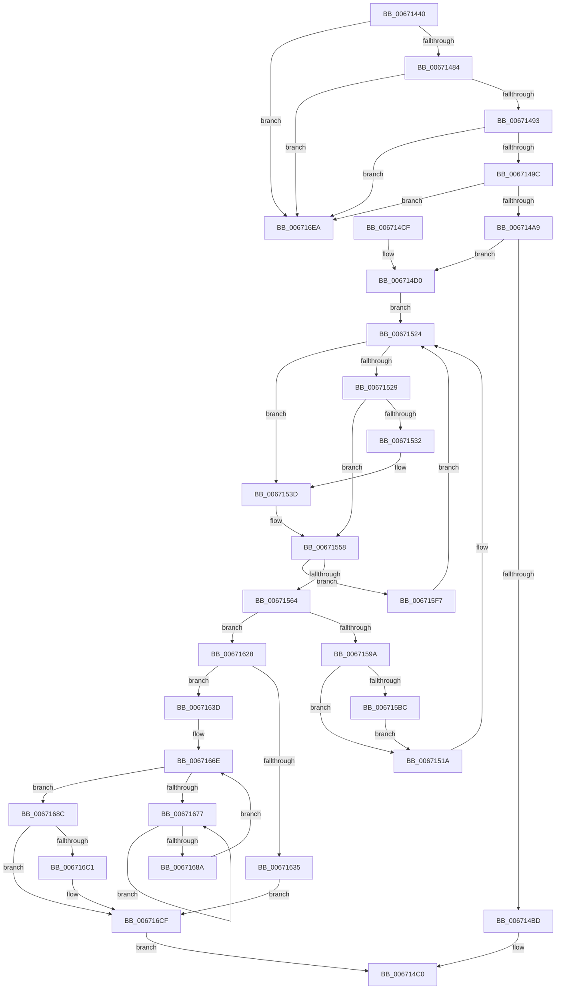

# MiReplaceImportEntry

- RVA: `0x00671440`–`0x00671705` (길이 `709` bytes)
- VA: `0x0000000140671440`
- 실행 섹션: `.text`
- PDB 이름 있음: `예`; PDB Function 태그: `아니요`
- unwind 정보 RVA: `0x000D7864`
- 디코드: `184`개 명령, `709/709` bytes 표시
- 미해석 바이트: `0` (있으면 어셈블리에 `.byte`로 보존)

> 이 문서는 커널 이미지의 기계어와 PDB 기호를 분석해 생성했습니다. 4번과 5번은 함수 원형과 자료형을 바이너리 사용 방식에서 추정한 C 해석이며 원본 소스 복구 결과는 아닙니다.

## 1. Dependencies

- 직접 호출 지점: **24**; 고유 호출 대상: **15**
- 직접 호출자로 확인된 함수: **3**
- RIP 상대 이미지 참조: **2**

### Outgoing calls
- `0x00671476` → [RtlImageDirectoryEntryToData](../43/RtlImageDirectoryEntryToData_function_004328D0.md) (function, `0x004328D0`)
- `0x006714B4` → [MI_IS_PHYSICAL_ADDRESS](../23/MI_IS_PHYSICAL_ADDRESS_function_0023B3A0.md) (function, `0x0023B3A0`)
- `0x006714F9` → [MiGetAnyMultiplexedVm](../44/MiGetAnyMultiplexedVm_function_00448BD0.md) (function, `0x00448BD0`)
- `0x00671506` → [MiLockWorkingSetShared](../27/MiLockWorkingSetShared_function_0027CBF0.md) (function, `0x0027CBF0`)
- `0x00671538` → [MiUnlockPageTable](../21/MiUnlockPageTable_function_00216EC0.md) (function, `0x00216EC0`)
- `0x00671553` → [MiLockNestedPageTable](../23/MiLockNestedPageTable_function_0023E890.md) (function, `0x0023E890`)
- `0x006715AD` → [MiCopyOnWrite](../36/MiCopyOnWrite_function_00362A0C.md) (function, `0x00362A0C`)
- `0x006715C2` → [MiUnlockPageTable](../21/MiUnlockPageTable_function_00216EC0.md) (function, `0x00216EC0`)
- `0x006715CD` → [MiUnlockWorkingSetShared](../27/MiUnlockWorkingSetShared_function_0027D690.md) (function, `0x0027D690`)
- `0x006715DA` → [MiCopyOnWriteCheckConditions](../2A/MiCopyOnWriteCheckConditions_function_002A750C.md) (function, `0x002A750C`)
- `0x006715E2` → [MiLockWorkingSetShared](../27/MiLockWorkingSetShared_function_0027CBF0.md) (function, `0x0027CBF0`)
- `0x006715ED` → [MiLockNestedPageTable](../23/MiLockNestedPageTable_function_0023E890.md) (function, `0x0023E890`)
- `0x006715FD` → [MiUnlockPageTable](../21/MiUnlockPageTable_function_00216EC0.md) (function, `0x00216EC0`)
- `0x00671608` → [MiUnlockWorkingSetShared](../27/MiUnlockWorkingSetShared_function_0027D690.md) (function, `0x0027D690`)
- `0x00671613` → [MiLockWorkingSetShared](../27/MiLockWorkingSetShared_function_0027CBF0.md) (function, `0x0027CBF0`)
- `0x0067161E` → [MiLockNestedPageTable](../23/MiLockNestedPageTable_function_0023E890.md) (function, `0x0023E890`)
- `0x0067164B` → [MiMapPageInHyperSpaceWorker](../33/MiMapPageInHyperSpaceWorker_function_00332B10.md) (function, `0x00332B10`)
- `0x00671664` → [MiUnmapPageInHyperSpaceWorker](../43/MiUnmapPageInHyperSpaceWorker_function_00432800.md) (function, `0x00432800`)
- `0x0067167C` → [KeYieldProcessorEx](../3F/KeYieldProcessorEx_function_003FBD00.md) (function, `0x003FBD00`)
- `0x0067168F` → [MiCaptureDirtyBitToPfn](../37/MiCaptureDirtyBitToPfn_function_00370DD0.md) (function, `0x00370DD0`)
- `0x006716CA` → [MiReleasePageFileInfo](../28/MiReleasePageFileInfo_function_00283FD0.md) (function, `0x00283FD0`)
- `0x006716D5` → [MiUnlockPageTable](../21/MiUnlockPageTable_function_00216EC0.md) (function, `0x00216EC0`)
- `0x006716E0` → [MiUnlockWorkingSetShared](../27/MiUnlockWorkingSetShared_function_0027D690.md) (function, `0x0027D690`)
- `0x006716FF` → [KeBugCheckEx](../4F/KeBugCheckEx_function_004FD660.md) (function, `0x004FD660`)

### Direct callers
- [MmReplaceImportEntry](MmReplaceImportEntry_function_0067175C.md) at `0x00671760`
- [MiReplacePatchImportEntry](../68/MiReplacePatchImportEntry_function_00683D80.md) at `0x00683DE3`
- [MmReplaceImportEntriesForVerifier](../../page/7F/MmReplaceImportEntriesForVerifier_function_007FE040.md) at `0x007FE0B5`

### Static image references
- `0x006714A9` → RVA `0x00E2D998` (`.data`; read/write)
- `0x00671698` → RVA `0x00E30088` (`.data`; read)

## 2. Other-region calls and transfers

- 다른 실행 섹션으로 향하는 call: **0**
- 별도 외부 분기/꼬리 이동을 확인하지 못했습니다.

## 3. Assembly (complete function range)

```asm
00671440  48 8B C4                        mov rax, rsp
00671443  44 89 48 20                     mov dword ptr [rax + 0x20], r9d
00671447  4C 89 40 18                     mov qword ptr [rax + 0x18], r8
0067144B  53                              push rbx
0067144C  55                              push rbp
0067144D  56                              push rsi
0067144E  57                              push rdi
0067144F  41 54                           push r12
00671451  41 56                           push r14
00671453  41 57                           push r15
00671455  48 83 EC 30                     sub rsp, 0x30
00671459  83 60 20 00                     and dword ptr [rax + 0x20], 0
0067145D  4C 8D 48 20                     lea r9, [rax + 0x20]
00671461  4D 8B F8                        mov r15, r8
00671464  48 8B DA                        mov rbx, rdx
00671467  48 8B F9                        mov rdi, rcx
0067146A  41 B8 0C 00 00 00               mov r8d, 0xc
00671470  48 8B 49 30                     mov rcx, qword ptr [rcx + 0x30]
00671474  B2 01                           mov dl, 1
00671476  E8 55 14 DC FF                  call 0x1404328d0
0067147B  48 85 C0                        test rax, rax
0067147E  0F 84 66 02 00 00               je 0x1406716ea
00671484  8B 94 24 88 00 00 00            mov edx, dword ptr [rsp + 0x88]
0067148B  85 D2                           test edx, edx
0067148D  0F 84 57 02 00 00               je 0x1406716ea
00671493  48 3B D8                        cmp rbx, rax
00671496  0F 82 4E 02 00 00               jb 0x1406716ea
0067149C  48 8D 0C 10                     lea rcx, [rax + rdx]
006714A0  48 3B D9                        cmp rbx, rcx
006714A3  0F 83 41 02 00 00               jae 0x1406716ea
006714A9  F0 48 FF 05 E7 C4 7B 00         lock inc qword ptr [rip + 0x7bc4e7]
006714B1  48 8B CB                        mov rcx, rbx
006714B4  E8 E7 9E BC FF                  call 0x14023b3a0
006714B9  85 C0                           test eax, eax
006714BB  74 13                           je 0x1406714d0
006714BD  4C 89 3B                        mov qword ptr [rbx], r15
006714C0  48 83 C4 30                     add rsp, 0x30
006714C4  41 5F                           pop r15
006714C6  41 5E                           pop r14
006714C8  41 5C                           pop r12
006714CA  5F                              pop rdi
006714CB  5E                              pop rsi
006714CC  5D                              pop rbp
006714CD  5B                              pop rbx
006714CE  C3                              ret
006714CF  CC                              int3
006714D0  4C 8B F3                        mov r14, rbx
006714D3  48 BD 00 00 00 00 80 F6 FF FF   movabs rbp, 0xfffff68000000000
006714DD  49 C1 EE 09                     shr r14, 9
006714E1  48 B8 F8 FF FF FF 7F 00 00 00   movabs rax, 0x7ffffffff8
006714EB  4C 23 F0                        and r14, rax
006714EE  48 8B C5                        mov rax, rbp
006714F1  B9 01 00 00 00                  mov ecx, 1
006714F6  4C 03 F0                        add r14, rax
006714F9  E8 D2 76 DD FF                  call 0x140448bd0
006714FE  48 8B C8                        mov rcx, rax
00671501  33 FF                           xor edi, edi
00671503  48 8B F0                        mov rsi, rax
00671506  E8 E5 B6 C0 FF                  call 0x14027cbf0
0067150B  44 8A E0                        mov r12b, al
0067150E  49 BF F8 FF FF FF 7F 00 00 00   movabs r15, 0x7ffffffff8
00671518  EB 0A                           jmp 0x140671524
0067151A  48 BD 00 00 00 00 80 F6 FF FF   movabs rbp, 0xfffff68000000000
00671524  48 85 FF                        test rdi, rdi
00671527  74 14                           je 0x14067153d
00671529  49 F7 C6 FF 0F 00 00            test r14, 0xfff
00671530  75 26                           jne 0x140671558
00671532  48 8B D7                        mov rdx, rdi
00671535  48 8B CE                        mov rcx, rsi
00671538  E8 83 59 BA FF                  call 0x140216ec0
0067153D  49 8B FE                        mov rdi, r14
00671540  48 C1 EF 09                     shr rdi, 9
00671544  49 23 FF                        and rdi, r15
00671547  48 8B C5                        mov rax, rbp
0067154A  48 03 F8                        add rdi, rax
0067154D  48 8B CE                        mov rcx, rsi
00671550  48 8B D7                        mov rdx, rdi
00671553  E8 38 D3 BC FF                  call 0x14023e890
00671558  49 8B 0E                        mov rcx, qword ptr [r14]
0067155B  F6 C1 01                        test cl, 1
0067155E  0F 84 93 00 00 00               je 0x1406715f7
00671564  4C 8B C9                        mov r9, rcx
00671567  48 B8 FF FF FF FF FF 00 00 00   movabs rax, 0xffffffffff
00671571  49 C1 E9 0C                     shr r9, 0xc
00671575  4C 23 C8                        and r9, rax
00671578  4B 8D 2C 49                     lea rbp, [r9 + r9*2]
0067157C  48 C1 E5 04                     shl rbp, 4
00671580  48 B8 00 00 00 00 00 DE FF FF   movabs rax, 0xffffde0000000000
0067158A  48 03 E8                        add rbp, rax
0067158D  48 8B 45 28                     mov rax, qword ptr [rbp + 0x28]
00671591  48 85 C0                        test rax, rax
00671594  0F 89 8E 00 00 00               jns 0x140671628
0067159A  48 83 64 24 20 00               and qword ptr [rsp + 0x20], 0
006715A0  45 33 C9                        xor r9d, r9d
006715A3  49 83 C8 FF                     or r8, 0xffffffffffffffff
006715A7  49 8B D6                        mov rdx, r14
006715AA  48 8B CB                        mov rcx, rbx
006715AD  E8 5A 14 CF FF                  call 0x140362a0c
006715B2  8B E8                           mov ebp, eax
006715B4  85 C0                           test eax, eax
006715B6  0F 89 5E FF FF FF               jns 0x14067151a
006715BC  48 8B D7                        mov rdx, rdi
006715BF  48 8B CE                        mov rcx, rsi
006715C2  E8 F9 58 BA FF                  call 0x140216ec0
006715C7  41 8A D4                        mov dl, r12b
006715CA  48 8B CE                        mov rcx, rsi
006715CD  E8 BE C0 C0 FF                  call 0x14027d690
006715D2  45 33 C0                        xor r8d, r8d
006715D5  8B D5                           mov edx, ebp
006715D7  48 8B CE                        mov rcx, rsi
006715DA  E8 2D 5F C3 FF                  call 0x1402a750c
006715DF  48 8B CE                        mov rcx, rsi
006715E2  E8 09 B6 C0 FF                  call 0x14027cbf0
006715E7  48 8B D7                        mov rdx, rdi
006715EA  48 8B CE                        mov rcx, rsi
006715ED  E8 9E D2 BC FF                  call 0x14023e890
006715F2  E9 23 FF FF FF                  jmp 0x14067151a
006715F7  48 8B D7                        mov rdx, rdi
006715FA  48 8B CE                        mov rcx, rsi
006715FD  E8 BE 58 BA FF                  call 0x140216ec0
00671602  41 8A D4                        mov dl, r12b
00671605  48 8B CE                        mov rcx, rsi
00671608  E8 83 C0 C0 FF                  call 0x14027d690
0067160D  48 8B 03                        mov rax, qword ptr [rbx]
00671610  48 8B CE                        mov rcx, rsi
00671613  E8 D8 B5 C0 FF                  call 0x14027cbf0
00671618  48 8B D7                        mov rdx, rdi
0067161B  48 8B CE                        mov rcx, rsi
0067161E  E8 6D D2 BC FF                  call 0x14023e890
00671623  E9 FC FE FF FF                  jmp 0x140671524
00671628  4C 8B BC 24 80 00 00 00         mov r15, qword ptr [rsp + 0x80]
00671630  F6 C1 42                        test cl, 0x42
00671633  74 08                           je 0x14067163d
00671635  4C 89 3B                        mov qword ptr [rbx], r15
00671638  E9 92 00 00 00                  jmp 0x1406716cf
0067163D  41 BE 00 00 00 80               mov r14d, 0x80000000
00671643  33 D2                           xor edx, edx
00671645  45 8B C6                        mov r8d, r14d
00671648  49 8B C9                        mov rcx, r9
0067164B  E8 C0 14 CC FF                  call 0x140332b10
00671650  81 E3 FF 0F 00 00               and ebx, 0xfff
00671656  45 8B C6                        mov r8d, r14d
00671659  48 03 C3                        add rax, rbx
0067165C  B2 11                           mov dl, 0x11
0067165E  48 8B C8                        mov rcx, rax
00671661  4C 89 38                        mov qword ptr [rax], r15
00671664  E8 97 11 DC FF                  call 0x140432800
00671669  83 64 24 70 00                  and dword ptr [rsp + 0x70], 0
0067166E  F0 48 0F BA 6D 18 3F            lock bts qword ptr [rbp + 0x18], 0x3f
00671675  73 15                           jae 0x14067168c
00671677  48 8D 4C 24 70                  lea rcx, [rsp + 0x70]
0067167C  E8 7F A6 D8 FF                  call 0x1403fbd00
00671681  48 8B 45 18                     mov rax, qword ptr [rbp + 0x18]
00671685  48 85 C0                        test rax, rax
00671688  78 ED                           js 0x140671677
0067168A  EB E2                           jmp 0x14067166e
0067168C  48 8B CD                        mov rcx, rbp
0067168F  E8 3C F7 CF FF                  call 0x140370dd0
00671694  48 8B 4D 28                     mov rcx, qword ptr [rbp + 0x28]
00671698  48 8B 15 E9 E9 7B 00            mov rdx, qword ptr [rip + 0x7be9e9]
0067169F  48 C1 E9 2B                     shr rcx, 0x2b
006716A3  81 E1 FF 03 00 00               and ecx, 0x3ff
006716A9  48 8B 0C CA                     mov rcx, qword ptr [rdx + rcx*8]
006716AD  48 BA FF FF FF FF FF FF FF 7F   movabs rdx, 0x7fffffffffffffff
006716B7  F0 48 21 55 18                  lock and qword ptr [rbp + 0x18], rdx
006716BC  48 85 C0                        test rax, rax
006716BF  74 0E                           je 0x1406716cf
006716C1  41 B8 01 00 00 00               mov r8d, 1
006716C7  48 8B D0                        mov rdx, rax
006716CA  E8 01 29 C1 FF                  call 0x140283fd0
006716CF  48 8B D7                        mov rdx, rdi
006716D2  48 8B CE                        mov rcx, rsi
006716D5  E8 E6 57 BA FF                  call 0x140216ec0
006716DA  41 8A D4                        mov dl, r12b
006716DD  48 8B CE                        mov rcx, rsi
006716E0  E8 AB BF C0 FF                  call 0x14027d690
006716E5  E9 D6 FD FF FF                  jmp 0x1406714c0
006716EA  4C 8B CB                        mov r9, rbx
006716ED  4C 89 7C 24 20                  mov qword ptr [rsp + 0x20], r15
006716F2  4C 8B C7                        mov r8, rdi
006716F5  BA 14 10 00 00                  mov edx, 0x1014
006716FA  B9 1A 00 00 00                  mov ecx, 0x1a
006716FF  E8 5C BF E8 FF                  call 0x1404fd660
00671704  CC                              int3
```

## 4. C-style interpretation (structured pseudocode)

```c
__int64 __fastcall MiReplaceImportEntry(__int64 a1, __int64 a2, __int64 a3, int a4)
{
    __int64 result;
    __int64 v_r14;
    __int64 v_rbp;
    __int64 v_rbx;
    __int64 v_rdi;
    __int64 v_rsp;
    unsigned int v_stack_p20;
    unsigned int v_stack_p70;
    unsigned __int64 v_stack_p80;

    *(unsigned int *)(v_rsp + 32) = a4;
    *(unsigned __int64 *)(v_rsp + 24) = a3;
    v_rsp = (v_rsp) - (48);
    result = RtlImageDirectoryEntryToData(*(unsigned __int64 *)(a1 + 48), 1, 12, v_rsp + 32);
    if (result == 0) goto loc_006716EA;
    if ((unsigned int)((unsigned int)(v_stack_p20)) == 0) goto loc_006716EA;
    if (a2 < result) goto loc_006716EA;
    if (a2 >= (result + (unsigned int)(v_stack_p20) * 1)) goto loc_006716EA;
    result = MI_IS_PHYSICAL_ADDRESS(a2, (unsigned int)(v_stack_p20), 12, v_rsp + 32);
    if ((unsigned int)(result) == 0) goto loc_006714D0;
    *(unsigned __int64 *)(a2) = a3;
loc_006714C0:
    v_rsp = (v_rsp) + (48);
    return result;
loc_006714D0:
    v_r14 = (a2) >> (9);
    v_r14 = (v_r14) & (result);
    v_r14 = (v_r14) + (v_rbp);
    result = MiGetAnyMultiplexedVm(1, (unsigned int)(v_stack_p20), 12, v_rsp + 32);
    v_rdi = 0;
    result = MiLockWorkingSetShared(result, (unsigned int)(v_stack_p20), 12, v_rsp + 32);
    goto loc_00671524;
loc_0067151A:
loc_00671524:
    if (0 == 0) goto loc_0067153D;
    if (((v_r14) & (0xFFFULL)) != 0) goto loc_00671558;
    result = MiUnlockPageTable(result, 0, 12, v_rsp + 32);
loc_0067153D:
    v_rdi = (v_r14) >> (9);
    v_rdi = (v_rdi) & (a3);
    v_rdi = (v_rdi) + (v_rbp);
    result = MiLockNestedPageTable(result, v_rdi, 12, v_rsp + 32);
loc_00671558:
    if ((((unsigned __int8)(*(unsigned __int64 *)(v_r14))) & (1)) == 0) goto loc_006715F7;
    a4 = (*(unsigned __int64 *)(v_r14)) >> (12);
    a4 = (a4) & (result);
    v_rbp = (a4 + a4 * 2) << (4);
    v_rbp = (v_rbp) + (result);
    if (!sign_flag) goto loc_00671628;
    a4 = 0;
    a3 = (12) | (-1);
    result = MiCopyOnWrite(a2, v_r14, a3, a4);
    if (!sign_flag) goto loc_0067151A;
    result = MiUnlockPageTable(result, v_rdi, a3, a4);
    result = MiUnlockWorkingSetShared(result, (unsigned __int8)((unsigned __int8)(result)), a3, a4);
    a3 = 0;
    result = MiCopyOnWriteCheckConditions(result, (unsigned int)((unsigned int)((unsigned int)((unsigned int)(result)))), a3, a4);
    result = MiLockWorkingSetShared(result, (unsigned int)((unsigned int)((unsigned int)((unsigned int)(result)))), a3, a4);
    result = MiLockNestedPageTable(result, v_rdi, a3, a4);
    goto loc_0067151A;
loc_006715F7:
    result = MiUnlockPageTable(result, v_rdi, a3, a4);
    result = MiUnlockWorkingSetShared(result, (unsigned __int8)((unsigned __int8)(result)), a3, a4);
    result = MiLockWorkingSetShared(result, (unsigned __int8)((unsigned __int8)(result)), a3, a4);
    result = MiLockNestedPageTable(result, v_rdi, a3, a4);
    goto loc_00671524;
loc_00671628:
    if ((((unsigned __int8)(result)) & (66)) == 0) goto loc_0067163D;
    *(unsigned __int64 *)(a2) = v_stack_p80;
    goto loc_006716CF;
loc_0067163D:
    a2 = 0;
    result = MiMapPageInHyperSpaceWorker(0, a2, (unsigned int)((unsigned int)((unsigned int)(0x80000000ULL))), a4);
    v_rbx = (unsigned int)((a2) & (0xFFFULL));
    result = (result) + (v_rbx);
    *(unsigned __int64 *)(result) = v_stack_p80;
    result = MiUnmapPageInHyperSpaceWorker(result, 17, (unsigned int)((unsigned int)((unsigned int)(0x80000000ULL))), a4);
loc_0067166E:
    if (condition_is_above_or_equal) goto loc_0067168C;
loc_00671677:
    result = KeYieldProcessorEx(v_stack_p70, 17, (unsigned int)((unsigned int)((unsigned int)(0x80000000ULL))), a4);
    if (sign_flag) goto loc_00671677;
    goto loc_0067166E;
loc_0067168C:
    result = MiCaptureDirtyBitToPfn((unsigned int)((unsigned int)(result)), 17, (unsigned int)((unsigned int)((unsigned int)(0x80000000ULL))), a4);
    a1 = (*(unsigned __int64 *)((unsigned int)((unsigned int)(result)) + 40)) >> (43);
    a1 = (unsigned int)((a1) & (0x3FFULL));
    if (result != 0) {
        a3 = 1;
        a2 = result;
        result = MiReleasePageFileInfo(*(unsigned __int64 *)(*(unsigned __int64 *)(v_rip + 8120809) + a1 * 8), a2, a3, a4);
    }
    result = MiUnlockPageTable(result, v_rdi, a3, a4);
    result = MiUnlockWorkingSetShared(result, (unsigned __int8)((unsigned __int8)(result)), a3, a4);
    goto loc_006714C0;
loc_006716EA:
    v_stack_p20 = v_stack_p80;
    result = KeBugCheckEx(26, (unsigned int)(0x1014ULL), v_rdi, v_rbx);
    return result;
}
```

## 5. (Beta) C Style

```c
int64_t MiReplaceImportEntry(void *Arg1, int64_t Arg2, int64_t Arg3, int32_t Arg4)
{
    uint8_t *arg1 = (uint8_t *)Arg1;

    int64_t result;
    int64_t local_r14;
    int64_t local_rbp;
    int64_t local_rbx;
    int64_t local_rdi;
    int64_t local_rsp;
    uint32_t v_stack_p20;
    uint32_t v_stack_p70;
    uint64_t v_stack_p80;

    *(uint32_t *)(local_rsp + 0x20) = Arg4;
    *(uint64_t *)(local_rsp + 0x18) = Arg3;
    local_rsp = (local_rsp) - (48);
    result = RtlImageDirectoryEntryToData(*(uint64_t *)(arg1 + 0x30), 1, 12, local_rsp + 32);
    if (result == 0) goto loc_006716EA;
    if ((uint32_t)((uint32_t)(v_stack_p20)) == 0) goto loc_006716EA;
    if (Arg2 < result) goto loc_006716EA;
    if (Arg2 >= (result + (uint32_t)(v_stack_p20) * 1)) goto loc_006716EA;
    result = MI_IS_PHYSICAL_ADDRESS(Arg2, (uint32_t)(v_stack_p20), 12, local_rsp + 32);
    if ((uint32_t)(result) == 0) goto loc_006714D0;
    *(uint64_t *)(Arg2) = Arg3;
loc_006714C0:
    local_rsp = (local_rsp) + (48);
    return result;
loc_006714D0:
    local_r14 = (Arg2) >> (9);
    local_r14 = (local_r14) & (result);
    local_r14 = (local_r14) + (local_rbp);
    result = MiGetAnyMultiplexedVm(1, (uint32_t)(v_stack_p20), 12, local_rsp + 32);
    local_rdi = 0;
    result = MiLockWorkingSetShared(result, (uint32_t)(v_stack_p20), 12, local_rsp + 32);
    goto loc_00671524;
loc_0067151A:
loc_00671524:
    if (0 == 0) goto loc_0067153D;
    if (((local_r14) & (0xFFFULL)) != 0) goto loc_00671558;
    result = MiUnlockPageTable(result, 0, 12, local_rsp + 32);
loc_0067153D:
    local_rdi = (local_r14) >> (9);
    local_rdi = (local_rdi) & (Arg3);
    local_rdi = (local_rdi) + (local_rbp);
    result = MiLockNestedPageTable(result, local_rdi, 12, local_rsp + 32);
loc_00671558:
    if ((((uint8_t)(*(uint64_t *)(local_r14))) & (1)) == 0) goto loc_006715F7;
    Arg4 = (*(uint64_t *)(local_r14)) >> (12);
    Arg4 = (Arg4) & (result);
    local_rbp = (Arg4 + Arg4 * 2) << (4);
    local_rbp = (local_rbp) + (result);
    if (!sign_flag) goto loc_00671628;
    Arg4 = 0;
    Arg3 = (12) | (-1);
    result = MiCopyOnWrite(Arg2, local_r14, Arg3, Arg4);
    if (!sign_flag) goto loc_0067151A;
    result = MiUnlockPageTable(result, local_rdi, Arg3, Arg4);
    result = MiUnlockWorkingSetShared(result, (uint8_t)((uint8_t)(result)), Arg3, Arg4);
    Arg3 = 0;
    result = MiCopyOnWriteCheckConditions(result, (uint32_t)((uint32_t)((uint32_t)((uint32_t)(result)))), Arg3, Arg4);
    result = MiLockWorkingSetShared(result, (uint32_t)((uint32_t)((uint32_t)((uint32_t)(result)))), Arg3, Arg4);
    result = MiLockNestedPageTable(result, local_rdi, Arg3, Arg4);
    goto loc_0067151A;
loc_006715F7:
    result = MiUnlockPageTable(result, local_rdi, Arg3, Arg4);
    result = MiUnlockWorkingSetShared(result, (uint8_t)((uint8_t)(result)), Arg3, Arg4);
    result = MiLockWorkingSetShared(result, (uint8_t)((uint8_t)(result)), Arg3, Arg4);
    result = MiLockNestedPageTable(result, local_rdi, Arg3, Arg4);
    goto loc_00671524;
loc_00671628:
    if ((((uint8_t)(result)) & (66)) == 0) goto loc_0067163D;
    *(uint64_t *)(Arg2) = v_stack_p80;
    goto loc_006716CF;
loc_0067163D:
    Arg2 = 0;
    result = MiMapPageInHyperSpaceWorker(0, Arg2, (uint32_t)((uint32_t)((uint32_t)(0x80000000ULL))), Arg4);
    local_rbx = (uint32_t)((Arg2) & (0xFFFULL));
    result = (result) + (local_rbx);
    *(uint64_t *)(result) = v_stack_p80;
    result = MiUnmapPageInHyperSpaceWorker(result, 17, (uint32_t)((uint32_t)((uint32_t)(0x80000000ULL))), Arg4);
loc_0067166E:
    if (condition_is_above_or_equal) goto loc_0067168C;
loc_00671677:
    result = KeYieldProcessorEx(v_stack_p70, 17, (uint32_t)((uint32_t)((uint32_t)(0x80000000ULL))), Arg4);
    if (sign_flag) goto loc_00671677;
    goto loc_0067166E;
loc_0067168C:
    result = MiCaptureDirtyBitToPfn((uint32_t)((uint32_t)(result)), 17, (uint32_t)((uint32_t)((uint32_t)(0x80000000ULL))), Arg4);
    Arg1 = (*(uint64_t *)((uint32_t)((uint32_t)(result)) + 0x28)) >> (43);
    Arg1 = (uint32_t)((Arg1) & (0x3FFULL));
    if (result != 0) {
        Arg3 = 1;
        Arg2 = result;
        result = MiReleasePageFileInfo(*(uint64_t *)(*(uint64_t *)(v_rip + 0x7BE9E9) + arg1 * 8), Arg2, Arg3, Arg4);
    }
    result = MiUnlockPageTable(result, local_rdi, Arg3, Arg4);
    result = MiUnlockWorkingSetShared(result, (uint8_t)((uint8_t)(result)), Arg3, Arg4);
    goto loc_006714C0;
loc_006716EA:
    v_stack_p20 = v_stack_p80;
    result = KeBugCheckEx(26, (uint32_t)(0x1014ULL), local_rdi, local_rbx);
    return result;
}
```

### 관측된 메모리 오프셋

구조체 형식이 확인되지 않은 접근은 인자 기준의 오프셋으로만 기록했습니다.

| 기준 인자 | 오프셋 표현 | 폭 (bit) | 접근 |
|---|---:|---:|---|
| `Arg1` | `+ 0x30` | `64` | `R` |

## 6. Execution-region graph

[열기: 2D/3D 그래프와 함수 탐색 컨트롤 패널](../../../control-panel.html?section=text&rva=0x00671440&view=graph)

- 2D 그래프는 위에서 아래로 흐르고, 3D 그래프는 빈 공간을 드래그해 회전합니다. Shift+드래그는 이동, 휠은 확대·축소, 함수 노드 선택은 대상 보고서 이동입니다.

### Static fallback


