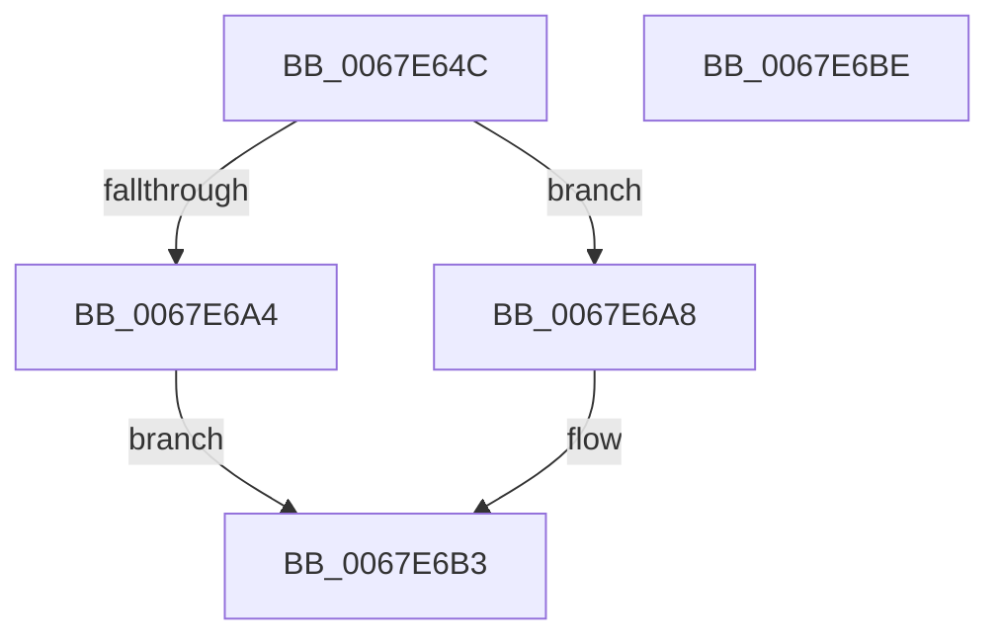

# MiReserveFaultPte

- RVA: `0x0067E64C`–`0x0067E6BF` (길이 `115` bytes)
- VA: `0x000000014067E64C`
- 실행 섹션: `.text`
- PDB 이름 있음: `예`; PDB Function 태그: `아니요`
- unwind 정보 RVA: `0x0006E5F8`
- 디코드: `29`개 명령, `115/115` bytes 표시
- 미해석 바이트: `0` (있으면 어셈블리에 `.byte`로 보존)

> 이 문서는 커널 이미지의 기계어와 PDB 기호를 분석해 생성했습니다. 4번과 5번은 함수 원형과 자료형을 바이너리 사용 방식에서 추정한 C 해석이며 원본 소스 복구 결과는 아닙니다.

## 1. Dependencies

- 직접 호출 지점: **3**; 고유 호출 대상: **3**
- 직접 호출자로 확인된 함수: **1**
- RIP 상대 이미지 참조: **3**

### Outgoing calls
- `0x0067E677` → [ExAcquireSpinLockExclusive](../24/ExAcquireSpinLockExclusive_function_00248690.md) (function, `0x00248690`)
- `0x0067E68A` → [RtlFindClearBitsAndSet](../3E/RtlFindClearBitsAndSet_function_003E0CD0.md) (function, `0x003E0CD0`)
- `0x0067E69A` → [MiReleaseSpinLockExclusive](../24/MiReleaseSpinLockExclusive_function_002482C0.md) (function, `0x002482C0`)

### Direct callers
- [MiValidateImagePfn](../../page/93/MiValidateImagePfn_function_0093EA08.md) at `0x0093ED03`

### Static image references
- `0x0067E656` → RVA `0x00E37414` (`.data`; read)
- `0x0067E66B` → RVA `0x00E37410` (`.data`; read)
- `0x0067E6A8` → RVA `0x00E37408` (`.data`; read)

## 2. Other-region calls and transfers

- 다른 실행 섹션으로 향하는 call: **0**
- 별도 외부 분기/꼬리 이동을 확인하지 못했습니다.

## 3. Assembly (complete function range)

```asm
0067E64C  48 89 5C 24 08                  mov qword ptr [rsp + 8], rbx
0067E651  57                              push rdi
0067E652  48 83 EC 30                     sub rsp, 0x30
0067E656  48 8D 05 B7 8D 7B 00            lea rax, [rip + 0x7b8db7]
0067E65D  48 C7 44 24 20 10 00 00 00      mov qword ptr [rsp + 0x20], 0x10
0067E666  83 64 24 24 00                  and dword ptr [rsp + 0x24], 0
0067E66B  48 8D 0D 9E 8D 7B 00            lea rcx, [rip + 0x7b8d9e]
0067E672  48 89 44 24 28                  mov qword ptr [rsp + 0x28], rax
0067E677  E8 14 A0 BC FF                  call 0x140248690
0067E67C  45 33 C0                        xor r8d, r8d
0067E67F  48 8D 4C 24 20                  lea rcx, [rsp + 0x20]
0067E684  8A D8                           mov bl, al
0067E686  41 8D 50 01                     lea edx, [r8 + 1]
0067E68A  E8 41 26 D6 FF                  call 0x1403e0cd0
0067E68F  8A D3                           mov dl, bl
0067E691  8B F8                           mov edi, eax
0067E693  48 8D 0D 76 8D 7B 00            lea rcx, [rip + 0x7b8d76]
0067E69A  E8 21 9C BC FF                  call 0x1402482c0
0067E69F  83 FF FF                        cmp edi, -1
0067E6A2  75 04                           jne 0x14067e6a8
0067E6A4  33 C0                           xor eax, eax
0067E6A6  EB 0B                           jmp 0x14067e6b3
0067E6A8  48 8B 05 59 8D 7B 00            mov rax, qword ptr [rip + 0x7b8d59]
0067E6AF  48 8D 04 F8                     lea rax, [rax + rdi*8]
0067E6B3  48 8B 5C 24 40                  mov rbx, qword ptr [rsp + 0x40]
0067E6B8  48 83 C4 30                     add rsp, 0x30
0067E6BC  5F                              pop rdi
0067E6BD  C3                              ret
0067E6BE  CC                              int3
```

## 4. C-style interpretation (structured pseudocode)

```c
__int64 __fastcall MiReserveFaultPte(__int64 a1, __int64 a2, int a3)
{
    __int64 result;
    __int64 v_rsp;
    unsigned __int64 v_stack_m10;
    unsigned int v_stack_m14;
    unsigned __int64 v_stack_m18;
    unsigned __int64 v_stack_p8;

    v_stack_p8 = v_rbx;
    v_rsp = (v_rsp) - (48);
    v_stack_m18 = 16;
    v_stack_m10 = v_rip + 8097207;
    result = ExAcquireSpinLockExclusive(v_rip + 8097182, a2, a3, a4);
    a3 = 0;
    result = RtlFindClearBitsAndSet(v_stack_m18, a3 + 1, a3, a4);
    result = MiReleaseSpinLockExclusive(v_rip + 8097142, (unsigned __int8)((unsigned __int8)(result)), a3, a4);
    if (((unsigned int)((unsigned int)((unsigned int)(result)))) != -1) goto loc_0067E6A8;
    result = 0;
    goto loc_0067E6B3;
loc_0067E6A8:
loc_0067E6B3:
    v_rsp = (v_rsp) + (48);
    return *(unsigned __int64 *)(v_rip + 8097113) + (unsigned int)((unsigned int)(result)) * 8;
}
```

## 5. (Beta) C Style

```c
int64_t MiReserveFaultPte(int64_t Arg1, int64_t Arg2, int32_t Arg3)
{
    int64_t result;
    int64_t local_rsp;
    uint64_t v_stack_m10;
    uint32_t v_stack_m14;
    uint64_t v_stack_m18;
    uint64_t v_stack_p8;

    v_stack_p8 = local_rbx;
    local_rsp = (local_rsp) - (48);
    v_stack_m18 = 16;
    v_stack_m10 = v_rip + 8097207;
    result = ExAcquireSpinLockExclusive(v_rip + 8097182, Arg2, Arg3, a4);
    Arg3 = 0;
    result = RtlFindClearBitsAndSet(v_stack_m18, Arg3 + 1, Arg3, a4);
    result = MiReleaseSpinLockExclusive(v_rip + 8097142, (uint8_t)((uint8_t)(result)), Arg3, a4);
    if (((uint32_t)((uint32_t)((uint32_t)(result)))) != -1) goto loc_0067E6A8;
    result = 0;
    goto loc_0067E6B3;
loc_0067E6A8:
loc_0067E6B3:
    local_rsp = (local_rsp) + (48);
    return *(uint64_t *)(v_rip + 0x7B8D59) + (uint32_t)((uint32_t)(result)) * 8;
}
```

## 6. Execution-region graph

[열기: 2D/3D 그래프와 함수 탐색 컨트롤 패널](../../../control-panel.html?section=text&rva=0x0067E64C&view=graph)

- 2D 그래프는 위에서 아래로 흐르고, 3D 그래프는 빈 공간을 드래그해 회전합니다. Shift+드래그는 이동, 휠은 확대·축소, 함수 노드 선택은 대상 보고서 이동입니다.

### Static fallback


