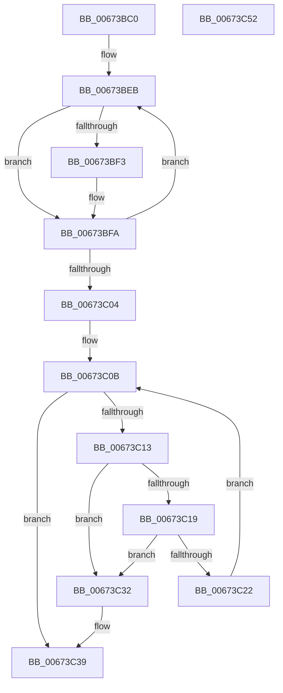

# MiReturnAddMemoryResources

- RVA: `0x00673BC0`–`0x00673C53` (길이 `147` bytes)
- VA: `0x0000000140673BC0`
- 실행 섹션: `.text`
- PDB 이름 있음: `예`; PDB Function 태그: `아니요`
- unwind 정보 RVA: `0x00060BC4`
- 디코드: `42`개 명령, `147/147` bytes 표시
- 미해석 바이트: `0` (있으면 어셈블리에 `.byte`로 보존)

> 이 문서는 커널 이미지의 기계어와 PDB 기호를 분석해 생성했습니다. 4번과 5번은 함수 원형과 자료형을 바이너리 사용 방식에서 추정한 C 해석이며 원본 소스 복구 결과는 아닙니다.

## 1. Dependencies

- 직접 호출 지점: **5**; 고유 호출 대상: **4**
- 직접 호출자로 확인된 함수: **2**
- RIP 상대 이미지 참조: **0**

### Outgoing calls
- `0x00673BD2` → [MiUnlinkHotAddFlight](../../page/7F/MiUnlinkHotAddFlight_function_007FB05C.md) (function, `0x007FB05C`)
- `0x00673BDA` → [MiReleaseAddMemoryLocks](../../page/7F/MiReleaseAddMemoryLocks_function_007FACEC.md) (function, `0x007FACEC`)
- `0x00673BF5` → [ExFreePoolWithTag](../../poolcode/B8/ExFreePoolWithTag_function_00B82870.md) (function, `0x00B82870`)
- `0x00673C2B` → [ExFreePoolWithTag](../../poolcode/B8/ExFreePoolWithTag_function_00B82870.md) (function, `0x00B82870`)
- `0x00673C3D` → [MiDeletePartitionPageNodes](../69/MiDeletePartitionPageNodes_function_006908F0.md) (function, `0x006908F0`)

### Direct callers
- [MiAddPhysicalMemory](../../page/7F/MiAddPhysicalMemory_function_007F95FC.md) at `0x007F988D`
- [MiRemovePhysicalMemory](../../page/7F/MiRemovePhysicalMemory_function_007FAD3C.md) at `0x007FB00E`

### Static image references
- 디코드된 RIP-relative 메모리 참조가 없습니다.

## 2. Other-region calls and transfers

- 다른 실행 섹션으로 향하는 call: **4**
  - `0x00673BD2` → [MiUnlinkHotAddFlight](../../page/7F/MiUnlinkHotAddFlight_function_007FB05C.md) (`.text` → `PAGE`)
  - `0x00673BDA` → [MiReleaseAddMemoryLocks](../../page/7F/MiReleaseAddMemoryLocks_function_007FACEC.md) (`.text` → `PAGE`)
  - `0x00673BF5` → [ExFreePoolWithTag](../../poolcode/B8/ExFreePoolWithTag_function_00B82870.md) (`.text` → `POOLCODE`)
  - `0x00673C2B` → [ExFreePoolWithTag](../../poolcode/B8/ExFreePoolWithTag_function_00B82870.md) (`.text` → `POOLCODE`)
- 별도 외부 분기/꼬리 이동을 확인하지 못했습니다.

## 3. Assembly (complete function range)

```asm
00673BC0  48 89 5C 24 08                  mov qword ptr [rsp + 8], rbx
00673BC5  48 89 74 24 10                  mov qword ptr [rsp + 0x10], rsi
00673BCA  57                              push rdi
00673BCB  48 83 EC 20                     sub rsp, 0x20
00673BCF  48 8B D9                        mov rbx, rcx
00673BD2  E8 85 74 18 00                  call 0x1407fb05c
00673BD7  48 8B CB                        mov rcx, rbx
00673BDA  E8 0D 71 18 00                  call 0x1407facec
00673BDF  48 8D BB A0 00 00 00            lea rdi, [rbx + 0xa0]
00673BE6  BE 02 00 00 00                  mov esi, 2
00673BEB  48 8B 0F                        mov rcx, qword ptr [rdi]
00673BEE  48 85 C9                        test rcx, rcx
00673BF1  74 07                           je 0x140673bfa
00673BF3  33 D2                           xor edx, edx
00673BF5  E8 76 EC 50 00                  call 0x140b82870
00673BFA  48 83 C7 08                     add rdi, 8
00673BFE  48 83 EE 01                     sub rsi, 1
00673C02  75 E7                           jne 0x140673beb
00673C04  48 8D BB 88 00 00 00            lea rdi, [rbx + 0x88]
00673C0B  48 8B 0F                        mov rcx, qword ptr [rdi]
00673C0E  48 3B CF                        cmp rcx, rdi
00673C11  74 26                           je 0x140673c39
00673C13  48 39 79 08                     cmp qword ptr [rcx + 8], rdi
00673C17  75 19                           jne 0x140673c32
00673C19  48 8B 01                        mov rax, qword ptr [rcx]
00673C1C  48 39 48 08                     cmp qword ptr [rax + 8], rcx
00673C20  75 10                           jne 0x140673c32
00673C22  48 89 07                        mov qword ptr [rdi], rax
00673C25  33 D2                           xor edx, edx
00673C27  48 89 78 08                     mov qword ptr [rax + 8], rdi
00673C2B  E8 40 EC 50 00                  call 0x140b82870
00673C30  EB D9                           jmp 0x140673c0b
00673C32  B9 03 00 00 00                  mov ecx, 3
00673C37  CD 29                           int 0x29
00673C39  48 8D 4B 68                     lea rcx, [rbx + 0x68]
00673C3D  E8 AE CC 01 00                  call 0x1406908f0
00673C42  48 8B 5C 24 30                  mov rbx, qword ptr [rsp + 0x30]
00673C47  48 8B 74 24 38                  mov rsi, qword ptr [rsp + 0x38]
00673C4C  48 83 C4 20                     add rsp, 0x20
00673C50  5F                              pop rdi
00673C51  C3                              ret
00673C52  CC                              int3
```

## 4. C-style interpretation (structured pseudocode)

```c
__int64 __fastcall MiReturnAddMemoryResources(__int64 a1, int a2)
{
    __int64 result;
    __int64 v_rdi;
    __int64 v_rsi;
    __int64 v_rsp;
    unsigned __int64 v_stack_p10;
    unsigned __int64 v_stack_p8;

    v_stack_p8 = v_rbx;
    v_stack_p10 = v_rsi;
    v_rsp = (v_rsp) - (32);
    result = MiUnlinkHotAddFlight(a1, a2, a3, a4);
    result = MiReleaseAddMemoryLocks(a1, a2, a3, a4);
loc_00673BEB:
    if (*(unsigned __int64 *)(a1 + 160) != 0) {
        a2 = 0;
        result = ExFreePoolWithTag(*(unsigned __int64 *)(a1 + 160), a2, a3, a4);
    }
    v_rdi = (a1 + 160) + (8);
    v_rsi = (2) - (1);
    if (condition_is_not_equal) goto loc_00673BEB;
loc_00673C0B:
    if ((*(unsigned __int64 *)(a1 + 136)) == (a1 + 136)) goto loc_00673C39;
    if ((*(unsigned __int64 *)(*(unsigned __int64 *)(a1 + 136) + 8)) != (a1 + 136)) goto loc_00673C32;
    if ((*(unsigned __int64 *)(*(unsigned __int64 *)(*(unsigned __int64 *)(a1 + 136)) + 8)) != (*(unsigned __int64 *)(a1 + 136))) goto loc_00673C32;
    *(unsigned __int64 *)(a1 + 136) = *(unsigned __int64 *)(*(unsigned __int64 *)(a1 + 136));
    a2 = 0;
    *(unsigned __int64 *)(*(unsigned __int64 *)(*(unsigned __int64 *)(a1 + 136)) + 8) = a1 + 136;
    result = ExFreePoolWithTag(*(unsigned __int64 *)(a1 + 136), a2, a3, a4);
    goto loc_00673C0B;
loc_00673C32:
loc_00673C39:
    result = MiDeletePartitionPageNodes(a1 + 104, a2, a3, a4);
    v_rsp = (v_rsp) + (32);
    return result;
}
```

## 5. (Beta) C Style

```c
int64_t MiReturnAddMemoryResources(void *Arg1, int32_t Arg2)
{
    uint8_t *arg1 = (uint8_t *)Arg1;

    int64_t result;
    int64_t local_rdi;
    int64_t local_rsi;
    int64_t local_rsp;
    uint64_t v_stack_p10;
    uint64_t v_stack_p8;

    v_stack_p8 = local_rbx;
    v_stack_p10 = local_rsi;
    local_rsp = (local_rsp) - (32);
    result = MiUnlinkHotAddFlight(Arg1, Arg2, a3, a4);
    result = MiReleaseAddMemoryLocks(Arg1, Arg2, a3, a4);
loc_00673BEB:
    if (*(uint64_t *)(arg1 + 0xA0) != 0) {
        Arg2 = 0;
        result = ExFreePoolWithTag(*(uint64_t *)(arg1 + 0xA0), Arg2, a3, a4);
    }
    local_rdi = (Arg1 + 160) + (8);
    local_rsi = (2) - (1);
    if (condition_is_not_equal) goto loc_00673BEB;
loc_00673C0B:
    if ((*(uint64_t *)(arg1 + 0x88)) == (Arg1 + 136)) goto loc_00673C39;
    if ((*(uint64_t *)(*(uint64_t *)(arg1 + 0x88) + 0x8)) != (Arg1 + 136)) goto loc_00673C32;
    if ((*(uint64_t *)(*(uint64_t *)(*(uint64_t *)(arg1 + 0x88)) + 0x8)) != (*(uint64_t *)(arg1 + 0x88))) goto loc_00673C32;
    *(uint64_t *)(arg1 + 0x88) = *(uint64_t *)(*(uint64_t *)(arg1 + 0x88));
    Arg2 = 0;
    *(void **)(*(uint64_t *)(*(uint64_t *)(arg1 + 0x88)) + 0x8) = Arg1 + 136;
    result = ExFreePoolWithTag(*(uint64_t *)(arg1 + 0x88), Arg2, a3, a4);
    goto loc_00673C0B;
loc_00673C32:
loc_00673C39:
    result = MiDeletePartitionPageNodes(Arg1 + 104, Arg2, a3, a4);
    local_rsp = (local_rsp) + (32);
    return result;
}
```

### 관측된 메모리 오프셋

구조체 형식이 확인되지 않은 접근은 인자 기준의 오프셋으로만 기록했습니다.

| 기준 인자 | 오프셋 표현 | 폭 (bit) | 접근 |
|---|---:|---:|---|
| `Arg1` | `+ 0x0` | `64` | `R` |
| `Arg1` | `+ 0x0` | `64` | `W` |
| `Arg1` | `+ 0x68` | `64` | `R` |
| `Arg1` | `+ 0x88` | `64` | `R` |
| `Arg1` | `+ 0xA0` | `64` | `R` |

## 6. Execution-region graph

[열기: 2D/3D 그래프와 함수 탐색 컨트롤 패널](../../../control-panel.html?section=text&rva=0x00673BC0&view=graph)

- 2D 그래프는 위에서 아래로 흐르고, 3D 그래프는 빈 공간을 드래그해 회전합니다. Shift+드래그는 이동, 휠은 확대·축소, 함수 노드 선택은 대상 보고서 이동입니다.

### Static fallback


