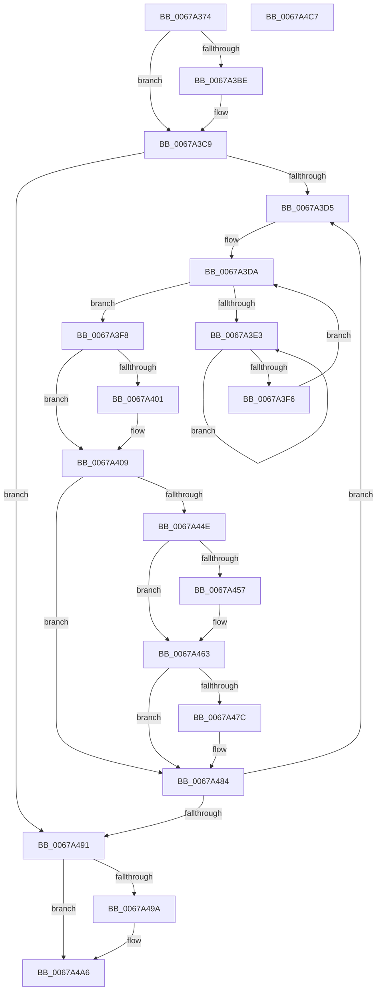

# MiReturnBadPagesToBadList

- RVA: `0x0067A374`–`0x0067A4C8` (길이 `340` bytes)
- VA: `0x000000014067A374`
- 실행 섹션: `.text`
- PDB 이름 있음: `예`; PDB Function 태그: `아니요`
- unwind 정보 RVA: `0x0006B074`
- 디코드: `86`개 명령, `340/340` bytes 표시
- 미해석 바이트: `0` (있으면 어셈블리에 `.byte`로 보존)

> 이 문서는 커널 이미지의 기계어와 PDB 기호를 분석해 생성했습니다. 4번과 5번은 함수 원형과 자료형을 바이너리 사용 방식에서 추정한 C 해석이며 원본 소스 복구 결과는 아닙니다.

## 1. Dependencies

- 직접 호출 지점: **7**; 고유 호출 대상: **5**
- 직접 호출자로 확인된 함수: **2**
- RIP 상대 이미지 참조: **1**

### Outgoing calls
- `0x0067A3C4` → [KiRaiseIrqlProcessIrqlFlags](../4F/KiRaiseIrqlProcessIrqlFlags_function_004F56FC.md) (function, `0x004F56FC`)
- `0x0067A3E8` → [KeYieldProcessorEx](../3F/KeYieldProcessorEx_function_003FBD00.md) (function, `0x003FBD00`)
- `0x0067A422` → [MiSetPfnContainingFrame](../36/MiSetPfnContainingFrame_function_00363FC0.md) (function, `0x00363FC0`)
- `0x0067A42F` → [MiInsertPageInList](../2B/MiInsertPageInList_function_002BA000.md) (function, `0x002BA000`)
- `0x0067A45E` → [KiLowerIrqlProcessIrqlFlags](../4F/KiLowerIrqlProcessIrqlFlags_function_004F5698.md) (function, `0x004F5698`)
- `0x0067A47F` → [KiRaiseIrqlProcessIrqlFlags](../4F/KiRaiseIrqlProcessIrqlFlags_function_004F56FC.md) (function, `0x004F56FC`)
- `0x0067A4A1` → [KiLowerIrqlProcessIrqlFlags](../4F/KiLowerIrqlProcessIrqlFlags_function_004F5698.md) (function, `0x004F5698`)

### Direct callers
- [MiRemoveBadPages](MiRemoveBadPages_function_00679F6C.md) at `0x0067A0AF`
- [MmRemovePhysicalMemory](../../page/7F/MmRemovePhysicalMemory_function_007FB560.md) at `0x007FB7B2`

### Static image references
- `0x0067A3B5` → RVA `0x00FC6D20` (`ALMOSTRO`; read)

## 2. Other-region calls and transfers

- 다른 실행 섹션으로 향하는 call: **0**
- 별도 외부 분기/꼬리 이동을 확인하지 못했습니다.

## 3. Assembly (complete function range)

```asm
0067A374  48 89 5C 24 10                  mov qword ptr [rsp + 0x10], rbx
0067A379  48 89 6C 24 18                  mov qword ptr [rsp + 0x18], rbp
0067A37E  48 89 74 24 20                  mov qword ptr [rsp + 0x20], rsi
0067A383  57                              push rdi
0067A384  41 56                           push r14
0067A386  41 57                           push r15
0067A388  48 83 EC 20                     sub rsp, 0x20
0067A38C  48 8D 1C 49                     lea rbx, [rcx + rcx*2]
0067A390  48 8B F2                        mov rsi, rdx
0067A393  48 C1 E3 04                     shl rbx, 4
0067A397  48 B8 00 00 00 00 00 DE FF FF   movabs rax, 0xffffde0000000000
0067A3A1  48 03 D8                        add rbx, rax
0067A3A4  44 0F 20 C7                     mov rdi, cr8
0067A3A8  41 BF 02 00 00 00               mov r15d, 2
0067A3AE  45 0F 22 C7                     mov cr8, r15
0067A3B2  45 33 F6                        xor r14d, r14d
0067A3B5  44 39 35 64 C9 94 00            cmp dword ptr [rip + 0x94c964], r14d
0067A3BC  74 0B                           je 0x14067a3c9
0067A3BE  41 8A D7                        mov dl, r15b
0067A3C1  40 8A CF                        mov cl, dil
0067A3C4  E8 33 B3 E7 FF                  call 0x1404f56fc
0067A3C9  49 8B EE                        mov rbp, r14
0067A3CC  48 85 F6                        test rsi, rsi
0067A3CF  0F 84 BC 00 00 00               je 0x14067a491
0067A3D5  44 89 74 24 40                  mov dword ptr [rsp + 0x40], r14d
0067A3DA  F0 48 0F BA 6B 18 3F            lock bts qword ptr [rbx + 0x18], 0x3f
0067A3E1  73 15                           jae 0x14067a3f8
0067A3E3  48 8D 4C 24 40                  lea rcx, [rsp + 0x40]
0067A3E8  E8 13 19 D8 FF                  call 0x1403fbd00
0067A3ED  48 8B 43 18                     mov rax, qword ptr [rbx + 0x18]
0067A3F1  48 85 C0                        test rax, rax
0067A3F4  78 ED                           js 0x14067a3e3
0067A3F6  EB E2                           jmp 0x14067a3da
0067A3F8  48 8B 43 08                     mov rax, qword ptr [rbx + 8]
0067A3FC  48 85 C0                        test rax, rax
0067A3FF  75 08                           jne 0x14067a409
0067A401  48 C7 43 08 FC FF FF FF         mov qword ptr [rbx + 8], 0xfffffffffffffffc
0067A409  8B 43 20                        mov eax, dword ptr [rbx + 0x20]
0067A40C  33 D2                           xor edx, edx
0067A40E  89 44 24 40                     mov dword ptr [rsp + 0x40], eax
0067A412  48 8B CB                        mov rcx, rbx
0067A415  66 44 89 74 24 40               mov word ptr [rsp + 0x40], r14w
0067A41B  8B 44 24 40                     mov eax, dword ptr [rsp + 0x40]
0067A41F  89 43 20                        mov dword ptr [rbx + 0x20], eax
0067A422  E8 99 9B CE FF                  call 0x140363fc0
0067A427  BA 20 00 00 00                  mov edx, 0x20
0067A42C  48 8B CB                        mov rcx, rbx
0067A42F  E8 CC FB C3 FF                  call 0x1402ba000
0067A434  48 B8 FF FF FF FF FF FF FF 7F   movabs rax, 0x7fffffffffffffff
0067A43E  F0 48 21 43 18                  lock and qword ptr [rbx + 0x18], rax
0067A443  48 8D 45 01                     lea rax, [rbp + 1]
0067A447  48 8B E8                        mov rbp, rax
0067A44A  A8 3F                           test al, 0x3f
0067A44C  75 36                           jne 0x14067a484
0067A44E  44 39 35 CB C8 94 00            cmp dword ptr [rip + 0x94c8cb], r14d
0067A455  74 0C                           je 0x14067a463
0067A457  44 0F 20 C1                     mov rcx, cr8
0067A45B  40 8A D7                        mov dl, dil
0067A45E  E8 35 B2 E7 FF                  call 0x1404f5698
0067A463  40 0F B6 C7                     movzx eax, dil
0067A467  44 0F 22 C0                     mov cr8, rax
0067A46B  44 0F 20 C1                     mov rcx, cr8
0067A46F  45 0F 22 C7                     mov cr8, r15
0067A473  44 39 35 A6 C8 94 00            cmp dword ptr [rip + 0x94c8a6], r14d
0067A47A  74 08                           je 0x14067a484
0067A47C  41 8A D7                        mov dl, r15b
0067A47F  E8 78 B2 E7 FF                  call 0x1404f56fc
0067A484  48 83 C3 30                     add rbx, 0x30
0067A488  48 3B EE                        cmp rbp, rsi
0067A48B  0F 82 44 FF FF FF               jb 0x14067a3d5
0067A491  44 39 35 88 C8 94 00            cmp dword ptr [rip + 0x94c888], r14d
0067A498  74 0C                           je 0x14067a4a6
0067A49A  44 0F 20 C1                     mov rcx, cr8
0067A49E  40 8A D7                        mov dl, dil
0067A4A1  E8 F2 B1 E7 FF                  call 0x1404f5698
0067A4A6  40 0F B6 C7                     movzx eax, dil
0067A4AA  44 0F 22 C0                     mov cr8, rax
0067A4AE  48 8B 5C 24 48                  mov rbx, qword ptr [rsp + 0x48]
0067A4B3  48 8B 6C 24 50                  mov rbp, qword ptr [rsp + 0x50]
0067A4B8  48 8B 74 24 58                  mov rsi, qword ptr [rsp + 0x58]
0067A4BD  48 83 C4 20                     add rsp, 0x20
0067A4C1  41 5F                           pop r15
0067A4C3  41 5E                           pop r14
0067A4C5  5F                              pop rdi
0067A4C6  C3                              ret
0067A4C7  CC                              int3
```

## 4. C-style interpretation (structured pseudocode)

```c
__int64 __fastcall MiReturnBadPagesToBadList(__int64 a1, __int64 a2)
{
    __int64 result;
    __int64 v_r14;
    __int64 v_rbx;
    __int64 v_rsp;
    unsigned __int64 v_stack_p10;
    unsigned __int64 v_stack_p18;
    unsigned __int64 v_stack_p20;
    unsigned int v_stack_p8;

    v_stack_p10 = v_rbx;
    v_stack_p18 = v_rbp;
    v_stack_p20 = v_rsi;
    v_rsp = (v_rsp) - (32);
    v_rbx = (a1 + a1 * 2) << (4);
    v_rbx = (v_rbx) + (result);
    v_r14 = 0;
    if ((*(unsigned int *)(v_rip + 9750884)) != 0) {
        a2 = 2;
        a1 = (unsigned __int8)(v_cr8);
        result = KiRaiseIrqlProcessIrqlFlags(a1, a2, a3, a4);
    }
    if (a2 == 0) goto loc_0067A491;
loc_0067A3D5:
    v_stack_p8 = 0;
loc_0067A3DA:
    if (condition_is_above_or_equal) goto loc_0067A3F8;
loc_0067A3E3:
    result = KeYieldProcessorEx(v_stack_p8, a2, a3, a4);
    if (sign_flag) goto loc_0067A3E3;
    goto loc_0067A3DA;
loc_0067A3F8:
    if (*(unsigned __int64 *)(v_rbx + 8) == 0) {
        *(unsigned __int64 *)(v_rbx + 8) = -4;
    }
    a2 = 0;
    v_stack_p8 = (unsigned int)((unsigned int)(*(unsigned int *)(v_rbx + 32)));
    v_stack_p8 = 0;
    *(unsigned int *)(v_rbx + 32) = (unsigned int)((unsigned int)(v_stack_p8));
    result = MiSetPfnContainingFrame(v_rbx, a2, a3, a4);
    result = MiInsertPageInList(v_rbx, 32, a3, a4);
    if ((((unsigned __int8)(0 + 1)) & (63)) != 0) goto loc_0067A484;
    result = 0 + 1;
    if ((*(unsigned int *)(v_rip + 9750731)) != 0) {
        a1 = 2;
        a2 = (unsigned __int8)(v_cr8);
        result = KiLowerIrqlProcessIrqlFlags(a1, a2, a3, a4);
    }
    result = (unsigned __int8)(v_cr8);
    if ((*(unsigned int *)(v_rip + 9750694)) != 0) {
        a2 = 2;
        result = KiRaiseIrqlProcessIrqlFlags((unsigned __int8)(v_cr8), a2, a3, a4);
    }
    v_rbx = (v_rbx) + (48);
    if ((0 + 1) < a2) goto loc_0067A3D5;
loc_0067A491:
    if ((*(unsigned int *)(v_rip + 9750664)) != 0) {
        a1 = 2;
        a2 = (unsigned __int8)(v_cr8);
        result = KiLowerIrqlProcessIrqlFlags(a1, a2, a3, a4);
    }
    v_rsp = (v_rsp) + (32);
    return (unsigned __int8)(v_cr8);
}
```

## 5. (Beta) C Style

```c
int64_t MiReturnBadPagesToBadList(void *Arg1, int64_t Arg2)
{
    uint8_t *arg1 = (uint8_t *)Arg1;

    int64_t result;
    int64_t local_r14;
    int64_t local_rbx;
    int64_t local_rsp;
    uint64_t v_stack_p10;
    uint64_t v_stack_p18;
    uint64_t v_stack_p20;
    uint32_t v_stack_p8;

    v_stack_p10 = local_rbx;
    v_stack_p18 = local_rbp;
    v_stack_p20 = local_rsi;
    local_rsp = (local_rsp) - (32);
    local_rbx = (Arg1 + Arg1 * 2) << (4);
    local_rbx = (local_rbx) + (result);
    local_r14 = 0;
    if ((*(uint32_t *)(v_rip + 0x94C964)) != 0) {
        Arg2 = 2;
        Arg1 = (uint8_t)(v_cr8);
        result = KiRaiseIrqlProcessIrqlFlags(Arg1, Arg2, a3, a4);
    }
    if (Arg2 == 0) goto loc_0067A491;
loc_0067A3D5:
    v_stack_p8 = 0;
loc_0067A3DA:
    if (condition_is_above_or_equal) goto loc_0067A3F8;
loc_0067A3E3:
    result = KeYieldProcessorEx(v_stack_p8, Arg2, a3, a4);
    if (sign_flag) goto loc_0067A3E3;
    goto loc_0067A3DA;
loc_0067A3F8:
    if (*(uint64_t *)(local_rbx + 0x8) == 0) {
        *(uint64_t *)(local_rbx + 0x8) = -4;
    }
    Arg2 = 0;
    v_stack_p8 = (uint32_t)((uint32_t)(*(uint32_t *)(local_rbx + 0x20)));
    v_stack_p8 = 0;
    *(uint32_t *)(local_rbx + 0x20) = (uint32_t)((uint32_t)(v_stack_p8));
    result = MiSetPfnContainingFrame(local_rbx, Arg2, a3, a4);
    result = MiInsertPageInList(local_rbx, 32, a3, a4);
    if ((((uint8_t)(0 + 1)) & (63)) != 0) goto loc_0067A484;
    result = 0 + 1;
    if ((*(uint32_t *)(v_rip + 0x94C8CB)) != 0) {
        Arg1 = 2;
        Arg2 = (uint8_t)(v_cr8);
        result = KiLowerIrqlProcessIrqlFlags(Arg1, Arg2, a3, a4);
    }
    result = (uint8_t)(v_cr8);
    if ((*(uint32_t *)(v_rip + 0x94C8A6)) != 0) {
        Arg2 = 2;
        result = KiRaiseIrqlProcessIrqlFlags((uint8_t)(v_cr8), Arg2, a3, a4);
    }
    local_rbx = (local_rbx) + (48);
    if ((0 + 1) < Arg2) goto loc_0067A3D5;
loc_0067A491:
    if ((*(uint32_t *)(v_rip + 0x94C888)) != 0) {
        Arg1 = 2;
        Arg2 = (uint8_t)(v_cr8);
        result = KiLowerIrqlProcessIrqlFlags(Arg1, Arg2, a3, a4);
    }
    local_rsp = (local_rsp) + (32);
    return (uint8_t)(v_cr8);
}
```

### 관측된 메모리 오프셋

구조체 형식이 확인되지 않은 접근은 인자 기준의 오프셋으로만 기록했습니다.

| 기준 인자 | 오프셋 표현 | 폭 (bit) | 접근 |
|---|---:|---:|---|
| `Arg1` | `+ 0x0 + rcx*2` | `64` | `R` |

## 6. Execution-region graph

[열기: 2D/3D 그래프와 함수 탐색 컨트롤 패널](../../../control-panel.html?section=text&rva=0x0067A374&view=graph)

- 2D 그래프는 위에서 아래로 흐르고, 3D 그래프는 빈 공간을 드래그해 회전합니다. Shift+드래그는 이동, 휠은 확대·축소, 함수 노드 선택은 대상 보고서 이동입니다.

### Static fallback


