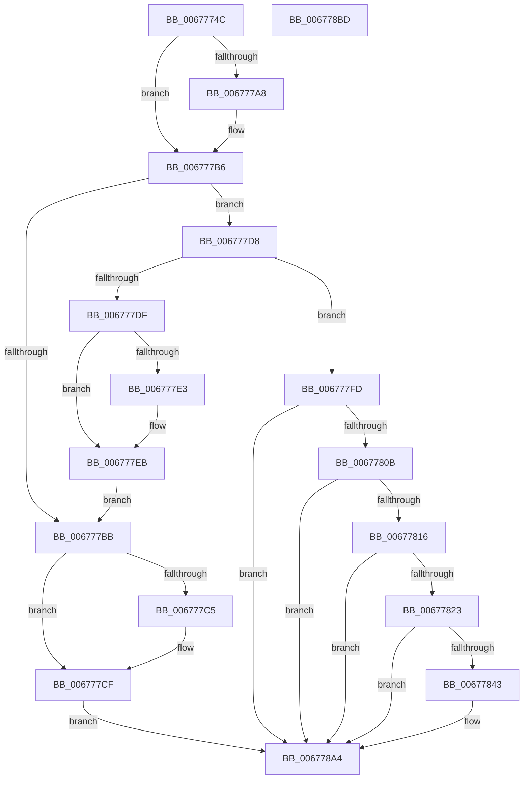

# MiReturnMdlExcess

- RVA: `0x0067774C`–`0x006778BE` (길이 `370` bytes)
- VA: `0x000000014067774C`
- 실행 섹션: `.text`
- PDB 이름 있음: `예`; PDB Function 태그: `아니요`
- unwind 정보 RVA: `0x00060300`
- 디코드: `99`개 명령, `370/370` bytes 표시
- 미해석 바이트: `0` (있으면 어셈블리에 `.byte`로 보존)

> 이 문서는 커널 이미지의 기계어와 PDB 기호를 분석해 생성했습니다. 4번과 5번은 함수 원형과 자료형을 바이너리 사용 방식에서 추정한 C 해석이며 원본 소스 복구 결과는 아닙니다.

## 1. Dependencies

- 직접 호출 지점: **7**; 고유 호출 대상: **6**
- 직접 호출자로 확인된 함수: **1**
- RIP 상대 이미지 참조: **0**

### Outgoing calls
- `0x006777B1` → [MiReturnMdlCharges](../3F/MiReturnMdlCharges_function_003F6238.md) (function, `0x003F6238`)
- `0x006777CA` → [ExFreePoolWithTag](../../poolcode/B8/ExFreePoolWithTag_function_00B82870.md) (function, `0x00B82870`)
- `0x006777E6` → [MiInitializeMdlBatchPages](../2C/MiInitializeMdlBatchPages_function_002C90E4.md) (function, `0x002C90E4`)
- `0x006777F6` → [MiFreePagesFromMdl](../3F/MiFreePagesFromMdl_function_003F8300.md) (function, `0x003F8300`)
- `0x00677836` → [MiAllocatePool](../35/MiAllocatePool_function_0035B540.md) (function, `0x0035B540`)
- `0x00677884` → [memcpy](../6C/memcpy_function_006C6840.md) (function, `0x006C6840`)
- `0x0067789B` → [ExFreePoolWithTag](../../poolcode/B8/ExFreePoolWithTag_function_00B82870.md) (function, `0x00B82870`)

### Direct callers
- [MiAllocatePagesForMdl](../3E/MiAllocatePagesForMdl_function_003EABEC.md) at `0x003EAD92`

### Static image references
- 디코드된 RIP-relative 메모리 참조가 없습니다.

## 2. Other-region calls and transfers

- 다른 실행 섹션으로 향하는 call: **2**
  - `0x006777CA` → [ExFreePoolWithTag](../../poolcode/B8/ExFreePoolWithTag_function_00B82870.md) (`.text` → `POOLCODE`)
  - `0x0067789B` → [ExFreePoolWithTag](../../poolcode/B8/ExFreePoolWithTag_function_00B82870.md) (`.text` → `POOLCODE`)
- 별도 외부 분기/꼬리 이동을 확인하지 못했습니다.

## 3. Assembly (complete function range)

```asm
0067774C  48 89 5C 24 08                  mov qword ptr [rsp + 8], rbx
00677751  48 89 6C 24 10                  mov qword ptr [rsp + 0x10], rbp
00677756  48 89 74 24 18                  mov qword ptr [rsp + 0x18], rsi
0067775B  57                              push rdi
0067775C  41 56                           push r14
0067775E  41 57                           push r15
00677760  48 83 EC 20                     sub rsp, 0x20
00677764  48 8B 79 40                     mov rdi, qword ptr [rcx + 0x40]
00677768  48 8B D9                        mov rbx, rcx
0067776B  4C 8B 71 20                     mov r14, qword ptr [rcx + 0x20]
0067776F  45 33 FF                        xor r15d, r15d
00677772  8B 77 28                        mov esi, dword ptr [rdi + 0x28]
00677775  48 C1 EE 0C                     shr rsi, 0xc
00677779  48 0F AF 71 30                  imul rsi, qword ptr [rcx + 0x30]
0067777E  8B 89 94 00 00 00               mov ecx, dword ptr [rcx + 0x94]
00677784  C1 E9 03                        shr ecx, 3
00677787  4C 2B F6                        sub r14, rsi
0067778A  83 E1 01                        and ecx, 1
0067778D  8B E9                           mov ebp, ecx
0067778F  83 CD 02                        or ebp, 2
00677792  F6 83 94 00 00 00 10            test byte ptr [rbx + 0x94], 0x10
00677799  0F 44 E9                        cmove ebp, ecx
0067779C  83 CD 08                        or ebp, 8
0067779F  F7 43 38 00 04 00 00            test dword ptr [rbx + 0x38], 0x400
006777A6  75 0E                           jne 0x1406777b6
006777A8  48 8B 0B                        mov rcx, qword ptr [rbx]
006777AB  44 8B C5                        mov r8d, ebp
006777AE  49 8B D6                        mov rdx, r14
006777B1  E8 82 EA D7 FF                  call 0x1403f6238
006777B6  48 85 F6                        test rsi, rsi
006777B9  75 1D                           jne 0x1406777d8
006777BB  8B 83 94 00 00 00               mov eax, dword ptr [rbx + 0x94]
006777C1  A8 01                           test al, 1
006777C3  75 0A                           jne 0x1406777cf
006777C5  33 D2                           xor edx, edx
006777C7  48 8B CF                        mov rcx, rdi
006777CA  E8 A1 B0 50 00                  call 0x140b82870
006777CF  4C 89 7B 40                     mov qword ptr [rbx + 0x40], r15
006777D3  E9 CC 00 00 00                  jmp 0x1406778a4
006777D8  8B 43 38                        mov eax, dword ptr [rbx + 0x38]
006777DB  A8 04                           test al, 4
006777DD  74 1E                           je 0x1406777fd
006777DF  A8 40                           test al, 0x40
006777E1  75 08                           jne 0x1406777eb
006777E3  48 8B CB                        mov rcx, rbx
006777E6  E8 F9 18 C5 FF                  call 0x1402c90e4
006777EB  45 33 C9                        xor r9d, r9d
006777EE  44 8B C5                        mov r8d, ebp
006777F1  33 D2                           xor edx, edx
006777F3  48 8B CF                        mov rcx, rdi
006777F6  E8 05 0B D8 FF                  call 0x1403f8300
006777FB  EB BE                           jmp 0x1406777bb
006777FD  8B 83 94 00 00 00               mov eax, dword ptr [rbx + 0x94]
00677803  A8 01                           test al, 1
00677805  0F 85 99 00 00 00               jne 0x1406778a4
0067780B  48 83 7B 30 01                  cmp qword ptr [rbx + 0x30], 1
00677810  0F 85 8E 00 00 00               jne 0x1406778a4
00677816  49 81 FE 00 08 00 00            cmp r14, 0x800
0067781D  0F 86 81 00 00 00               jbe 0x1406778a4
00677823  48 8D 14 F5 30 00 00 00         lea rdx, [rsi*8 + 0x30]
0067782B  B9 40 00 00 00                  mov ecx, 0x40
00677830  41 B8 4D 6D 64 69               mov r8d, 0x69646d4d
00677836  E8 05 3D CE FF                  call 0x14035b540
0067783B  48 8B F8                        mov rdi, rax
0067783E  48 85 C0                        test rax, rax
00677841  74 61                           je 0x1406778a4
00677843  4C 89 38                        mov qword ptr [rax], r15
00677846  4C 8D 04 F5 00 00 00 00         lea r8, [rsi*8]
0067784E  66 44 89 78 0A                  mov word ptr [rax + 0xa], r15w
00677853  48 8B D6                        mov rdx, rsi
00677856  48 C1 E2 0C                     shl rdx, 0xc
0067785A  48 8B CA                        mov rcx, rdx
0067785D  89 50 28                        mov dword ptr [rax + 0x28], edx
00677860  48 C1 E9 0C                     shr rcx, 0xc
00677864  66 83 C1 06                     add cx, 6
00677868  4C 89 78 20                     mov qword ptr [rax + 0x20], r15
0067786C  66 C1 E1 03                     shl cx, 3
00677870  66 89 48 08                     mov word ptr [rax + 8], cx
00677874  48 8D 48 30                     lea rcx, [rax + 0x30]
00677878  44 89 78 2C                     mov dword ptr [rax + 0x2c], r15d
0067787C  48 8B 53 40                     mov rdx, qword ptr [rbx + 0x40]
00677880  48 83 C2 30                     add rdx, 0x30
00677884  E8 B7 EF 04 00                  call 0x1406c6840
00677889  48 8B 43 40                     mov rax, qword ptr [rbx + 0x40]
0067788D  33 D2                           xor edx, edx
0067788F  0F B7 48 0A                     movzx ecx, word ptr [rax + 0xa]
00677893  66 89 4F 0A                     mov word ptr [rdi + 0xa], cx
00677897  48 8B 4B 40                     mov rcx, qword ptr [rbx + 0x40]
0067789B  E8 D0 AF 50 00                  call 0x140b82870
006778A0  48 89 7B 40                     mov qword ptr [rbx + 0x40], rdi
006778A4  48 8B 5C 24 40                  mov rbx, qword ptr [rsp + 0x40]
006778A9  48 8B 6C 24 48                  mov rbp, qword ptr [rsp + 0x48]
006778AE  48 8B 74 24 50                  mov rsi, qword ptr [rsp + 0x50]
006778B3  48 83 C4 20                     add rsp, 0x20
006778B7  41 5F                           pop r15
006778B9  41 5E                           pop r14
006778BB  5F                              pop rdi
006778BC  C3                              ret
006778BD  CC                              int3
```

## 4. C-style interpretation (structured pseudocode)

```c
__int64 __fastcall MiReturnMdlExcess(__int64 a1, __int64 a2, __int64 a3, int a4)
{
    __int64 result;
    __int64 v_r14;
    __int64 v_r15;
    __int64 v_rbp;
    __int64 v_rsi;
    __int64 v_rsp;
    unsigned __int64 v_stack_p10;
    unsigned __int64 v_stack_p18;
    unsigned __int64 v_stack_p8;

    v_stack_p8 = v_rbx;
    v_stack_p10 = v_rbp;
    v_stack_p18 = v_rsi;
    v_rsp = (v_rsp) - (32);
    v_r15 = 0;
    v_rsi = ((unsigned int)(*(unsigned int *)(*(unsigned __int64 *)(a1 + 64) + 40))) >> (12);
    v_rsi = (v_rsi) * (*(unsigned __int64 *)(a1 + 48));
    a1 = (unsigned int)(((unsigned int)(*(unsigned int *)(a1 + 148))) >> (3));
    v_r14 = (*(unsigned __int64 *)(a1 + 32)) - (v_rsi);
    a1 = (unsigned int)((a1) & (1));
    v_rbp = (unsigned int)(((unsigned int)((unsigned int)(a1))) | (2));
    if (((*(unsigned __int8 *)(a1 + 148)) & (16)) == 0) { v_rbp = (unsigned int)(a1); }
    v_rbp = (unsigned int)((v_rbp) | (8));
    if (((*(unsigned int *)(a1 + 56)) & (0x400ULL)) == 0) {
        a1 = *(unsigned __int64 *)(a1);
        a3 = (unsigned int)(v_rbp);
        a2 = v_r14;
        result = MiReturnMdlCharges(a1, a2, a3, a4);
    }
    if (v_rsi != 0) goto loc_006777D8;
loc_006777BB:
    result = (unsigned int)(*(unsigned int *)(a1 + 148));
    if ((((unsigned __int8)((unsigned int)(*(unsigned int *)(a1 + 148)))) & (1)) == 0) {
        a2 = 0;
        a1 = *(unsigned __int64 *)(a1 + 64);
        result = ExFreePoolWithTag(a1, a2, a3, a4);
    }
    *(unsigned __int64 *)(a1 + 64) = 0;
    goto loc_006778A4;
loc_006777D8:
    if ((((unsigned __int8)((unsigned int)(*(unsigned int *)(a1 + 56)))) & (4)) == 0) goto loc_006777FD;
    result = (unsigned int)(*(unsigned int *)(a1 + 56));
    if ((((unsigned __int8)((unsigned int)(*(unsigned int *)(a1 + 56)))) & (64)) == 0) {
        a1 = a1;
        result = MiInitializeMdlBatchPages(a1, a2, a3, a4);
    }
    a4 = 0;
    a2 = 0;
    result = MiFreePagesFromMdl(*(unsigned __int64 *)(a1 + 64), a2, (unsigned int)((unsigned int)(v_rbp)), a4);
    goto loc_006777BB;
loc_006777FD:
    if ((((unsigned __int8)((unsigned int)(*(unsigned int *)(a1 + 148)))) & (1)) != 0) goto loc_006778A4;
    if ((*(unsigned __int64 *)(a1 + 48)) != 1) goto loc_006778A4;
    if (v_r14 <= 0x800ULL) goto loc_006778A4;
    result = MiAllocatePool(64, v_rsi * 8 + 48, (unsigned int)(0x69646D4DULL), a4);
    if (result != 0) {
        *(unsigned __int64 *)(result) = 0;
        a3 = v_rsi * 8;
        *(unsigned __int16 *)(result + 10) = 0;
        a2 = v_rsi;
        a2 = (a2) << (12);
        a1 = a2;
        *(unsigned int *)(result + 40) = (unsigned int)(a2);
        a1 = (a1) >> (12);
        a1 = (unsigned __int16)((a1) + (6));
        *(unsigned __int64 *)(result + 32) = 0;
        a1 = (unsigned __int16)((a1) << (3));
        *(unsigned __int16 *)(result + 8) = (unsigned __int16)(a1);
        a1 = result + 48;
        *(unsigned int *)(result + 44) = 0;
        a2 = *(unsigned __int64 *)(a1 + 64);
        a2 = (a2) + (48);
        result = memcpy(a1, a2, a3, a4);
        result = *(unsigned __int64 *)(a1 + 64);
        a2 = 0;
        a1 = *(unsigned __int16 *)(result + 10);
        *(unsigned __int16 *)(result + 10) = (unsigned __int16)(a1);
        a1 = *(unsigned __int64 *)(a1 + 64);
        result = ExFreePoolWithTag(a1, a2, a3, a4);
        *(unsigned __int64 *)(a1 + 64) = result;
    }
    v_rsp = (v_rsp) + (32);
    return result;
}
```

## 5. (Beta) C Style

```c
int64_t MiReturnMdlExcess(void *Arg1, int64_t Arg2, int64_t Arg3, int32_t Arg4)
{
    uint8_t *arg1 = (uint8_t *)Arg1;

    int64_t result;
    int64_t local_r14;
    int64_t local_r15;
    int64_t local_rbp;
    int64_t local_rsi;
    int64_t local_rsp;
    uint64_t v_stack_p10;
    uint64_t v_stack_p18;
    uint64_t v_stack_p8;

    v_stack_p8 = local_rbx;
    v_stack_p10 = local_rbp;
    v_stack_p18 = local_rsi;
    local_rsp = (local_rsp) - (32);
    local_r15 = 0;
    local_rsi = ((uint32_t)(*(uint32_t *)(*(uint64_t *)(arg1 + 0x40) + 0x28))) >> (12);
    local_rsi = (local_rsi) * (*(uint64_t *)(arg1 + 0x30));
    Arg1 = (uint32_t)(((uint32_t)(*(uint32_t *)(arg1 + 0x94))) >> (3));
    local_r14 = (*(uint64_t *)(arg1 + 0x20)) - (local_rsi);
    Arg1 = (uint32_t)((Arg1) & (1));
    local_rbp = (uint32_t)(((uint32_t)((uint32_t)(Arg1))) | (2));
    if (((*(uint8_t *)(arg1 + 0x94)) & (16)) == 0) { local_rbp = (uint32_t)(Arg1); }
    local_rbp = (uint32_t)((local_rbp) | (8));
    if (((*(uint32_t *)(arg1 + 0x38)) & (0x400ULL)) == 0) {
        Arg1 = *(uint64_t *)(arg1);
        Arg3 = (uint32_t)(local_rbp);
        Arg2 = local_r14;
        result = MiReturnMdlCharges(Arg1, Arg2, Arg3, Arg4);
    }
    if (local_rsi != 0) goto loc_006777D8;
loc_006777BB:
    result = (uint32_t)(*(uint32_t *)(arg1 + 0x94));
    if ((((uint8_t)((uint32_t)(*(uint32_t *)(arg1 + 0x94)))) & (1)) == 0) {
        Arg2 = 0;
        Arg1 = *(uint64_t *)(arg1 + 0x40);
        result = ExFreePoolWithTag(Arg1, Arg2, Arg3, Arg4);
    }
    *(uint64_t *)(arg1 + 0x40) = 0;
    goto loc_006778A4;
loc_006777D8:
    if ((((uint8_t)((uint32_t)(*(uint32_t *)(arg1 + 0x38)))) & (4)) == 0) goto loc_006777FD;
    result = (uint32_t)(*(uint32_t *)(arg1 + 0x38));
    if ((((uint8_t)((uint32_t)(*(uint32_t *)(arg1 + 0x38)))) & (64)) == 0) {
        Arg1 = Arg1;
        result = MiInitializeMdlBatchPages(Arg1, Arg2, Arg3, Arg4);
    }
    Arg4 = 0;
    Arg2 = 0;
    result = MiFreePagesFromMdl(*(uint64_t *)(arg1 + 0x40), Arg2, (uint32_t)((uint32_t)(local_rbp)), Arg4);
    goto loc_006777BB;
loc_006777FD:
    if ((((uint8_t)((uint32_t)(*(uint32_t *)(arg1 + 0x94)))) & (1)) != 0) goto loc_006778A4;
    if ((*(uint64_t *)(arg1 + 0x30)) != 1) goto loc_006778A4;
    if (local_r14 <= 0x800ULL) goto loc_006778A4;
    result = MiAllocatePool(64, local_rsi * 8 + 48, (uint32_t)(0x69646D4DULL), Arg4);
    if (result != 0) {
        *(uint64_t *)(result) = 0;
        Arg3 = local_rsi * 8;
        *(uint16_t *)(result + 0xA) = 0;
        Arg2 = local_rsi;
        Arg2 = (Arg2) << (12);
        Arg1 = Arg2;
        *(uint32_t *)(result + 0x28) = (uint32_t)(Arg2);
        Arg1 = (Arg1) >> (12);
        Arg1 = (uint16_t)((Arg1) + (6));
        *(uint64_t *)(result + 0x20) = 0;
        Arg1 = (uint16_t)((Arg1) << (3));
        *(uint16_t *)(result + 0x8) = (uint16_t)(Arg1);
        Arg1 = result + 48;
        *(uint32_t *)(result + 0x2C) = 0;
        Arg2 = *(uint64_t *)(arg1 + 0x40);
        Arg2 = (Arg2) + (48);
        result = memcpy(Arg1, Arg2, Arg3, Arg4);
        result = *(uint64_t *)(arg1 + 0x40);
        Arg2 = 0;
        Arg1 = *(uint16_t *)(result + 0xA);
        *(uint16_t *)(result + 0xA) = (uint16_t)(Arg1);
        Arg1 = *(uint64_t *)(arg1 + 0x40);
        result = ExFreePoolWithTag(Arg1, Arg2, Arg3, Arg4);
        *(uint64_t *)(arg1 + 0x40) = result;
    }
    local_rsp = (local_rsp) + (32);
    return result;
}
```

### 관측된 메모리 오프셋

구조체 형식이 확인되지 않은 접근은 인자 기준의 오프셋으로만 기록했습니다.

| 기준 인자 | 오프셋 표현 | 폭 (bit) | 접근 |
|---|---:|---:|---|
| `Arg1` | `+ 0x0` | `64` | `R` |
| `Arg1` | `+ 0x20` | `64` | `R` |
| `Arg1` | `+ 0x30` | `64` | `R` |
| `Arg1` | `+ 0x38` | `32` | `R` |
| `Arg1` | `+ 0x40` | `64` | `R` |
| `Arg1` | `+ 0x40` | `64` | `W` |
| `Arg1` | `+ 0x94` | `8` | `R` |
| `Arg1` | `+ 0x94` | `32` | `R` |

## 6. Execution-region graph

[열기: 2D/3D 그래프와 함수 탐색 컨트롤 패널](../../../control-panel.html?section=text&rva=0x0067774C&view=graph)

- 2D 그래프는 위에서 아래로 흐르고, 3D 그래프는 빈 공간을 드래그해 회전합니다. Shift+드래그는 이동, 휠은 확대·축소, 함수 노드 선택은 대상 보고서 이동입니다.

### Static fallback


