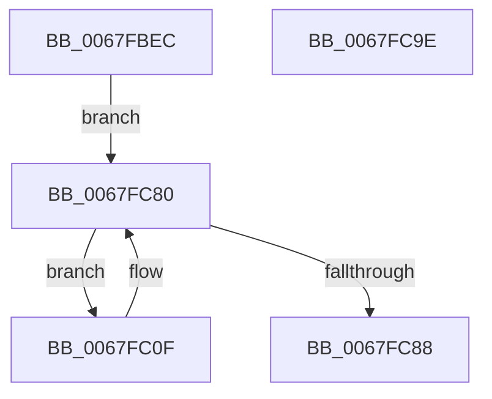

# MiReturnPfnList

- RVA: `0x0067FBEC`–`0x0067FC9F` (길이 `179` bytes)
- VA: `0x000000014067FBEC`
- 실행 섹션: `.text`
- PDB 이름 있음: `예`; PDB Function 태그: `아니요`
- unwind 정보 RVA: `0x000701D4`
- 디코드: `48`개 명령, `179/179` bytes 표시
- 미해석 바이트: `0` (있으면 어셈블리에 `.byte`로 보존)

> 이 문서는 커널 이미지의 기계어와 PDB 기호를 분석해 생성했습니다. 4번과 5번은 함수 원형과 자료형을 바이너리 사용 방식에서 추정한 C 해석이며 원본 소스 복구 결과는 아닙니다.

## 1. Dependencies

- 직접 호출 지점: **5**; 고유 호출 대상: **4**
- 직접 호출자로 확인된 함수: **2**
- RIP 상대 이미지 참조: **0**

### Outgoing calls
- `0x0067FC05` → [MiUnlinkPageChainHead](../36/MiUnlinkPageChainHead_function_00365C40.md) (function, `0x00365C40`)
- `0x0067FC12` → [MiLockPageInline](../31/MiLockPageInline_function_0031A340.md) (function, `0x0031A340`)
- `0x0067FC69` → [MiInsertPageInFreeOrZeroedList](../33/MiInsertPageInFreeOrZeroedList_function_00334D20.md) (function, `0x00334D20`)
- `0x0067FC73` → [MiUnlockPage](../31/MiUnlockPage_function_0031A3E0.md) (function, `0x0031A3E0`)
- `0x0067FC7B` → [MiUnlinkPageChainHead](../36/MiUnlinkPageChainHead_function_00365C40.md) (function, `0x00365C40`)

### Direct callers
- [MiInitializeDynamicBitmap](MiInitializeDynamicBitmap_function_0067F5BC.md) at `0x0067F977`
- [MiDeleteSparseRange](../../page/80/MiDeleteSparseRange_function_0080C1D0.md) at `0x0080C22C`

### Static image references
- 디코드된 RIP-relative 메모리 참조가 없습니다.

## 2. Other-region calls and transfers

- 다른 실행 섹션으로 향하는 call: **0**
- 별도 외부 분기/꼬리 이동을 확인하지 못했습니다.

## 3. Assembly (complete function range)

```asm
0067FBEC  48 89 5C 24 10                  mov qword ptr [rsp + 0x10], rbx
0067FBF1  48 89 6C 24 18                  mov qword ptr [rsp + 0x18], rbp
0067FBF6  56                              push rsi
0067FBF7  57                              push rdi
0067FBF8  41 56                           push r14
0067FBFA  48 83 EC 20                     sub rsp, 0x20
0067FBFE  48 8B 69 10                     mov rbp, qword ptr [rcx + 0x10]
0067FC02  48 8B F1                        mov rsi, rcx
0067FC05  E8 36 60 CE FF                  call 0x140365c40
0067FC0A  45 33 F6                        xor r14d, r14d
0067FC0D  EB 71                           jmp 0x14067fc80
0067FC0F  48 8B CF                        mov rcx, rdi
0067FC12  E8 29 A7 C9 FF                  call 0x14031a340
0067FC17  8A D8                           mov bl, al
0067FC19  48 B9 00 00 00 00 00 00 00 C0   movabs rcx, 0xc000000000000000
0067FC23  48 8B 47 18                     mov rax, qword ptr [rdi + 0x18]
0067FC27  48 23 C1                        and rax, rcx
0067FC2A  48 89 47 18                     mov qword ptr [rdi + 0x18], rax
0067FC2E  8B 47 20                        mov eax, dword ptr [rdi + 0x20]
0067FC31  89 44 24 40                     mov dword ptr [rsp + 0x40], eax
0067FC35  66 44 89 74 24 40               mov word ptr [rsp + 0x40], r14w
0067FC3B  8B 44 24 40                     mov eax, dword ptr [rsp + 0x40]
0067FC3F  89 47 20                        mov dword ptr [rdi + 0x20], eax
0067FC42  48 B8 00 00 00 00 00 DE FF FF   movabs rax, 0xffffde0000000000
0067FC4C  48 8B CF                        mov rcx, rdi
0067FC4F  BA 02 00 00 00                  mov edx, 2
0067FC54  48 2B C8                        sub rcx, rax
0067FC57  48 B8 AB AA AA AA AA AA AA AA   movabs rax, 0xaaaaaaaaaaaaaaab
0067FC61  48 C1 F9 04                     sar rcx, 4
0067FC65  48 0F AF C8                     imul rcx, rax
0067FC69  E8 B2 50 CB FF                  call 0x140334d20
0067FC6E  8A D3                           mov dl, bl
0067FC70  48 8B CF                        mov rcx, rdi
0067FC73  E8 68 A7 C9 FF                  call 0x14031a3e0
0067FC78  48 8B CE                        mov rcx, rsi
0067FC7B  E8 C0 5F CE FF                  call 0x140365c40
0067FC80  48 8B F8                        mov rdi, rax
0067FC83  48 85 C0                        test rax, rax
0067FC86  75 87                           jne 0x14067fc0f
0067FC88  48 8B 5C 24 48                  mov rbx, qword ptr [rsp + 0x48]
0067FC8D  48 8B C5                        mov rax, rbp
0067FC90  48 8B 6C 24 50                  mov rbp, qword ptr [rsp + 0x50]
0067FC95  48 83 C4 20                     add rsp, 0x20
0067FC99  41 5E                           pop r14
0067FC9B  5F                              pop rdi
0067FC9C  5E                              pop rsi
0067FC9D  C3                              ret
0067FC9E  CC                              int3
```

## 4. C-style interpretation (structured pseudocode)

```c
__int64 __fastcall MiReturnPfnList(__int64 a1)
{
    __int64 result;
    __int64 v_r14;
    __int64 v_rsp;
    unsigned __int64 v_stack_p10;
    unsigned __int64 v_stack_p18;
    unsigned int v_stack_p8;

    v_stack_p10 = v_rbx;
    v_stack_p18 = v_rbp;
    v_rsp = (v_rsp) - (32);
    result = MiUnlinkPageChainHead(a1, a2, a3, a4);
    v_r14 = 0;
    goto loc_0067FC80;
loc_0067FC0F:
    result = MiLockPageInline(v_rdi, a2, a3, a4);
    result = (*(unsigned __int64 *)(v_rdi + 24)) & (v_rdi);
    *(unsigned __int64 *)(v_rdi + 24) = result;
    v_stack_p8 = (unsigned int)((unsigned int)(*(unsigned int *)(v_rdi + 32)));
    v_stack_p8 = 0;
    *(unsigned int *)(v_rdi + 32) = (unsigned int)((unsigned int)(v_stack_p8));
    a1 = (v_rdi) - ((unsigned int)(v_stack_p8));
    a1 = (a1) >> (4);
    a1 = (a1) * ((unsigned int)(v_stack_p8));
    result = MiInsertPageInFreeOrZeroedList(a1, 2, a3, a4);
    result = MiUnlockPage(v_rdi, (unsigned __int8)((unsigned __int8)(result)), a3, a4);
    result = MiUnlinkPageChainHead(a1, (unsigned __int8)((unsigned __int8)(result)), a3, a4);
loc_0067FC80:
    if (result != 0) goto loc_0067FC0F;
    v_rsp = (v_rsp) + (32);
    return *(unsigned __int64 *)(a1 + 16);
}
```

## 5. (Beta) C Style

```c
int64_t MiReturnPfnList(void *Arg1)
{
    uint8_t *arg1 = (uint8_t *)Arg1;

    int64_t result;
    int64_t local_r14;
    int64_t local_rsp;
    uint64_t v_stack_p10;
    uint64_t v_stack_p18;
    uint32_t v_stack_p8;

    v_stack_p10 = local_rbx;
    v_stack_p18 = local_rbp;
    local_rsp = (local_rsp) - (32);
    result = MiUnlinkPageChainHead(Arg1, a2, a3, a4);
    local_r14 = 0;
    goto loc_0067FC80;
loc_0067FC0F:
    result = MiLockPageInline(local_rdi, a2, a3, a4);
    result = (*(uint64_t *)(local_rdi + 0x18)) & (local_rdi);
    *(uint64_t *)(local_rdi + 0x18) = result;
    v_stack_p8 = (uint32_t)((uint32_t)(*(uint32_t *)(local_rdi + 0x20)));
    v_stack_p8 = 0;
    *(uint32_t *)(local_rdi + 0x20) = (uint32_t)((uint32_t)(v_stack_p8));
    Arg1 = (local_rdi) - ((uint32_t)(v_stack_p8));
    Arg1 = (Arg1) >> (4);
    Arg1 = (Arg1) * ((uint32_t)(v_stack_p8));
    result = MiInsertPageInFreeOrZeroedList(Arg1, 2, a3, a4);
    result = MiUnlockPage(local_rdi, (uint8_t)((uint8_t)(result)), a3, a4);
    result = MiUnlinkPageChainHead(Arg1, (uint8_t)((uint8_t)(result)), a3, a4);
loc_0067FC80:
    if (result != 0) goto loc_0067FC0F;
    local_rsp = (local_rsp) + (32);
    return *(uint64_t *)(arg1 + 0x10);
}
```

### 관측된 메모리 오프셋

구조체 형식이 확인되지 않은 접근은 인자 기준의 오프셋으로만 기록했습니다.

| 기준 인자 | 오프셋 표현 | 폭 (bit) | 접근 |
|---|---:|---:|---|
| `Arg1` | `+ 0x10` | `64` | `R` |

## 6. Execution-region graph

[열기: 2D/3D 그래프와 함수 탐색 컨트롤 패널](../../../control-panel.html?section=text&rva=0x0067FBEC&view=graph)

- 2D 그래프는 위에서 아래로 흐르고, 3D 그래프는 빈 공간을 드래그해 회전합니다. Shift+드래그는 이동, 휠은 확대·축소, 함수 노드 선택은 대상 보고서 이동입니다.

### Static fallback


