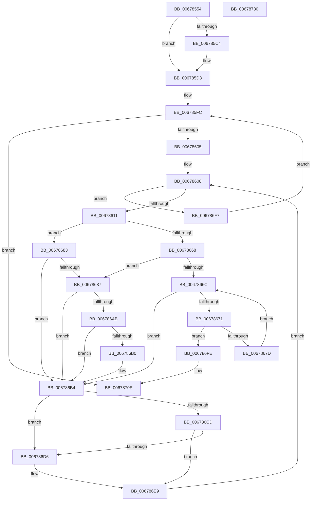

# MiSetGraphicsPtes

- RVA: `0x00678554`–`0x00678731` (길이 `477` bytes)
- VA: `0x0000000140678554`
- 실행 섹션: `.text`
- PDB 이름 있음: `예`; PDB Function 태그: `아니요`
- unwind 정보 RVA: `0x00068D9C`
- 디코드: `133`개 명령, `477/477` bytes 표시
- 미해석 바이트: `0` (있으면 어셈블리에 `.byte`로 보존)

> 이 문서는 커널 이미지의 기계어와 PDB 기호를 분석해 생성했습니다. 4번과 5번은 함수 원형과 자료형을 바이너리 사용 방식에서 추정한 C 해석이며 원본 소스 복구 결과는 아닙니다.

## 1. Dependencies

- 직접 호출 지점: **9**; 고유 호출 대상: **6**
- 직접 호출자로 확인된 함수: **1**
- RIP 상대 이미지 참조: **0**

### Outgoing calls
- `0x006785ED` → [MiLockWorkingSetShared](../27/MiLockWorkingSetShared_function_0027CBF0.md) (function, `0x0027CBF0`)
- `0x00678637` → [MiLockLowestValidPageTableEx](../28/MiLockLowestValidPageTableEx_function_00280D10.md) (function, `0x00280D10`)
- `0x006786BA` → [MiUnlockPageTable](../21/MiUnlockPageTable_function_00216EC0.md) (function, `0x00216EC0`)
- `0x006786C4` → [MiWorkingSetIsContended](../2A/MiWorkingSetIsContended_function_002AE520.md) (function, `0x002AE520`)
- `0x006786CD` → [KeShouldYieldProcessor](../27/KeShouldYieldProcessor_function_002773E0.md) (function, `0x002773E0`)
- `0x006786DC` → [MiUnlockWorkingSetShared](../27/MiUnlockWorkingSetShared_function_0027D690.md) (function, `0x0027D690`)
- `0x006786E4` → [MiLockWorkingSetShared](../27/MiLockWorkingSetShared_function_0027CBF0.md) (function, `0x0027CBF0`)
- `0x00678709` → [MiUnlockPageTable](../21/MiUnlockPageTable_function_00216EC0.md) (function, `0x00216EC0`)
- `0x00678714` → [MiUnlockWorkingSetShared](../27/MiUnlockWorkingSetShared_function_0027D690.md) (function, `0x0027D690`)

### Direct callers
- [MmSetGraphicsPtes](../../page/7F/MmSetGraphicsPtes_function_007FC8B0.md) at `0x007FCA98`

### Static image references
- 디코드된 RIP-relative 메모리 참조가 없습니다.

## 2. Other-region calls and transfers

- 다른 실행 섹션으로 향하는 call: **0**
- 별도 외부 분기/꼬리 이동을 확인하지 못했습니다.

## 3. Assembly (complete function range)

```asm
00678554  48 89 5C 24 18                  mov qword ptr [rsp + 0x18], rbx
00678559  4C 89 4C 24 20                  mov qword ptr [rsp + 0x20], r9
0067855E  55                              push rbp
0067855F  56                              push rsi
00678560  57                              push rdi
00678561  41 54                           push r12
00678563  41 55                           push r13
00678565  41 56                           push r14
00678567  41 57                           push r15
00678569  48 83 EC 20                     sub rsp, 0x20
0067856D  4C 8B E1                        mov r12, rcx
00678570  49 B9 F8 FF FF FF 7F 00 00 00   movabs r9, 0x7ffffffff8
0067857A  49 C1 EC 09                     shr r12, 9
0067857E  4D 8B F0                        mov r14, r8
00678581  4D 23 E1                        and r12, r9
00678584  49 B8 00 00 00 00 80 F6 FF FF   movabs r8, 0xfffff68000000000
0067858E  33 DB                           xor ebx, ebx
00678590  49 8B C0                        mov rax, r8
00678593  48 03 CA                        add rcx, rdx
00678596  4C 03 E0                        add r12, rax
00678599  48 C1 E9 09                     shr rcx, 9
0067859D  49 23 C9                        and rcx, r9
006785A0  49 8B C0                        mov rax, r8
006785A3  8B BC 24 88 00 00 00            mov edi, dword ptr [rsp + 0x88]
006785AA  4C 8D 78 F8                     lea r15, [rax - 8]
006785AE  4C 03 F9                        add r15, rcx
006785B1  8B C7                           mov eax, edi
006785B3  83 E0 01                        and eax, 1
006785B6  4C 89 7C 24 60                  mov qword ptr [rsp + 0x60], r15
006785BB  89 84 24 88 00 00 00            mov dword ptr [rsp + 0x88], eax
006785C2  74 0F                           je 0x1406785d3
006785C4  4D 85 F6                        test r14, r14
006785C7  48 8D 44 24 68                  lea rax, [rsp + 0x68]
006785CC  49 0F 44 C6                     cmove rax, r14
006785D0  4C 8B F0                        mov r14, rax
006785D3  65 48 8B 04 25 88 01 00 00      mov rax, qword ptr gs:[0x188]
006785DC  48 8B A8 B8 00 00 00            mov rbp, qword ptr [rax + 0xb8]
006785E3  48 81 C5 00 04 00 00            add rbp, 0x400
006785EA  48 8B CD                        mov rcx, rbp
006785ED  E8 FE 45 C0 FF                  call 0x14027cbf0
006785F2  D1 EF                           shr edi, 1
006785F4  44 8A E8                        mov r13b, al
006785F7  F7 D7                           not edi
006785F9  83 E7 01                        and edi, 1
006785FC  83 FF 02                        cmp edi, 2
006785FF  0F 83 09 01 00 00               jae 0x14067870e
00678605  49 8B F4                        mov rsi, r12
00678608  49 3B F7                        cmp rsi, r15
0067860B  0F 87 E6 00 00 00               ja 0x1406786f7
00678611  48 8B C6                        mov rax, rsi
00678614  4C 8D 44 24 68                  lea r8, [rsp + 0x68]
00678619  48 25 00 F0 FF FF               and rax, 0xfffffffffffff000
0067861F  48 8B D6                        mov rdx, rsi
00678622  48 05 F8 0F 00 00               add rax, 0xff8
00678628  48 8B CD                        mov rcx, rbp
0067862B  48 3B 44 24 60                  cmp rax, qword ptr [rsp + 0x60]
00678630  4C 0F 46 F8                     cmovbe r15, rax
00678634  45 33 C9                        xor r9d, r9d
00678637  E8 D4 86 C0 FF                  call 0x140280d10
0067863C  4C 8B C0                        mov r8, rax
0067863F  48 8B CE                        mov rcx, rsi
00678642  48 B8 F8 FF FF FF 7F 00 00 00   movabs rax, 0x7ffffffff8
0067864C  48 C1 E9 09                     shr rcx, 9
00678650  48 23 C8                        and rcx, rax
00678653  48 B8 00 00 00 00 80 F6 FF FF   movabs rax, 0xfffff68000000000
0067865D  48 8B C0                        mov rax, rax
00678660  48 03 C8                        add rcx, rax
00678663  4C 3B C1                        cmp r8, rcx
00678666  75 1B                           jne 0x140678683
00678668  85 FF                           test edi, edi
0067866A  75 1B                           jne 0x140678687
0067866C  49 3B F7                        cmp rsi, r15
0067866F  77 43                           ja 0x1406786b4
00678671  48 8B 06                        mov rax, qword ptr [rsi]
00678674  48 85 C0                        test rax, rax
00678677  0F 85 81 00 00 00               jne 0x1406786fe
0067867D  48 83 C6 08                     add rsi, 8
00678681  EB E9                           jmp 0x14067866c
00678683  85 FF                           test edi, edi
00678685  74 2D                           je 0x1406786b4
00678687  48 8B 4C 24 78                  mov rcx, qword ptr [rsp + 0x78]
0067868C  33 D2                           xor edx, edx
0067868E  48 C1 E9 0C                     shr rcx, 0xc
00678692  49 8B C7                        mov rax, r15
00678695  48 2B C6                        sub rax, rsi
00678698  48 C1 F8 03                     sar rax, 3
0067869C  48 FF C0                        inc rax
0067869F  48 F7 F1                        div rcx
006786A2  39 9C 24 88 00 00 00            cmp dword ptr [rsp + 0x88], ebx
006786A9  75 09                           jne 0x1406786b4
006786AB  4D 85 F6                        test r14, r14
006786AE  74 04                           je 0x1406786b4
006786B0  4D 8D 34 C6                     lea r14, [r14 + rax*8]
006786B4  49 8B D0                        mov rdx, r8
006786B7  48 8B CD                        mov rcx, rbp
006786BA  E8 01 E8 B9 FF                  call 0x140216ec0
006786BF  33 D2                           xor edx, edx
006786C1  48 8B CD                        mov rcx, rbp
006786C4  E8 57 5E C3 FF                  call 0x1402ae520
006786C9  85 C0                           test eax, eax
006786CB  75 09                           jne 0x1406786d6
006786CD  E8 0E ED BF FF                  call 0x1402773e0
006786D2  85 C0                           test eax, eax
006786D4  74 13                           je 0x1406786e9
006786D6  41 8A D5                        mov dl, r13b
006786D9  48 8B CD                        mov rcx, rbp
006786DC  E8 AF 4F C0 FF                  call 0x14027d690
006786E1  48 8B CD                        mov rcx, rbp
006786E4  E8 07 45 C0 FF                  call 0x14027cbf0
006786E9  49 8D 77 08                     lea rsi, [r15 + 8]
006786ED  4C 8B 7C 24 60                  mov r15, qword ptr [rsp + 0x60]
006786F2  E9 11 FF FF FF                  jmp 0x140678608
006786F7  FF C7                           inc edi
006786F9  E9 FE FE FF FF                  jmp 0x1406785fc
006786FE  49 8B D0                        mov rdx, r8
00678701  48 8B CD                        mov rcx, rbp
00678704  BB 18 00 00 C0                  mov ebx, 0xc0000018
00678709  E8 B2 E7 B9 FF                  call 0x140216ec0
0067870E  41 8A D5                        mov dl, r13b
00678711  48 8B CD                        mov rcx, rbp
00678714  E8 77 4F C0 FF                  call 0x14027d690
00678719  8B C3                           mov eax, ebx
0067871B  48 8B 5C 24 70                  mov rbx, qword ptr [rsp + 0x70]
00678720  48 83 C4 20                     add rsp, 0x20
00678724  41 5F                           pop r15
00678726  41 5E                           pop r14
00678728  41 5D                           pop r13
0067872A  41 5C                           pop r12
0067872C  5F                              pop rdi
0067872D  5E                              pop rsi
0067872E  5D                              pop rbp
0067872F  C3                              ret
00678730  CC                              int3
```

## 4. C-style interpretation (structured pseudocode)

```c
__int64 __fastcall MiSetGraphicsPtes(__int64 a1, __int64 a2, __int64 a3, __int64 a4, __int64 a5, unsigned int a6)
{
    __int64 result;
    __int64 v_r12;
    __int64 v_r14;
    __int64 v_r15;
    __int64 v_rbp;
    __int64 v_rbx;
    __int64 v_rdi;
    __int64 v_rsi;
    __int64 v_rsp;
    unsigned __int64 v_stack_p10;
    unsigned __int64 v_stack_p18;
    unsigned __int64 v_stack_p20;
    unsigned int v_stack_p30;
    unsigned __int64 v_stack_p8;

    v_stack_p18 = v_rbx;
    v_stack_p20 = a4;
    v_rsp = (v_rsp) - (32);
    v_r12 = (a1) >> (9);
    v_r12 = (v_r12) & (a4);
    v_rbx = 0;
    a1 = (a1) + (a2);
    v_r12 = (v_r12) + (a3);
    a1 = (a1) >> (9);
    a1 = (a1) & (a4);
    v_r15 = (a3 - 8) + (a1);
    result = (unsigned int)(((unsigned int)((unsigned int)((unsigned int)(a6)))) & (1));
    v_stack_p8 = v_r15;
    v_stack_p30 = (unsigned int)(result);
    v_r14 = a3;
    if (!(condition_is_equal)) {
        result = v_stack_p10;
        if (a3 == 0) { result = a3; }
        v_r14 = result;
    }
    v_rbp = (*(unsigned __int64 *)(*(unsigned __int64 *)(gs_base + (0 + 392)) + 184)) + (0x400ULL);
    result = MiLockWorkingSetShared(v_rbp, a2, a3, a4);
    v_rdi = (unsigned int)(((unsigned int)(a6)) >> (1));
    v_rdi = (unsigned int)(~(v_rdi));
    v_rdi = (unsigned int)((v_rdi) & (1));
loc_006785FC:
    if (((unsigned int)(v_rdi)) >= 2) goto loc_0067870E;
loc_00678608:
    if (v_r12 > v_r15) goto loc_006786F7;
    result = (v_r12) & (0xFFFFFFFFFFFFF000ULL);
    result = (result) + (0xFF8ULL);
    if (result <= v_stack_p8) { v_r15 = result; }
    a4 = 0;
    result = MiLockLowestValidPageTableEx(v_rbp, v_r12, v_stack_p10, a4);
    a1 = (v_r12) >> (9);
    a1 = (a1) & (result);
    a1 = (a1) + (result);
    if (result != a1) goto loc_00678683;
    if ((unsigned int)(v_rdi) != 0) goto loc_00678687;
loc_0067866C:
    if (v_r12 > v_r15) goto loc_006786B4;
    if (*(unsigned __int64 *)(v_r12) != 0) goto loc_006786FE;
    v_rsi = (v_r12) + (8);
    goto loc_0067866C;
loc_00678683:
    if ((unsigned int)(v_rdi) == 0) goto loc_006786B4;
loc_00678687:
    a2 = 0;
    a1 = (v_stack_p20) >> (12);
    result = (v_r15) - (v_rsi);
    result = (result) >> (3);
    result = (result) + 1;
    if (a6 != 0) goto loc_006786B4;
    if (v_r14 != 0) {
        v_r14 = v_r14 + result * 8;
    }
    result = MiUnlockPageTable(v_rbp, result, result, a4);
    a2 = 0;
    result = MiWorkingSetIsContended(v_rbp, a2, result, a4);
    if ((unsigned int)(result) != 0) goto loc_006786D6;
    result = KeShouldYieldProcessor(v_rbp, a2, result, a4);
    if ((unsigned int)(result) != 0) {
        a2 = (unsigned __int8)((unsigned __int8)(result));
        a1 = v_rbp;
        result = MiUnlockWorkingSetShared(a1, a2, result, a4);
        a1 = v_rbp;
        result = MiLockWorkingSetShared(a1, a2, result, a4);
    }
    goto loc_00678608;
loc_006786F7:
    v_rdi = (unsigned int)((v_rdi) + 1);
    goto loc_006785FC;
loc_006786FE:
    result = MiUnlockPageTable(v_rbp, result, result, a4);
loc_0067870E:
    result = MiUnlockWorkingSetShared(v_rbp, (unsigned __int8)((unsigned __int8)(result)), result, a4);
    v_rsp = (v_rsp) + (32);
    return (unsigned int)((unsigned int)((unsigned int)(0xC0000018ULL)));
}
```

## 5. (Beta) C Style

```c
int64_t MiSetGraphicsPtes(int64_t Arg1, int64_t Arg2, int64_t Arg3, int64_t Arg4, uint64_t Arg5, uint32_t Arg6)
{
    int64_t result;
    int64_t local_r12;
    int64_t local_r14;
    int64_t local_r15;
    int64_t local_rbp;
    int64_t local_rbx;
    int64_t local_rdi;
    int64_t local_rsi;
    int64_t local_rsp;
    uint64_t v_stack_p10;
    uint64_t v_stack_p18;
    uint64_t v_stack_p20;
    uint32_t v_stack_p30;
    uint64_t v_stack_p8;

    v_stack_p18 = local_rbx;
    v_stack_p20 = Arg4;
    local_rsp = (local_rsp) - (32);
    local_r12 = (Arg1) >> (9);
    local_r12 = (local_r12) & (Arg4);
    local_rbx = 0;
    Arg1 = (Arg1) + (Arg2);
    local_r12 = (local_r12) + (Arg3);
    Arg1 = (Arg1) >> (9);
    Arg1 = (Arg1) & (Arg4);
    local_r15 = (Arg3 - 8) + (Arg1);
    result = (uint32_t)(((uint32_t)((uint32_t)((uint32_t)(Arg6)))) & (1));
    v_stack_p8 = local_r15;
    v_stack_p30 = (uint32_t)(result);
    local_r14 = Arg3;
    if (!(condition_is_equal)) {
        result = v_stack_p10;
        if (Arg3 == 0) { result = Arg3; }
        local_r14 = result;
    }
    local_rbp = (*(uint64_t *)(*(uint64_t *)(gs_base + (0 + 0x188)) + 0xB8)) + (0x400ULL);
    result = MiLockWorkingSetShared(local_rbp, Arg2, Arg3, Arg4);
    local_rdi = (uint32_t)(((uint32_t)(Arg6)) >> (1));
    local_rdi = (uint32_t)(~(local_rdi));
    local_rdi = (uint32_t)((local_rdi) & (1));
loc_006785FC:
    if (((uint32_t)(local_rdi)) >= 2) goto loc_0067870E;
loc_00678608:
    if (local_r12 > local_r15) goto loc_006786F7;
    result = (local_r12) & (0xFFFFFFFFFFFFF000ULL);
    result = (result) + (0xFF8ULL);
    if (result <= v_stack_p8) { local_r15 = result; }
    Arg4 = 0;
    result = MiLockLowestValidPageTableEx(local_rbp, local_r12, v_stack_p10, Arg4);
    Arg1 = (local_r12) >> (9);
    Arg1 = (Arg1) & (result);
    Arg1 = (Arg1) + (result);
    if (result != Arg1) goto loc_00678683;
    if ((uint32_t)(local_rdi) != 0) goto loc_00678687;
loc_0067866C:
    if (local_r12 > local_r15) goto loc_006786B4;
    if (*(uint64_t *)(local_r12) != 0) goto loc_006786FE;
    local_rsi = (local_r12) + (8);
    goto loc_0067866C;
loc_00678683:
    if ((uint32_t)(local_rdi) == 0) goto loc_006786B4;
loc_00678687:
    Arg2 = 0;
    Arg1 = (v_stack_p20) >> (12);
    result = (local_r15) - (local_rsi);
    result = (result) >> (3);
    result = (result) + 1;
    if (Arg6 != 0) goto loc_006786B4;
    if (local_r14 != 0) {
        local_r14 = local_r14 + result * 8;
    }
    result = MiUnlockPageTable(local_rbp, result, result, Arg4);
    Arg2 = 0;
    result = MiWorkingSetIsContended(local_rbp, Arg2, result, Arg4);
    if ((uint32_t)(result) != 0) goto loc_006786D6;
    result = KeShouldYieldProcessor(local_rbp, Arg2, result, Arg4);
    if ((uint32_t)(result) != 0) {
        Arg2 = (uint8_t)((uint8_t)(result));
        Arg1 = local_rbp;
        result = MiUnlockWorkingSetShared(Arg1, Arg2, result, Arg4);
        Arg1 = local_rbp;
        result = MiLockWorkingSetShared(Arg1, Arg2, result, Arg4);
    }
    goto loc_00678608;
loc_006786F7:
    local_rdi = (uint32_t)((local_rdi) + 1);
    goto loc_006785FC;
loc_006786FE:
    result = MiUnlockPageTable(local_rbp, result, result, Arg4);
loc_0067870E:
    result = MiUnlockWorkingSetShared(local_rbp, (uint8_t)((uint8_t)(result)), result, Arg4);
    local_rsp = (local_rsp) + (32);
    return (uint32_t)((uint32_t)((uint32_t)(0xC0000018ULL)));
}
```

## 6. Execution-region graph

[열기: 2D/3D 그래프와 함수 탐색 컨트롤 패널](../../../control-panel.html?section=text&rva=0x00678554&view=graph)

- 2D 그래프는 위에서 아래로 흐르고, 3D 그래프는 빈 공간을 드래그해 회전합니다. Shift+드래그는 이동, 휠은 확대·축소, 함수 노드 선택은 대상 보고서 이동입니다.

### Static fallback


