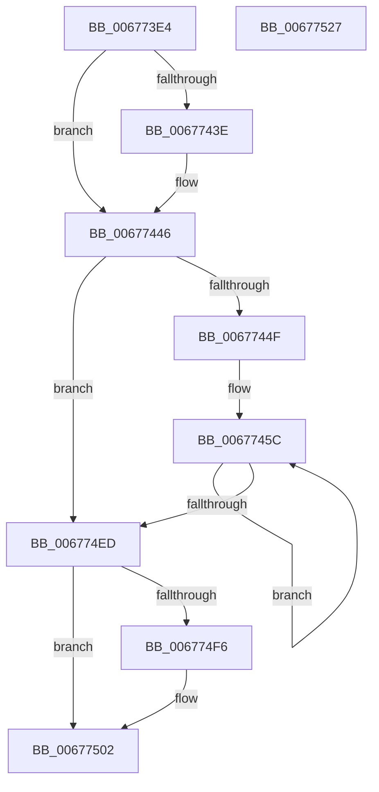

# MiSetHugeRangePartitionId

- RVA: `0x006773E4`–`0x00677528` (길이 `324` bytes)
- VA: `0x00000001406773E4`
- 실행 섹션: `.text`
- PDB 이름 있음: `예`; PDB Function 태그: `아니요`
- unwind 정보 RVA: `0x00075C18`
- 디코드: `86`개 명령, `324/324` bytes 표시
- 미해석 바이트: `0` (있으면 어셈블리에 `.byte`로 보존)

> 이 문서는 커널 이미지의 기계어와 PDB 기호를 분석해 생성했습니다. 4번과 5번은 함수 원형과 자료형을 바이너리 사용 방식에서 추정한 C 해석이며 원본 소스 복구 결과는 아닙니다.

## 1. Dependencies

- 직접 호출 지점: **5**; 고유 호출 대상: **4**
- 직접 호출자로 확인된 함수: **1**
- RIP 상대 이미지 참조: **3**

### Outgoing calls
- `0x00677441` → [KiRaiseIrqlProcessIrqlFlags](../4F/KiRaiseIrqlProcessIrqlFlags_function_004F56FC.md) (function, `0x004F56FC`)
- `0x0067745F` → [MiLockHugePfnInternal](../3F/MiLockHugePfnInternal_function_003FBC80.md) (function, `0x003FBC80`)
- `0x006774B5` → [MiUpdateHugePageCounts](MiUpdateHugePageCounts_function_00677530.md) (function, `0x00677530`)
- `0x006774C9` → [MiUpdateHugePageCounts](MiUpdateHugePageCounts_function_00677530.md) (function, `0x00677530`)
- `0x006774FD` → [KiLowerIrqlProcessIrqlFlags](../4F/KiLowerIrqlProcessIrqlFlags_function_004F5698.md) (function, `0x004F5698`)

### Direct callers
- [MiActOnPartitionNodePages](../68/MiActOnPartitionNodePages_function_0068F7F4.md) at `0x0068FBE3`

### Static image references
- `0x00677400` → RVA `0x00E300C0` (`.data`; read)
- `0x00677435` → RVA `0x00FC6D20` (`ALMOSTRO`; read)
- `0x0067749A` → RVA `0x00E300C8` (`.data`; read)

## 2. Other-region calls and transfers

- 다른 실행 섹션으로 향하는 call: **0**
- 별도 외부 분기/꼬리 이동을 확인하지 못했습니다.

## 3. Assembly (complete function range)

```asm
006773E4  48 89 5C 24 08                  mov qword ptr [rsp + 8], rbx
006773E9  48 89 6C 24 10                  mov qword ptr [rsp + 0x10], rbp
006773EE  48 89 74 24 18                  mov qword ptr [rsp + 0x18], rsi
006773F3  57                              push rdi
006773F4  41 54                           push r12
006773F6  41 55                           push r13
006773F8  41 56                           push r14
006773FA  41 57                           push r15
006773FC  48 83 EC 20                     sub rsp, 0x20
00677400  48 8B 05 B9 8C 7B 00            mov rax, qword ptr [rip + 0x7b8cb9]
00677407  49 8B D8                        mov rbx, r8
0067740A  0F B7 39                        movzx edi, word ptr [rcx]
0067740D  49 8B F1                        mov rsi, r9
00677410  48 C1 EB 12                     shr rbx, 0x12
00677414  4C 8B EA                        mov r13, rdx
00677417  81 E3 FF FF 3F 00               and ebx, 0x3fffff
0067741D  4C 8B F1                        mov r14, rcx
00677420  48 C1 EE 12                     shr rsi, 0x12
00677424  4C 8D 3C D8                     lea r15, [rax + rbx*8]
00677428  44 0F 20 C5                     mov rbp, cr8
0067742C  BA 02 00 00 00                  mov edx, 2
00677431  44 0F 22 C2                     mov cr8, rdx
00677435  83 3D E4 F8 94 00 00            cmp dword ptr [rip + 0x94f8e4], 0
0067743C  74 08                           je 0x140677446
0067743E  40 8A CD                        mov cl, bpl
00677441  E8 B6 E2 E7 FF                  call 0x1404f56fc
00677446  48 85 F6                        test rsi, rsi
00677449  0F 84 9E 00 00 00               je 0x1406774ed
0067744F  81 E7 FF 07 00 00               and edi, 0x7ff
00677455  4C 8B E6                        mov r12, rsi
00677458  48 C1 E7 04                     shl rdi, 4
0067745C  49 8B CF                        mov rcx, r15
0067745F  E8 1C 48 D8 FF                  call 0x1403fbc80
00677464  49 8B 07                        mov rax, qword ptr [r15]
00677467  BA 01 00 00 00                  mov edx, 1
0067746C  48 25 0B 80 FF FF               and rax, 0xffffffffffff800b
00677472  48 0B C7                        or rax, rdi
00677475  48 83 C8 03                     or rax, 3
00677479  49 89 07                        mov qword ptr [r15], rax
0067747C  49 8B C7                        mov rax, r15
0067747F  48 2B 05 3A 8C 7B 00            sub rax, qword ptr [rip + 0x7b8c3a]
00677486  48 C1 F8 03                     sar rax, 3
0067748A  25 FF FF 3F 00                  and eax, 0x3fffff
0067748F  8B C8                           mov ecx, eax
00677491  83 E1 1F                        and ecx, 0x1f
00677494  D3 E2                           shl edx, cl
00677496  8B C8                           mov ecx, eax
00677498  F7 D2                           not edx
0067749A  48 8B 05 27 8C 7B 00            mov rax, qword ptr [rip + 0x7b8c27]
006774A1  48 C1 E9 05                     shr rcx, 5
006774A5  F0 21 14 88                     lock and dword ptr [rax + rcx*4], edx
006774A9  45 33 C9                        xor r9d, r9d
006774AC  4C 8B C6                        mov r8, rsi
006774AF  48 8B D3                        mov rdx, rbx
006774B2  49 8B CD                        mov rcx, r13
006774B5  E8 76 00 00 00                  call 0x140677530
006774BA  41 B9 01 00 00 00               mov r9d, 1
006774C0  4C 8B C6                        mov r8, rsi
006774C3  48 8B D3                        mov rdx, rbx
006774C6  49 8B CE                        mov rcx, r14
006774C9  E8 62 00 00 00                  call 0x140677530
006774CE  48 8D 4B 01                     lea rcx, [rbx + 1]
006774D2  49 83 C7 08                     add r15, 8
006774D6  48 33 D9                        xor rbx, rcx
006774D9  48 81 E3 00 00 C0 FF            and rbx, 0xffffffffffc00000
006774E0  48 33 D9                        xor rbx, rcx
006774E3  49 83 EC 01                     sub r12, 1
006774E7  0F 85 6F FF FF FF               jne 0x14067745c
006774ED  83 3D 2C F8 94 00 00            cmp dword ptr [rip + 0x94f82c], 0
006774F4  74 0C                           je 0x140677502
006774F6  44 0F 20 C1                     mov rcx, cr8
006774FA  40 8A D5                        mov dl, bpl
006774FD  E8 96 E1 E7 FF                  call 0x1404f5698
00677502  40 0F B6 C5                     movzx eax, bpl
00677506  44 0F 22 C0                     mov cr8, rax
0067750A  48 8B 5C 24 50                  mov rbx, qword ptr [rsp + 0x50]
0067750F  48 8B 6C 24 58                  mov rbp, qword ptr [rsp + 0x58]
00677514  48 8B 74 24 60                  mov rsi, qword ptr [rsp + 0x60]
00677519  48 83 C4 20                     add rsp, 0x20
0067751D  41 5F                           pop r15
0067751F  41 5E                           pop r14
00677521  41 5D                           pop r13
00677523  41 5C                           pop r12
00677525  5F                              pop rdi
00677526  C3                              ret
00677527  CC                              int3
```

## 4. C-style interpretation (structured pseudocode)

```c
__int64 __fastcall MiSetHugeRangePartitionId(__int64 a1, __int64 a2, __int64 a3, __int64 a4)
{
    __int64 result;
    __int64 v_r12;
    __int64 v_r15;
    __int64 v_rbx;
    __int64 v_rdi;
    __int64 v_rsi;
    __int64 v_rsp;
    unsigned __int64 v_stack_p10;
    unsigned __int64 v_stack_p18;
    unsigned __int64 v_stack_p8;

    v_stack_p8 = v_rbx;
    v_stack_p10 = v_rbp;
    v_stack_p18 = v_rsi;
    v_rsp = (v_rsp) - (32);
    v_rbx = (a3) >> (18);
    v_rbx = (unsigned int)((v_rbx) & (0x3FFFFFULL));
    v_rsi = (a4) >> (18);
    result = *(unsigned __int64 *)(v_rip + 8096953);
    if ((*(unsigned int *)(v_rip + 9763044)) != 0) {
        a1 = (unsigned __int8)(v_cr8);
        result = KiRaiseIrqlProcessIrqlFlags(a1, 2, a3, a4);
    }
    if (v_rsi == 0) goto loc_006774ED;
    v_rdi = (unsigned int)((*(unsigned __int16 *)(a1)) & (0x7FFULL));
    v_rdi = (v_rdi) << (4);
loc_0067745C:
    result = MiLockHugePfnInternal(*(unsigned __int64 *)(v_rip + 8096953) + v_rbx * 8, 2, a3, a4);
    result = (*(unsigned __int64 *)(*(unsigned __int64 *)(v_rip + 8096953) + v_rbx * 8)) & (0xFFFFFFFFFFFF800BULL);
    result = (result) | (v_rdi);
    result = (result) | (3);
    *(unsigned __int64 *)(*(unsigned __int64 *)(v_rip + 8096953) + v_rbx * 8) = result;
    result = (*(unsigned __int64 *)(v_rip + 8096953) + v_rbx * 8) - (*(unsigned __int64 *)(v_rip + 8096826));
    result = (result) >> (3);
    result = (unsigned int)((result) & (0x3FFFFFULL));
    a1 = (unsigned int)(((unsigned int)((unsigned int)(result))) & (31));
    a2 = (unsigned int)((1) << ((unsigned __int8)(a1)));
    a2 = (unsigned int)(~(a2));
    a1 = ((unsigned int)((unsigned int)(result))) >> (5);
    a4 = 0;
    result = MiUpdateHugePageCounts(a2, v_rbx, v_rsi, a4);
    result = MiUpdateHugePageCounts(a1, v_rbx, v_rsi, 1);
    v_r15 = (*(unsigned __int64 *)(v_rip + 8096953) + v_rbx * 8) + (8);
    v_rbx = (v_rbx) ^ (v_rbx + 1);
    v_rbx = (v_rbx) & (0xFFFFFFFFFFC00000ULL);
    v_rbx = (v_rbx) ^ (v_rbx + 1);
    v_r12 = (v_rsi) - (1);
    if (condition_is_not_equal) goto loc_0067745C;
loc_006774ED:
    if ((*(unsigned int *)(v_rip + 9762860)) != 0) {
        a1 = 2;
        a2 = (unsigned __int8)(v_cr8);
        result = KiLowerIrqlProcessIrqlFlags(a1, a2, v_rsi, 1);
    }
    v_rsp = (v_rsp) + (32);
    return (unsigned __int8)(v_cr8);
}
```

## 5. (Beta) C Style

```c
int64_t MiSetHugeRangePartitionId(void *Arg1, int64_t Arg2, int64_t Arg3, int64_t Arg4)
{
    uint8_t *arg1 = (uint8_t *)Arg1;

    int64_t result;
    int64_t local_r12;
    int64_t local_r15;
    int64_t local_rbx;
    int64_t local_rdi;
    int64_t local_rsi;
    int64_t local_rsp;
    uint64_t v_stack_p10;
    uint64_t v_stack_p18;
    uint64_t v_stack_p8;

    v_stack_p8 = local_rbx;
    v_stack_p10 = local_rbp;
    v_stack_p18 = local_rsi;
    local_rsp = (local_rsp) - (32);
    local_rbx = (Arg3) >> (18);
    local_rbx = (uint32_t)((local_rbx) & (0x3FFFFFULL));
    local_rsi = (Arg4) >> (18);
    result = *(uint64_t *)(v_rip + 0x7B8CB9);
    if ((*(uint32_t *)(v_rip + 0x94F8E4)) != 0) {
        Arg1 = (uint8_t)(v_cr8);
        result = KiRaiseIrqlProcessIrqlFlags(Arg1, 2, Arg3, Arg4);
    }
    if (local_rsi == 0) goto loc_006774ED;
    local_rdi = (uint32_t)((*(uint16_t *)(arg1)) & (0x7FFULL));
    local_rdi = (local_rdi) << (4);
loc_0067745C:
    result = MiLockHugePfnInternal(*(uint64_t *)(v_rip + 0x7B8CB9) + local_rbx * 8, 2, Arg3, Arg4);
    result = (*(uint64_t *)(*(uint64_t *)(v_rip + 0x7B8CB9) + local_rbx * 8)) & (0xFFFFFFFFFFFF800BULL);
    result = (result) | (local_rdi);
    result = (result) | (3);
    *(uint64_t *)(*(uint64_t *)(v_rip + 0x7B8CB9) + local_rbx * 8) = result;
    result = (*(uint64_t *)(v_rip + 0x7B8CB9) + local_rbx * 8) - (*(uint64_t *)(v_rip + 0x7B8C3A));
    result = (result) >> (3);
    result = (uint32_t)((result) & (0x3FFFFFULL));
    Arg1 = (uint32_t)(((uint32_t)((uint32_t)(result))) & (31));
    Arg2 = (uint32_t)((1) << ((uint8_t)(Arg1)));
    Arg2 = (uint32_t)(~(Arg2));
    Arg1 = ((uint32_t)((uint32_t)(result))) >> (5);
    Arg4 = 0;
    result = MiUpdateHugePageCounts(Arg2, local_rbx, local_rsi, Arg4);
    result = MiUpdateHugePageCounts(Arg1, local_rbx, local_rsi, 1);
    local_r15 = (*(uint64_t *)(v_rip + 0x7B8CB9) + local_rbx * 8) + (8);
    local_rbx = (local_rbx) ^ (local_rbx + 1);
    local_rbx = (local_rbx) & (0xFFFFFFFFFFC00000ULL);
    local_rbx = (local_rbx) ^ (local_rbx + 1);
    local_r12 = (local_rsi) - (1);
    if (condition_is_not_equal) goto loc_0067745C;
loc_006774ED:
    if ((*(uint32_t *)(v_rip + 0x94F82C)) != 0) {
        Arg1 = 2;
        Arg2 = (uint8_t)(v_cr8);
        result = KiLowerIrqlProcessIrqlFlags(Arg1, Arg2, local_rsi, 1);
    }
    local_rsp = (local_rsp) + (32);
    return (uint8_t)(v_cr8);
}
```

### 관측된 메모리 오프셋

구조체 형식이 확인되지 않은 접근은 인자 기준의 오프셋으로만 기록했습니다.

| 기준 인자 | 오프셋 표현 | 폭 (bit) | 접근 |
|---|---:|---:|---|
| `Arg1` | `+ 0x0` | `16` | `R` |

## 6. Execution-region graph

[열기: 2D/3D 그래프와 함수 탐색 컨트롤 패널](../../../control-panel.html?section=text&rva=0x006773E4&view=graph)

- 2D 그래프는 위에서 아래로 흐르고, 3D 그래프는 빈 공간을 드래그해 회전합니다. Shift+드래그는 이동, 휠은 확대·축소, 함수 노드 선택은 대상 보고서 이동입니다.

### Static fallback


