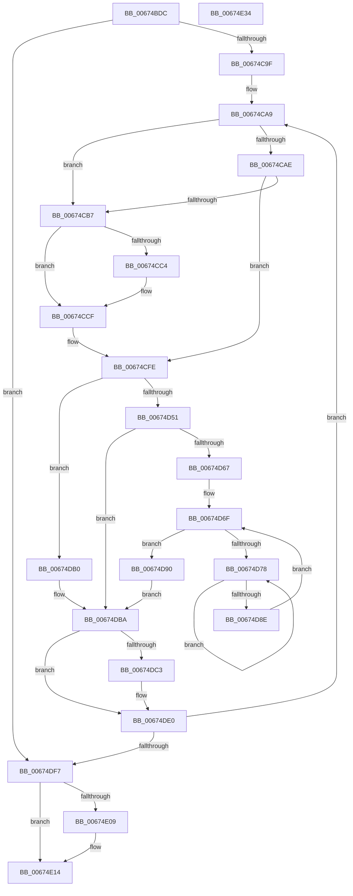

# MiSetPageProtection

- RVA: `0x00674BDC`–`0x00674E35` (길이 `601` bytes)
- VA: `0x0000000140674BDC`
- 실행 섹션: `.text`
- PDB 이름 있음: `예`; PDB Function 태그: `아니요`
- unwind 정보 RVA: `0x000C7B3C`
- 디코드: `151`개 명령, `601/601` bytes 표시
- 미해석 바이트: `0` (있으면 어셈블리에 `.byte`로 보존)

> 이 문서는 커널 이미지의 기계어와 PDB 기호를 분석해 생성했습니다. 4번과 5번은 함수 원형과 자료형을 바이너리 사용 방식에서 추정한 C 해석이며 원본 소스 복구 결과는 아닙니다.

## 1. Dependencies

- 직접 호출 지점: **17**; 고유 호출 대상: **15**
- 직접 호출자로 확인된 함수: **2**
- RIP 상대 이미지 참조: **0**

### Outgoing calls
- `0x00674C50` → [MiMakeValidPte](../2C/MiMakeValidPte_function_002C5590.md) (function, `0x002C5590`)
- `0x00674C5B` → [MiVaToFlushVm](../31/MiVaToFlushVm_function_0031AD84.md) (function, `0x0031AD84`)
- `0x00674C68` → [MiLockWorkingSetShared](../27/MiLockWorkingSetShared_function_0027CBF0.md) (function, `0x0027CBF0`)
- `0x00674C74` → [MiGetProcessorFlushList](../24/MiGetProcessorFlushList_function_00242C90.md) (function, `0x00242C90`)
- `0x00674C91` → [MiInitializeTbFlushList](../29/MiInitializeTbFlushList_function_00294F00.md) (function, `0x00294F00`)
- `0x00674CBA` → [MiFlushTbList](../31/MiFlushTbList_function_00311FC0.md) (function, `0x00311FC0`)
- `0x00674CCA` → [MiUnlockPageTable](../21/MiUnlockPageTable_function_00216EC0.md) (function, `0x00216EC0`)
- `0x00674CF9` → [MiLockNestedPageTable](../23/MiLockNestedPageTable_function_0023E890.md) (function, `0x0023E890`)
- `0x00674D80` → [KeYieldProcessorEx](../3F/KeYieldProcessorEx_function_003FBD00.md) (function, `0x003FBD00`)
- `0x00674D9A` → [MiMarkKernelStack](../2A/MiMarkKernelStack_function_002A2290.md) (function, `0x002A2290`)
- `0x00674DB5` → [MiLockPageAndSetDirty](../28/MiLockPageAndSetDirty_function_002857A0.md) (function, `0x002857A0`)
- `0x00674DC9` → [MiWriteValidPteNewProtection](../28/MiWriteValidPteNewProtection_function_00281810.md) (function, `0x00281810`)
- `0x00674DDB` → [MiInsertTbFlushEntry](../29/MiInsertTbFlushEntry_function_00293670.md) (function, `0x00293670`)
- `0x00674DFA` → [MiFlushTbList](../31/MiFlushTbList_function_00311FC0.md) (function, `0x00311FC0`)
- `0x00674DFF` → [MiReleaseProcessorFlushList](../31/MiReleaseProcessorFlushList_function_00313C70.md) (function, `0x00313C70`)
- `0x00674E0F` → [MiUnlockPageTable](../21/MiUnlockPageTable_function_00216EC0.md) (function, `0x00216EC0`)
- `0x00674E1E` → [MiUnlockWorkingSetShared](../27/MiUnlockWorkingSetShared_function_0027D690.md) (function, `0x0027D690`)

### Direct callers
- [MmSetPageProtection](../4E/MmSetPageProtection_function_004E1580.md) at `0x004E15D1`
- [MmAllocateIsrStack](../../page/80/MmAllocateIsrStack_function_00807ECC.md) at `0x00807F26`
- [MmAllocateIsrStack](../../page/80/MmAllocateIsrStack_function_00807ECC.md) at `0x00807F59`

### Static image references
- 디코드된 RIP-relative 메모리 참조가 없습니다.

## 2. Other-region calls and transfers

- 다른 실행 섹션으로 향하는 call: **0**
- 별도 외부 분기/꼬리 이동을 확인하지 못했습니다.

## 3. Assembly (complete function range)

```asm
00674BDC  44 89 44 24 18                  mov dword ptr [rsp + 0x18], r8d
00674BE1  53                              push rbx
00674BE2  55                              push rbp
00674BE3  56                              push rsi
00674BE4  57                              push rdi
00674BE5  41 54                           push r12
00674BE7  41 55                           push r13
00674BE9  41 56                           push r14
00674BEB  41 57                           push r15
00674BED  48 83 EC 48                     sub rsp, 0x48
00674BF1  48 B8 F8 FF FF FF 7F 00 00 00   movabs rax, 0x7ffffffff8
00674BFB  41 83 F8 1F                     cmp r8d, 0x1f
00674BFF  BF 04 00 00 00                  mov edi, 4
00674C04  4C 8B F1                        mov r14, rcx
00674C07  41 0F 45 F8                     cmovne edi, r8d
00674C0B  4C 8B E9                        mov r13, rcx
00674C0E  49 C1 EE 09                     shr r14, 9
00674C12  4C 23 F0                        and r14, rax
00674C15  48 B8 00 00 00 00 80 F6 FF FF   movabs rax, 0xfffff68000000000
00674C1F  48 8B C0                        mov rax, rax
00674C22  4C 03 F0                        add r14, rax
00674C25  BD 00 00 00 00                  mov ebp, 0
00674C2A  48 F7 C2 FF 0F 00 00            test rdx, 0xfff
00674C31  44 8B C7                        mov r8d, edi
00674C34  49 8B CE                        mov rcx, r14
00674C37  40 0F 95 C5                     setne bpl
00674C3B  48 C1 EA 0C                     shr rdx, 0xc
00674C3F  48 03 EA                        add rbp, rdx
00674C42  41 81 C8 00 00 00 A0            or r8d, 0xa0000000
00674C49  33 D2                           xor edx, edx
00674C4B  48 89 6C 24 30                  mov qword ptr [rsp + 0x30], rbp
00674C50  E8 3B 09 C5 FF                  call 0x1402c5590
00674C55  49 8B CD                        mov rcx, r13
00674C58  48 8B D8                        mov rbx, rax
00674C5B  E8 24 61 CA FF                  call 0x14031ad84
00674C60  48 8B C8                        mov rcx, rax
00674C63  4C 8B F8                        mov r15, rax
00674C66  33 F6                           xor esi, esi
00674C68  E8 83 7F C0 FF                  call 0x14027cbf0
00674C6D  88 84 24 90 00 00 00            mov byte ptr [rsp + 0x90], al
00674C74  E8 17 E0 BC FF                  call 0x140242c90
00674C79  45 33 C9                        xor r9d, r9d
00674C7C  C7 44 24 20 24 00 00 00         mov dword ptr [rsp + 0x20], 0x24
00674C84  44 8D 46 14                     lea r8d, [rsi + 0x14]
00674C88  49 8B D7                        mov rdx, r15
00674C8B  48 8B C8                        mov rcx, rax
00674C8E  4C 8B E0                        mov r12, rax
00674C91  E8 6A 02 C2 FF                  call 0x140294f00
00674C96  48 85 ED                        test rbp, rbp
00674C99  0F 84 58 01 00 00               je 0x140674df7
00674C9F  83 E7 04                        and edi, 4
00674CA2  89 BC 24 98 00 00 00            mov dword ptr [rsp + 0x98], edi
00674CA9  48 85 F6                        test rsi, rsi
00674CAC  74 09                           je 0x140674cb7
00674CAE  49 F7 C6 FF 0F 00 00            test r14, 0xfff
00674CB5  75 47                           jne 0x140674cfe
00674CB7  49 8B CC                        mov rcx, r12
00674CBA  E8 01 D3 C9 FF                  call 0x140311fc0
00674CBF  48 85 F6                        test rsi, rsi
00674CC2  74 0B                           je 0x140674ccf
00674CC4  48 8B D6                        mov rdx, rsi
00674CC7  49 8B CF                        mov rcx, r15
00674CCA  E8 F1 21 BA FF                  call 0x140216ec0
00674CCF  48 B8 F8 FF FF FF 7F 00 00 00   movabs rax, 0x7ffffffff8
00674CD9  49 8B F6                        mov rsi, r14
00674CDC  48 C1 EE 09                     shr rsi, 9
00674CE0  48 23 F0                        and rsi, rax
00674CE3  48 B8 00 00 00 00 80 F6 FF FF   movabs rax, 0xfffff68000000000
00674CED  48 8B C0                        mov rax, rax
00674CF0  48 03 F0                        add rsi, rax
00674CF3  49 8B CF                        mov rcx, r15
00674CF6  48 8B D6                        mov rdx, rsi
00674CF9  E8 92 9B BC FF                  call 0x14023e890
00674CFE  49 8B 3E                        mov rdi, qword ptr [r14]
00674D01  48 B8 FF FF FF FF FF 00 00 00   movabs rax, 0xffffffffff
00674D0B  48 8B D7                        mov rdx, rdi
00674D0E  49 B8 FF 0F 00 00 00 00 F0 FF   movabs r8, 0xfff0000000000fff
00674D18  48 C1 EA 0C                     shr rdx, 0xc
00674D1C  48 8B CA                        mov rcx, rdx
00674D1F  48 23 D0                        and rdx, rax
00674D22  48 C1 E1 0C                     shl rcx, 0xc
00674D26  48 33 D9                        xor rbx, rcx
00674D29  49 23 D8                        and rbx, r8
00674D2C  48 33 D9                        xor rbx, rcx
00674D2F  48 8D 2C 52                     lea rbp, [rdx + rdx*2]
00674D33  48 8B CB                        mov rcx, rbx
00674D36  48 C1 E5 04                     shl rbp, 4
00674D3A  48 B8 00 00 00 00 00 DE FF FF   movabs rax, 0xffffde0000000000
00674D44  48 03 E8                        add rbp, rax
00674D47  83 BC 24 98 00 00 00 00         cmp dword ptr [rsp + 0x98], 0
00674D4F  74 5F                           je 0x140674db0
00674D51  48 83 CB 42                     or rbx, 0x42
00674D55  40 F6 C7 42                     test dil, 0x42
00674D59  48 0F 44 D9                     cmove rbx, rcx
00674D5D  83 BC 24 A0 00 00 00 1F         cmp dword ptr [rsp + 0xa0], 0x1f
00674D65  75 53                           jne 0x140674dba
00674D67  83 A4 24 A8 00 00 00 00         and dword ptr [rsp + 0xa8], 0
00674D6F  F0 48 0F BA 6D 18 3F            lock bts qword ptr [rbp + 0x18], 0x3f
00674D76  73 18                           jae 0x140674d90
00674D78  48 8D 8C 24 A8 00 00 00         lea rcx, [rsp + 0xa8]
00674D80  E8 7B 6F D8 FF                  call 0x1403fbd00
00674D85  48 8B 45 18                     mov rax, qword ptr [rbp + 0x18]
00674D89  48 85 C0                        test rax, rax
00674D8C  78 EA                           js 0x140674d78
00674D8E  EB DF                           jmp 0x140674d6f
00674D90  49 C7 C0 E0 FF FF FF            mov r8, 0xffffffffffffffe0
00674D97  48 8B D5                        mov rdx, rbp
00674D9A  E8 F1 D4 C2 FF                  call 0x1402a2290
00674D9F  48 B8 FF FF FF FF FF FF FF 7F   movabs rax, 0x7fffffffffffffff
00674DA9  F0 48 21 45 18                  lock and qword ptr [rbp + 0x18], rax
00674DAE  EB 0A                           jmp 0x140674dba
00674DB0  33 D2                           xor edx, edx
00674DB2  48 8B CD                        mov rcx, rbp
00674DB5  E8 E6 09 C1 FF                  call 0x1402857a0
00674DBA  48 83 CB 20                     or rbx, 0x20
00674DBE  48 3B DF                        cmp rbx, rdi
00674DC1  74 1D                           je 0x140674de0
00674DC3  48 8B D3                        mov rdx, rbx
00674DC6  49 8B CE                        mov rcx, r14
00674DC9  E8 42 CA C0 FF                  call 0x140281810
00674DCE  45 33 C9                        xor r9d, r9d
00674DD1  49 8B D5                        mov rdx, r13
00674DD4  49 8B CC                        mov rcx, r12
00674DD7  45 8D 41 01                     lea r8d, [r9 + 1]
00674DDB  E8 90 E8 C1 FF                  call 0x140293670
00674DE0  49 81 C5 00 10 00 00            add r13, 0x1000
00674DE7  49 83 C6 08                     add r14, 8
00674DEB  48 83 6C 24 30 01               sub qword ptr [rsp + 0x30], 1
00674DF1  0F 85 B2 FE FF FF               jne 0x140674ca9
00674DF7  49 8B CC                        mov rcx, r12
00674DFA  E8 C1 D1 C9 FF                  call 0x140311fc0
00674DFF  E8 6C EE C9 FF                  call 0x140313c70
00674E04  48 85 F6                        test rsi, rsi
00674E07  74 0B                           je 0x140674e14
00674E09  48 8B D6                        mov rdx, rsi
00674E0C  49 8B CF                        mov rcx, r15
00674E0F  E8 AC 20 BA FF                  call 0x140216ec0
00674E14  8A 94 24 90 00 00 00            mov dl, byte ptr [rsp + 0x90]
00674E1B  49 8B CF                        mov rcx, r15
00674E1E  E8 6D 88 C0 FF                  call 0x14027d690
00674E23  48 83 C4 48                     add rsp, 0x48
00674E27  41 5F                           pop r15
00674E29  41 5E                           pop r14
00674E2B  41 5D                           pop r13
00674E2D  41 5C                           pop r12
00674E2F  5F                              pop rdi
00674E30  5E                              pop rsi
00674E31  5D                              pop rbp
00674E32  5B                              pop rbx
00674E33  C3                              ret
00674E34  CC                              int3
```

## 4. C-style interpretation (structured pseudocode)

```c
__int64 __fastcall MiSetPageProtection(__int64 a1, __int64 a2, int a3, int a4)
{
    __int64 result;
    __int64 v_r13;
    __int64 v_r14;
    __int64 v_rbp;
    __int64 v_rbx;
    __int64 v_rdi;
    __int64 v_rsi;
    __int64 v_rsp;
    unsigned __int64 v_stack_m58;
    unsigned int v_stack_m68;
    unsigned int v_stack_p10;
    unsigned int v_stack_p18;
    unsigned int v_stack_p20;
    unsigned __int8 v_stack_p8;

    v_stack_p18 = a3;
    v_rsp = (v_rsp) - (72);
    v_rdi = 4;
    if (a3 != 31) { v_rdi = a3; }
    v_r14 = (a1) >> (9);
    v_r14 = (v_r14) & (result);
    v_r14 = (v_r14) + (result);
    v_rbp = (((a2) & (0xFFFULL)) != 0) ? 1 : 0;
    a2 = (a2) >> (12);
    v_rbp = (v_rbp) + (a2);
    a3 = (unsigned int)(((unsigned int)((unsigned int)(v_rdi))) | (0xA0000000ULL));
    a2 = 0;
    v_stack_m58 = v_rbp;
    result = MiMakeValidPte(v_r14, a2, a3, a4);
    result = MiVaToFlushVm(a1, a2, a3, a4);
    v_rsi = 0;
    result = MiLockWorkingSetShared(result, a2, a3, a4);
    v_stack_p8 = (unsigned __int8)(result);
    result = MiGetProcessorFlushList(result, a2, a3, a4);
    a4 = 0;
    v_stack_m68 = 36;
    result = MiInitializeTbFlushList(result, result, v_rsi + 20, a4);
    if (v_rbp == 0) goto loc_00674DF7;
    v_rdi = (unsigned int)((v_rdi) & (4));
    v_stack_p10 = (unsigned int)(v_rdi);
loc_00674CA9:
    if (0 == 0) goto loc_00674CB7;
    if (((v_r14) & (0xFFFULL)) != 0) goto loc_00674CFE;
loc_00674CB7:
    result = MiFlushTbList(result, result, v_rsi + 20, a4);
    if (0 != 0) {
        a2 = 0;
        a1 = result;
        result = MiUnlockPageTable(a1, a2, v_rsi + 20, a4);
    }
    v_rsi = (v_r14) >> (9);
    v_rsi = (v_rsi) & (result);
    v_rsi = (v_rsi) + (result);
    result = MiLockNestedPageTable(result, v_rsi, v_rsi + 20, a4);
loc_00674CFE:
    a2 = (*(unsigned __int64 *)(v_r14)) >> (12);
    a2 = (a2) & (result);
    a1 = (a2) << (12);
    v_rbx = (result) ^ (a1);
    v_rbx = (v_rbx) & (v_rsi + 20);
    v_rbx = (v_rbx) ^ (a1);
    v_rbp = (a2 + a2 * 2) << (4);
    v_rbp = (v_rbp) + (result);
    if (v_stack_p10 == 0) goto loc_00674DB0;
    v_rbx = (v_rbx) | (66);
    if ((((unsigned __int8)(*(unsigned __int64 *)(v_r14))) & (66)) == 0) { v_rbx = v_rbx; }
    if (v_stack_p18 != 31) goto loc_00674DBA;
loc_00674D6F:
    if (v_stack_p18 >= 31) goto loc_00674D90;
loc_00674D78:
    result = KeYieldProcessorEx(v_stack_p20, a2, v_rsi + 20, a4);
    if (sign_flag) goto loc_00674D78;
    goto loc_00674D6F;
loc_00674D90:
    result = MiMarkKernelStack(v_stack_p20, v_rbp, -32, a4);
    goto loc_00674DBA;
loc_00674DB0:
    a2 = 0;
    result = MiLockPageAndSetDirty(v_rbp, a2, -32, a4);
loc_00674DBA:
    v_rbx = (v_rbx) | (32);
    if (v_rbx != (*(unsigned __int64 *)(v_r14))) {
        a2 = v_rbx;
        a1 = v_r14;
        result = MiWriteValidPteNewProtection(a1, a2, -32, a4);
        a4 = 0;
        a2 = a1;
        a1 = result;
        a3 = a4 + 1;
        result = MiInsertTbFlushEntry(a1, a2, a3, a4);
    }
    v_r13 = (a1) + (0x1000ULL);
    v_r14 = (v_r14) + (8);
    if (condition_is_not_equal) goto loc_00674CA9;
loc_00674DF7:
    result = MiFlushTbList(result, a2, a3, a4);
    result = MiReleaseProcessorFlushList(result, a2, a3, a4);
    if (v_rsi != 0) {
        a2 = v_rsi;
        a1 = result;
        result = MiUnlockPageTable(a1, a2, a3, a4);
    }
    result = MiUnlockWorkingSetShared(result, v_stack_p8, a3, a4);
    v_rsp = (v_rsp) + (72);
    return result;
}
```

## 5. (Beta) C Style

```c
int64_t MiSetPageProtection(int64_t Arg1, int64_t Arg2, int32_t Arg3, int32_t Arg4)
{
    int64_t result;
    int64_t local_r13;
    int64_t local_r14;
    int64_t local_rbp;
    int64_t local_rbx;
    int64_t local_rdi;
    int64_t local_rsi;
    int64_t local_rsp;
    uint64_t v_stack_m58;
    uint32_t v_stack_m68;
    uint32_t v_stack_p10;
    uint32_t v_stack_p18;
    uint32_t v_stack_p20;
    uint8_t v_stack_p8;

    v_stack_p18 = Arg3;
    local_rsp = (local_rsp) - (72);
    local_rdi = 4;
    if (Arg3 != 31) { local_rdi = Arg3; }
    local_r14 = (Arg1) >> (9);
    local_r14 = (local_r14) & (result);
    local_r14 = (local_r14) + (result);
    local_rbp = (((Arg2) & (0xFFFULL)) != 0) ? 1 : 0;
    Arg2 = (Arg2) >> (12);
    local_rbp = (local_rbp) + (Arg2);
    Arg3 = (uint32_t)(((uint32_t)((uint32_t)(local_rdi))) | (0xA0000000ULL));
    Arg2 = 0;
    v_stack_m58 = local_rbp;
    result = MiMakeValidPte(local_r14, Arg2, Arg3, Arg4);
    result = MiVaToFlushVm(Arg1, Arg2, Arg3, Arg4);
    local_rsi = 0;
    result = MiLockWorkingSetShared(result, Arg2, Arg3, Arg4);
    v_stack_p8 = (uint8_t)(result);
    result = MiGetProcessorFlushList(result, Arg2, Arg3, Arg4);
    Arg4 = 0;
    v_stack_m68 = 36;
    result = MiInitializeTbFlushList(result, result, local_rsi + 20, Arg4);
    if (local_rbp == 0) goto loc_00674DF7;
    local_rdi = (uint32_t)((local_rdi) & (4));
    v_stack_p10 = (uint32_t)(local_rdi);
loc_00674CA9:
    if (0 == 0) goto loc_00674CB7;
    if (((local_r14) & (0xFFFULL)) != 0) goto loc_00674CFE;
loc_00674CB7:
    result = MiFlushTbList(result, result, local_rsi + 20, Arg4);
    if (0 != 0) {
        Arg2 = 0;
        Arg1 = result;
        result = MiUnlockPageTable(Arg1, Arg2, local_rsi + 20, Arg4);
    }
    local_rsi = (local_r14) >> (9);
    local_rsi = (local_rsi) & (result);
    local_rsi = (local_rsi) + (result);
    result = MiLockNestedPageTable(result, local_rsi, local_rsi + 20, Arg4);
loc_00674CFE:
    Arg2 = (*(uint64_t *)(local_r14)) >> (12);
    Arg2 = (Arg2) & (result);
    Arg1 = (Arg2) << (12);
    local_rbx = (result) ^ (Arg1);
    local_rbx = (local_rbx) & (local_rsi + 20);
    local_rbx = (local_rbx) ^ (Arg1);
    local_rbp = (Arg2 + Arg2 * 2) << (4);
    local_rbp = (local_rbp) + (result);
    if (v_stack_p10 == 0) goto loc_00674DB0;
    local_rbx = (local_rbx) | (66);
    if ((((uint8_t)(*(uint64_t *)(local_r14))) & (66)) == 0) { local_rbx = local_rbx; }
    if (v_stack_p18 != 31) goto loc_00674DBA;
loc_00674D6F:
    if (v_stack_p18 >= 31) goto loc_00674D90;
loc_00674D78:
    result = KeYieldProcessorEx(v_stack_p20, Arg2, local_rsi + 20, Arg4);
    if (sign_flag) goto loc_00674D78;
    goto loc_00674D6F;
loc_00674D90:
    result = MiMarkKernelStack(v_stack_p20, local_rbp, -32, Arg4);
    goto loc_00674DBA;
loc_00674DB0:
    Arg2 = 0;
    result = MiLockPageAndSetDirty(local_rbp, Arg2, -32, Arg4);
loc_00674DBA:
    local_rbx = (local_rbx) | (32);
    if (local_rbx != (*(uint64_t *)(local_r14))) {
        Arg2 = local_rbx;
        Arg1 = local_r14;
        result = MiWriteValidPteNewProtection(Arg1, Arg2, -32, Arg4);
        Arg4 = 0;
        Arg2 = Arg1;
        Arg1 = result;
        Arg3 = Arg4 + 1;
        result = MiInsertTbFlushEntry(Arg1, Arg2, Arg3, Arg4);
    }
    local_r13 = (Arg1) + (0x1000ULL);
    local_r14 = (local_r14) + (8);
    if (condition_is_not_equal) goto loc_00674CA9;
loc_00674DF7:
    result = MiFlushTbList(result, Arg2, Arg3, Arg4);
    result = MiReleaseProcessorFlushList(result, Arg2, Arg3, Arg4);
    if (local_rsi != 0) {
        Arg2 = local_rsi;
        Arg1 = result;
        result = MiUnlockPageTable(Arg1, Arg2, Arg3, Arg4);
    }
    result = MiUnlockWorkingSetShared(result, v_stack_p8, Arg3, Arg4);
    local_rsp = (local_rsp) + (72);
    return result;
}
```

## 6. Execution-region graph

[열기: 2D/3D 그래프와 함수 탐색 컨트롤 패널](../../../control-panel.html?section=text&rva=0x00674BDC&view=graph)

- 2D 그래프는 위에서 아래로 흐르고, 3D 그래프는 빈 공간을 드래그해 회전합니다. Shift+드래그는 이동, 휠은 확대·축소, 함수 노드 선택은 대상 보고서 이동입니다.

### Static fallback


