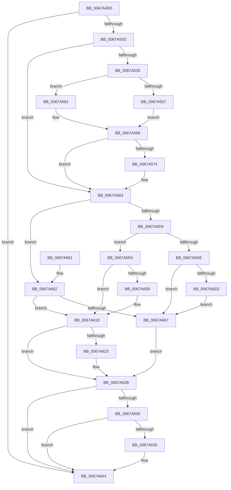

# MiSetPfnRemovalRequested

- RVA: `0x0067A4D0`–`0x0067A674` (길이 `420` bytes)
- VA: `0x000000014067A4D0`
- 실행 섹션: `.text`
- PDB 이름 있음: `예`; PDB Function 태그: `아니요`
- unwind 정보 RVA: `0x000D7E14`
- 디코드: `113`개 명령, `420/420` bytes 표시
- 미해석 바이트: `0` (있으면 어셈블리에 `.byte`로 보존)

> 이 문서는 커널 이미지의 기계어와 PDB 기호를 분석해 생성했습니다. 4번과 5번은 함수 원형과 자료형을 바이너리 사용 방식에서 추정한 C 해석이며 원본 소스 복구 결과는 아닙니다.

## 1. Dependencies

- 직접 호출 지점: **6**; 고유 호출 대상: **6**
- 직접 호출자로 확인된 함수: **8**
- RIP 상대 이미지 참조: **1**

### Outgoing calls
- `0x0067A528` → [MI_NODE_FROM_PFN](../2B/MI_NODE_FROM_PFN_function_002B0F30.md) (function, `0x002B0F30`)
- `0x0067A577` → [MiGetBaseResidentPage](../31/MiGetBaseResidentPage_function_0031C750.md) (function, `0x0031C750`)
- `0x0067A5AB` → [MiGetPfnPageSizeIndex](../31/MiGetPfnPageSizeIndex_function_0031C710.md) (function, `0x0031C710`)
- `0x0067A600` → [MiAnyPagesRemovalPending](../47/MiAnyPagesRemovalPending_function_0047CDB8.md) (function, `0x0047CDB8`)
- `0x0067A626` → [MiRemovePendingBadPageNode](MiRemovePendingBadPageNode_function_0067A0DC.md) (function, `0x0067A0DC`)
- `0x0067A66D` → [MiAddPendingBadPageNode](MiAddPendingBadPageNode_function_006793B4.md) (function, `0x006793B4`)

### Direct callers
- [MiInsertPageInList](../2B/MiInsertPageInList_function_002BA000.md) at `0x002BAAC6`
- [MiMakePageBad](../48/MiMakePageBad_function_00486F04.md) at `0x00486FF7`
- [MiInitializeDynamicPfns](MiInitializeDynamicPfns_function_00672BD0.md) at `0x00672FF1`
- [MiHotRemoveHugeRange](MiHotRemoveHugeRange_function_00675DD0.md) at `0x006760B7`
- [MiRemoveBadPages](MiRemoveBadPages_function_00679F6C.md) at `0x0067A035`
- [MiUnlinkBadPages](MiUnlinkBadPages_function_0067A6FC.md) at `0x0067A7BA`
- [MmMarkPhysicalMemoryAsBad](MmMarkPhysicalMemoryAsBad_function_0067AA50.md) at `0x0067AD50`
- [MiMarkFileOnlyPfnBad](../68/MiMarkFileOnlyPfnBad_function_006815C4.md) at `0x006816FD`
- [MiMarkFileOnlyPfnBad](../68/MiMarkFileOnlyPfnBad_function_006815C4.md) at `0x0068172E`

### Static image references
- `0x0067A533` → RVA `0x00E30088` (`.data`; read)

## 2. Other-region calls and transfers

- 다른 실행 섹션으로 향하는 call: **0**
- 별도 외부 분기/꼬리 이동을 확인하지 못했습니다.

## 3. Assembly (complete function range)

```asm
0067A4D0  48 89 5C 24 08                  mov qword ptr [rsp + 8], rbx
0067A4D5  48 89 6C 24 18                  mov qword ptr [rsp + 0x18], rbp
0067A4DA  48 89 74 24 20                  mov qword ptr [rsp + 0x20], rsi
0067A4DF  57                              push rdi
0067A4E0  41 54                           push r12
0067A4E2  41 55                           push r13
0067A4E4  41 56                           push r14
0067A4E6  41 57                           push r15
0067A4E8  48 83 EC 20                     sub rsp, 0x20
0067A4EC  8B 41 20                        mov eax, dword ptr [rcx + 0x20]
0067A4EF  4D 8B E9                        mov r13, r9
0067A4F2  89 44 24 58                     mov dword ptr [rsp + 0x58], eax
0067A4F6  45 8B E0                        mov r12d, r8d
0067A4F9  C1 E8 1E                        shr eax, 0x1e
0067A4FC  44 8B F2                        mov r14d, edx
0067A4FF  83 E0 01                        and eax, 1
0067A502  48 8B F1                        mov rsi, rcx
0067A505  3B C2                           cmp eax, edx
0067A507  0F 84 37 01 00 00               je 0x14067a644
0067A50D  48 8B 41 28                     mov rax, qword ptr [rcx + 0x28]
0067A511  33 FF                           xor edi, edi
0067A513  33 DB                           xor ebx, ebx
0067A515  48 83 CD FF                     or rbp, 0xffffffffffffffff
0067A519  48 0F BA E0 35                  bt rax, 0x35
0067A51E  44 8D 7F 03                     lea r15d, [rdi + 3]
0067A522  0F 82 8B 00 00 00               jb 0x14067a5b3
0067A528  E8 03 6A C3 FF                  call 0x1402b0f30
0067A52D  8B C8                           mov ecx, eax
0067A52F  48 8B 46 28                     mov rax, qword ptr [rsi + 0x28]
0067A533  48 8B 15 4E 5B 7B 00            mov rdx, qword ptr [rip + 0x7b5b4e]
0067A53A  48 C1 E8 2B                     shr rax, 0x2b
0067A53E  48 69 C9 80 DF 00 00            imul rcx, rcx, 0xdf80
0067A545  25 FF 03 00 00                  and eax, 0x3ff
0067A54A  4C 8B 04 C2                     mov r8, qword ptr [rdx + rax*8]
0067A54E  49 03 48 10                     add rcx, qword ptr [r8 + 0x10]
0067A552  45 85 F6                        test r14d, r14d
0067A555  74 0A                           je 0x14067a561
0067A557  F0 48 FF 81 98 3B 00 00         lock inc qword ptr [rcx + 0x3b98]
0067A55F  EB 08                           jmp 0x14067a569
0067A561  F0 48 01 A9 98 3B 00 00         lock add qword ptr [rcx + 0x3b98], rbp
0067A569  48 8B 46 28                     mov rax, qword ptr [rsi + 0x28]
0067A56D  48 0F BA E0 28                  bt rax, 0x28
0067A572  73 3F                           jae 0x14067a5b3
0067A574  48 8B CE                        mov rcx, rsi
0067A577  E8 D4 21 CA FF                  call 0x14031c750
0067A57C  48 8B F8                        mov rdi, rax
0067A57F  8B 48 20                        mov ecx, dword ptr [rax + 0x20]
0067A582  48 8B 58 28                     mov rbx, qword ptr [rax + 0x28]
0067A586  48 B8 00 00 00 00 00 DE FF FF   movabs rax, 0xffffde0000000000
0067A590  48 8B EF                        mov rbp, rdi
0067A593  48 8B CF                        mov rcx, rdi
0067A596  48 2B E8                        sub rbp, rax
0067A599  48 B8 AB AA AA AA AA AA AA AA   movabs rax, 0xaaaaaaaaaaaaaaab
0067A5A3  48 C1 FD 04                     sar rbp, 4
0067A5A7  48 0F AF E8                     imul rbp, rax
0067A5AB  E8 60 21 CA FF                  call 0x14031c710
0067A5B0  44 8B F8                        mov r15d, eax
0067A5B3  8A 4C 24 5B                     mov cl, byte ptr [rsp + 0x5b]
0067A5B7  41 8A D6                        mov dl, r14b
0067A5BA  80 E2 01                        and dl, 1
0067A5BD  80 E1 BF                        and cl, 0xbf
0067A5C0  C0 E2 06                        shl dl, 6
0067A5C3  0A D1                           or dl, cl
0067A5C5  88 54 24 5B                     mov byte ptr [rsp + 0x5b], dl
0067A5C9  8B 4C 24 58                     mov ecx, dword ptr [rsp + 0x58]
0067A5CD  89 4E 20                        mov dword ptr [rsi + 0x20], ecx
0067A5D0  48 85 FF                        test rdi, rdi
0067A5D3  0F 84 89 00 00 00               je 0x14067a662
0067A5D9  45 85 F6                        test r14d, r14d
0067A5DC  74 1C                           je 0x14067a5fa
0067A5DE  48 B9 00 00 00 00 00 02 00 00   movabs rcx, 0x20000000000
0067A5E8  48 85 D9                        test rcx, rbx
0067A5EB  75 7A                           jne 0x14067a667
0067A5ED  48 8B 47 28                     mov rax, qword ptr [rdi + 0x28]
0067A5F1  48 0B C1                        or rax, rcx
0067A5F4  48 89 47 28                     mov qword ptr [rdi + 0x28], rax
0067A5F8  EB 6D                           jmp 0x14067a667
0067A5FA  41 8B D7                        mov edx, r15d
0067A5FD  48 8B CD                        mov rcx, rbp
0067A600  E8 B3 27 E0 FF                  call 0x14047cdb8
0067A605  85 C0                           test eax, eax
0067A607  75 15                           jne 0x14067a61e
0067A609  48 8B 47 28                     mov rax, qword ptr [rdi + 0x28]
0067A60D  48 B9 FF FF FF FF FF FD FF FF   movabs rcx, 0xfffffdffffffffff
0067A617  48 23 C1                        and rax, rcx
0067A61A  48 89 47 28                     mov qword ptr [rdi + 0x28], rax
0067A61E  45 85 E4                        test r12d, r12d
0067A621  74 08                           je 0x14067a62b
0067A623  48 8B CE                        mov rcx, rsi
0067A626  E8 B1 FA FF FF                  call 0x14067a0dc
0067A62B  48 85 FF                        test rdi, rdi
0067A62E  74 14                           je 0x14067a644
0067A630  48 3B FE                        cmp rdi, rsi
0067A633  74 0F                           je 0x14067a644
0067A635  48 B8 FF FF FF FF FF FF FF 7F   movabs rax, 0x7fffffffffffffff
0067A63F  F0 48 21 47 18                  lock and qword ptr [rdi + 0x18], rax
0067A644  48 8B 5C 24 50                  mov rbx, qword ptr [rsp + 0x50]
0067A649  48 8B 6C 24 60                  mov rbp, qword ptr [rsp + 0x60]
0067A64E  48 8B 74 24 68                  mov rsi, qword ptr [rsp + 0x68]
0067A653  48 83 C4 20                     add rsp, 0x20
0067A657  41 5F                           pop r15
0067A659  41 5E                           pop r14
0067A65B  41 5D                           pop r13
0067A65D  41 5C                           pop r12
0067A65F  5F                              pop rdi
0067A660  C3                              ret
0067A661  CC                              int3
0067A662  45 85 F6                        test r14d, r14d
0067A665  74 B7                           je 0x14067a61e
0067A667  49 8B D5                        mov rdx, r13
0067A66A  48 8B CE                        mov rcx, rsi
0067A66D  E8 42 ED FF FF                  call 0x1406793b4
0067A672  EB B7                           jmp 0x14067a62b
```

## 4. C-style interpretation (structured pseudocode)

```c
__int64 __fastcall MiSetPfnRemovalRequested(__int64 a1, int a2, int a3, __int64 a4)
{
    __int64 result;
    __int64 v_r15;
    __int64 v_rbp;
    __int64 v_rbx;
    __int64 v_rdi;
    __int64 v_rsp;
    unsigned int v_stack_p10;
    unsigned __int8 v_stack_p13;
    unsigned __int64 v_stack_p18;
    unsigned __int64 v_stack_p20;
    unsigned __int64 v_stack_p8;

    v_stack_p8 = v_rbx;
    v_stack_p18 = v_rbp;
    v_stack_p20 = v_rsi;
    v_rsp = (v_rsp) - (32);
    v_stack_p10 = (unsigned int)((unsigned int)(*(unsigned int *)(a1 + 32)));
    result = (unsigned int)(((unsigned int)(*(unsigned int *)(a1 + 32))) >> (30));
    result = (unsigned int)((result) & (1));
    if (((unsigned int)(result)) == a2) goto loc_0067A644;
    v_rdi = 0;
    v_rbx = 0;
    v_rbp = (v_rbp) | (-1);
    if (condition_is_below) goto loc_0067A5B3;
    result = MI_NODE_FROM_PFN(a1, a2, a3, a4);
    result = (*(unsigned __int64 *)(a1 + 40)) >> (43);
    a1 = ((unsigned int)((unsigned int)(result))) * ((unsigned int)((unsigned int)(result)));
    result = (unsigned int)((result) & (0x3FFULL));
    a1 = (a1) + (*(unsigned __int64 *)(*(unsigned __int64 *)(*(unsigned __int64 *)(v_rip + 8084302) + result * 8) + 16));
    if ((unsigned int)((unsigned int)(a2)) == 0) goto loc_0067A561;
    goto loc_0067A569;
loc_0067A561:
loc_0067A569:
    result = *(unsigned __int64 *)(a1 + 40);
    v_r15 = v_rdi + 3;
    if (!(condition_is_above_or_equal)) {
        a1 = a1;
        result = MiGetBaseResidentPage(a1, *(unsigned __int64 *)(v_rip + 8084302), *(unsigned __int64 *)(*(unsigned __int64 *)(v_rip + 8084302) + result * 8), a4);
        v_rdi = result;
        a1 = *(unsigned int *)(result + 32);
        v_rbx = *(unsigned __int64 *)(result + 40);
        v_rbp = v_rdi;
        a1 = v_rdi;
        v_rbp = (v_rbp) - (result);
        v_rbp = (v_rbp) >> (4);
        v_rbp = (v_rbp) * (result);
        result = MiGetPfnPageSizeIndex(a1, *(unsigned __int64 *)(v_rip + 8084302), *(unsigned __int64 *)(*(unsigned __int64 *)(v_rip + 8084302) + result * 8), a4);
        v_r15 = (unsigned int)(result);
    }
    a2 = (unsigned __int8)(((unsigned __int8)((unsigned int)(a2))) & (1));
    a1 = (unsigned __int8)((v_stack_p13) & (191));
    a2 = (unsigned __int8)((a2) << (6));
    a2 = (unsigned __int8)((a2) | ((unsigned __int8)(a1)));
    v_stack_p13 = (unsigned __int8)(a2);
    *(unsigned int *)(a1 + 32) = (unsigned int)((unsigned int)(v_stack_p10));
    if (v_rdi == 0) goto loc_0067A662;
    if ((unsigned int)((unsigned int)(a2)) == 0) goto loc_0067A5FA;
    if ((((unsigned int)(v_stack_p10)) & (v_rbx)) != 0) goto loc_0067A667;
    result = (*(unsigned __int64 *)(v_rdi + 40)) | ((unsigned int)(v_stack_p10));
    *(unsigned __int64 *)(v_rdi + 40) = result;
    goto loc_0067A667;
loc_0067A5FA:
    result = MiAnyPagesRemovalPending(v_rbp, (unsigned int)((unsigned int)(v_r15)), *(unsigned __int64 *)(*(unsigned __int64 *)(v_rip + 8084302) + result * 8), a4);
    if ((unsigned int)(result) == 0) {
        result = *(unsigned __int64 *)(v_rdi + 40);
        result = (result) & (v_rbp);
        *(unsigned __int64 *)(v_rdi + 40) = result;
    }
    if ((unsigned int)((unsigned int)(a3)) != 0) {
        a1 = a1;
        result = MiRemovePendingBadPageNode(a1, (unsigned int)((unsigned int)(v_r15)), *(unsigned __int64 *)(*(unsigned __int64 *)(v_rip + 8084302) + result * 8), a4);
    }
    if (v_rdi == 0) goto loc_0067A644;
    if (v_rdi != a1) {
    }
    v_rsp = (v_rsp) + (32);
    return result;
loc_0067A662:
    if ((unsigned int)((unsigned int)(a2)) == 0) goto loc_0067A61E;
loc_0067A667:
    result = MiAddPendingBadPageNode(v_stack_p20, a4, *(unsigned __int64 *)(*(unsigned __int64 *)(v_rip + 8084302) + result * 8), a4);
    goto loc_0067A62B;
}
```

## 5. (Beta) C Style

```c
int64_t MiSetPfnRemovalRequested(void *Arg1, int32_t Arg2, int32_t Arg3, int64_t Arg4)
{
    uint8_t *arg1 = (uint8_t *)Arg1;

    int64_t result;
    int64_t local_r15;
    int64_t local_rbp;
    int64_t local_rbx;
    int64_t local_rdi;
    int64_t local_rsp;
    uint32_t v_stack_p10;
    uint8_t v_stack_p13;
    uint64_t v_stack_p18;
    uint64_t v_stack_p20;
    uint64_t v_stack_p8;

    v_stack_p8 = local_rbx;
    v_stack_p18 = local_rbp;
    v_stack_p20 = local_rsi;
    local_rsp = (local_rsp) - (32);
    v_stack_p10 = (uint32_t)((uint32_t)(*(uint32_t *)(arg1 + 0x20)));
    result = (uint32_t)(((uint32_t)(*(uint32_t *)(arg1 + 0x20))) >> (30));
    result = (uint32_t)((result) & (1));
    if (((uint32_t)(result)) == Arg2) goto loc_0067A644;
    local_rdi = 0;
    local_rbx = 0;
    local_rbp = (local_rbp) | (-1);
    if (condition_is_below) goto loc_0067A5B3;
    result = MI_NODE_FROM_PFN(Arg1, Arg2, Arg3, Arg4);
    result = (*(uint64_t *)(arg1 + 0x28)) >> (43);
    Arg1 = ((uint32_t)((uint32_t)(result))) * ((uint32_t)((uint32_t)(result)));
    result = (uint32_t)((result) & (0x3FFULL));
    Arg1 = (Arg1) + (*(uint64_t *)(*(uint64_t *)(*(uint64_t *)(v_rip + 0x7B5B4E) + result * 8) + 0x10));
    if ((uint32_t)((uint32_t)(Arg2)) == 0) goto loc_0067A561;
    goto loc_0067A569;
loc_0067A561:
loc_0067A569:
    result = *(uint64_t *)(arg1 + 0x28);
    local_r15 = local_rdi + 3;
    if (!(condition_is_above_or_equal)) {
        Arg1 = Arg1;
        result = MiGetBaseResidentPage(Arg1, *(uint64_t *)(v_rip + 0x7B5B4E), *(uint64_t *)(*(uint64_t *)(v_rip + 0x7B5B4E) + result * 8), Arg4);
        local_rdi = result;
        Arg1 = *(uint32_t *)(result + 0x20);
        local_rbx = *(uint64_t *)(result + 0x28);
        local_rbp = local_rdi;
        Arg1 = local_rdi;
        local_rbp = (local_rbp) - (result);
        local_rbp = (local_rbp) >> (4);
        local_rbp = (local_rbp) * (result);
        result = MiGetPfnPageSizeIndex(Arg1, *(uint64_t *)(v_rip + 0x7B5B4E), *(uint64_t *)(*(uint64_t *)(v_rip + 0x7B5B4E) + result * 8), Arg4);
        local_r15 = (uint32_t)(result);
    }
    Arg2 = (uint8_t)(((uint8_t)((uint32_t)(Arg2))) & (1));
    Arg1 = (uint8_t)((v_stack_p13) & (191));
    Arg2 = (uint8_t)((Arg2) << (6));
    Arg2 = (uint8_t)((Arg2) | ((uint8_t)(Arg1)));
    v_stack_p13 = (uint8_t)(Arg2);
    *(uint32_t *)(arg1 + 0x20) = (uint32_t)((uint32_t)(v_stack_p10));
    if (local_rdi == 0) goto loc_0067A662;
    if ((uint32_t)((uint32_t)(Arg2)) == 0) goto loc_0067A5FA;
    if ((((uint32_t)(v_stack_p10)) & (local_rbx)) != 0) goto loc_0067A667;
    result = (*(uint64_t *)(local_rdi + 0x28)) | ((uint32_t)(v_stack_p10));
    *(uint64_t *)(local_rdi + 0x28) = result;
    goto loc_0067A667;
loc_0067A5FA:
    result = MiAnyPagesRemovalPending(local_rbp, (uint32_t)((uint32_t)(local_r15)), *(uint64_t *)(*(uint64_t *)(v_rip + 0x7B5B4E) + result * 8), Arg4);
    if ((uint32_t)(result) == 0) {
        result = *(uint64_t *)(local_rdi + 0x28);
        result = (result) & (local_rbp);
        *(uint64_t *)(local_rdi + 0x28) = result;
    }
    if ((uint32_t)((uint32_t)(Arg3)) != 0) {
        Arg1 = Arg1;
        result = MiRemovePendingBadPageNode(Arg1, (uint32_t)((uint32_t)(local_r15)), *(uint64_t *)(*(uint64_t *)(v_rip + 0x7B5B4E) + result * 8), Arg4);
    }
    if (local_rdi == 0) goto loc_0067A644;
    if (local_rdi != Arg1) {
    }
    local_rsp = (local_rsp) + (32);
    return result;
loc_0067A662:
    if ((uint32_t)((uint32_t)(Arg2)) == 0) goto loc_0067A61E;
loc_0067A667:
    result = MiAddPendingBadPageNode(v_stack_p20, Arg4, *(uint64_t *)(*(uint64_t *)(v_rip + 0x7B5B4E) + result * 8), Arg4);
    goto loc_0067A62B;
}
```

### 관측된 메모리 오프셋

구조체 형식이 확인되지 않은 접근은 인자 기준의 오프셋으로만 기록했습니다.

| 기준 인자 | 오프셋 표현 | 폭 (bit) | 접근 |
|---|---:|---:|---|
| `Arg1` | `+ 0x20` | `32` | `R` |
| `Arg1` | `+ 0x20` | `32` | `W` |
| `Arg1` | `+ 0x28` | `64` | `R` |

## 6. Execution-region graph

[열기: 2D/3D 그래프와 함수 탐색 컨트롤 패널](../../../control-panel.html?section=text&rva=0x0067A4D0&view=graph)

- 2D 그래프는 위에서 아래로 흐르고, 3D 그래프는 빈 공간을 드래그해 회전합니다. Shift+드래그는 이동, 휠은 확대·축소, 함수 노드 선택은 대상 보고서 이동입니다.

### Static fallback


