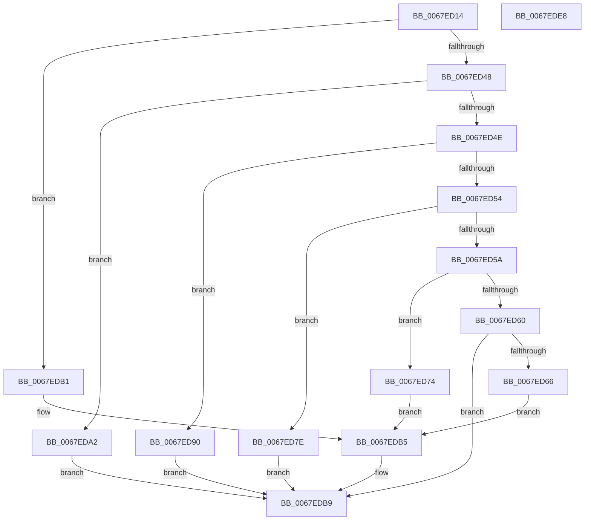

# MiSetTrimWhileAgingState

- RVA: `0x0067ED14`–`0x0067EDE9` (길이 `213` bytes)
- VA: `0x000000014067ED14`
- 실행 섹션: `.text`
- PDB 이름 있음: `예`; PDB Function 태그: `아니요`
- unwind 정보 RVA: `0x00060BC4`
- 디코드: `55`개 명령, `213/213` bytes 표시
- 미해석 바이트: `0` (있으면 어셈블리에 `.byte`로 보존)

> 이 문서는 커널 이미지의 기계어와 PDB 기호를 분석해 생성했습니다. 4번과 5번은 함수 원형과 자료형을 바이너리 사용 방식에서 추정한 C 해석이며 원본 소스 복구 결과는 아닙니다.

## 1. Dependencies

- 직접 호출 지점: **2**; 고유 호출 대상: **2**
- 직접 호출자로 확인된 함수: **2**
- RIP 상대 이미지 참조: **0**

### Outgoing calls
- `0x0067ED37` → [MiLockWorkingSetExclusive](../32/MiLockWorkingSetExclusive_function_003238A0.md) (function, `0x003238A0`)
- `0x0067EDD3` → [MiUnlockWorkingSetExclusive](../27/MiUnlockWorkingSetExclusive_function_0027EC70.md) (function, `0x0027EC70`)

### Direct callers
- [MiInitializeWorkingSetManagerParameters](MiInitializeWorkingSetManagerParameters_function_0067E7F8.md) at `0x0067E9F5`
- [MmSetTrimWhileAgingState](MmSetTrimWhileAgingState_function_0067EF5C.md) at `0x0067EF73`

### Static image references
- 디코드된 RIP-relative 메모리 참조가 없습니다.

## 2. Other-region calls and transfers

- 다른 실행 섹션으로 향하는 call: **0**
- 별도 외부 분기/꼬리 이동을 확인하지 못했습니다.

## 3. Assembly (complete function range)

```asm
0067ED14  48 89 5C 24 08                  mov qword ptr [rsp + 8], rbx
0067ED19  48 89 74 24 10                  mov qword ptr [rsp + 0x10], rsi
0067ED1E  57                              push rdi
0067ED1F  48 83 EC 20                     sub rsp, 0x20
0067ED23  48 8B 99 C0 44 00 00            mov rbx, qword ptr [rcx + 0x44c0]
0067ED2A  48 8D B1 80 49 00 00            lea rsi, [rcx + 0x4980]
0067ED31  48 8B CE                        mov rcx, rsi
0067ED34  48 8B FA                        mov rdi, rdx
0067ED37  E8 64 4B CA FF                  call 0x1403238a0
0067ED3C  44 8B 07                        mov r8d, dword ptr [rdi]
0067ED3F  8A D0                           mov dl, al
0067ED41  33 C0                           xor eax, eax
0067ED43  45 85 C0                        test r8d, r8d
0067ED46  74 69                           je 0x14067edb1
0067ED48  41 83 E8 01                     sub r8d, 1
0067ED4C  74 54                           je 0x14067eda2
0067ED4E  41 83 E8 01                     sub r8d, 1
0067ED52  74 3C                           je 0x14067ed90
0067ED54  41 83 E8 01                     sub r8d, 1
0067ED58  74 24                           je 0x14067ed7e
0067ED5A  41 83 E8 01                     sub r8d, 1
0067ED5E  74 14                           je 0x14067ed74
0067ED60  41 83 F8 01                     cmp r8d, 1
0067ED64  75 53                           jne 0x14067edb9
0067ED66  48 8B 47 08                     mov rax, qword ptr [rdi + 8]
0067ED6A  48 89 43 48                     mov qword ptr [rbx + 0x48], rax
0067ED6E  48 8B 47 10                     mov rax, qword ptr [rdi + 0x10]
0067ED72  EB 41                           jmp 0x14067edb5
0067ED74  48 C7 43 48 00 DC 05 00         mov qword ptr [rbx + 0x48], 0x5dc00
0067ED7C  EB 37                           jmp 0x14067edb5
0067ED7E  48 C7 43 48 00 20 03 00         mov qword ptr [rbx + 0x48], 0x32000
0067ED86  48 C7 43 40 00 32 00 00         mov qword ptr [rbx + 0x40], 0x3200
0067ED8E  EB 29                           jmp 0x14067edb9
0067ED90  48 C7 43 48 00 20 03 00         mov qword ptr [rbx + 0x48], 0x32000
0067ED98  48 C7 43 40 00 C8 00 00         mov qword ptr [rbx + 0x40], 0xc800
0067EDA0  EB 17                           jmp 0x14067edb9
0067EDA2  48 83 4B 40 FF                  or qword ptr [rbx + 0x40], 0xffffffffffffffff
0067EDA7  48 C7 43 48 00 20 03 00         mov qword ptr [rbx + 0x48], 0x32000
0067EDAF  EB 08                           jmp 0x14067edb9
0067EDB1  48 89 43 48                     mov qword ptr [rbx + 0x48], rax
0067EDB5  48 89 43 40                     mov qword ptr [rbx + 0x40], rax
0067EDB9  8B 07                           mov eax, dword ptr [rdi]
0067EDBB  48 8B CE                        mov rcx, rsi
0067EDBE  89 43 50                        mov dword ptr [rbx + 0x50], eax
0067EDC1  8A 47 04                        mov al, byte ptr [rdi + 4]
0067EDC4  88 83 16 01 00 00               mov byte ptr [rbx + 0x116], al
0067EDCA  8A 47 05                        mov al, byte ptr [rdi + 5]
0067EDCD  88 83 17 01 00 00               mov byte ptr [rbx + 0x117], al
0067EDD3  E8 98 FE BF FF                  call 0x14027ec70
0067EDD8  48 8B 5C 24 30                  mov rbx, qword ptr [rsp + 0x30]
0067EDDD  48 8B 74 24 38                  mov rsi, qword ptr [rsp + 0x38]
0067EDE2  48 83 C4 20                     add rsp, 0x20
0067EDE6  5F                              pop rdi
0067EDE7  C3                              ret
0067EDE8  CC                              int3
```

## 4. C-style interpretation (structured pseudocode)

```c
__int64 __fastcall MiSetTrimWhileAgingState(__int64 a1, __int64 a2)
{
    __int64 result;
    __int64 v_rsp;
    unsigned __int64 v_stack_p10;
    unsigned __int64 v_stack_p8;

    v_stack_p8 = v_rbx;
    v_stack_p10 = v_rsi;
    v_rsp = (v_rsp) - (32);
    result = MiLockWorkingSetExclusive(a1 + 18816, a2, a3, a4);
    result = 0;
    if ((unsigned int)((unsigned int)(*(unsigned int *)(a2))) == 0) goto loc_0067EDB1;
    a3 = (unsigned int)(((unsigned int)(*(unsigned int *)(a2))) - (1));
    if (condition_is_equal) goto loc_0067EDA2;
    a3 = (unsigned int)((a3) - (1));
    if (condition_is_equal) goto loc_0067ED90;
    a3 = (unsigned int)((a3) - (1));
    if (condition_is_equal) goto loc_0067ED7E;
    a3 = (unsigned int)((a3) - (1));
    if (condition_is_equal) goto loc_0067ED74;
    if (((unsigned int)(a3)) != 1) goto loc_0067EDB9;
    *(unsigned __int64 *)(*(unsigned __int64 *)(a1 + 17600) + 72) = *(unsigned __int64 *)(a2 + 8);
    goto loc_0067EDB5;
loc_0067ED74:
    *(unsigned __int64 *)(*(unsigned __int64 *)(a1 + 17600) + 72) = 0x5DC00ULL;
    goto loc_0067EDB5;
loc_0067ED7E:
    *(unsigned __int64 *)(*(unsigned __int64 *)(a1 + 17600) + 72) = 0x32000ULL;
    *(unsigned __int64 *)(*(unsigned __int64 *)(a1 + 17600) + 64) = 0x3200ULL;
    goto loc_0067EDB9;
loc_0067ED90:
    *(unsigned __int64 *)(*(unsigned __int64 *)(a1 + 17600) + 72) = 0x32000ULL;
    *(unsigned __int64 *)(*(unsigned __int64 *)(a1 + 17600) + 64) = 0xC800ULL;
    goto loc_0067EDB9;
loc_0067EDA2:
    *(unsigned __int64 *)(*(unsigned __int64 *)(a1 + 17600) + 72) = 0x32000ULL;
    goto loc_0067EDB9;
loc_0067EDB1:
    *(unsigned __int64 *)(*(unsigned __int64 *)(a1 + 17600) + 72) = *(unsigned __int64 *)(a2 + 16);
loc_0067EDB5:
    *(unsigned __int64 *)(*(unsigned __int64 *)(a1 + 17600) + 64) = *(unsigned __int64 *)(a2 + 16);
loc_0067EDB9:
    *(unsigned int *)(*(unsigned __int64 *)(a1 + 17600) + 80) = (unsigned int)((unsigned int)(*(unsigned int *)(a2)));
    *(unsigned __int8 *)(*(unsigned __int64 *)(a1 + 17600) + 278) = (unsigned __int8)(*(unsigned __int8 *)(a2 + 4));
    *(unsigned __int8 *)(*(unsigned __int64 *)(a1 + 17600) + 279) = (unsigned __int8)(*(unsigned __int8 *)(a2 + 5));
    result = MiUnlockWorkingSetExclusive(a1 + 18816, (unsigned __int8)(result), a3, a4);
    v_rsp = (v_rsp) + (32);
    return result;
}
```

## 5. (Beta) C Style

```c
int64_t MiSetTrimWhileAgingState(void *Arg1, void *Arg2)
{
    uint8_t *arg1 = (uint8_t *)Arg1;
    uint8_t *arg2 = (uint8_t *)Arg2;

    int64_t result;
    int64_t local_rsp;
    uint64_t v_stack_p10;
    uint64_t v_stack_p8;

    v_stack_p8 = local_rbx;
    v_stack_p10 = local_rsi;
    local_rsp = (local_rsp) - (32);
    result = MiLockWorkingSetExclusive(Arg1 + 18816, Arg2, a3, a4);
    result = 0;
    if ((uint32_t)((uint32_t)(*(uint32_t *)(arg2))) == 0) goto loc_0067EDB1;
    a3 = (uint32_t)(((uint32_t)(*(uint32_t *)(arg2))) - (1));
    if (condition_is_equal) goto loc_0067EDA2;
    a3 = (uint32_t)((a3) - (1));
    if (condition_is_equal) goto loc_0067ED90;
    a3 = (uint32_t)((a3) - (1));
    if (condition_is_equal) goto loc_0067ED7E;
    a3 = (uint32_t)((a3) - (1));
    if (condition_is_equal) goto loc_0067ED74;
    if (((uint32_t)(a3)) != 1) goto loc_0067EDB9;
    *(uint64_t *)(*(uint64_t *)(arg1 + 0x44C0) + 0x48) = *(uint64_t *)(arg2 + 0x8);
    goto loc_0067EDB5;
loc_0067ED74:
    *(uint64_t *)(*(uint64_t *)(arg1 + 0x44C0) + 0x48) = 0x5DC00ULL;
    goto loc_0067EDB5;
loc_0067ED7E:
    *(uint64_t *)(*(uint64_t *)(arg1 + 0x44C0) + 0x48) = 0x32000ULL;
    *(uint64_t *)(*(uint64_t *)(arg1 + 0x44C0) + 0x40) = 0x3200ULL;
    goto loc_0067EDB9;
loc_0067ED90:
    *(uint64_t *)(*(uint64_t *)(arg1 + 0x44C0) + 0x48) = 0x32000ULL;
    *(uint64_t *)(*(uint64_t *)(arg1 + 0x44C0) + 0x40) = 0xC800ULL;
    goto loc_0067EDB9;
loc_0067EDA2:
    *(uint64_t *)(*(uint64_t *)(arg1 + 0x44C0) + 0x48) = 0x32000ULL;
    goto loc_0067EDB9;
loc_0067EDB1:
    *(uint64_t *)(*(uint64_t *)(arg1 + 0x44C0) + 0x48) = *(uint64_t *)(arg2 + 0x10);
loc_0067EDB5:
    *(uint64_t *)(*(uint64_t *)(arg1 + 0x44C0) + 0x40) = *(uint64_t *)(arg2 + 0x10);
loc_0067EDB9:
    *(uint32_t *)(*(uint64_t *)(arg1 + 0x44C0) + 0x50) = (uint32_t)((uint32_t)(*(uint32_t *)(arg2)));
    *(uint8_t *)(*(uint64_t *)(arg1 + 0x44C0) + 0x116) = (uint8_t)(*(uint8_t *)(arg2 + 0x4));
    *(uint8_t *)(*(uint64_t *)(arg1 + 0x44C0) + 0x117) = (uint8_t)(*(uint8_t *)(arg2 + 0x5));
    result = MiUnlockWorkingSetExclusive(Arg1 + 18816, (uint8_t)(result), a3, a4);
    local_rsp = (local_rsp) + (32);
    return result;
}
```

### 관측된 메모리 오프셋

구조체 형식이 확인되지 않은 접근은 인자 기준의 오프셋으로만 기록했습니다.

| 기준 인자 | 오프셋 표현 | 폭 (bit) | 접근 |
|---|---:|---:|---|
| `Arg1` | `+ 0x44C0` | `64` | `R` |
| `Arg1` | `+ 0x4980` | `64` | `R` |
| `Arg2` | `+ 0x0` | `32` | `R` |
| `Arg2` | `+ 0x4` | `8` | `R` |
| `Arg2` | `+ 0x5` | `8` | `R` |
| `Arg2` | `+ 0x8` | `64` | `R` |
| `Arg2` | `+ 0x10` | `64` | `R` |

## 6. Execution-region graph

[열기: 2D/3D 그래프와 함수 탐색 컨트롤 패널](../../../control-panel.html?section=text&rva=0x0067ED14&view=graph)

- 2D 그래프는 위에서 아래로 흐르고, 3D 그래프는 빈 공간을 드래그해 회전합니다. Shift+드래그는 이동, 휠은 확대·축소, 함수 노드 선택은 대상 보고서 이동입니다.

### Static fallback


