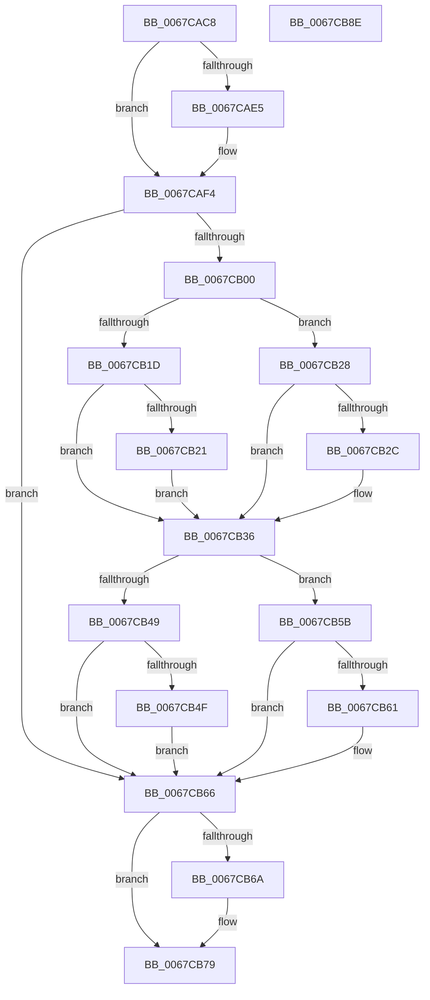

# MiSignalNonPagedPoolWatchers

- RVA: `0x0067CAC8`–`0x0067CB8F` (길이 `199` bytes)
- VA: `0x000000014067CAC8`
- 실행 섹션: `.text`
- PDB 이름 있음: `예`; PDB Function 태그: `아니요`
- unwind 정보 RVA: `0x0005C954`
- 디코드: `55`개 명령, `199/199` bytes 표시
- 미해석 바이트: `0` (있으면 어셈블리에 `.byte`로 보존)

> 이 문서는 커널 이미지의 기계어와 PDB 기호를 분석해 생성했습니다. 4번과 5번은 함수 원형과 자료형을 바이너리 사용 방식에서 추정한 C 해석이며 원본 소스 복구 결과는 아닙니다.

## 1. Dependencies

- 직접 호출 지점: **6**; 고유 호출 대상: **4**
- 직접 호출자로 확인된 함수: **2**
- RIP 상대 이미지 참조: **5**

### Outgoing calls
- `0x0067CAEC` → [ExAcquireSpinLockExclusive](../24/ExAcquireSpinLockExclusive_function_00248690.md) (function, `0x00248690`)
- `0x0067CB21` → [KeResetEvent](../24/KeResetEvent_function_00248350.md) (function, `0x00248350`)
- `0x0067CB31` → [KeSetEvent](../33/KeSetEvent_function_0033F310.md) (function, `0x0033F310`)
- `0x0067CB54` → [KeSetEvent](../33/KeSetEvent_function_0033F310.md) (function, `0x0033F310`)
- `0x0067CB61` → [KeResetEvent](../24/KeResetEvent_function_00248350.md) (function, `0x00248350`)
- `0x0067CB74` → [MiReleaseSpinLockExclusive](../24/MiReleaseSpinLockExclusive_function_002482C0.md) (function, `0x002482C0`)

### Direct callers
- [MiInitializeNonPagedPoolThresholds](MiInitializeNonPagedPoolThresholds_function_0067CA64.md) at `0x0067CAA7`
- [MiInitializeMemoryEvents](../../page/81/MiInitializeMemoryEvents_function_0081123C.md) at `0x00811309`

### Static image references
- `0x0067CAE5` → RVA `0x00E3CC40` (`.data`; read)
- `0x0067CAF4` → RVA `0x00E38E10` (`.data`; read)
- `0x0067CB00` → RVA `0x00E2CB40` (`.data`; read)
- `0x0067CB07` → RVA `0x00E2CB48` (`.data`; read)
- `0x0067CB36` → RVA `0x00E38E08` (`.data`; read)

## 2. Other-region calls and transfers

- 다른 실행 섹션으로 향하는 call: **0**
- 별도 외부 분기/꼬리 이동을 확인하지 못했습니다.

## 3. Assembly (complete function range)

```asm
0067CAC8  48 89 5C 24 08                  mov qword ptr [rsp + 8], rbx
0067CACD  48 89 6C 24 10                  mov qword ptr [rsp + 0x10], rbp
0067CAD2  48 89 74 24 18                  mov qword ptr [rsp + 0x18], rsi
0067CAD7  57                              push rdi
0067CAD8  48 83 EC 20                     sub rsp, 0x20
0067CADC  8B D9                           mov ebx, ecx
0067CADE  40 B7 11                        mov dil, 0x11
0067CAE1  85 C9                           test ecx, ecx
0067CAE3  75 0F                           jne 0x14067caf4
0067CAE5  48 8D 0D 54 01 7C 00            lea rcx, [rip + 0x7c0154]
0067CAEC  E8 9F BB BC FF                  call 0x140248690
0067CAF1  40 8A F8                        mov dil, al
0067CAF4  48 8B 0D 15 C3 7B 00            mov rcx, qword ptr [rip + 0x7bc315]
0067CAFB  48 85 C9                        test rcx, rcx
0067CAFE  74 66                           je 0x14067cb66
0067CB00  48 8B 2D 39 00 7B 00            mov rbp, qword ptr [rip + 0x7b0039]
0067CB07  48 8B 35 3A 00 7B 00            mov rsi, qword ptr [rip + 0x7b003a]
0067CB0E  8B 41 04                        mov eax, dword ptr [rcx + 4]
0067CB11  48 8D 95 00 EC FF FF            lea rdx, [rbp - 0x1400]
0067CB18  48 3B F2                        cmp rsi, rdx
0067CB1B  72 0B                           jb 0x14067cb28
0067CB1D  85 C0                           test eax, eax
0067CB1F  74 15                           je 0x14067cb36
0067CB21  E8 2A B8 BC FF                  call 0x140248350
0067CB26  EB 0E                           jmp 0x14067cb36
0067CB28  85 C0                           test eax, eax
0067CB2A  75 0A                           jne 0x14067cb36
0067CB2C  45 33 C0                        xor r8d, r8d
0067CB2F  33 D2                           xor edx, edx
0067CB31  E8 DA 27 CC FF                  call 0x14033f310
0067CB36  48 8B 0D CB C2 7B 00            mov rcx, qword ptr [rip + 0x7bc2cb]
0067CB3D  48 8D 85 00 F8 FF FF            lea rax, [rbp - 0x800]
0067CB44  48 3B F0                        cmp rsi, rax
0067CB47  72 12                           jb 0x14067cb5b
0067CB49  83 79 04 00                     cmp dword ptr [rcx + 4], 0
0067CB4D  75 17                           jne 0x14067cb66
0067CB4F  45 33 C0                        xor r8d, r8d
0067CB52  33 D2                           xor edx, edx
0067CB54  E8 B7 27 CC FF                  call 0x14033f310
0067CB59  EB 0B                           jmp 0x14067cb66
0067CB5B  83 79 04 00                     cmp dword ptr [rcx + 4], 0
0067CB5F  74 05                           je 0x14067cb66
0067CB61  E8 EA B7 BC FF                  call 0x140248350
0067CB66  85 DB                           test ebx, ebx
0067CB68  75 0F                           jne 0x14067cb79
0067CB6A  40 8A D7                        mov dl, dil
0067CB6D  48 8D 0D CC 00 7C 00            lea rcx, [rip + 0x7c00cc]
0067CB74  E8 47 B7 BC FF                  call 0x1402482c0
0067CB79  48 8B 5C 24 30                  mov rbx, qword ptr [rsp + 0x30]
0067CB7E  48 8B 6C 24 38                  mov rbp, qword ptr [rsp + 0x38]
0067CB83  48 8B 74 24 40                  mov rsi, qword ptr [rsp + 0x40]
0067CB88  48 83 C4 20                     add rsp, 0x20
0067CB8C  5F                              pop rdi
0067CB8D  C3                              ret
0067CB8E  CC                              int3
```

## 4. C-style interpretation (structured pseudocode)

```c
__int64 __fastcall MiSignalNonPagedPoolWatchers(int a1, __int64 a2, int a3)
{
    __int64 result;
    __int64 v_rdi;
    __int64 v_rsp;
    unsigned __int64 v_stack_p10;
    unsigned __int64 v_stack_p18;
    unsigned __int64 v_stack_p8;

    v_stack_p8 = v_rbx;
    v_stack_p10 = v_rbp;
    v_stack_p18 = v_rsi;
    v_rsp = (v_rsp) - (32);
    v_rdi = 17;
    if (a1 == 0) {
        a1 = v_rip + 8126804;
        result = ExAcquireSpinLockExclusive(a1, a2, a3, a4);
        v_rdi = (unsigned __int8)(result);
    }
    if (*(unsigned __int64 *)(v_rip + 8110869) == 0) goto loc_0067CB66;
    if ((*(unsigned __int64 *)(v_rip + 8060986)) < (*(unsigned __int64 *)(v_rip + 8060985) - 5120)) goto loc_0067CB28;
    if ((unsigned int)((unsigned int)(*(unsigned int *)(*(unsigned __int64 *)(v_rip + 8110869) + 4))) == 0) goto loc_0067CB36;
    result = KeResetEvent(*(unsigned __int64 *)(v_rip + 8110869), *(unsigned __int64 *)(v_rip + 8060985) - 5120, a3, a4);
    goto loc_0067CB36;
loc_0067CB28:
    if ((unsigned int)(result) == 0) {
        a3 = 0;
        a2 = 0;
        result = KeSetEvent(*(unsigned __int64 *)(v_rip + 8110869), a2, a3, a4);
    }
    if ((*(unsigned __int64 *)(v_rip + 8060986)) < (*(unsigned __int64 *)(v_rip + 8060985) - 2048)) goto loc_0067CB5B;
    if ((*(unsigned int *)(*(unsigned __int64 *)(v_rip + 8110795) + 4)) != 0) goto loc_0067CB66;
    a3 = 0;
    a2 = 0;
    result = KeSetEvent(*(unsigned __int64 *)(v_rip + 8110795), a2, a3, a4);
    goto loc_0067CB66;
loc_0067CB5B:
    if ((*(unsigned int *)(*(unsigned __int64 *)(v_rip + 8110795) + 4)) != 0) {
        result = KeResetEvent(*(unsigned __int64 *)(v_rip + 8110795), a2, a3, a4);
    }
    if ((unsigned int)((unsigned int)(a1)) == 0) {
        a2 = (unsigned __int8)(v_rdi);
        a1 = v_rip + 8126668;
        result = MiReleaseSpinLockExclusive(a1, a2, a3, a4);
    }
    v_rsp = (v_rsp) + (32);
    return result;
}
```

## 5. (Beta) C Style

```c
int64_t MiSignalNonPagedPoolWatchers(int32_t Arg1, int64_t Arg2, int32_t Arg3)
{
    int64_t result;
    int64_t local_rdi;
    int64_t local_rsp;
    uint64_t v_stack_p10;
    uint64_t v_stack_p18;
    uint64_t v_stack_p8;

    v_stack_p8 = local_rbx;
    v_stack_p10 = local_rbp;
    v_stack_p18 = local_rsi;
    local_rsp = (local_rsp) - (32);
    local_rdi = 17;
    if (Arg1 == 0) {
        Arg1 = v_rip + 8126804;
        result = ExAcquireSpinLockExclusive(Arg1, Arg2, Arg3, a4);
        local_rdi = (uint8_t)(result);
    }
    if (*(uint64_t *)(v_rip + 0x7BC315) == 0) goto loc_0067CB66;
    if ((*(uint64_t *)(v_rip + 0x7B003A)) < (*(uint64_t *)(v_rip + 0x7B0039) - 5120)) goto loc_0067CB28;
    if ((uint32_t)((uint32_t)(*(uint32_t *)(*(uint64_t *)(v_rip + 0x7BC315) + 0x4))) == 0) goto loc_0067CB36;
    result = KeResetEvent(*(uint64_t *)(v_rip + 0x7BC315), *(uint64_t *)(v_rip + 0x7B0039) - 5120, Arg3, a4);
    goto loc_0067CB36;
loc_0067CB28:
    if ((uint32_t)(result) == 0) {
        Arg3 = 0;
        Arg2 = 0;
        result = KeSetEvent(*(uint64_t *)(v_rip + 0x7BC315), Arg2, Arg3, a4);
    }
    if ((*(uint64_t *)(v_rip + 0x7B003A)) < (*(uint64_t *)(v_rip + 0x7B0039) - 2048)) goto loc_0067CB5B;
    if ((*(uint32_t *)(*(uint64_t *)(v_rip + 0x7BC2CB) + 0x4)) != 0) goto loc_0067CB66;
    Arg3 = 0;
    Arg2 = 0;
    result = KeSetEvent(*(uint64_t *)(v_rip + 0x7BC2CB), Arg2, Arg3, a4);
    goto loc_0067CB66;
loc_0067CB5B:
    if ((*(uint32_t *)(*(uint64_t *)(v_rip + 0x7BC2CB) + 0x4)) != 0) {
        result = KeResetEvent(*(uint64_t *)(v_rip + 0x7BC2CB), Arg2, Arg3, a4);
    }
    if ((uint32_t)((uint32_t)(Arg1)) == 0) {
        Arg2 = (uint8_t)(local_rdi);
        Arg1 = v_rip + 8126668;
        result = MiReleaseSpinLockExclusive(Arg1, Arg2, Arg3, a4);
    }
    local_rsp = (local_rsp) + (32);
    return result;
}
```

## 6. Execution-region graph

[열기: 2D/3D 그래프와 함수 탐색 컨트롤 패널](../../../control-panel.html?section=text&rva=0x0067CAC8&view=graph)

- 2D 그래프는 위에서 아래로 흐르고, 3D 그래프는 빈 공간을 드래그해 회전합니다. Shift+드래그는 이동, 휠은 확대·축소, 함수 노드 선택은 대상 보고서 이동입니다.

### Static fallback


