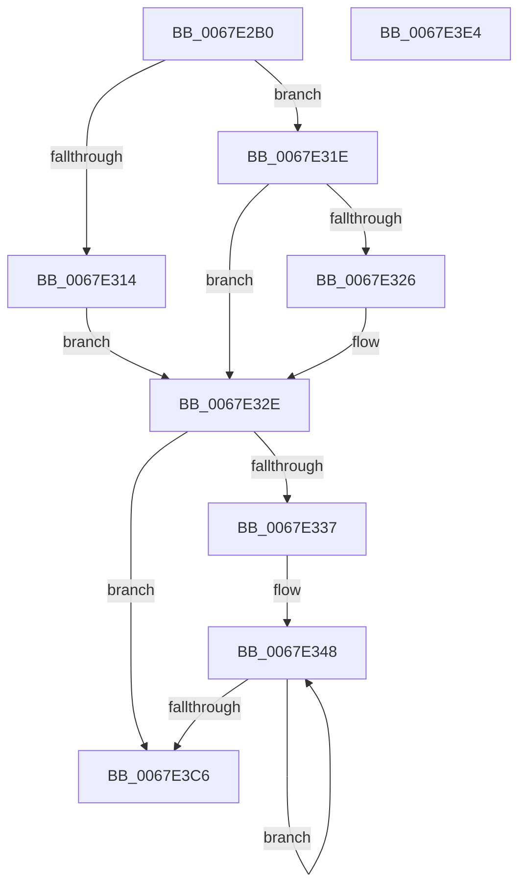

# MiSlowRotateCopy

- RVA: `0x0067E2B0`–`0x0067E3E5` (길이 `309` bytes)
- VA: `0x000000014067E2B0`
- 실행 섹션: `.text`
- PDB 이름 있음: `예`; PDB Function 태그: `아니요`
- unwind 정보 RVA: `0x0007BBB4`
- 디코드: `87`개 명령, `309/309` bytes 표시
- 미해석 바이트: `0` (있으면 어셈블리에 `.byte`로 보존)

> 이 문서는 커널 이미지의 기계어와 PDB 기호를 분석해 생성했습니다. 4번과 5번은 함수 원형과 자료형을 바이너리 사용 방식에서 추정한 C 해석이며 원본 소스 복구 결과는 아닙니다.

## 1. Dependencies

- 직접 호출 지점: **5**; 고유 호출 대상: **4**
- 직접 호출자로 확인된 함수: **2**
- RIP 상대 이미지 참조: **1**

### Outgoing calls
- `0x0067E355` → [MiGetPteMappingSet](../32/MiGetPteMappingSet_function_00322EB0.md) (function, `0x00322EB0`)
- `0x0067E36D` → [MiInitializeSlowPte](MiInitializeSlowPte_function_0067E1F8.md) (function, `0x0067E1F8`)
- `0x0067E37C` → [MiInitializeSlowPte](MiInitializeSlowPte_function_0067E1F8.md) (function, `0x0067E1F8`)
- `0x0067E3A0` → [KeCopyPage](../6B/KeCopyPage_function_006BA0F0.md) (function, `0x006BA0F0`)
- `0x0067E3B7` → [MiReturnPteMappingSet](../2B/MiReturnPteMappingSet_function_002B2600.md) (function, `0x002B2600`)

### Direct callers
- [MiRotateToFrameBuffer](../../page/A3/MiRotateToFrameBuffer_function_00A38214.md) at `0x00A384FC`
- [MiReplaceRotateWithDemandZero](../../page/A7/MiReplaceRotateWithDemandZero_function_00A7C010.md) at `0x00A7C288`

### Static image references
- `0x0067E3A5` → RVA `0x00010880` (`.rdata`; read)

## 2. Other-region calls and transfers

- 다른 실행 섹션으로 향하는 call: **0**
- 별도 외부 분기/꼬리 이동을 확인하지 못했습니다.

## 3. Assembly (complete function range)

```asm
0067E2B0  4C 8B DC                        mov r11, rsp
0067E2B3  49 89 5B 10                     mov qword ptr [r11 + 0x10], rbx
0067E2B7  49 89 6B 18                     mov qword ptr [r11 + 0x18], rbp
0067E2BB  49 89 73 20                     mov qword ptr [r11 + 0x20], rsi
0067E2BF  57                              push rdi
0067E2C0  41 54                           push r12
0067E2C2  41 55                           push r13
0067E2C4  41 56                           push r14
0067E2C6  41 57                           push r15
0067E2C8  48 83 EC 40                     sub rsp, 0x40
0067E2CC  44 8B 7A 28                     mov r15d, dword ptr [rdx + 0x28]
0067E2D0  4C 8D 6A 30                     lea r13, [rdx + 0x30]
0067E2D4  33 C0                           xor eax, eax
0067E2D6  49 C1 EF 0C                     shr r15, 0xc
0067E2DA  4C 8B CA                        mov r9, rdx
0067E2DD  0F 57 C0                        xorps xmm0, xmm0
0067E2E0  0F 11 44 24 20                  movups xmmword ptr [rsp + 0x20], xmm0
0067E2E5  49 89 43 C8                     mov qword ptr [r11 - 0x38], rax
0067E2E9  4C 8B E1                        mov r12, rcx
0067E2EC  8D 68 04                        lea ebp, [rax + 4]
0067E2EF  44 8D 70 01                     lea r14d, [rax + 1]
0067E2F3  41 8B 40 30                     mov eax, dword ptr [r8 + 0x30]
0067E2F7  8B D0                           mov edx, eax
0067E2F9  41 B8 00 0C 00 00               mov r8d, 0xc00
0067E2FF  41 23 D0                        and edx, r8d
0067E302  A9 80 03 00 00                  test eax, 0x380
0067E307  0F 95 C1                        setne cl
0067E30A  41 3B D0                        cmp edx, r8d
0067E30D  0F 94 C0                        sete al
0067E310  84 C8                           test al, cl
0067E312  74 0A                           je 0x14067e31e
0067E314  41 8D 6E 1B                     lea ebp, [r14 + 0x1b]
0067E318  44 8D 75 E6                     lea r14d, [rbp - 0x1a]
0067E31C  EB 10                           jmp 0x14067e32e
0067E31E  81 FA 00 04 00 00               cmp edx, 0x400
0067E324  75 08                           jne 0x14067e32e
0067E326  BD 0C 00 00 00                  mov ebp, 0xc
0067E32B  45 33 F6                        xor r14d, r14d
0067E32E  4D 85 FF                        test r15, r15
0067E331  0F 84 8F 00 00 00               je 0x14067e3c6
0067E337  48 BE 00 00 00 00 80 F6 FF FF   movabs rsi, 0xfffff68000000000
0067E341  48 C1 E6 19                     shl rsi, 0x19
0067E345  4D 2B E1                        sub r12, r9
0067E348  BA 02 00 00 00                  mov edx, 2
0067E34D  4C 8D 44 24 20                  lea r8, [rsp + 0x20]
0067E352  8D 4A FF                        lea ecx, [rdx - 1]
0067E355  E8 56 4B CA FF                  call 0x140322eb0
0067E35A  48 8B 5C 24 30                  mov rbx, qword ptr [rsp + 0x30]
0067E35F  44 8B C5                        mov r8d, ebp
0067E362  49 8B 55 00                     mov rdx, qword ptr [r13]
0067E366  48 8B CB                        mov rcx, rbx
0067E369  48 8D 7B 08                     lea rdi, [rbx + 8]
0067E36D  E8 86 FE FF FF                  call 0x14067e1f8
0067E372  4B 8B 14 2C                     mov rdx, qword ptr [r12 + r13]
0067E376  44 8B C5                        mov r8d, ebp
0067E379  48 8B CF                        mov rcx, rdi
0067E37C  E8 77 FE FF FF                  call 0x14067e1f8
0067E381  48 8B D3                        mov rdx, rbx
0067E384  48 8B CF                        mov rcx, rdi
0067E387  48 C1 E2 19                     shl rdx, 0x19
0067E38B  45 8B C6                        mov r8d, r14d
0067E38E  48 C1 E1 19                     shl rcx, 0x19
0067E392  48 2B D6                        sub rdx, rsi
0067E395  48 2B CE                        sub rcx, rsi
0067E398  48 C1 FA 10                     sar rdx, 0x10
0067E39C  48 C1 F9 10                     sar rcx, 0x10
0067E3A0  E8 4B BD 03 00                  call 0x1406ba0f0
0067E3A5  48 8B 05 D4 24 99 FF            mov rax, qword ptr [rip - 0x66db2c]
0067E3AC  48 8D 4C 24 20                  lea rcx, [rsp + 0x20]
0067E3B1  48 89 03                        mov qword ptr [rbx], rax
0067E3B4  48 89 07                        mov qword ptr [rdi], rax
0067E3B7  E8 44 42 C3 FF                  call 0x1402b2600
0067E3BC  4D 8D 6D 08                     lea r13, [r13 + 8]
0067E3C0  49 83 EF 01                     sub r15, 1
0067E3C4  75 82                           jne 0x14067e348
0067E3C6  4C 8D 5C 24 40                  lea r11, [rsp + 0x40]
0067E3CB  49 8B 5B 38                     mov rbx, qword ptr [r11 + 0x38]
0067E3CF  49 8B 6B 40                     mov rbp, qword ptr [r11 + 0x40]
0067E3D3  49 8B 73 48                     mov rsi, qword ptr [r11 + 0x48]
0067E3D7  49 8B E3                        mov rsp, r11
0067E3DA  41 5F                           pop r15
0067E3DC  41 5E                           pop r14
0067E3DE  41 5D                           pop r13
0067E3E0  41 5C                           pop r12
0067E3E2  5F                              pop rdi
0067E3E3  C3                              ret
0067E3E4  CC                              int3
```

## 4. C-style interpretation (structured pseudocode)

```c
__int64 __fastcall MiSlowRotateCopy(__int64 a1, __int64 a2, __int64 a3)
{
    __int64 result;
    __int64 v_r12;
    __int64 v_r14;
    __int64 v_r15;
    __int64 v_rbp;
    __int64 v_rsi;
    __int64 v_rsp;
    unsigned __int64 v_stack_m28;
    unsigned __int64 v_stack_m38;
    unsigned __int64 v_stack_m48;

    *(unsigned __int64 *)(v_rsp + 16) = v_rbx;
    *(unsigned __int64 *)(v_rsp + 24) = v_rbp;
    *(unsigned __int64 *)(v_rsp + 32) = v_rsi;
    v_rsp = (v_rsp) - (64);
    result = 0;
    v_r15 = ((unsigned int)(*(unsigned int *)(a2 + 40))) >> (12);
    v_stack_m48 = v_xmm0;
    *(unsigned __int64 *)(v_rsp - 56) = 0;
    a2 = (unsigned int)(((unsigned int)((unsigned int)((unsigned int)(*(unsigned int *)(a3 + 48))))) & ((unsigned int)((unsigned int)(0xC00ULL))));
    a1 = ((((unsigned int)((unsigned int)(*(unsigned int *)(a3 + 48)))) & (896)) != 0) ? 1 : 0;
    result = (((unsigned int)(a2)) == ((unsigned int)((unsigned int)(0xC00ULL)))) ? 1 : 0;
    if ((((unsigned __int8)(result)) & ((unsigned __int8)(a1))) == 0) goto loc_0067E31E;
    goto loc_0067E32E;
loc_0067E31E:
    v_rbp = result + 1 + 27;
    v_r14 = result + 1 + 27 - 26;
    if (((unsigned int)(a2)) == 0x400ULL) {
        v_rbp = 12;
        v_r14 = 0;
    }
    if (v_r15 == 0) goto loc_0067E3C6;
    v_rsi = (v_rsi) << (25);
    v_r12 = (a1) - (a2);
loc_0067E348:
    result = MiGetPteMappingSet(2 - 1, 2, v_stack_m48, a2);
    result = MiInitializeSlowPte(v_stack_m38, *(unsigned __int64 *)(a2 + 48), (unsigned int)((unsigned int)(v_rbp)), a2);
    result = MiInitializeSlowPte(v_stack_m38 + 8, *(unsigned __int64 *)(v_r12 + a2 + 48 * 1), (unsigned int)((unsigned int)(v_rbp)), a2);
    a2 = (v_stack_m38) << (25);
    a1 = (v_stack_m38 + 8) << (25);
    a2 = (a2) - (v_rsi);
    a1 = (a1) - (v_rsi);
    a2 = (a2) >> (16);
    a1 = (a1) >> (16);
    result = KeCopyPage(a1, a2, 0, a2);
    *(unsigned __int64 *)(v_stack_m38) = *(unsigned __int64 *)(v_rip - 6740780);
    *(unsigned __int64 *)(v_stack_m38 + 8) = *(unsigned __int64 *)(v_rip - 6740780);
    result = MiReturnPteMappingSet(v_stack_m48, a2, 0, a2);
    v_r15 = (v_r15) - (1);
    if (condition_is_not_equal) goto loc_0067E348;
loc_0067E3C6:
    return result;
}
```

## 5. (Beta) C Style

```c
int64_t MiSlowRotateCopy(void *Arg1, void *Arg2, void *Arg3)
{
    uint8_t *arg1 = (uint8_t *)Arg1;
    uint8_t *arg2 = (uint8_t *)Arg2;
    uint8_t *arg3 = (uint8_t *)Arg3;

    int64_t result;
    int64_t local_r12;
    int64_t local_r14;
    int64_t local_r15;
    int64_t local_rbp;
    int64_t local_rsi;
    int64_t local_rsp;
    uint64_t v_stack_m28;
    uint64_t v_stack_m38;
    uint64_t v_stack_m48;

    *(uint64_t *)(local_rsp + 0x10) = local_rbx;
    *(uint64_t *)(local_rsp + 0x18) = local_rbp;
    *(uint64_t *)(local_rsp + 0x20) = local_rsi;
    local_rsp = (local_rsp) - (64);
    result = 0;
    local_r15 = ((uint32_t)(*(uint32_t *)(arg2 + 0x28))) >> (12);
    v_stack_m48 = v_xmm0;
    *(uint64_t *)(local_rsp - 0x38) = 0;
    Arg2 = (uint32_t)(((uint32_t)((uint32_t)((uint32_t)(*(uint32_t *)(arg3 + 0x30))))) & ((uint32_t)((uint32_t)(0xC00ULL))));
    Arg1 = ((((uint32_t)((uint32_t)(*(uint32_t *)(arg3 + 0x30)))) & (896)) != 0) ? 1 : 0;
    result = (((uint32_t)(Arg2)) == ((uint32_t)((uint32_t)(0xC00ULL)))) ? 1 : 0;
    if ((((uint8_t)(result)) & ((uint8_t)(Arg1))) == 0) goto loc_0067E31E;
    goto loc_0067E32E;
loc_0067E31E:
    local_rbp = result + 1 + 27;
    local_r14 = result + 1 + 27 - 26;
    if (((uint32_t)(Arg2)) == 0x400ULL) {
        local_rbp = 12;
        local_r14 = 0;
    }
    if (local_r15 == 0) goto loc_0067E3C6;
    local_rsi = (local_rsi) << (25);
    local_r12 = (Arg1) - (Arg2);
loc_0067E348:
    result = MiGetPteMappingSet(2 - 1, 2, v_stack_m48, Arg2);
    result = MiInitializeSlowPte(v_stack_m38, *(uint64_t *)(arg2 + 0x30), (uint32_t)((uint32_t)(local_rbp)), Arg2);
    result = MiInitializeSlowPte(v_stack_m38 + 8, *(uint64_t *)(local_r12 + arg2 + 0x30 * 1), (uint32_t)((uint32_t)(local_rbp)), Arg2);
    Arg2 = (v_stack_m38) << (25);
    Arg1 = (v_stack_m38 + 8) << (25);
    Arg2 = (Arg2) - (local_rsi);
    Arg1 = (Arg1) - (local_rsi);
    Arg2 = (Arg2) >> (16);
    Arg1 = (Arg1) >> (16);
    result = KeCopyPage(Arg1, Arg2, 0, Arg2);
    *(uint64_t *)(v_stack_m38) = *(uint64_t *)(v_rip - 0x66DB2C);
    *(uint64_t *)(v_stack_m38 + 0x8) = *(uint64_t *)(v_rip - 0x66DB2C);
    result = MiReturnPteMappingSet(v_stack_m48, Arg2, 0, Arg2);
    local_r15 = (local_r15) - (1);
    if (condition_is_not_equal) goto loc_0067E348;
loc_0067E3C6:
    return result;
}
```

### 관측된 메모리 오프셋

구조체 형식이 확인되지 않은 접근은 인자 기준의 오프셋으로만 기록했습니다.

| 기준 인자 | 오프셋 표현 | 폭 (bit) | 접근 |
|---|---:|---:|---|
| `Arg1` | `+ 0x0 + r13*1` | `64` | `R` |
| `Arg2` | `+ 0x0` | `64` | `R` |
| `Arg2` | `+ 0x8` | `64` | `R` |
| `Arg2` | `+ 0x28` | `32` | `R` |
| `Arg2` | `+ 0x30` | `64` | `R` |
| `Arg3` | `+ 0x30` | `32` | `R` |

## 6. Execution-region graph

[열기: 2D/3D 그래프와 함수 탐색 컨트롤 패널](../../../control-panel.html?section=text&rva=0x0067E2B0&view=graph)

- 2D 그래프는 위에서 아래로 흐르고, 3D 그래프는 빈 공간을 드래그해 회전합니다. Shift+드래그는 이동, 휠은 확대·축소, 함수 노드 선택은 대상 보고서 이동입니다.

### Static fallback


