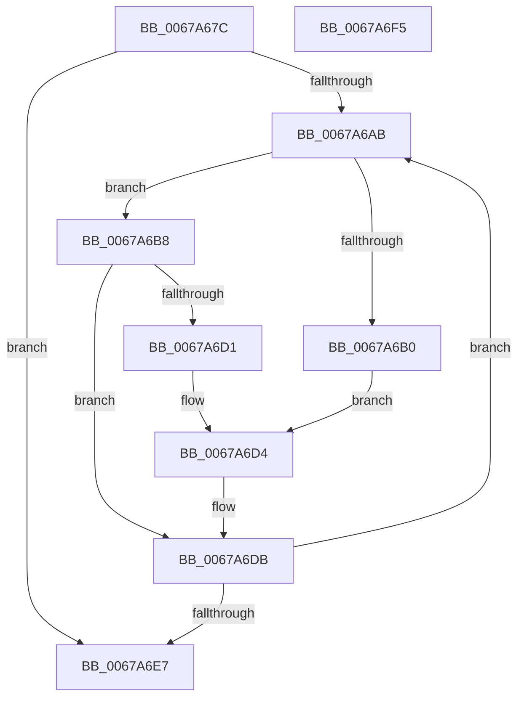

# MiSortPageFramesRemoveDuplicates

- RVA: `0x0067A67C`–`0x0067A6F6` (길이 `122` bytes)
- VA: `0x000000014067A67C`
- 실행 섹션: `.text`
- PDB 이름 있음: `예`; PDB Function 태그: `아니요`
- unwind 정보 RVA: `0x0005CAAC`
- 디코드: `37`개 명령, `122/122` bytes 표시
- 미해석 바이트: `0` (있으면 어셈블리에 `.byte`로 보존)

> 이 문서는 커널 이미지의 기계어와 PDB 기호를 분석해 생성했습니다. 4번과 5번은 함수 원형과 자료형을 바이너리 사용 방식에서 추정한 C 해석이며 원본 소스 복구 결과는 아닙니다.

## 1. Dependencies

- 직접 호출 지점: **1**; 고유 호출 대상: **1**
- 직접 호출자로 확인된 함수: **2**
- RIP 상대 이미지 참조: **1**

### Outgoing calls
- `0x0067A699` → [qsort](../50/qsort_function_005009F0.md) (function, `0x005009F0`)

### Direct callers
- [MiGetListOfPendingBadPages](MiGetListOfPendingBadPages_function_006799D0.md) at `0x00679D17`
- [MmEnumerateBadPages](../../page/7F/MmEnumerateBadPages_function_007FDE28.md) at `0x007FDFF4`

### Static image references
- `0x0067A686` → RVA `0x00679520` (`MiBadPageSort`; read)

## 2. Other-region calls and transfers

- 다른 실행 섹션으로 향하는 call: **0**
- 별도 외부 분기/꼬리 이동을 확인하지 못했습니다.

## 3. Assembly (complete function range)

```asm
0067A67C  48 89 5C 24 08                  mov qword ptr [rsp + 8], rbx
0067A681  57                              push rdi
0067A682  48 83 EC 20                     sub rsp, 0x20
0067A686  4C 8D 0D 93 EE FF FF            lea r9, [rip - 0x116d]
0067A68D  41 B8 08 00 00 00               mov r8d, 8
0067A693  48 8B FA                        mov rdi, rdx
0067A696  48 8B D9                        mov rbx, rcx
0067A699  E8 52 63 E8 FF                  call 0x1405009f0
0067A69E  33 C9                           xor ecx, ecx
0067A6A0  45 33 C0                        xor r8d, r8d
0067A6A3  4C 8B CB                        mov r9, rbx
0067A6A6  48 85 FF                        test rdi, rdi
0067A6A9  74 3C                           je 0x14067a6e7
0067A6AB  4D 85 C0                        test r8, r8
0067A6AE  75 08                           jne 0x14067a6b8
0067A6B0  49 8B 01                        mov rax, qword ptr [r9]
0067A6B3  48 89 03                        mov qword ptr [rbx], rax
0067A6B6  EB 1C                           jmp 0x14067a6d4
0067A6B8  49 8B 11                        mov rdx, qword ptr [r9]
0067A6BB  49 BA FF FF FF FF FF FF 0F 00   movabs r10, 0xfffffffffffff
0067A6C5  48 8B C2                        mov rax, rdx
0067A6C8  48 33 43 F8                     xor rax, qword ptr [rbx - 8]
0067A6CC  49 85 C2                        test r10, rax
0067A6CF  74 0A                           je 0x14067a6db
0067A6D1  48 89 13                        mov qword ptr [rbx], rdx
0067A6D4  48 83 C3 08                     add rbx, 8
0067A6D8  48 FF C1                        inc rcx
0067A6DB  49 83 C1 08                     add r9, 8
0067A6DF  49 FF C0                        inc r8
0067A6E2  4C 3B C7                        cmp r8, rdi
0067A6E5  72 C4                           jb 0x14067a6ab
0067A6E7  48 8B 5C 24 30                  mov rbx, qword ptr [rsp + 0x30]
0067A6EC  48 8B C1                        mov rax, rcx
0067A6EF  48 83 C4 20                     add rsp, 0x20
0067A6F3  5F                              pop rdi
0067A6F4  C3                              ret
0067A6F5  CC                              int3
```

## 4. C-style interpretation (structured pseudocode)

```c
__int64 __fastcall MiSortPageFramesRemoveDuplicates(__int64 a1, __int64 a2)
{
    __int64 result;
    __int64 v_rbx;
    __int64 v_rsp;
    unsigned __int64 v_stack_p8;

    v_stack_p8 = v_rbx;
    v_rsp = (v_rsp) - (32);
    result = qsort(a1, a2, 8, v_rip - 4461);
    a1 = 0;
    a3 = 0;
    if (a2 == 0) goto loc_0067A6E7;
loc_0067A6AB:
    if (0 != 0) goto loc_0067A6B8;
    *(unsigned __int64 *)(a1) = *(unsigned __int64 *)(0);
    goto loc_0067A6D4;
loc_0067A6B8:
    result = (*(unsigned __int64 *)(0)) ^ (*(unsigned __int64 *)(a1 - 8));
    if (((v_r10) & (result)) == 0) goto loc_0067A6DB;
    *(unsigned __int64 *)(a1) = *(unsigned __int64 *)(0);
loc_0067A6D4:
    v_rbx = (a1) + (8);
    a1 = (a1) + 1;
loc_0067A6DB:
    a4 = (0) + (8);
    a3 = (a3) + 1;
    if (a3 < a2) goto loc_0067A6AB;
loc_0067A6E7:
    v_rsp = (v_rsp) + (32);
    return a1;
}
```

## 5. (Beta) C Style

```c
void *MiSortPageFramesRemoveDuplicates(void *Arg1, int64_t Arg2)
{
    uint8_t *arg1 = (uint8_t *)Arg1;

    int64_t result;
    int64_t local_rbx;
    int64_t local_rsp;
    uint64_t v_stack_p8;

    v_stack_p8 = local_rbx;
    local_rsp = (local_rsp) - (32);
    result = qsort(Arg1, Arg2, 8, v_rip - 4461);
    Arg1 = 0;
    a3 = 0;
    if (Arg2 == 0) goto loc_0067A6E7;
loc_0067A6AB:
    if (0 != 0) goto loc_0067A6B8;
    *(uint64_t *)(arg1) = *(uint64_t *)(0);
    goto loc_0067A6D4;
loc_0067A6B8:
    result = (*(uint64_t *)(0)) ^ (*(uint64_t *)(arg1 - 0x8));
    if (((local_r10) & (result)) == 0) goto loc_0067A6DB;
    *(uint64_t *)(arg1) = *(uint64_t *)(0);
loc_0067A6D4:
    local_rbx = (Arg1) + (8);
    Arg1 = (Arg1) + 1;
loc_0067A6DB:
    a4 = (0) + (8);
    a3 = (a3) + 1;
    if (a3 < Arg2) goto loc_0067A6AB;
loc_0067A6E7:
    local_rsp = (local_rsp) + (32);
    return Arg1;
}
```

### 관측된 메모리 오프셋

구조체 형식이 확인되지 않은 접근은 인자 기준의 오프셋으로만 기록했습니다.

| 기준 인자 | 오프셋 표현 | 폭 (bit) | 접근 |
|---|---:|---:|---|
| `Arg1` | `- 0x8` | `64` | `R` |
| `Arg1` | `+ 0x0` | `64` | `R` |
| `Arg1` | `+ 0x0` | `64` | `W` |

## 6. Execution-region graph

[열기: 2D/3D 그래프와 함수 탐색 컨트롤 패널](../../../control-panel.html?section=text&rva=0x0067A67C&view=graph)

- 2D 그래프는 위에서 아래로 흐르고, 3D 그래프는 빈 공간을 드래그해 회전합니다. Shift+드래그는 이동, 휠은 확대·축소, 함수 노드 선택은 대상 보고서 이동입니다.

### Static fallback


