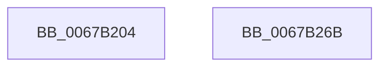

# MiStackCopyHighLevel

- RVA: `0x0067B204`–`0x0067B26C` (길이 `104` bytes)
- VA: `0x000000014067B204`
- 실행 섹션: `.text`
- PDB 이름 있음: `예`; PDB Function 태그: `아니요`
- unwind 정보 RVA: `0x0005CAAC`
- 디코드: `29`개 명령, `104/104` bytes 표시
- 미해석 바이트: `0` (있으면 어셈블리에 `.byte`로 보존)

> 이 문서는 커널 이미지의 기계어와 PDB 기호를 분석해 생성했습니다. 4번과 5번은 함수 원형과 자료형을 바이너리 사용 방식에서 추정한 C 해석이며 원본 소스 복구 결과는 아닙니다.

## 1. Dependencies

- 직접 호출 지점: **3**; 고유 호출 대상: **3**
- 직접 호출자로 확인된 함수: **1**
- RIP 상대 이미지 참조: **0**

### Outgoing calls
- `0x0067B248` → [MiCopyKstack](MiCopyKstack_function_0067B058.md) (function, `0x0067B058`)
- `0x0067B253` → [MiSwitchKstackPages](MiSwitchKstackPages_function_0067B464.md) (function, `0x0067B464`)
- `0x0067B25B` → [MiClearPfnReuseFields](../37/MiClearPfnReuseFields_function_003759F0.md) (function, `0x003759F0`)

### Direct callers
- [MiWritePteHighLevelIsr](../4C/MiWritePteHighLevelIsr_function_004C2FC0.md) at `0x004C3103`

### Static image references
- 디코드된 RIP-relative 메모리 참조가 없습니다.

## 2. Other-region calls and transfers

- 다른 실행 섹션으로 향하는 call: **0**
- 별도 외부 분기/꼬리 이동을 확인하지 못했습니다.

## 3. Assembly (complete function range)

```asm
0067B204  48 89 5C 24 08                  mov qword ptr [rsp + 8], rbx
0067B209  57                              push rdi
0067B20A  48 83 EC 20                     sub rsp, 0x20
0067B20E  48 8B 41 08                     mov rax, qword ptr [rcx + 8]
0067B212  48 BA 00 00 00 00 00 DE FF FF   movabs rdx, 0xffffde0000000000
0067B21C  48 8D 3C 40                     lea rdi, [rax + rax*2]
0067B220  48 C1 E7 04                     shl rdi, 4
0067B224  48 8B C2                        mov rax, rdx
0067B227  48 03 F8                        add rdi, rax
0067B22A  48 8B 01                        mov rax, qword ptr [rcx]
0067B22D  48 8D 1C 40                     lea rbx, [rax + rax*2]
0067B231  48 C1 E3 04                     shl rbx, 4
0067B235  48 8B C2                        mov rax, rdx
0067B238  4C 8B 41 10                     mov r8, qword ptr [rcx + 0x10]
0067B23C  48 03 D8                        add rbx, rax
0067B23F  48 8B D3                        mov rdx, rbx
0067B242  45 33 C9                        xor r9d, r9d
0067B245  48 8B CF                        mov rcx, rdi
0067B248  E8 0B FE FF FF                  call 0x14067b058
0067B24D  48 8B D3                        mov rdx, rbx
0067B250  48 8B CF                        mov rcx, rdi
0067B253  E8 0C 02 00 00                  call 0x14067b464
0067B258  48 8B CB                        mov rcx, rbx
0067B25B  E8 90 A7 CF FF                  call 0x1403759f0
0067B260  48 8B 5C 24 30                  mov rbx, qword ptr [rsp + 0x30]
0067B265  48 83 C4 20                     add rsp, 0x20
0067B269  5F                              pop rdi
0067B26A  C3                              ret
0067B26B  CC                              int3
```

## 4. C-style interpretation (structured pseudocode)

```c
__int64 __fastcall MiStackCopyHighLevel(__int64 a1, __int64 a2, __int64 a3, int a4)
{
    __int64 result;
    __int64 v_rbx;
    __int64 v_rdi;
    __int64 v_rsp;
    unsigned __int64 v_stack_p8;

    v_stack_p8 = v_rbx;
    v_rsp = (v_rsp) - (32);
    v_rdi = (*(unsigned __int64 *)(a1 + 8) + *(unsigned __int64 *)(a1 + 8) * 2) << (4);
    v_rdi = (v_rdi) + (a2);
    v_rbx = (*(unsigned __int64 *)(a1) + *(unsigned __int64 *)(a1) * 2) << (4);
    v_rbx = (v_rbx) + (a2);
    a4 = 0;
    result = MiCopyKstack(v_rdi, v_rbx, *(unsigned __int64 *)(a1 + 16), a4);
    result = MiSwitchKstackPages(v_rdi, v_rbx, *(unsigned __int64 *)(a1 + 16), a4);
    result = MiClearPfnReuseFields(v_rbx, v_rbx, *(unsigned __int64 *)(a1 + 16), a4);
    v_rsp = (v_rsp) + (32);
    return result;
}
```

## 5. (Beta) C Style

```c
int64_t MiStackCopyHighLevel(void *Arg1, int64_t Arg2, int64_t Arg3, int32_t Arg4)
{
    uint8_t *arg1 = (uint8_t *)Arg1;

    int64_t result;
    int64_t local_rbx;
    int64_t local_rdi;
    int64_t local_rsp;
    uint64_t v_stack_p8;

    v_stack_p8 = local_rbx;
    local_rsp = (local_rsp) - (32);
    local_rdi = (*(uint64_t *)(arg1 + 0x8) + *(uint64_t *)(arg1 + 0x8) * 2) << (4);
    local_rdi = (local_rdi) + (Arg2);
    local_rbx = (*(uint64_t *)(arg1) + *(uint64_t *)(arg1) * 2) << (4);
    local_rbx = (local_rbx) + (Arg2);
    Arg4 = 0;
    result = MiCopyKstack(local_rdi, local_rbx, *(uint64_t *)(arg1 + 0x10), Arg4);
    result = MiSwitchKstackPages(local_rdi, local_rbx, *(uint64_t *)(arg1 + 0x10), Arg4);
    result = MiClearPfnReuseFields(local_rbx, local_rbx, *(uint64_t *)(arg1 + 0x10), Arg4);
    local_rsp = (local_rsp) + (32);
    return result;
}
```

### 관측된 메모리 오프셋

구조체 형식이 확인되지 않은 접근은 인자 기준의 오프셋으로만 기록했습니다.

| 기준 인자 | 오프셋 표현 | 폭 (bit) | 접근 |
|---|---:|---:|---|
| `Arg1` | `+ 0x0` | `64` | `R` |
| `Arg1` | `+ 0x8` | `64` | `R` |
| `Arg1` | `+ 0x10` | `64` | `R` |

## 6. Execution-region graph

[열기: 2D/3D 그래프와 함수 탐색 컨트롤 패널](../../../control-panel.html?section=text&rva=0x0067B204&view=graph)

- 2D 그래프는 위에서 아래로 흐르고, 3D 그래프는 빈 공간을 드래그해 회전합니다. Shift+드래그는 이동, 휠은 확대·축소, 함수 노드 선택은 대상 보고서 이동입니다.

### Static fallback


