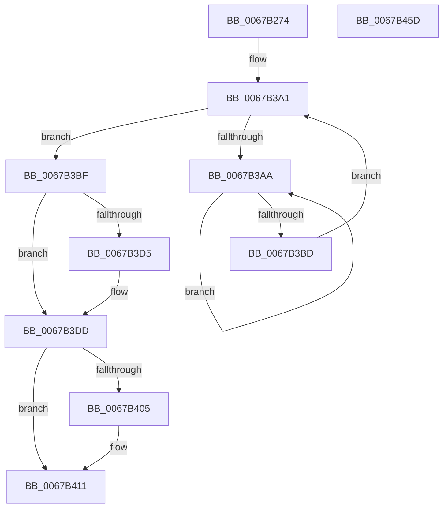

# MiStackTheftFreezeProcessors

- RVA: `0x0067B274`–`0x0067B45E` (길이 `490` bytes)
- VA: `0x000000014067B274`
- 실행 섹션: `.text`
- PDB 이름 있음: `예`; PDB Function 태그: `아니요`
- unwind 정보 RVA: `0x000D7E34`
- 디코드: `111`개 명령, `490/490` bytes 표시
- 미해석 바이트: `0` (있으면 어셈블리에 `.byte`로 보존)

> 이 문서는 커널 이미지의 기계어와 PDB 기호를 분석해 생성했습니다. 4번과 5번은 함수 원형과 자료형을 바이너리 사용 방식에서 추정한 C 해석이며 원본 소스 복구 결과는 아닙니다.

## 1. Dependencies

- 직접 호출 지점: **11**; 고유 호출 대상: **11**
- 직접 호출자로 확인된 함수: **1**
- RIP 상대 이미지 참조: **4**

### Outgoing calls
- `0x0067B2AD` → [memset](../6C/memset_function_006C6C40.md) (function, `0x006C6C40`)
- `0x0067B2C1` → [MiMapPageInHyperSpaceWorker](../33/MiMapPageInHyperSpaceWorker_function_00332B10.md) (function, `0x00332B10`)
- `0x0067B34E` → [MiVaToFlushVm](../31/MiVaToFlushVm_function_0031AD84.md) (function, `0x0031AD84`)
- `0x0067B36D` → [MiInitializeTbFlushList](../29/MiInitializeTbFlushList_function_00294F00.md) (function, `0x00294F00`)
- `0x0067B382` → [MiInsertTbFlushEntry](../29/MiInsertTbFlushEntry_function_00293670.md) (function, `0x00293670`)
- `0x0067B3AF` → [KeYieldProcessorEx](../3F/KeYieldProcessorEx_function_003FBD00.md) (function, `0x003FBD00`)
- `0x0067B3D8` → [KiRaiseIrqlProcessIrqlFlags](../4F/KiRaiseIrqlProcessIrqlFlags_function_004F56FC.md) (function, `0x004F56FC`)
- `0x0067B3F7` → [KeIpiGenericCall](../47/KeIpiGenericCall_function_00471720.md) (function, `0x00471720`)
- `0x0067B40C` → [KiLowerIrqlProcessIrqlFlags](../4F/KiLowerIrqlProcessIrqlFlags_function_004F5698.md) (function, `0x004F5698`)
- `0x0067B433` → [MiUnmapPageInHyperSpaceWorker](../43/MiUnmapPageInHyperSpaceWorker_function_00432800.md) (function, `0x00432800`)
- `0x0067B43F` → [_security_check_cookie](../6A/_security_check_cookie_function_006AC640.md) (function, `0x006AC640`)

### Direct callers
- [sub_006F60F8](../6F/Unknown_function_006F60F8.md) at `0x006F62D5`

### Static image references
- `0x0067B28F` → RVA `0x00E0A740` (`.data`; read)
- `0x0067B3CC` → RVA `0x00FC6D20` (`ALMOSTRO`; read)
- `0x0067B3DD` → RVA `0x00FC6A80` (`ALMOSTRO`; read)
- `0x0067B3E8` → RVA `0x004C2FC0` (`MiWritePteHighLevelIsr`; read)

## 2. Other-region calls and transfers

- 다른 실행 섹션으로 향하는 call: **0**
- 별도 외부 분기/꼬리 이동을 확인하지 못했습니다.

## 3. Assembly (complete function range)

```asm
0067B274  48 8B C4                        mov rax, rsp
0067B277  48 89 58 10                     mov qword ptr [rax + 0x10], rbx
0067B27B  48 89 70 18                     mov qword ptr [rax + 0x18], rsi
0067B27F  48 89 78 20                     mov qword ptr [rax + 0x20], rdi
0067B283  55                              push rbp
0067B284  48 8D 68 B8                     lea rbp, [rax - 0x48]
0067B288  48 81 EC 40 01 00 00            sub rsp, 0x140
0067B28F  48 8B 05 AA F4 78 00            mov rax, qword ptr [rip + 0x78f4aa]
0067B296  48 33 C4                        xor rax, rsp
0067B299  48 89 45 30                     mov qword ptr [rbp + 0x30], rax
0067B29D  48 8B F9                        mov rdi, rcx
0067B2A0  33 D2                           xor edx, edx
0067B2A2  48 8D 4C 24 54                  lea rcx, [rsp + 0x54]
0067B2A7  41 B8 D4 00 00 00               mov r8d, 0xd4
0067B2AD  E8 8E B9 04 00                  call 0x1406c6c40
0067B2B2  48 8B 5F 08                     mov rbx, qword ptr [rdi + 8]
0067B2B6  33 D2                           xor edx, edx
0067B2B8  48 8B CB                        mov rcx, rbx
0067B2BB  41 B8 00 00 00 80               mov r8d, 0x80000000
0067B2C1  E8 4A 78 CB FF                  call 0x140332b10
0067B2C6  48 8B C8                        mov rcx, rax
0067B2C9  48 8B F0                        mov rsi, rax
0067B2CC  48 C1 E9 09                     shr rcx, 9
0067B2D0  48 B8 F8 FF FF FF 7F 00 00 00   movabs rax, 0x7ffffffff8
0067B2DA  48 23 C8                        and rcx, rax
0067B2DD  48 B8 00 00 00 00 80 F6 FF FF   movabs rax, 0xfffff68000000000
0067B2E7  48 03 C8                        add rcx, rax
0067B2EA  48 89 4F 10                     mov qword ptr [rdi + 0x10], rcx
0067B2EE  48 8B 0F                        mov rcx, qword ptr [rdi]
0067B2F1  48 8D 14 49                     lea rdx, [rcx + rcx*2]
0067B2F5  48 03 D2                        add rdx, rdx
0067B2F8  48 B8 08 00 00 00 00 DE FF FF   movabs rax, 0xffffde0000000008
0067B302  48 8B 0C D0                     mov rcx, qword ptr [rax + rdx*8]
0067B306  48 B8 00 00 00 00 00 00 00 80   movabs rax, 0x8000000000000000
0067B310  48 0B C8                        or rcx, rax
0067B313  48 8B 01                        mov rax, qword ptr [rcx]
0067B316  83 64 24 50 00                  and dword ptr [rsp + 0x50], 0
0067B31B  48 89 4C 24 40                  mov qword ptr [rsp + 0x40], rcx
0067B320  48 8B CB                        mov rcx, rbx
0067B323  48 C1 E1 0C                     shl rcx, 0xc
0067B327  48 8B D1                        mov rdx, rcx
0067B32A  48 89 7D 28                     mov qword ptr [rbp + 0x28], rdi
0067B32E  48 33 D0                        xor rdx, rax
0067B331  48 B8 FF 0F 00 00 00 00 F0 FF   movabs rax, 0xfff0000000000fff
0067B33B  48 23 D0                        and rdx, rax
0067B33E  48 33 D1                        xor rdx, rcx
0067B341  48 8B 4F 28                     mov rcx, qword ptr [rdi + 0x28]
0067B345  48 83 CA 20                     or rdx, 0x20
0067B349  48 89 54 24 48                  mov qword ptr [rsp + 0x48], rdx
0067B34E  E8 31 FA C9 FF                  call 0x14031ad84
0067B353  41 B9 09 00 00 00               mov r9d, 9
0067B359  C7 44 24 20 54 00 00 00         mov dword ptr [rsp + 0x20], 0x54
0067B361  48 8B D0                        mov rdx, rax
0067B364  48 8D 4C 24 60                  lea rcx, [rsp + 0x60]
0067B369  45 8D 41 0B                     lea r8d, [r9 + 0xb]
0067B36D  E8 8E 9B C1 FF                  call 0x140294f00
0067B372  48 8B 57 28                     mov rdx, qword ptr [rdi + 0x28]
0067B376  48 8D 4C 24 60                  lea rcx, [rsp + 0x60]
0067B37B  45 33 C9                        xor r9d, r9d
0067B37E  45 8D 41 01                     lea r8d, [r9 + 1]
0067B382  E8 E9 82 C1 FF                  call 0x140293670
0067B387  48 8D 1C 5B                     lea rbx, [rbx + rbx*2]
0067B38B  48 C1 E3 04                     shl rbx, 4
0067B38F  48 B8 00 00 00 00 00 DE FF FF   movabs rax, 0xffffde0000000000
0067B399  48 03 D8                        add rbx, rax
0067B39C  83 64 24 30 00                  and dword ptr [rsp + 0x30], 0
0067B3A1  F0 48 0F BA 6B 18 3F            lock bts qword ptr [rbx + 0x18], 0x3f
0067B3A8  73 15                           jae 0x14067b3bf
0067B3AA  48 8D 4C 24 30                  lea rcx, [rsp + 0x30]
0067B3AF  E8 4C 09 D8 FF                  call 0x1403fbd00
0067B3B4  48 8B 43 18                     mov rax, qword ptr [rbx + 0x18]
0067B3B8  48 85 C0                        test rax, rax
0067B3BB  78 ED                           js 0x14067b3aa
0067B3BD  EB E2                           jmp 0x14067b3a1
0067B3BF  44 0F 20 C7                     mov rdi, cr8
0067B3C3  BA 0C 00 00 00                  mov edx, 0xc
0067B3C8  44 0F 22 C2                     mov cr8, rdx
0067B3CC  83 3D 4D B9 94 00 00            cmp dword ptr [rip + 0x94b94d], 0
0067B3D3  74 08                           je 0x14067b3dd
0067B3D5  40 8A CF                        mov cl, dil
0067B3D8  E8 1F A3 E7 FF                  call 0x1404f56fc
0067B3DD  8B 05 9D B6 94 00               mov eax, dword ptr [rip + 0x94b69d]
0067B3E3  48 8D 54 24 40                  lea rdx, [rsp + 0x40]
0067B3E8  48 8D 0D D1 7B E4 FF            lea rcx, [rip - 0x1b842f]
0067B3EF  89 44 24 58                     mov dword ptr [rsp + 0x58], eax
0067B3F3  89 44 24 54                     mov dword ptr [rsp + 0x54], eax
0067B3F7  E8 24 63 DF FF                  call 0x140471720
0067B3FC  83 3D 1D B9 94 00 00            cmp dword ptr [rip + 0x94b91d], 0
0067B403  74 0C                           je 0x14067b411
0067B405  44 0F 20 C1                     mov rcx, cr8
0067B409  40 8A D7                        mov dl, dil
0067B40C  E8 87 A2 E7 FF                  call 0x1404f5698
0067B411  40 0F B6 C7                     movzx eax, dil
0067B415  44 0F 22 C0                     mov cr8, rax
0067B419  48 B8 FF FF FF FF FF FF FF 7F   movabs rax, 0x7fffffffffffffff
0067B423  F0 48 21 43 18                  lock and qword ptr [rbx + 0x18], rax
0067B428  41 B8 00 00 00 80               mov r8d, 0x80000000
0067B42E  B2 11                           mov dl, 0x11
0067B430  48 8B CE                        mov rcx, rsi
0067B433  E8 C8 73 DB FF                  call 0x140432800
0067B438  48 8B 4D 30                     mov rcx, qword ptr [rbp + 0x30]
0067B43C  48 33 CC                        xor rcx, rsp
0067B43F  E8 FC 11 03 00                  call 0x1406ac640
0067B444  4C 8D 9C 24 40 01 00 00         lea r11, [rsp + 0x140]
0067B44C  49 8B 5B 18                     mov rbx, qword ptr [r11 + 0x18]
0067B450  49 8B 73 20                     mov rsi, qword ptr [r11 + 0x20]
0067B454  49 8B 7B 28                     mov rdi, qword ptr [r11 + 0x28]
0067B458  49 8B E3                        mov rsp, r11
0067B45B  5D                              pop rbp
0067B45C  C3                              ret
0067B45D  CC                              int3
```

## 4. C-style interpretation (structured pseudocode)

```c
__int64 __fastcall MiStackTheftFreezeProcessors(__int64 a1, int a2)
{
    __int64 result;
    __int64 v_rbx;
    __int64 v_rsp;
    unsigned __int64 v_stack_m100;
    unsigned __int64 v_stack_m108;
    unsigned int v_stack_m118;
    unsigned int v_stack_m128;
    unsigned __int64 v_stack_m8;
    unsigned __int64 v_stack_mE8;
    unsigned int v_stack_mF0;
    unsigned __int64 v_stack_mF4;
    unsigned int v_stack_mF8;

    *(unsigned __int64 *)(v_rsp + 16) = v_rbx;
    *(unsigned __int64 *)(v_rsp + 24) = v_rsi;
    *(unsigned __int64 *)(v_rsp + 32) = v_rdi;
    v_rsp = (v_rsp) - (320);
    result = (*(unsigned __int64 *)(v_rip + 7926954)) ^ (v_rsp);
    *(unsigned __int64 *)(v_rsp - 72 + 48) = result;
    a2 = 0;
    result = memset(v_stack_mF4, a2, 212, a4);
    a2 = 0;
    result = MiMapPageInHyperSpaceWorker(*(unsigned __int64 *)(a1 + 8), a2, (unsigned int)(0x80000000ULL), a4);
    a1 = (result) >> (9);
    a1 = (a1) & (result);
    a1 = (a1) + (result);
    *(unsigned __int64 *)(a1 + 16) = a1;
    a2 = (*(unsigned __int64 *)(a1) + *(unsigned __int64 *)(a1) * 2) + (*(unsigned __int64 *)(a1) + *(unsigned __int64 *)(a1) * 2);
    a1 = (*(unsigned __int64 *)(result + a2 * 8)) | (result);
    v_stack_m108 = a1;
    a1 = (*(unsigned __int64 *)(a1 + 8)) << (12);
    *(unsigned __int64 *)(v_rsp - 72 + 40) = a1;
    a2 = (a1) ^ (*(unsigned __int64 *)(a1));
    a2 = (a2) & (*(unsigned __int64 *)(a1));
    a2 = (a2) ^ (a1);
    a2 = (a2) | (32);
    v_stack_m100 = a2;
    result = MiVaToFlushVm(*(unsigned __int64 *)(a1 + 40), a2, (unsigned int)(0x80000000ULL), a4);
    v_stack_m128 = 84;
    result = MiInitializeTbFlushList(v_stack_mE8, result, 9 + 11, 9);
    a4 = 0;
    result = MiInsertTbFlushEntry(v_stack_mE8, *(unsigned __int64 *)(a1 + 40), a4 + 1, a4);
    v_rbx = (*(unsigned __int64 *)(a1 + 8) + *(unsigned __int64 *)(a1 + 8) * 2) << (4);
    v_rbx = (v_rbx) + (result);
loc_0067B3A1:
    if (condition_is_above_or_equal) goto loc_0067B3BF;
loc_0067B3AA:
    result = KeYieldProcessorEx(v_stack_m118, *(unsigned __int64 *)(a1 + 40), a4 + 1, a4);
    if (sign_flag) goto loc_0067B3AA;
    goto loc_0067B3A1;
loc_0067B3BF:
    result = *(unsigned __int64 *)(v_rbx + 24);
    if ((*(unsigned int *)(v_rip + 9746765)) != 0) {
        a1 = (unsigned __int8)(v_cr8);
        result = KiRaiseIrqlProcessIrqlFlags(a1, 12, a4 + 1, a4);
    }
    v_stack_mF0 = (unsigned int)((unsigned int)(*(unsigned int *)(v_rip + 9746077)));
    v_stack_mF4 = (unsigned int)((unsigned int)(*(unsigned int *)(v_rip + 9746077)));
    result = KeIpiGenericCall(v_rip - 1803311, v_stack_m108, a4 + 1, a4);
    if ((*(unsigned int *)(v_rip + 9746717)) != 0) {
        a1 = 12;
        a2 = (unsigned __int8)(v_cr8);
        result = KiLowerIrqlProcessIrqlFlags(a1, a2, a4 + 1, a4);
    }
    result = MiUnmapPageInHyperSpaceWorker(result, 17, (unsigned int)(0x80000000ULL), a4);
    a1 = (*(unsigned __int64 *)(v_rsp - 72 + 48)) ^ (v_rsp);
    result = _security_check_cookie(a1, 17, (unsigned int)(0x80000000ULL), a4);
    return result;
}
```

## 5. (Beta) C Style

```c
int64_t MiStackTheftFreezeProcessors(void *Arg1, int32_t Arg2)
{
    uint8_t *arg1 = (uint8_t *)Arg1;

    int64_t result;
    int64_t local_rbx;
    int64_t local_rsp;
    uint64_t v_stack_m100;
    uint64_t v_stack_m108;
    uint32_t v_stack_m118;
    uint32_t v_stack_m128;
    uint64_t v_stack_m8;
    uint64_t v_stack_mE8;
    uint32_t v_stack_mF0;
    uint64_t v_stack_mF4;
    uint32_t v_stack_mF8;

    *(uint64_t *)(local_rsp + 0x10) = local_rbx;
    *(uint64_t *)(local_rsp + 0x18) = local_rsi;
    *(uint64_t *)(local_rsp + 0x20) = local_rdi;
    local_rsp = (local_rsp) - (320);
    result = (*(uint64_t *)(v_rip + 0x78F4AA)) ^ (local_rsp);
    *(uint64_t *)(local_rsp - 0x48 + 0x30) = result;
    Arg2 = 0;
    result = memset(v_stack_mF4, Arg2, 212, a4);
    Arg2 = 0;
    result = MiMapPageInHyperSpaceWorker(*(uint64_t *)(arg1 + 0x8), Arg2, (uint32_t)(0x80000000ULL), a4);
    Arg1 = (result) >> (9);
    Arg1 = (Arg1) & (result);
    Arg1 = (Arg1) + (result);
    *(void **)(arg1 + 0x10) = Arg1;
    Arg2 = (*(uint64_t *)(arg1) + *(uint64_t *)(arg1) * 2) + (*(uint64_t *)(arg1) + *(uint64_t *)(arg1) * 2);
    Arg1 = (*(uint64_t *)(result + Arg2 * 8)) | (result);
    v_stack_m108 = Arg1;
    Arg1 = (*(uint64_t *)(arg1 + 0x8)) << (12);
    *(void **)(local_rsp - 0x48 + 0x28) = Arg1;
    Arg2 = (Arg1) ^ (*(uint64_t *)(arg1));
    Arg2 = (Arg2) & (*(uint64_t *)(arg1));
    Arg2 = (Arg2) ^ (Arg1);
    Arg2 = (Arg2) | (32);
    v_stack_m100 = Arg2;
    result = MiVaToFlushVm(*(uint64_t *)(arg1 + 0x28), Arg2, (uint32_t)(0x80000000ULL), a4);
    v_stack_m128 = 84;
    result = MiInitializeTbFlushList(v_stack_mE8, result, 9 + 11, 9);
    a4 = 0;
    result = MiInsertTbFlushEntry(v_stack_mE8, *(uint64_t *)(arg1 + 0x28), a4 + 1, a4);
    local_rbx = (*(uint64_t *)(arg1 + 0x8) + *(uint64_t *)(arg1 + 0x8) * 2) << (4);
    local_rbx = (local_rbx) + (result);
loc_0067B3A1:
    if (condition_is_above_or_equal) goto loc_0067B3BF;
loc_0067B3AA:
    result = KeYieldProcessorEx(v_stack_m118, *(uint64_t *)(arg1 + 0x28), a4 + 1, a4);
    if (sign_flag) goto loc_0067B3AA;
    goto loc_0067B3A1;
loc_0067B3BF:
    result = *(uint64_t *)(local_rbx + 0x18);
    if ((*(uint32_t *)(v_rip + 0x94B94D)) != 0) {
        Arg1 = (uint8_t)(v_cr8);
        result = KiRaiseIrqlProcessIrqlFlags(Arg1, 12, a4 + 1, a4);
    }
    v_stack_mF0 = (uint32_t)((uint32_t)(*(uint32_t *)(v_rip + 0x94B69D)));
    v_stack_mF4 = (uint32_t)((uint32_t)(*(uint32_t *)(v_rip + 0x94B69D)));
    result = KeIpiGenericCall(v_rip - 1803311, v_stack_m108, a4 + 1, a4);
    if ((*(uint32_t *)(v_rip + 0x94B91D)) != 0) {
        Arg1 = 12;
        Arg2 = (uint8_t)(v_cr8);
        result = KiLowerIrqlProcessIrqlFlags(Arg1, Arg2, a4 + 1, a4);
    }
    result = MiUnmapPageInHyperSpaceWorker(result, 17, (uint32_t)(0x80000000ULL), a4);
    Arg1 = (*(uint64_t *)(local_rsp - 0x48 + 0x30)) ^ (local_rsp);
    result = _security_check_cookie(Arg1, 17, (uint32_t)(0x80000000ULL), a4);
    return result;
}
```

### 관측된 메모리 오프셋

구조체 형식이 확인되지 않은 접근은 인자 기준의 오프셋으로만 기록했습니다.

| 기준 인자 | 오프셋 표현 | 폭 (bit) | 접근 |
|---|---:|---:|---|
| `Arg1` | `+ 0x0` | `64` | `R` |
| `Arg1` | `+ 0x8` | `64` | `R` |
| `Arg1` | `+ 0x10` | `64` | `W` |
| `Arg1` | `+ 0x28` | `64` | `R` |

## 6. Execution-region graph

[열기: 2D/3D 그래프와 함수 탐색 컨트롤 패널](../../../control-panel.html?section=text&rva=0x0067B274&view=graph)

- 2D 그래프는 위에서 아래로 흐르고, 3D 그래프는 빈 공간을 드래그해 회전합니다. Shift+드래그는 이동, 휠은 확대·축소, 함수 노드 선택은 대상 보고서 이동입니다.

### Static fallback


