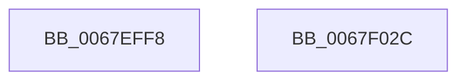

# MiSubsectionNeedsExtents

- RVA: `0x0067EFF8`–`0x0067F02D` (길이 `53` bytes)
- VA: `0x000000014067EFF8`
- 실행 섹션: `.text`
- PDB 이름 있음: `예`; PDB Function 태그: `아니요`
- unwind 정보 RVA: `0x0005CAAC`
- 디코드: `16`개 명령, `53/53` bytes 표시
- 미해석 바이트: `0` (있으면 어셈블리에 `.byte`로 보존)

> 이 문서는 커널 이미지의 기계어와 PDB 기호를 분석해 생성했습니다. 4번과 5번은 함수 원형과 자료형을 바이너리 사용 방식에서 추정한 C 해석이며 원본 소스 복구 결과는 아닙니다.

## 1. Dependencies

- 직접 호출 지점: **2**; 고유 호출 대상: **2**
- 직접 호출자로 확인된 함수: **2**
- RIP 상대 이미지 참조: **0**

### Outgoing calls
- `0x0067F00C` → [ExAcquireSpinLockExclusive](../24/ExAcquireSpinLockExclusive_function_00248690.md) (function, `0x00248690`)
- `0x0067F01C` → [MiReleaseSpinLockExclusive](../24/MiReleaseSpinLockExclusive_function_002482C0.md) (function, `0x002482C0`)

### Direct callers
- [MmExtendSection](../../page/98/MmExtendSection_function_00982C38.md) at `0x00982FB9`
- [MiExtendSection](../../page/98/MiExtendSection_function_00982FDC.md) at `0x0098336E`

### Static image references
- 디코드된 RIP-relative 메모리 참조가 없습니다.

## 2. Other-region calls and transfers

- 다른 실행 섹션으로 향하는 call: **0**
- 별도 외부 분기/꼬리 이동을 확인하지 못했습니다.

## 3. Assembly (complete function range)

```asm
0067EFF8  48 89 5C 24 08                  mov qword ptr [rsp + 8], rbx
0067EFFD  57                              push rdi
0067EFFE  48 83 EC 20                     sub rsp, 0x20
0067F002  48 8B 19                        mov rbx, qword ptr [rcx]
0067F005  48 8B F9                        mov rdi, rcx
0067F008  48 8D 4B 48                     lea rcx, [rbx + 0x48]
0067F00C  E8 7F 96 BC FF                  call 0x140248690
0067F011  0F BA 6F 34 1E                  bts dword ptr [rdi + 0x34], 0x1e
0067F016  48 8D 4B 48                     lea rcx, [rbx + 0x48]
0067F01A  8A D0                           mov dl, al
0067F01C  E8 9F 92 BC FF                  call 0x1402482c0
0067F021  48 8B 5C 24 30                  mov rbx, qword ptr [rsp + 0x30]
0067F026  48 83 C4 20                     add rsp, 0x20
0067F02A  5F                              pop rdi
0067F02B  C3                              ret
0067F02C  CC                              int3
```

## 4. C-style interpretation (structured pseudocode)

```c
__int64 __fastcall MiSubsectionNeedsExtents(__int64 a1)
{
    __int64 result;
    __int64 v_rsp;
    unsigned __int64 v_stack_p8;

    v_stack_p8 = v_rbx;
    v_rsp = (v_rsp) - (32);
    result = ExAcquireSpinLockExclusive(*(unsigned __int64 *)(a1) + 72, a2, a3, a4);
    result = MiReleaseSpinLockExclusive(*(unsigned __int64 *)(a1) + 72, (unsigned __int8)(result), a3, a4);
    v_rsp = (v_rsp) + (32);
    return result;
}
```

## 5. (Beta) C Style

```c
int64_t MiSubsectionNeedsExtents(void *Arg1)
{
    uint8_t *arg1 = (uint8_t *)Arg1;

    int64_t result;
    int64_t local_rsp;
    uint64_t v_stack_p8;

    v_stack_p8 = local_rbx;
    local_rsp = (local_rsp) - (32);
    result = ExAcquireSpinLockExclusive(*(uint64_t *)(arg1) + 72, a2, a3, a4);
    result = MiReleaseSpinLockExclusive(*(uint64_t *)(arg1) + 72, (uint8_t)(result), a3, a4);
    local_rsp = (local_rsp) + (32);
    return result;
}
```

### 관측된 메모리 오프셋

구조체 형식이 확인되지 않은 접근은 인자 기준의 오프셋으로만 기록했습니다.

| 기준 인자 | 오프셋 표현 | 폭 (bit) | 접근 |
|---|---:|---:|---|
| `Arg1` | `+ 0x0` | `64` | `R` |
| `Arg1` | `+ 0x34` | `32` | `R/W` |

## 6. Execution-region graph

[열기: 2D/3D 그래프와 함수 탐색 컨트롤 패널](../../../control-panel.html?section=text&rva=0x0067EFF8&view=graph)

- 2D 그래프는 위에서 아래로 흐르고, 3D 그래프는 빈 공간을 드래그해 회전합니다. Shift+드래그는 이동, 휠은 확대·축소, 함수 노드 선택은 대상 보고서 이동입니다.

### Static fallback


