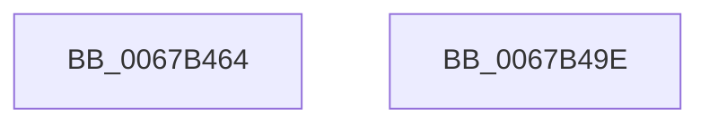

# MiSwitchKstackPages

- RVA: `0x0067B464`–`0x0067B49F` (길이 `59` bytes)
- VA: `0x000000014067B464`
- 실행 섹션: `.text`
- PDB 이름 있음: `예`; PDB Function 태그: `아니요`
- unwind 정보 RVA: `0x0005CF00`
- 디코드: `19`개 명령, `59/59` bytes 표시
- 미해석 바이트: `0` (있으면 어셈블리에 `.byte`로 보존)

> 이 문서는 커널 이미지의 기계어와 PDB 기호를 분석해 생성했습니다. 4번과 5번은 함수 원형과 자료형을 바이너리 사용 방식에서 추정한 C 해석이며 원본 소스 복구 결과는 아닙니다.

## 1. Dependencies

- 직접 호출 지점: **2**; 고유 호출 대상: **2**
- 직접 호출자로 확인된 함수: **2**
- RIP 상대 이미지 참조: **0**

### Outgoing calls
- `0x0067B46D` → [MiCopyPfnEntryEx](../2B/MiCopyPfnEntryEx_function_002B2670.md) (function, `0x002B2670`)
- `0x0067B493` → [MiSetPfnIdentity](../2A/MiSetPfnIdentity_function_002A2350.md) (function, `0x002A2350`)

### Direct callers
- [MiStackCopyHighLevel](MiStackCopyHighLevel_function_0067B204.md) at `0x0067B253`
- [sub_006DAAE6](../6D/Unknown_function_006DAAE6.md) at `0x006DAB80`

### Static image references
- 디코드된 RIP-relative 메모리 참조가 없습니다.

## 2. Other-region calls and transfers

- 다른 실행 섹션으로 향하는 call: **0**
- 별도 외부 분기/꼬리 이동을 확인하지 못했습니다.

## 3. Assembly (complete function range)

```asm
0067B464  40 53                           push rbx
0067B466  48 83 EC 20                     sub rsp, 0x20
0067B46A  48 8B D9                        mov rbx, rcx
0067B46D  E8 FE 71 C3 FF                  call 0x1402b2670
0067B472  8B 43 20                        mov eax, dword ptr [rbx + 0x20]
0067B475  BA 02 00 00 00                  mov edx, 2
0067B47A  89 44 24 30                     mov dword ptr [rsp + 0x30], eax
0067B47E  48 8B CB                        mov rcx, rbx
0067B481  C1 E8 10                        shr eax, 0x10
0067B484  24 FE                           and al, 0xfe
0067B486  0C 06                           or al, 6
0067B488  88 44 24 32                     mov byte ptr [rsp + 0x32], al
0067B48C  8B 44 24 30                     mov eax, dword ptr [rsp + 0x30]
0067B490  89 43 20                        mov dword ptr [rbx + 0x20], eax
0067B493  E8 B8 6E C2 FF                  call 0x1402a2350
0067B498  48 83 C4 20                     add rsp, 0x20
0067B49C  5B                              pop rbx
0067B49D  C3                              ret
0067B49E  CC                              int3
```

## 4. C-style interpretation (structured pseudocode)

```c
__int64 __fastcall MiSwitchKstackPages(__int64 a1)
{
    __int64 result;
    __int64 v_rsp;
    unsigned int v_stack_p8;
    unsigned __int8 v_stack_pA;

    v_rsp = (v_rsp) - (32);
    result = MiCopyPfnEntryEx(a1, a2, a3, a4);
    v_stack_p8 = (unsigned int)((unsigned int)(*(unsigned int *)(a1 + 32)));
    result = (unsigned int)(((unsigned int)(*(unsigned int *)(a1 + 32))) >> (16));
    result = (unsigned __int8)((result) & (254));
    result = (unsigned __int8)((result) | (6));
    v_stack_pA = (unsigned __int8)(result);
    *(unsigned int *)(a1 + 32) = (unsigned int)((unsigned int)(v_stack_p8));
    result = MiSetPfnIdentity(a1, 2, a3, a4);
    v_rsp = (v_rsp) + (32);
    return result;
}
```

## 5. (Beta) C Style

```c
int64_t MiSwitchKstackPages(void *Arg1)
{
    uint8_t *arg1 = (uint8_t *)Arg1;

    int64_t result;
    int64_t local_rsp;
    uint32_t v_stack_p8;
    uint8_t v_stack_pA;

    local_rsp = (local_rsp) - (32);
    result = MiCopyPfnEntryEx(Arg1, a2, a3, a4);
    v_stack_p8 = (uint32_t)((uint32_t)(*(uint32_t *)(arg1 + 0x20)));
    result = (uint32_t)(((uint32_t)(*(uint32_t *)(arg1 + 0x20))) >> (16));
    result = (uint8_t)((result) & (254));
    result = (uint8_t)((result) | (6));
    v_stack_pA = (uint8_t)(result);
    *(uint32_t *)(arg1 + 0x20) = (uint32_t)((uint32_t)(v_stack_p8));
    result = MiSetPfnIdentity(Arg1, 2, a3, a4);
    local_rsp = (local_rsp) + (32);
    return result;
}
```

### 관측된 메모리 오프셋

구조체 형식이 확인되지 않은 접근은 인자 기준의 오프셋으로만 기록했습니다.

| 기준 인자 | 오프셋 표현 | 폭 (bit) | 접근 |
|---|---:|---:|---|
| `Arg1` | `+ 0x20` | `32` | `R` |
| `Arg1` | `+ 0x20` | `32` | `W` |

## 6. Execution-region graph

[열기: 2D/3D 그래프와 함수 탐색 컨트롤 패널](../../../control-panel.html?section=text&rva=0x0067B464&view=graph)

- 2D 그래프는 위에서 아래로 흐르고, 3D 그래프는 빈 공간을 드래그해 회전합니다. Shift+드래그는 이동, 휠은 확대·축소, 함수 노드 선택은 대상 보고서 이동입니다.

### Static fallback


