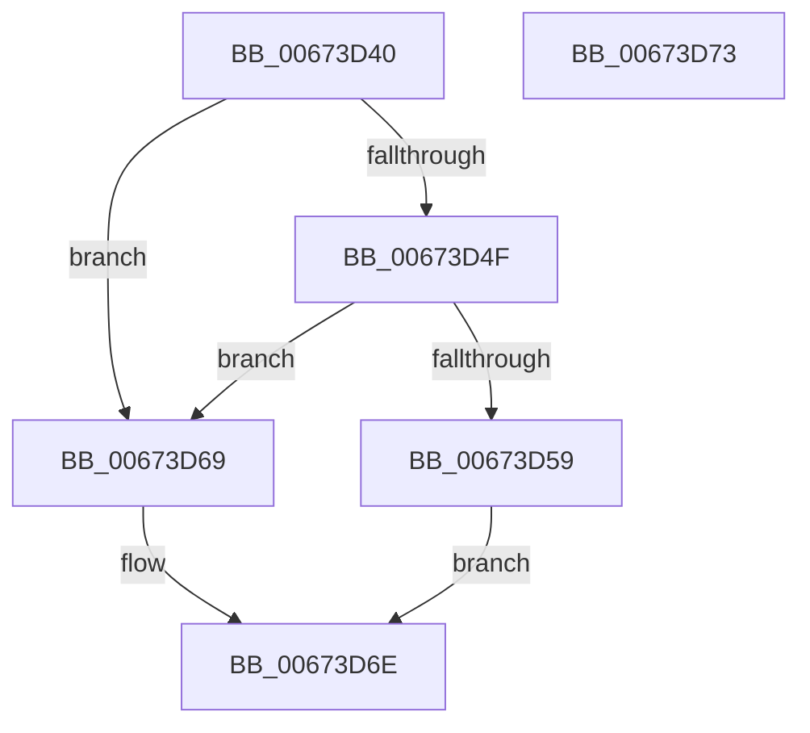

# MiSystemInSingleProcessorMode

- RVA: `0x00673D40`–`0x00673D74` (길이 `52` bytes)
- VA: `0x0000000140673D40`
- 실행 섹션: `.text`
- PDB 이름 있음: `예`; PDB Function 태그: `아니요`
- unwind 정보 RVA: `0x0005C788`
- 디코드: `17`개 명령, `52/52` bytes 표시
- 미해석 바이트: `0` (있으면 어셈블리에 `.byte`로 보존)

> 이 문서는 커널 이미지의 기계어와 PDB 기호를 분석해 생성했습니다. 4번과 5번은 함수 원형과 자료형을 바이너리 사용 방식에서 추정한 C 해석이며 원본 소스 복구 결과는 아닙니다.

## 1. Dependencies

- 직접 호출 지점: **1**; 고유 호출 대상: **1**
- 직접 호출자로 확인된 함수: **2**
- RIP 상대 이미지 참조: **2**

### Outgoing calls
- `0x00673D59` → [MiMirrorInSingleProcessorMode](../3B/MiMirrorInSingleProcessorMode_function_003B47A0.md) (function, `0x003B47A0`)

### Direct callers
- [MmAddRangeToCrashDump](MmAddRangeToCrashDump_function_0067D8B0.md) at `0x0067D92C`
- [MmRemoveSystemCacheFromDump](MmRemoveSystemCacheFromDump_function_0067DD58.md) at `0x0067DDAD`

### Static image references
- `0x00673D44` → RVA `0x00FC6A88` (`ALMOSTRO`; read)
- `0x00673D4F` → RVA `0x00F4754C` (`.data`; read)

## 2. Other-region calls and transfers

- 다른 실행 섹션으로 향하는 call: **0**
- 별도 외부 분기/꼬리 이동을 확인하지 못했습니다.

## 3. Assembly (complete function range)

```asm
00673D40  48 83 EC 28                     sub rsp, 0x28
00673D44  48 8B 05 3D 2D 95 00            mov rax, qword ptr [rip + 0x952d3d]
00673D4B  A8 30                           test al, 0x30
00673D4D  74 1A                           je 0x140673d69
00673D4F  8B 05 F7 37 8D 00               mov eax, dword ptr [rip + 0x8d37f7]
00673D55  A8 03                           test al, 3
00673D57  75 10                           jne 0x140673d69
00673D59  E8 42 0A D4 FF                  call 0x1403b47a0
00673D5E  33 C9                           xor ecx, ecx
00673D60  85 C0                           test eax, eax
00673D62  0F 95 C1                        setne cl
00673D65  8B C1                           mov eax, ecx
00673D67  EB 05                           jmp 0x140673d6e
00673D69  B8 01 00 00 00                  mov eax, 1
00673D6E  48 83 C4 28                     add rsp, 0x28
00673D72  C3                              ret
00673D73  CC                              int3
```

## 4. C-style interpretation (structured pseudocode)

```c
__int64 __fastcall MiSystemInSingleProcessorMode(int a1)
{
    __int64 result;
    __int64 v_rsp;

    v_rsp = (v_rsp) - (40);
    if ((((unsigned __int8)(*(unsigned __int64 *)(v_rip + 9776445))) & (48)) == 0) goto loc_00673D69;
    if ((((unsigned __int8)((unsigned int)(*(unsigned int *)(v_rip + 9254903)))) & (3)) != 0) goto loc_00673D69;
    result = MiMirrorInSingleProcessorMode(a1, a2, a3, a4);
    a1 = 0;
    a1 = ((unsigned int)(result) != 0) ? 1 : 0;
    goto loc_00673D6E;
loc_00673D69:
loc_00673D6E:
    v_rsp = (v_rsp) + (40);
    return 1;
}
```

## 5. (Beta) C Style

```c
int64_t MiSystemInSingleProcessorMode(int32_t Arg1)
{
    int64_t result;
    int64_t local_rsp;

    local_rsp = (local_rsp) - (40);
    if ((((uint8_t)(*(uint64_t *)(v_rip + 0x952D3D))) & (48)) == 0) goto loc_00673D69;
    if ((((uint8_t)((uint32_t)(*(uint32_t *)(v_rip + 0x8D37F7)))) & (3)) != 0) goto loc_00673D69;
    result = MiMirrorInSingleProcessorMode(Arg1, a2, a3, a4);
    Arg1 = 0;
    Arg1 = ((uint32_t)(result) != 0) ? 1 : 0;
    goto loc_00673D6E;
loc_00673D69:
loc_00673D6E:
    local_rsp = (local_rsp) + (40);
    return 1;
}
```

## 6. Execution-region graph

[열기: 2D/3D 그래프와 함수 탐색 컨트롤 패널](../../../control-panel.html?section=text&rva=0x00673D40&view=graph)

- 2D 그래프는 위에서 아래로 흐르고, 3D 그래프는 빈 공간을 드래그해 회전합니다. Shift+드래그는 이동, 휠은 확대·축소, 함수 노드 선택은 대상 보고서 이동입니다.

### Static fallback


