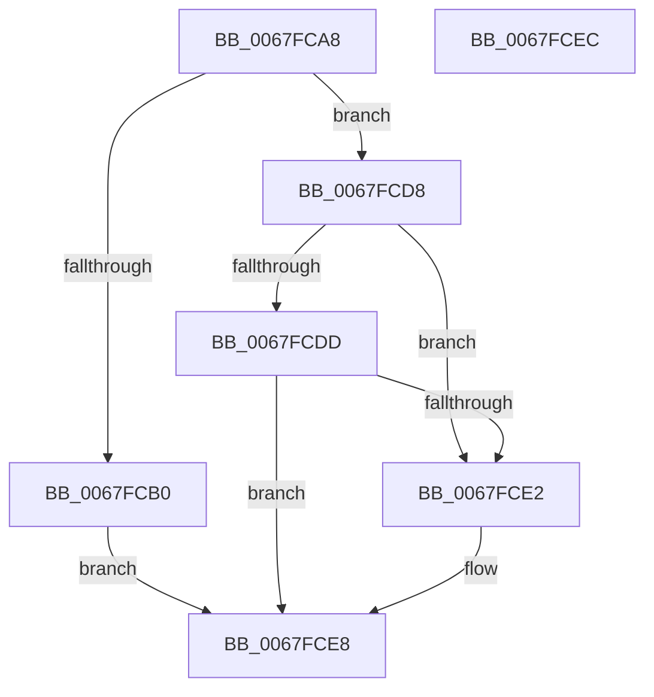

# MiSystemVaPreserveGuardPage

- RVA: `0x0067FCA8`–`0x0067FCED` (길이 `69` bytes)
- VA: `0x000000014067FCA8`
- 실행 섹션: `.text`
- PDB 이름 있음: `예`; PDB Function 태그: `아니요`
- unwind 정보 RVA: `0x000DB714`
- 디코드: `20`개 명령, `69/69` bytes 표시
- 미해석 바이트: `0` (있으면 어셈블리에 `.byte`로 보존)

> 이 문서는 커널 이미지의 기계어와 PDB 기호를 분석해 생성했습니다. 4번과 5번은 함수 원형과 자료형을 바이너리 사용 방식에서 추정한 C 해석이며 원본 소스 복구 결과는 아닙니다.

## 1. Dependencies

- 직접 호출 지점: **0**; 고유 호출 대상: **0**
- 직접 호출자로 확인된 함수: **2**
- RIP 상대 이미지 참조: **2**

### Outgoing calls
- 직접 디코드된 call 명령이 없습니다.

### Direct callers
- [MiMarkSystemVaAllocated](../3B/MiMarkSystemVaAllocated_function_003B3878.md) at `0x003B3A29`
- [MiExtendDynamicBitMap](../3B/MiExtendDynamicBitMap_function_003B6934.md) at `0x003B6A5C`

### Static image references
- `0x0067FCB0` → RVA `0x00FC5000` (`ALMOSTRO`; read)
- `0x0067FCBB` → RVA `0x00E2DBF8` (`.data`; read)

## 2. Other-region calls and transfers

- 다른 실행 섹션으로 향하는 call: **0**
- 별도 외부 분기/꼬리 이동을 확인하지 못했습니다.

## 3. Assembly (complete function range)

```asm
0067FCA8  45 33 C0                        xor r8d, r8d
0067FCAB  83 FA 04                        cmp edx, 4
0067FCAE  75 28                           jne 0x14067fcd8
0067FCB0  0F B7 05 49 53 94 00            movzx eax, word ptr [rip + 0x945349]
0067FCB7  48 8D 14 40                     lea rdx, [rax + rax*2]
0067FCBB  48 8B 05 36 DF 7A 00            mov rax, qword ptr [rip + 0x7adf36]
0067FCC2  48 05 80 FE FF FF               add rax, -0x180
0067FCC8  48 C1 E2 07                     shl rdx, 7
0067FCCC  48 03 D0                        add rdx, rax
0067FCCF  48 3B CA                        cmp rcx, rdx
0067FCD2  41 0F 94 C0                     sete r8b
0067FCD6  EB 10                           jmp 0x14067fce8
0067FCD8  83 FA 05                        cmp edx, 5
0067FCDB  74 05                           je 0x14067fce2
0067FCDD  83 FA 0E                        cmp edx, 0xe
0067FCE0  75 06                           jne 0x14067fce8
0067FCE2  41 B8 01 00 00 00               mov r8d, 1
0067FCE8  41 8B C0                        mov eax, r8d
0067FCEB  C3                              ret
0067FCEC  CC                              int3
```

## 4. C-style interpretation (structured pseudocode)

```c
__int64 __fastcall MiSystemVaPreserveGuardPage(__int64 a1, int a2, int a3)
{
    __int64 result;

    a3 = 0;
    if (a2 != 4) goto loc_0067FCD8;
    result = (*(unsigned __int64 *)(v_rip + 8052534)) + (-384);
    a2 = (*(unsigned __int16 *)(v_rip + 9720649) + *(unsigned __int16 *)(v_rip + 9720649) * 2) << (7);
    a2 = (a2) + (result);
    a3 = (a1 == a2) ? 1 : 0;
    goto loc_0067FCE8;
loc_0067FCD8:
    if (a2 == 5) goto loc_0067FCE2;
    if (a2 == 14) {
        a3 = 1;
    }
    return (unsigned int)(a3);
}
```

## 5. (Beta) C Style

```c
int64_t MiSystemVaPreserveGuardPage(int64_t Arg1, int32_t Arg2, int32_t Arg3)
{
    int64_t result;

    Arg3 = 0;
    if (Arg2 != 4) goto loc_0067FCD8;
    result = (*(uint64_t *)(v_rip + 0x7ADF36)) + (-384);
    Arg2 = (*(uint16_t *)(v_rip + 0x945349) + *(uint16_t *)(v_rip + 0x945349) * 2) << (7);
    Arg2 = (Arg2) + (result);
    Arg3 = (Arg1 == Arg2) ? 1 : 0;
    goto loc_0067FCE8;
loc_0067FCD8:
    if (Arg2 == 5) goto loc_0067FCE2;
    if (Arg2 == 14) {
        Arg3 = 1;
    }
    return (uint32_t)(Arg3);
}
```

## 6. Execution-region graph

[열기: 2D/3D 그래프와 함수 탐색 컨트롤 패널](../../../control-panel.html?section=text&rva=0x0067FCA8&view=graph)

- 2D 그래프는 위에서 아래로 흐르고, 3D 그래프는 빈 공간을 드래그해 회전합니다. Shift+드래그는 이동, 휠은 확대·축소, 함수 노드 선택은 대상 보고서 이동입니다.

### Static fallback


