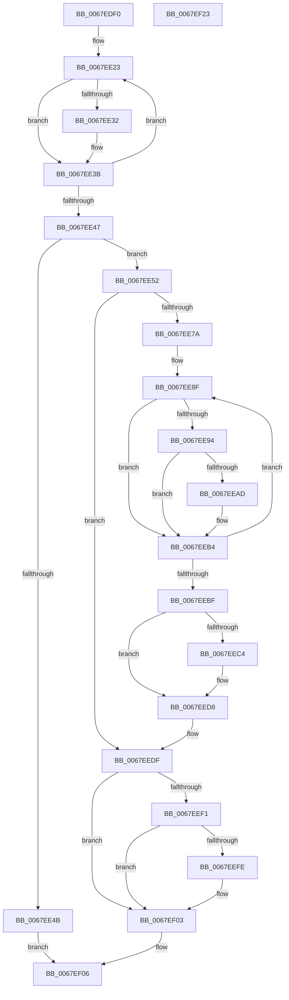

# MiTrimAllSystemPagableMemory

- RVA: `0x0067EDF0`–`0x0067EF24` (길이 `308` bytes)
- VA: `0x000000014067EDF0`
- 실행 섹션: `.text`
- PDB 이름 있음: `예`; PDB Function 태그: `아니요`
- unwind 정보 RVA: `0x00075C18`
- 디코드: `90`개 명령, `308/308` bytes 표시
- 미해석 바이트: `0` (있으면 어셈블리에 `.byte`로 보존)

> 이 문서는 커널 이미지의 기계어와 PDB 기호를 분석해 생성했습니다. 4번과 5번은 함수 원형과 자료형을 바이너리 사용 방식에서 추정한 C 해석이며 원본 소스 복구 결과는 아닙니다.

## 1. Dependencies

- 직접 호출 지점: **5**; 고유 호출 대상: **4**
- 직접 호출자로 확인된 함수: **3**
- RIP 상대 이미지 참조: **4**

### Outgoing calls
- `0x0067EE25` → [MiGetAnyMultiplexedVm](../44/MiGetAnyMultiplexedVm_function_00448BD0.md) (function, `0x00448BD0`)
- `0x0067EE96` → [MiGetAnyMultiplexedVm](../44/MiGetAnyMultiplexedVm_function_00448BD0.md) (function, `0x00448BD0`)
- `0x0067EEA1` → [MiEmptyTargetedWorkingSet](MiEmptyTargetedWorkingSet_function_0067E6F8.md) (function, `0x0067E6F8`)
- `0x0067EED0` → [MiPurgePartitionStandby](../33/MiPurgePartitionStandby_function_00334460.md) (function, `0x00334460`)
- `0x0067EEFE` → [KiCheckForKernelApcDelivery](../2E/KiCheckForKernelApcDelivery_function_002E2C80.md) (function, `0x002E2C80`)

### Direct callers
- [MmTrimAllSystemPagableMemory](MmTrimAllSystemPagableMemory_function_0067EFA0.md) at `0x0067EFA4`
- [MmShutdownSystem](../../pagelk/B7/MmShutdownSystem_function_00B73D80.md) at `0x00B73DB7`
- [MmVerifierTrimMemory](../../pagevrfy/BB/MmVerifierTrimMemory_function_00BB47E8.md) at `0x00BB4958`

### Static image references
- `0x0067EE0E` → RVA `0x00E37500` (`.data`; read)
- `0x0067EE6A` → RVA `0x00E374C4` (`.data`; read/write)
- `0x0067EE86` → RVA `0x00E37510` (`.data`; read/write)
- `0x0067EEC9` → RVA `0x00E38D00` (`.data`; read)

## 2. Other-region calls and transfers

- 다른 실행 섹션으로 향하는 call: **0**
- 별도 외부 분기/꼬리 이동을 확인하지 못했습니다.

## 3. Assembly (complete function range)

```asm
0067EDF0  48 89 5C 24 08                  mov qword ptr [rsp + 8], rbx
0067EDF5  48 89 6C 24 10                  mov qword ptr [rsp + 0x10], rbp
0067EDFA  48 89 74 24 18                  mov qword ptr [rsp + 0x18], rsi
0067EDFF  57                              push rdi
0067EE00  41 54                           push r12
0067EE02  41 55                           push r13
0067EE04  41 56                           push r14
0067EE06  41 57                           push r15
0067EE08  48 83 EC 20                     sub rsp, 0x20
0067EE0C  33 DB                           xor ebx, ebx
0067EE0E  4C 8D 35 EB 86 7B 00            lea r14, [rip + 0x7b86eb]
0067EE15  44 8B E1                        mov r12d, ecx
0067EE18  8B FB                           mov edi, ebx
0067EE1A  8B D3                           mov edx, ebx
0067EE1C  4D 8B C6                        mov r8, r14
0067EE1F  44 8D 4B 01                     lea r9d, [rbx + 1]
0067EE23  8B CA                           mov ecx, edx
0067EE25  E8 A6 9D DC FF                  call 0x140448bd0
0067EE2A  8B 40 04                        mov eax, dword ptr [rax + 4]
0067EE2D  41 39 00                        cmp dword ptr [r8], eax
0067EE30  74 09                           je 0x14067ee3b
0067EE32  8B CA                           mov ecx, edx
0067EE34  41 8B C1                        mov eax, r9d
0067EE37  D3 E0                           shl eax, cl
0067EE39  0B F8                           or edi, eax
0067EE3B  41 03 D1                        add edx, r9d
0067EE3E  49 83 C0 04                     add r8, 4
0067EE42  83 FA 03                        cmp edx, 3
0067EE45  7E DC                           jle 0x14067ee23
0067EE47  85 FF                           test edi, edi
0067EE49  75 07                           jne 0x14067ee52
0067EE4B  33 C0                           xor eax, eax
0067EE4D  E9 B4 00 00 00                  jmp 0x14067ef06
0067EE52  65 48 8B 34 25 88 01 00 00      mov rsi, qword ptr gs:[0x188]
0067EE5B  44 8B FB                        mov r15d, ebx
0067EE5E  41 8B C1                        mov eax, r9d
0067EE61  66 44 29 8E E6 01 00 00         sub word ptr [rsi + 0x1e6], r9w
0067EE69  90                              nop
0067EE6A  F0 0F C1 05 52 86 7B 00         lock xadd dword ptr [rip + 0x7b8652], eax
0067EE72  41 03 C1                        add eax, r9d
0067EE75  41 3B C1                        cmp eax, r9d
0067EE78  75 65                           jne 0x14067eedf
0067EE7A  65 48 8B 04 25 88 01 00 00      mov rax, qword ptr gs:[0x188]
0067EE83  45 8B F9                        mov r15d, r9d
0067EE86  48 87 05 83 86 7B 00            xchg qword ptr [rip + 0x7b8683], rax
0067EE8D  8B EB                           mov ebp, ebx
0067EE8F  41 84 F9                        test r9b, dil
0067EE92  74 20                           je 0x14067eeb4
0067EE94  8B CD                           mov ecx, ebp
0067EE96  E8 35 9D DC FF                  call 0x140448bd0
0067EE9B  48 8B C8                        mov rcx, rax
0067EE9E  4C 8B E8                        mov r13, rax
0067EEA1  E8 52 F8 FF FF                  call 0x14067e6f8
0067EEA6  45 8B CF                        mov r9d, r15d
0067EEA9  85 C0                           test eax, eax
0067EEAB  74 07                           je 0x14067eeb4
0067EEAD  41 8B 45 04                     mov eax, dword ptr [r13 + 4]
0067EEB1  41 89 06                        mov dword ptr [r14], eax
0067EEB4  41 03 E9                        add ebp, r9d
0067EEB7  49 83 C6 04                     add r14, 4
0067EEBB  D1 EF                           shr edi, 1
0067EEBD  75 D0                           jne 0x14067ee8f
0067EEBF  45 85 E4                        test r12d, r12d
0067EEC2  74 14                           je 0x14067eed8
0067EEC4  BA 08 00 00 00                  mov edx, 8
0067EEC9  48 8D 0D 30 9E 7B 00            lea rcx, [rip + 0x7b9e30]
0067EED0  E8 8B 55 CB FF                  call 0x140334460
0067EED5  45 8B CF                        mov r9d, r15d
0067EED8  48 87 1D 31 86 7B 00            xchg qword ptr [rip + 0x7b8631], rbx
0067EEDF  F0 FF 0D DE 85 7B 00            lock dec dword ptr [rip + 0x7b85de]
0067EEE6  90                              nop
0067EEE7  66 44 01 8E E6 01 00 00         add word ptr [rsi + 0x1e6], r9w
0067EEEF  75 12                           jne 0x14067ef03
0067EEF1  48 8D 8E 98 00 00 00            lea rcx, [rsi + 0x98]
0067EEF8  90                              nop
0067EEF9  48 39 09                        cmp qword ptr [rcx], rcx
0067EEFC  74 05                           je 0x14067ef03
0067EEFE  E8 7D 3D C6 FF                  call 0x1402e2c80
0067EF03  41 8B C7                        mov eax, r15d
0067EF06  48 8B 5C 24 50                  mov rbx, qword ptr [rsp + 0x50]
0067EF0B  48 8B 6C 24 58                  mov rbp, qword ptr [rsp + 0x58]
0067EF10  48 8B 74 24 60                  mov rsi, qword ptr [rsp + 0x60]
0067EF15  48 83 C4 20                     add rsp, 0x20
0067EF19  41 5F                           pop r15
0067EF1B  41 5E                           pop r14
0067EF1D  41 5D                           pop r13
0067EF1F  41 5C                           pop r12
0067EF21  5F                              pop rdi
0067EF22  C3                              ret
0067EF23  CC                              int3
```

## 4. C-style interpretation (structured pseudocode)

```c
__int64 __fastcall MiTrimAllSystemPagableMemory(int a1)
{
    __int64 result;
    __int64 v_r14;
    __int64 v_rbp;
    __int64 v_rbx;
    __int64 v_rdi;
    __int64 v_rsp;
    unsigned __int64 v_stack_p10;
    unsigned __int64 v_stack_p18;
    unsigned __int64 v_stack_p8;

    v_stack_p8 = v_rbx;
    v_stack_p10 = v_rbp;
    v_stack_p18 = v_rsi;
    v_rsp = (v_rsp) - (32);
    v_rbx = 0;
loc_0067EE23:
    result = MiGetAnyMultiplexedVm(0, 0, v_rip + 8095467, v_rbx + 1);
    result = (unsigned int)(*(unsigned int *)(result + 4));
    v_rdi = 0;
    if ((*(unsigned int *)(v_rip + 8095467)) != ((unsigned int)((unsigned int)(*(unsigned int *)(result + 4))))) {
        a1 = 0;
        result = (unsigned int)(v_rbx + 1);
        result = (unsigned int)((result) << ((unsigned __int8)(a1)));
        v_rdi = (unsigned int)((0) | ((unsigned int)(result)));
    }
    a2 = (unsigned int)((0) + ((unsigned int)(v_rbx + 1)));
    a3 = (v_rip + 8095467) + (4);
    if (((unsigned int)(a2)) <= 3) goto loc_0067EE23;
    if ((unsigned int)(v_rdi) != 0) goto loc_0067EE52;
    result = 0;
    goto loc_0067EF06;
loc_0067EE52:
    result = (unsigned int)(((unsigned int)((unsigned int)(v_rbx + 1))) + ((unsigned int)(v_rbx + 1)));
    if (((unsigned int)(result)) != ((unsigned int)(v_rbx + 1))) goto loc_0067EEDF;
loc_0067EE8F:
    if ((((unsigned __int8)(v_rbx + 1)) & ((unsigned __int8)(v_rdi))) == 0) goto loc_0067EEB4;
    result = MiGetAnyMultiplexedVm(0, a2, a3, v_rbx + 1);
    result = MiEmptyTargetedWorkingSet(result, a2, a3, v_rbx + 1);
    if ((unsigned int)(result) != 0) {
        result = *(unsigned int *)(result + 4);
        *(unsigned int *)(v_rip + 8095467) = (unsigned int)(result);
    }
    v_rbp = (unsigned int)((0) + ((unsigned int)((unsigned int)((unsigned int)((unsigned int)((unsigned int)(v_rbx + 1)))))));
    v_r14 = (v_rip + 8095467) + (4);
    v_rdi = (unsigned int)((v_rdi) >> (1));
    if (condition_is_not_equal) goto loc_0067EE8F;
    if ((unsigned int)((unsigned int)(a1)) != 0) {
        a2 = 8;
        a1 = v_rip + 8101424;
        result = MiPurgePartitionStandby(a1, a2, a3, (unsigned int)((unsigned int)((unsigned int)((unsigned int)(v_rbx + 1)))));
        a4 = (unsigned int)((unsigned int)((unsigned int)(v_rbx + 1)));
    }
loc_0067EEDF:
    if ((unsigned int)((unsigned int)(a1)) != 0) goto loc_0067EF03;
    if ((*(unsigned __int64 *)(*(unsigned __int64 *)(gs_base + (0 + 392)) + 152)) != (*(unsigned __int64 *)(gs_base + (0 + 392)) + 152)) {
        result = KiCheckForKernelApcDelivery(*(unsigned __int64 *)(gs_base + (0 + 392)) + 152, a2, a3, a4);
    }
loc_0067EF06:
    v_rsp = (v_rsp) + (32);
    return (unsigned int)((unsigned int)((unsigned int)((unsigned int)(v_rbx + 1))));
}
```

## 5. (Beta) C Style

```c
int64_t MiTrimAllSystemPagableMemory(int32_t Arg1)
{
    int64_t result;
    int64_t local_r14;
    int64_t local_rbp;
    int64_t local_rbx;
    int64_t local_rdi;
    int64_t local_rsp;
    uint64_t v_stack_p10;
    uint64_t v_stack_p18;
    uint64_t v_stack_p8;

    v_stack_p8 = local_rbx;
    v_stack_p10 = local_rbp;
    v_stack_p18 = local_rsi;
    local_rsp = (local_rsp) - (32);
    local_rbx = 0;
loc_0067EE23:
    result = MiGetAnyMultiplexedVm(0, 0, v_rip + 8095467, local_rbx + 1);
    result = (uint32_t)(*(uint32_t *)(result + 0x4));
    local_rdi = 0;
    if ((*(uint32_t *)(v_rip + 0x7B86EB)) != ((uint32_t)((uint32_t)(*(uint32_t *)(result + 0x4))))) {
        Arg1 = 0;
        result = (uint32_t)(local_rbx + 1);
        result = (uint32_t)((result) << ((uint8_t)(Arg1)));
        local_rdi = (uint32_t)((0) | ((uint32_t)(result)));
    }
    a2 = (uint32_t)((0) + ((uint32_t)(local_rbx + 1)));
    a3 = (v_rip + 8095467) + (4);
    if (((uint32_t)(a2)) <= 3) goto loc_0067EE23;
    if ((uint32_t)(local_rdi) != 0) goto loc_0067EE52;
    result = 0;
    goto loc_0067EF06;
loc_0067EE52:
    result = (uint32_t)(((uint32_t)((uint32_t)(local_rbx + 1))) + ((uint32_t)(local_rbx + 1)));
    if (((uint32_t)(result)) != ((uint32_t)(local_rbx + 1))) goto loc_0067EEDF;
loc_0067EE8F:
    if ((((uint8_t)(local_rbx + 1)) & ((uint8_t)(local_rdi))) == 0) goto loc_0067EEB4;
    result = MiGetAnyMultiplexedVm(0, a2, a3, local_rbx + 1);
    result = MiEmptyTargetedWorkingSet(result, a2, a3, local_rbx + 1);
    if ((uint32_t)(result) != 0) {
        result = *(uint32_t *)(result + 0x4);
        *(uint32_t *)(v_rip + 0x7B86EB) = (uint32_t)(result);
    }
    local_rbp = (uint32_t)((0) + ((uint32_t)((uint32_t)((uint32_t)((uint32_t)((uint32_t)(local_rbx + 1)))))));
    local_r14 = (v_rip + 8095467) + (4);
    local_rdi = (uint32_t)((local_rdi) >> (1));
    if (condition_is_not_equal) goto loc_0067EE8F;
    if ((uint32_t)((uint32_t)(Arg1)) != 0) {
        a2 = 8;
        Arg1 = v_rip + 8101424;
        result = MiPurgePartitionStandby(Arg1, a2, a3, (uint32_t)((uint32_t)((uint32_t)((uint32_t)(local_rbx + 1)))));
        a4 = (uint32_t)((uint32_t)((uint32_t)(local_rbx + 1)));
    }
loc_0067EEDF:
    if ((uint32_t)((uint32_t)(Arg1)) != 0) goto loc_0067EF03;
    if ((*(uint64_t *)(*(uint64_t *)(gs_base + (0 + 0x188)) + 0x98)) != (*(uint64_t *)(gs_base + (0 + 0x188)) + 152)) {
        result = KiCheckForKernelApcDelivery(*(uint64_t *)(gs_base + (0 + 0x188)) + 152, a2, a3, a4);
    }
loc_0067EF06:
    local_rsp = (local_rsp) + (32);
    return (uint32_t)((uint32_t)((uint32_t)((uint32_t)(local_rbx + 1))));
}
```

## 6. Execution-region graph

[열기: 2D/3D 그래프와 함수 탐색 컨트롤 패널](../../../control-panel.html?section=text&rva=0x0067EDF0&view=graph)

- 2D 그래프는 위에서 아래로 흐르고, 3D 그래프는 빈 공간을 드래그해 회전합니다. Shift+드래그는 이동, 휠은 확대·축소, 함수 노드 선택은 대상 보고서 이동입니다.

### Static fallback


