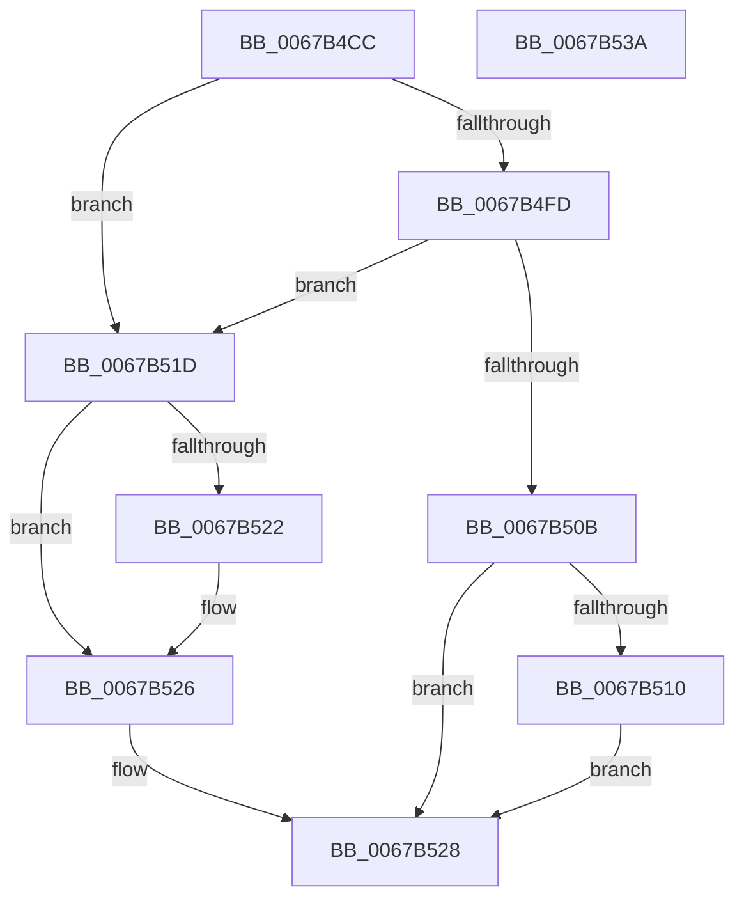

# MiTryAcquirePushLockUnordered

- RVA: `0x0067B4CC`–`0x0067B53B` (길이 `111` bytes)
- VA: `0x000000014067B4CC`
- 실행 섹션: `.text`
- PDB 이름 있음: `예`; PDB Function 태그: `아니요`
- unwind 정보 RVA: `0x00060BC4`
- 디코드: `37`개 명령, `111/111` bytes 표시
- 미해석 바이트: `0` (있으면 어셈블리에 `.byte`로 보존)

> 이 문서는 커널 이미지의 기계어와 PDB 기호를 분석해 생성했습니다. 4번과 5번은 함수 원형과 자료형을 바이너리 사용 방식에서 추정한 C 해석이며 원본 소스 복구 결과는 아닙니다.

## 1. Dependencies

- 직접 호출 지점: **3**; 고유 호출 대상: **3**
- 직접 호출자로 확인된 함수: **1**
- RIP 상대 이미지 참조: **0**

### Outgoing calls
- `0x0067B4E9` → [KeAbPreAcquire](../21/KeAbPreAcquire_function_00210230.md) (function, `0x00210230`)
- `0x0067B502` → [ExfTryAcquirePushLockSharedEx](../3F/ExfTryAcquirePushLockSharedEx_function_003FC210.md) (function, `0x003FC210`)
- `0x0067B516` → [KeAbPostReleaseEx](../26/KeAbPostReleaseEx_function_00262210.md) (function, `0x00262210`)

### Direct callers
- [MiIssuePageHeatList](../44/MiIssuePageHeatList_function_0044615C.md) at `0x004461BE`

### Static image references
- 디코드된 RIP-relative 메모리 참조가 없습니다.

## 2. Other-region calls and transfers

- 다른 실행 섹션으로 향하는 call: **0**
- 별도 외부 분기/꼬리 이동을 확인하지 못했습니다.

## 3. Assembly (complete function range)

```asm
0067B4CC  48 89 5C 24 08                  mov qword ptr [rsp + 8], rbx
0067B4D1  48 89 74 24 10                  mov qword ptr [rsp + 0x10], rsi
0067B4D6  57                              push rdi
0067B4D7  48 83 EC 20                     sub rsp, 0x20
0067B4DB  33 DB                           xor ebx, ebx
0067B4DD  33 D2                           xor edx, edx
0067B4DF  48 8B F1                        mov rsi, rcx
0067B4E2  41 89 19                        mov dword ptr [r9], ebx
0067B4E5  44 8D 43 01                     lea r8d, [rbx + 1]
0067B4E9  E8 42 4D B9 FF                  call 0x140210230
0067B4EE  48 8B F8                        mov rdi, rax
0067B4F1  8D 4B 11                        lea ecx, [rbx + 0x11]
0067B4F4  33 C0                           xor eax, eax
0067B4F6  F0 48 0F B1 0E                  lock cmpxchg qword ptr [rsi], rcx
0067B4FB  74 20                           je 0x14067b51d
0067B4FD  33 D2                           xor edx, edx
0067B4FF  48 8B CE                        mov rcx, rsi
0067B502  E8 09 0D D8 FF                  call 0x1403fc210
0067B507  84 C0                           test al, al
0067B509  75 12                           jne 0x14067b51d
0067B50B  48 85 FF                        test rdi, rdi
0067B50E  74 18                           je 0x14067b528
0067B510  48 8B D7                        mov rdx, rdi
0067B513  48 8B CE                        mov rcx, rsi
0067B516  E8 F5 6C BE FF                  call 0x140262210
0067B51B  EB 0B                           jmp 0x14067b528
0067B51D  48 85 FF                        test rdi, rdi
0067B520  74 04                           je 0x14067b526
0067B522  C6 47 0A 01                     mov byte ptr [rdi + 0xa], 1
0067B526  B3 01                           mov bl, 1
0067B528  48 8B 74 24 38                  mov rsi, qword ptr [rsp + 0x38]
0067B52D  8A C3                           mov al, bl
0067B52F  48 8B 5C 24 30                  mov rbx, qword ptr [rsp + 0x30]
0067B534  48 83 C4 20                     add rsp, 0x20
0067B538  5F                              pop rdi
0067B539  C3                              ret
0067B53A  CC                              int3
```

## 4. C-style interpretation (structured pseudocode)

```c
__int64 __fastcall MiTryAcquirePushLockUnordered(__int64 a1, int a2, __int64 a3, __int64 a4)
{
    __int64 result;
    __int64 v_rbx;
    __int64 v_rsp;
    unsigned __int64 v_stack_p10;
    unsigned __int64 v_stack_p8;

    v_stack_p8 = v_rbx;
    v_stack_p10 = v_rsi;
    v_rsp = (v_rsp) - (32);
    v_rbx = 0;
    a2 = 0;
    *(unsigned int *)(a4) = 0;
    result = KeAbPreAcquire(a1, a2, v_rbx + 1, a4);
    result = 0;
    if (condition_is_equal) goto loc_0067B51D;
    a2 = 0;
    result = ExfTryAcquirePushLockSharedEx(a1, a2, v_rbx + 1, a4);
    if ((unsigned __int8)(result) != 0) goto loc_0067B51D;
    if (result == 0) goto loc_0067B528;
    result = KeAbPostReleaseEx(a1, result, v_rbx + 1, a4);
    goto loc_0067B528;
loc_0067B51D:
    if (result != 0) {
        *(unsigned __int8 *)(result + 10) = 1;
    }
loc_0067B528:
    v_rsp = (v_rsp) + (32);
    return 1;
}
```

## 5. (Beta) C Style

```c
int64_t MiTryAcquirePushLockUnordered(void *Arg1, int32_t Arg2, int64_t Arg3, void *Arg4)
{
    uint8_t *arg1 = (uint8_t *)Arg1;
    uint8_t *arg4 = (uint8_t *)Arg4;

    int64_t result;
    int64_t local_rbx;
    int64_t local_rsp;
    uint64_t v_stack_p10;
    uint64_t v_stack_p8;

    v_stack_p8 = local_rbx;
    v_stack_p10 = local_rsi;
    local_rsp = (local_rsp) - (32);
    local_rbx = 0;
    Arg2 = 0;
    *(uint32_t *)(arg4) = 0;
    result = KeAbPreAcquire(Arg1, Arg2, local_rbx + 1, Arg4);
    result = 0;
    if (condition_is_equal) goto loc_0067B51D;
    Arg2 = 0;
    result = ExfTryAcquirePushLockSharedEx(Arg1, Arg2, local_rbx + 1, Arg4);
    if ((uint8_t)(result) != 0) goto loc_0067B51D;
    if (result == 0) goto loc_0067B528;
    result = KeAbPostReleaseEx(Arg1, result, local_rbx + 1, Arg4);
    goto loc_0067B528;
loc_0067B51D:
    if (result != 0) {
        *(uint8_t *)(result + 0xA) = 1;
    }
loc_0067B528:
    local_rsp = (local_rsp) + (32);
    return 1;
}
```

### 관측된 메모리 오프셋

구조체 형식이 확인되지 않은 접근은 인자 기준의 오프셋으로만 기록했습니다.

| 기준 인자 | 오프셋 표현 | 폭 (bit) | 접근 |
|---|---:|---:|---|
| `Arg1` | `+ 0x0` | `64` | `R` |
| `Arg4` | `+ 0x0` | `32` | `W` |

## 6. Execution-region graph

[열기: 2D/3D 그래프와 함수 탐색 컨트롤 패널](../../../control-panel.html?section=text&rva=0x0067B4CC&view=graph)

- 2D 그래프는 위에서 아래로 흐르고, 3D 그래프는 빈 공간을 드래그해 회전합니다. Shift+드래그는 이동, 휠은 확대·축소, 함수 노드 선택은 대상 보고서 이동입니다.

### Static fallback


