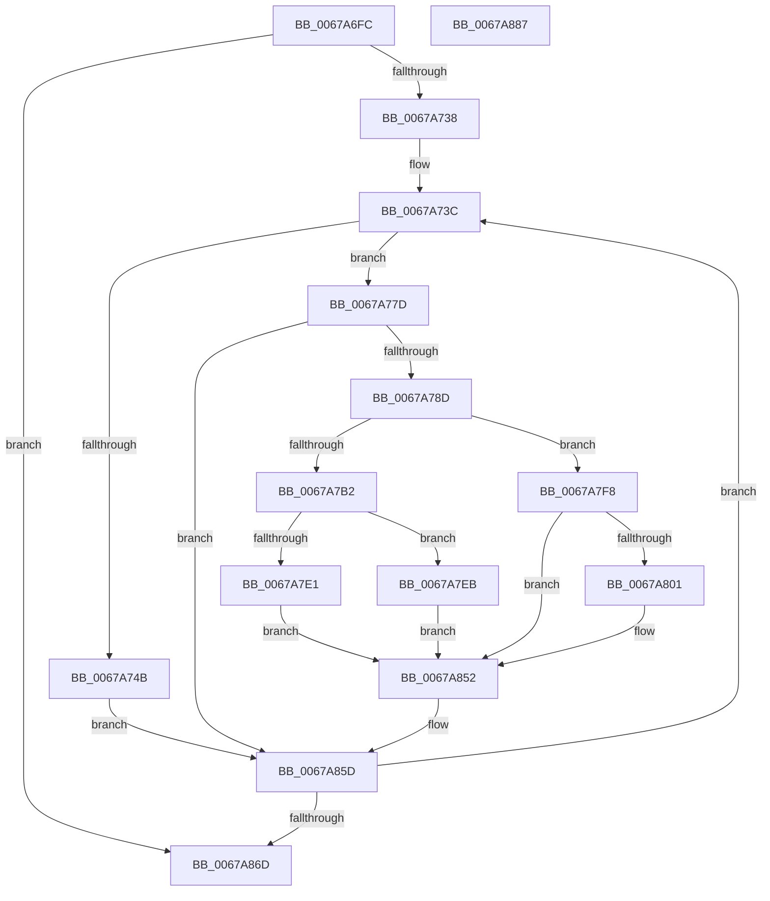

# MiUnlinkBadPages

- RVA: `0x0067A6FC`–`0x0067A888` (길이 `396` bytes)
- VA: `0x000000014067A6FC`
- 실행 섹션: `.text`
- PDB 이름 있음: `예`; PDB Function 태그: `아니요`
- unwind 정보 RVA: `0x00083688`
- 디코드: `113`개 명령, `396/396` bytes 표시
- 미해석 바이트: `0` (있으면 어셈블리에 `.byte`로 보존)

> 이 문서는 커널 이미지의 기계어와 PDB 기호를 분석해 생성했습니다. 4번과 5번은 함수 원형과 자료형을 바이너리 사용 방식에서 추정한 C 해석이며 원본 소스 복구 결과는 아닙니다.

## 1. Dependencies

- 직접 호출 지점: **11**; 고유 호출 대상: **10**
- 직접 호출자로 확인된 함수: **1**
- RIP 상대 이미지 참조: **1**

### Outgoing calls
- `0x0067A73F` → [MiIsPageInHugePfn](../2A/MiIsPageInHugePfn_function_002AB770.md) (function, `0x002AB770`)
- `0x0067A74B` → [MiMarkHugePfnGood](MiMarkHugePfnGood_function_00676BB0.md) (function, `0x00676BB0`)
- `0x0067A77D` → [MiSafeLockPage](../32/MiSafeLockPage_function_00321620.md) (function, `0x00321620`)
- `0x0067A7BA` → [MiSetPfnRemovalRequested](MiSetPfnRemovalRequested_function_0067A4D0.md) (function, `0x0067A4D0`)
- `0x0067A7E4` → [MiMarkFileOnlyPfnGood](../68/MiMarkFileOnlyPfnGood_function_0068178C.md) (function, `0x0068178C`)
- `0x0067A7F1` → [MiReleaseNonPagedResources](../32/MiReleaseNonPagedResources_function_0032299C.md) (function, `0x0032299C`)
- `0x0067A7F8` → [MiIsPageOnBadList](../2B/MiIsPageOnBadList_function_002B1018.md) (function, `0x002B1018`)
- `0x0067A81D` → [MiUnlinkPageFromBadList](../3B/MiUnlinkPageFromBadList_function_003BD620.md) (function, `0x003BD620`)
- `0x0067A83F` → [MiInsertPageInFreeOrZeroedList](../33/MiInsertPageInFreeOrZeroedList_function_00334D20.md) (function, `0x00334D20`)
- `0x0067A84A` → [MiReleaseNonPagedResources](../32/MiReleaseNonPagedResources_function_0032299C.md) (function, `0x0032299C`)
- `0x0067A858` → [MiUnlockPage](../31/MiUnlockPage_function_0031A3E0.md) (function, `0x0031A3E0`)

### Direct callers
- [MmMarkPhysicalMemoryAsGood](MmMarkPhysicalMemoryAsGood_function_0067B000.md) at `0x0067B033`

### Static image references
- `0x0067A791` → RVA `0x00E30088` (`.data`; read)

## 2. Other-region calls and transfers

- 다른 실행 섹션으로 향하는 call: **0**
- 별도 외부 분기/꼬리 이동을 확인하지 못했습니다.

## 3. Assembly (complete function range)

```asm
0067A6FC  48 89 5C 24 10                  mov qword ptr [rsp + 0x10], rbx
0067A701  48 89 6C 24 18                  mov qword ptr [rsp + 0x18], rbp
0067A706  56                              push rsi
0067A707  57                              push rdi
0067A708  41 54                           push r12
0067A70A  41 56                           push r14
0067A70C  41 57                           push r15
0067A70E  48 83 EC 20                     sub rsp, 0x20
0067A712  48 8D 1C 49                     lea rbx, [rcx + rcx*2]
0067A716  4C 8B F2                        mov r14, rdx
0067A719  48 C1 E3 04                     shl rbx, 4
0067A71D  48 8B F9                        mov rdi, rcx
0067A720  33 F6                           xor esi, esi
0067A722  48 B8 00 00 00 00 00 DE FF FF   movabs rax, 0xffffde0000000000
0067A72C  48 03 D8                        add rbx, rax
0067A72F  48 3B CA                        cmp rcx, rdx
0067A732  0F 83 35 01 00 00               jae 0x14067a86d
0067A738  44 8D 66 01                     lea r12d, [rsi + 1]
0067A73C  48 8B CF                        mov rcx, rdi
0067A73F  E8 2C 10 C3 FF                  call 0x1402ab770
0067A744  48 8B CF                        mov rcx, rdi
0067A747  85 C0                           test eax, eax
0067A749  74 32                           je 0x14067a77d
0067A74B  E8 60 C4 FF FF                  call 0x140676bb0
0067A750  85 C0                           test eax, eax
0067A752  48 8D 4B D0                     lea rcx, [rbx - 0x30]
0067A756  48 0F 49 CB                     cmovns rcx, rbx
0067A75A  48 8B D9                        mov rbx, rcx
0067A75D  48 8D 4F FF                     lea rcx, [rdi - 1]
0067A761  48 0F 49 CF                     cmovns rcx, rdi
0067A765  3D 12 01 00 00                  cmp eax, 0x112
0067A76A  48 8B F9                        mov rdi, rcx
0067A76D  48 8D 4E 01                     lea rcx, [rsi + 1]
0067A771  48 0F 45 CE                     cmovne rcx, rsi
0067A775  48 8B F1                        mov rsi, rcx
0067A778  E9 E0 00 00 00                  jmp 0x14067a85d
0067A77D  E8 9E 6E CA FF                  call 0x140321620
0067A782  40 8A E8                        mov bpl, al
0067A785  3C 11                           cmp al, 0x11
0067A787  0F 84 D0 00 00 00               je 0x14067a85d
0067A78D  48 8B 43 28                     mov rax, qword ptr [rbx + 0x28]
0067A791  48 8B 0D F0 58 7B 00            mov rcx, qword ptr [rip + 0x7b58f0]
0067A798  48 C1 E8 2B                     shr rax, 0x2b
0067A79C  25 FF 03 00 00                  and eax, 0x3ff
0067A7A1  4C 8B 3C C1                     mov r15, qword ptr [rcx + rax*8]
0067A7A5  48 8B CB                        mov rcx, rbx
0067A7A8  8B 43 20                        mov eax, dword ptr [rbx + 0x20]
0067A7AB  C1 E8 18                        shr eax, 0x18
0067A7AE  A8 40                           test al, 0x40
0067A7B0  74 46                           je 0x14067a7f8
0067A7B2  45 33 C9                        xor r9d, r9d
0067A7B5  45 8B C4                        mov r8d, r12d
0067A7B8  33 D2                           xor edx, edx
0067A7BA  E8 11 FD FF FF                  call 0x14067a4d0
0067A7BF  8B 43 20                        mov eax, dword ptr [rbx + 0x20]
0067A7C2  49 03 F4                        add rsi, r12
0067A7C5  89 44 24 50                     mov dword ptr [rsp + 0x50], eax
0067A7C9  C1 E8 18                        shr eax, 0x18
0067A7CC  24 7F                           and al, 0x7f
0067A7CE  88 44 24 53                     mov byte ptr [rsp + 0x53], al
0067A7D2  8B 44 24 50                     mov eax, dword ptr [rsp + 0x50]
0067A7D6  89 43 20                        mov dword ptr [rbx + 0x20], eax
0067A7D9  48 0F BA 63 28 35               bt qword ptr [rbx + 0x28], 0x35
0067A7DF  73 0A                           jae 0x14067a7eb
0067A7E1  48 8B CB                        mov rcx, rbx
0067A7E4  E8 A3 6F 00 00                  call 0x14068178c
0067A7E9  EB 67                           jmp 0x14067a852
0067A7EB  49 8B D4                        mov rdx, r12
0067A7EE  49 8B CF                        mov rcx, r15
0067A7F1  E8 A6 81 CA FF                  call 0x14032299c
0067A7F6  EB 5A                           jmp 0x14067a852
0067A7F8  E8 1B 68 C3 FF                  call 0x1402b1018
0067A7FD  85 C0                           test eax, eax
0067A7FF  74 51                           je 0x14067a852
0067A801  8B 43 20                        mov eax, dword ptr [rbx + 0x20]
0067A804  33 D2                           xor edx, edx
0067A806  89 44 24 50                     mov dword ptr [rsp + 0x50], eax
0067A80A  48 8B CB                        mov rcx, rbx
0067A80D  C1 E8 18                        shr eax, 0x18
0067A810  24 7F                           and al, 0x7f
0067A812  88 44 24 53                     mov byte ptr [rsp + 0x53], al
0067A816  8B 44 24 50                     mov eax, dword ptr [rsp + 0x50]
0067A81A  89 43 20                        mov dword ptr [rbx + 0x20], eax
0067A81D  E8 FE 2D D4 FF                  call 0x1403bd620
0067A822  48 8B 43 18                     mov rax, qword ptr [rbx + 0x18]
0067A826  48 B9 00 00 00 00 00 00 00 40   movabs rcx, 0x4000000000000000
0067A830  48 0B C1                        or rax, rcx
0067A833  BA 02 00 00 00                  mov edx, 2
0067A838  48 8B CF                        mov rcx, rdi
0067A83B  48 89 43 18                     mov qword ptr [rbx + 0x18], rax
0067A83F  E8 DC A4 CB FF                  call 0x140334d20
0067A844  49 8B D4                        mov rdx, r12
0067A847  49 8B CF                        mov rcx, r15
0067A84A  E8 4D 81 CA FF                  call 0x14032299c
0067A84F  49 03 F4                        add rsi, r12
0067A852  40 8A D5                        mov dl, bpl
0067A855  48 8B CB                        mov rcx, rbx
0067A858  E8 83 FB C9 FF                  call 0x14031a3e0
0067A85D  49 03 FC                        add rdi, r12
0067A860  48 83 C3 30                     add rbx, 0x30
0067A864  49 3B FE                        cmp rdi, r14
0067A867  0F 82 CF FE FF FF               jb 0x14067a73c
0067A86D  48 8B 5C 24 58                  mov rbx, qword ptr [rsp + 0x58]
0067A872  48 8B C6                        mov rax, rsi
0067A875  48 8B 6C 24 60                  mov rbp, qword ptr [rsp + 0x60]
0067A87A  48 83 C4 20                     add rsp, 0x20
0067A87E  41 5F                           pop r15
0067A880  41 5E                           pop r14
0067A882  41 5C                           pop r12
0067A884  5F                              pop rdi
0067A885  5E                              pop rsi
0067A886  C3                              ret
0067A887  CC                              int3
```

## 4. C-style interpretation (structured pseudocode)

```c
__int64 __fastcall MiUnlinkBadPages(__int64 a1, __int64 a2, __int64 a3, int a4)
{
    __int64 result;
    __int64 v_rbx;
    __int64 v_rdi;
    __int64 v_rsi;
    __int64 v_rsp;
    unsigned __int64 v_stack_p10;
    unsigned __int64 v_stack_p18;
    unsigned int v_stack_p8;
    unsigned __int8 v_stack_pB;

    v_stack_p10 = v_rbx;
    v_stack_p18 = v_rbp;
    v_rsp = (v_rsp) - (32);
    v_rbx = (a1 + a1 * 2) << (4);
    v_rsi = 0;
    v_rbx = (v_rbx) + (result);
    if (a1 >= a2) goto loc_0067A86D;
loc_0067A73C:
    result = MiIsPageInHugePfn(a1, a2, a3, a4);
    if ((unsigned int)(result) == 0) goto loc_0067A77D;
    result = MiMarkHugePfnGood(a1, a2, a3, a4);
    a1 = v_rbx - 48;
    if (!sign_flag) { a1 = v_rbx; }
    a1 = a1 - 1;
    if (!sign_flag) { a1 = a1; }
    a1 = v_rsi + 1;
    if (((unsigned int)(result)) != 274) { a1 = 0; }
    goto loc_0067A85D;
loc_0067A77D:
    result = MiSafeLockPage(a1, a2, a3, a4);
    if (((unsigned __int8)(result)) == 17) goto loc_0067A85D;
    result = (*(unsigned __int64 *)(a1 + 40)) >> (43);
    result = (unsigned int)((result) & (0x3FFULL));
    result = (unsigned int)(((unsigned int)(*(unsigned int *)(a1 + 32))) >> (24));
    if ((((unsigned __int8)(result)) & (64)) == 0) goto loc_0067A7F8;
    a4 = 0;
    a2 = 0;
    result = MiSetPfnRemovalRequested(a1, a2, (unsigned int)((unsigned int)(v_rsi + 1)), a4);
    v_rsi = (a1) + (v_rsi + 1);
    v_stack_p8 = (unsigned int)((unsigned int)(*(unsigned int *)(a1 + 32)));
    result = (unsigned int)(((unsigned int)(*(unsigned int *)(a1 + 32))) >> (24));
    result = (unsigned __int8)((result) & (127));
    v_stack_pB = (unsigned __int8)(result);
    *(unsigned int *)(a1 + 32) = (unsigned int)((unsigned int)(v_stack_p8));
    if (condition_is_above_or_equal) goto loc_0067A7EB;
    result = MiMarkFileOnlyPfnGood(a1, a2, (unsigned int)((unsigned int)(v_rsi + 1)), a4);
    goto loc_0067A852;
loc_0067A7EB:
    result = MiReleaseNonPagedResources(*(unsigned __int64 *)(*(unsigned __int64 *)(v_rip + 8083696) + result * 8), v_rsi + 1, (unsigned int)((unsigned int)(v_rsi + 1)), a4);
    goto loc_0067A852;
loc_0067A7F8:
    result = MiIsPageOnBadList(*(unsigned __int64 *)(*(unsigned __int64 *)(v_rip + 8083696) + result * 8), v_rsi + 1, (unsigned int)((unsigned int)(v_rsi + 1)), a4);
    if ((unsigned int)(result) != 0) {
        result = *(unsigned int *)(a1 + 32);
        a2 = 0;
        v_stack_p8 = (unsigned int)(result);
        a1 = a1;
        result = (unsigned int)((result) >> (24));
        result = (unsigned __int8)((result) & (127));
        v_stack_pB = (unsigned __int8)(result);
        result = v_stack_p8;
        *(unsigned int *)(a1 + 32) = (unsigned int)(result);
        result = MiUnlinkPageFromBadList(a1, a2, (unsigned int)((unsigned int)(v_rsi + 1)), a4);
        result = *(unsigned __int64 *)(a1 + 24);
        result = (result) | (a1);
        a2 = 2;
        a1 = a1;
        *(unsigned __int64 *)(a1 + 24) = result;
        result = MiInsertPageInFreeOrZeroedList(a1, a2, (unsigned int)((unsigned int)(v_rsi + 1)), a4);
        a2 = v_rsi + 1;
        a1 = *(unsigned __int64 *)(*(unsigned __int64 *)(v_rip + 8083696) + result * 8);
        result = MiReleaseNonPagedResources(a1, a2, (unsigned int)((unsigned int)(v_rsi + 1)), a4);
        v_rsi = (v_rsi) + (v_rsi + 1);
    }
    result = MiUnlockPage(a1, (unsigned __int8)((unsigned __int8)(result)), (unsigned int)((unsigned int)(v_rsi + 1)), a4);
loc_0067A85D:
    v_rdi = (a1) + (v_rsi + 1);
    v_rbx = (a1) + (48);
    if (v_rdi < a2) goto loc_0067A73C;
loc_0067A86D:
    v_rsp = (v_rsp) + (32);
    return v_rsi;
}
```

## 5. (Beta) C Style

```c
int64_t MiUnlinkBadPages(void *Arg1, int64_t Arg2, int64_t Arg3, int32_t Arg4)
{
    uint8_t *arg1 = (uint8_t *)Arg1;

    int64_t result;
    int64_t local_rbx;
    int64_t local_rdi;
    int64_t local_rsi;
    int64_t local_rsp;
    uint64_t v_stack_p10;
    uint64_t v_stack_p18;
    uint32_t v_stack_p8;
    uint8_t v_stack_pB;

    v_stack_p10 = local_rbx;
    v_stack_p18 = local_rbp;
    local_rsp = (local_rsp) - (32);
    local_rbx = (Arg1 + Arg1 * 2) << (4);
    local_rsi = 0;
    local_rbx = (local_rbx) + (result);
    if (Arg1 >= Arg2) goto loc_0067A86D;
loc_0067A73C:
    result = MiIsPageInHugePfn(Arg1, Arg2, Arg3, Arg4);
    if ((uint32_t)(result) == 0) goto loc_0067A77D;
    result = MiMarkHugePfnGood(Arg1, Arg2, Arg3, Arg4);
    Arg1 = local_rbx - 48;
    if (!sign_flag) { Arg1 = local_rbx; }
    Arg1 = Arg1 - 1;
    if (!sign_flag) { Arg1 = Arg1; }
    Arg1 = local_rsi + 1;
    if (((uint32_t)(result)) != 274) { Arg1 = 0; }
    goto loc_0067A85D;
loc_0067A77D:
    result = MiSafeLockPage(Arg1, Arg2, Arg3, Arg4);
    if (((uint8_t)(result)) == 17) goto loc_0067A85D;
    result = (*(uint64_t *)(arg1 + 0x28)) >> (43);
    result = (uint32_t)((result) & (0x3FFULL));
    result = (uint32_t)(((uint32_t)(*(uint32_t *)(arg1 + 0x20))) >> (24));
    if ((((uint8_t)(result)) & (64)) == 0) goto loc_0067A7F8;
    Arg4 = 0;
    Arg2 = 0;
    result = MiSetPfnRemovalRequested(Arg1, Arg2, (uint32_t)((uint32_t)(local_rsi + 1)), Arg4);
    local_rsi = (Arg1) + (local_rsi + 1);
    v_stack_p8 = (uint32_t)((uint32_t)(*(uint32_t *)(arg1 + 0x20)));
    result = (uint32_t)(((uint32_t)(*(uint32_t *)(arg1 + 0x20))) >> (24));
    result = (uint8_t)((result) & (127));
    v_stack_pB = (uint8_t)(result);
    *(uint32_t *)(arg1 + 0x20) = (uint32_t)((uint32_t)(v_stack_p8));
    if (condition_is_above_or_equal) goto loc_0067A7EB;
    result = MiMarkFileOnlyPfnGood(Arg1, Arg2, (uint32_t)((uint32_t)(local_rsi + 1)), Arg4);
    goto loc_0067A852;
loc_0067A7EB:
    result = MiReleaseNonPagedResources(*(uint64_t *)(*(uint64_t *)(v_rip + 0x7B58F0) + result * 8), local_rsi + 1, (uint32_t)((uint32_t)(local_rsi + 1)), Arg4);
    goto loc_0067A852;
loc_0067A7F8:
    result = MiIsPageOnBadList(*(uint64_t *)(*(uint64_t *)(v_rip + 0x7B58F0) + result * 8), local_rsi + 1, (uint32_t)((uint32_t)(local_rsi + 1)), Arg4);
    if ((uint32_t)(result) != 0) {
        result = *(uint32_t *)(arg1 + 0x20);
        Arg2 = 0;
        v_stack_p8 = (uint32_t)(result);
        Arg1 = Arg1;
        result = (uint32_t)((result) >> (24));
        result = (uint8_t)((result) & (127));
        v_stack_pB = (uint8_t)(result);
        result = v_stack_p8;
        *(uint32_t *)(arg1 + 0x20) = (uint32_t)(result);
        result = MiUnlinkPageFromBadList(Arg1, Arg2, (uint32_t)((uint32_t)(local_rsi + 1)), Arg4);
        result = *(uint64_t *)(arg1 + 0x18);
        result = (result) | (Arg1);
        Arg2 = 2;
        Arg1 = Arg1;
        *(uint64_t *)(arg1 + 0x18) = result;
        result = MiInsertPageInFreeOrZeroedList(Arg1, Arg2, (uint32_t)((uint32_t)(local_rsi + 1)), Arg4);
        Arg2 = local_rsi + 1;
        Arg1 = *(uint64_t *)(*(uint64_t *)(v_rip + 0x7B58F0) + result * 8);
        result = MiReleaseNonPagedResources(Arg1, Arg2, (uint32_t)((uint32_t)(local_rsi + 1)), Arg4);
        local_rsi = (local_rsi) + (local_rsi + 1);
    }
    result = MiUnlockPage(Arg1, (uint8_t)((uint8_t)(result)), (uint32_t)((uint32_t)(local_rsi + 1)), Arg4);
loc_0067A85D:
    local_rdi = (Arg1) + (local_rsi + 1);
    local_rbx = (Arg1) + (48);
    if (local_rdi < Arg2) goto loc_0067A73C;
loc_0067A86D:
    local_rsp = (local_rsp) + (32);
    return local_rsi;
}
```

### 관측된 메모리 오프셋

구조체 형식이 확인되지 않은 접근은 인자 기준의 오프셋으로만 기록했습니다.

| 기준 인자 | 오프셋 표현 | 폭 (bit) | 접근 |
|---|---:|---:|---|
| `Arg1` | `+ 0x0 + rcx*2` | `64` | `R` |

## 6. Execution-region graph

[열기: 2D/3D 그래프와 함수 탐색 컨트롤 패널](../../../control-panel.html?section=text&rva=0x0067A6FC&view=graph)

- 2D 그래프는 위에서 아래로 흐르고, 3D 그래프는 빈 공간을 드래그해 회전합니다. Shift+드래그는 이동, 휠은 확대·축소, 함수 노드 선택은 대상 보고서 이동입니다.

### Static fallback


