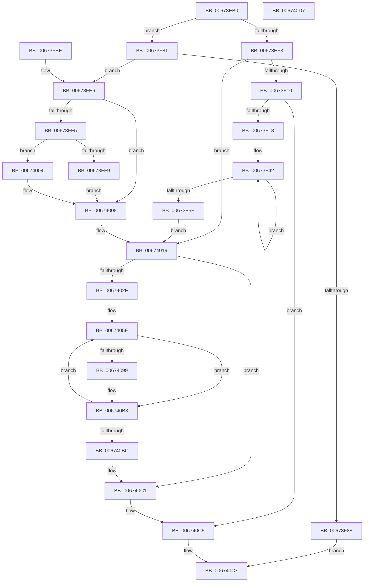

# MiUnlockPhysicalPageByVa

- RVA: `0x00673EB0`–`0x006740D8` (길이 `552` bytes)
- VA: `0x0000000140673EB0`
- 실행 섹션: `.text`
- PDB 이름 있음: `예`; PDB Function 태그: `아니요`
- unwind 정보 RVA: `0x000D7B38`
- 디코드: `139`개 명령, `552/552` bytes 표시
- 미해석 바이트: `0` (있으면 어셈블리에 `.byte`로 보존)

> 이 문서는 커널 이미지의 기계어와 PDB 기호를 분석해 생성했습니다. 4번과 5번은 함수 원형과 자료형을 바이너리 사용 방식에서 추정한 C 해석이며 원본 소스 복구 결과는 아닙니다.

## 1. Dependencies

- 직접 호출 지점: **6**; 고유 호출 대상: **6**
- 직접 호출자로 확인된 함수: **0**
- RIP 상대 이미지 참조: **1**

### Outgoing calls
- `0x00673EDC` → [MI_READ_PTE_LOCK_FREE](../28/MI_READ_PTE_LOCK_FREE_function_002828A0.md) (function, `0x002828A0`)
- `0x00673F1B` → [MiGetLeafVa](../27/MiGetLeafVa_function_0027C0A0.md) (function, `0x0027C0A0`)
- `0x00673F8B` → [MiReleaseWalkLocks](../23/MiReleaseWalkLocks_function_00239FD0.md) (function, `0x00239FD0`)
- `0x00673FE0` → [KeBugCheckEx](../4F/KeBugCheckEx_function_004FD660.md) (function, `0x004FD660`)
- `0x00674087` → [MiProbeUnlockPage](../24/MiProbeUnlockPage_function_00243860.md) (function, `0x00243860`)
- `0x006740AE` → [MiUnlockPageTableCharges](../40/MiUnlockPageTableCharges_function_00408140.md) (function, `0x00408140`)

### Direct callers
- 이 함수 시작 RVA로 연결되는 직접 call은 확인되지 않았습니다. 간접 호출은 완전히 역산할 수 없습니다.

### Static image references
- `0x00673FE9` → RVA `0x00E2DC80` (`.data`; read)

## 2. Other-region calls and transfers

- 다른 실행 섹션으로 향하는 call: **0**
- 별도 외부 분기/꼬리 이동을 확인하지 못했습니다.

## 3. Assembly (complete function range)

```asm
00673EB0  48 89 54 24 10                  mov qword ptr [rsp + 0x10], rdx
00673EB5  53                              push rbx
00673EB6  56                              push rsi
00673EB7  57                              push rdi
00673EB8  41 54                           push r12
00673EBA  41 55                           push r13
00673EBC  41 56                           push r14
00673EBE  41 57                           push r15
00673EC0  48 83 EC 40                     sub rsp, 0x40
00673EC4  45 8B F8                        mov r15d, r8d
00673EC7  48 8B DA                        mov rbx, rdx
00673ECA  48 8B F1                        mov rsi, rcx
00673ECD  4C 8B B1 B8 00 00 00            mov r14, qword ptr [rcx + 0xb8]
00673ED4  4C 89 74 24 30                  mov qword ptr [rsp + 0x30], r14
00673ED9  48 8B CA                        mov rcx, rdx
00673EDC  E8 BF E9 C0 FF                  call 0x1402828a0
00673EE1  41 BC 01 00 00 00               mov r12d, 1
00673EE7  41 8B FC                        mov edi, r12d
00673EEA  41 84 C4                        test r12b, al
00673EED  0F 84 8E 00 00 00               je 0x140673f81
00673EF3  4C 8B C8                        mov r9, rax
00673EF6  49 C1 E9 0C                     shr r9, 0xc
00673EFA  48 BA FF FF FF FF FF 00 00 00   movabs rdx, 0xffffffffff
00673F04  4C 23 CA                        and r9, rdx
00673F07  45 3B FC                        cmp r15d, r12d
00673F0A  0F 8C 09 01 00 00               jl 0x140674019
00673F10  84 C0                           test al, al
00673F12  0F 89 AD 01 00 00               jns 0x1406740c5
00673F18  48 8B CB                        mov rcx, rbx
00673F1B  E8 80 81 C0 FF                  call 0x14027c0a0
00673F20  4C 8B D0                        mov r10, rax
00673F23  48 8B 7E 30                     mov rdi, qword ptr [rsi + 0x30]
00673F27  49 03 FC                        add rdi, r12
00673F2A  48 8B 4E 28                     mov rcx, qword ptr [rsi + 0x28]
00673F2E  4C 8B C0                        mov r8, rax
00673F31  48 3B C8                        cmp rcx, rax
00673F34  4C 0F 47 C1                     cmova r8, rcx
00673F38  41 8B D4                        mov edx, r12d
00673F3B  49 8B C8                        mov rcx, r8
00673F3E  48 C1 E9 0C                     shr rcx, 0xc
00673F42  48 8B C1                        mov rax, rcx
00673F45  25 FF 01 00 00                  and eax, 0x1ff
00673F4A  48 0F AF C2                     imul rax, rdx
00673F4E  4C 03 C8                        add r9, rax
00673F51  48 C1 E9 09                     shr rcx, 9
00673F55  48 C1 E2 09                     shl rdx, 9
00673F59  45 2B FC                        sub r15d, r12d
00673F5C  75 E4                           jne 0x140673f42
00673F5E  48 C1 E2 0C                     shl rdx, 0xc
00673F62  49 03 D2                        add rdx, r10
00673F65  48 8B CF                        mov rcx, rdi
00673F68  48 8B C2                        mov rax, rdx
00673F6B  49 2B C0                        sub rax, r8
00673F6E  49 2B F8                        sub rdi, r8
00673F71  48 3B CA                        cmp rcx, rdx
00673F74  48 0F 43 F8                     cmovae rdi, rax
00673F78  48 C1 EF 0C                     shr rdi, 0xc
00673F7C  E9 98 00 00 00                  jmp 0x140674019
00673F81  48 0F BA E0 0A                  bt rax, 0xa
00673F86  73 5E                           jae 0x140673fe6
00673F88  48 8B CE                        mov rcx, rsi
00673F8B  E8 40 60 BC FF                  call 0x140239fd0
00673F90  48 C1 E3 19                     shl rbx, 0x19
00673F94  48 B8 00 00 00 00 80 F6 FF FF   movabs rax, 0xfffff68000000000
00673F9E  48 C1 E0 19                     shl rax, 0x19
00673FA2  48 2B D8                        sub rbx, rax
00673FA5  48 C1 FB 10                     sar rbx, 0x10
00673FA9  48 89 9C 24 80 00 00 00         mov qword ptr [rsp + 0x80], rbx
00673FB1  48 8B 03                        mov rax, qword ptr [rbx]
00673FB4  B8 02 00 00 00                  mov eax, 2
00673FB9  E9 09 01 00 00                  jmp 0x1406740c7
00673FBE  4C 63 C0                        movsxd r8, eax
00673FC1  48 8B 84 24 88 00 00 00         mov rax, qword ptr [rsp + 0x88]
00673FC9  48 89 44 24 20                  mov qword ptr [rsp + 0x20], rax
00673FCE  4C 8B 8C 24 80 00 00 00         mov r9, qword ptr [rsp + 0x80]
00673FD6  BA 42 12 00 00                  mov edx, 0x1242
00673FDB  B9 1A 00 00 00                  mov ecx, 0x1a
00673FE0  E8 7B 96 E8 FF                  call 0x1404fd660
00673FE5  90                              nop
00673FE6  4C 8B C8                        mov r9, rax
00673FE9  48 8B 0D 90 9C 7B 00            mov rcx, qword ptr [rip + 0x7b9c90]
00673FF0  48 85 C9                        test rcx, rcx
00673FF3  74 13                           je 0x140674008
00673FF5  A8 10                           test al, 0x10
00673FF7  75 0B                           jne 0x140674004
00673FF9  4C 8B C9                        mov r9, rcx
00673FFC  49 F7 D1                        not r9
00673FFF  4C 23 C8                        and r9, rax
00674002  EB 04                           jmp 0x140674008
00674004  49 83 E1 EF                     and r9, 0xffffffffffffffef
00674008  49 C1 E9 0C                     shr r9, 0xc
0067400C  48 BA FF FF FF FF FF 00 00 00   movabs rdx, 0xffffffffff
00674016  4C 23 CA                        and r9, rdx
00674019  41 8B 06                        mov eax, dword ptr [r14]
0067401C  F7 D8                           neg eax
0067401E  1B F6                           sbb esi, esi
00674020  81 E6 80 00 00 00               and esi, 0x80
00674026  48 85 FF                        test rdi, rdi
00674029  0F 84 92 00 00 00               je 0x1406740c1
0067402F  4B 8D 1C 49                     lea rbx, [r9 + r9*2]
00674033  48 C1 E3 04                     shl rbx, 4
00674037  48 B8 00 00 00 00 00 DE FF FF   movabs rax, 0xffffde0000000000
00674041  48 8B C0                        mov rax, rax
00674044  48 03 D8                        add rbx, rax
00674047  4C 8B FF                        mov r15, rdi
0067404A  49 BD FF FF FF FF 3F 00 00 00   movabs r13, 0x3fffffffff
00674054  49 BE 00 00 00 00 00 DE FF FF   movabs r14, 0xffffde0000000000
0067405E  44 89 A4 24 80 00 00 00         mov dword ptr [rsp + 0x80], r12d
00674066  4C 89 AC 24 98 00 00 00         mov qword ptr [rsp + 0x98], r13
0067406E  4C 8D 8C 24 80 00 00 00         lea r9, [rsp + 0x80]
00674076  4C 8D 84 24 98 00 00 00         lea r8, [rsp + 0x98]
0067407E  8D 96 00 01 00 00               lea edx, [rsi + 0x100]
00674084  48 8B CB                        mov rcx, rbx
00674087  E8 D4 F7 BC FF                  call 0x140243860
0067408C  48 8B 84 24 98 00 00 00         mov rax, qword ptr [rsp + 0x98]
00674094  49 3B C5                        cmp rax, r13
00674097  74 1A                           je 0x1406740b3
00674099  48 8D 0C 40                     lea rcx, [rax + rax*2]
0067409D  48 C1 E1 04                     shl rcx, 4
006740A1  49 8B C6                        mov rax, r14
006740A4  48 03 C8                        add rcx, rax
006740A7  8B 94 24 80 00 00 00            mov edx, dword ptr [rsp + 0x80]
006740AE  E8 8D 40 D9 FF                  call 0x140408140
006740B3  48 83 C3 30                     add rbx, 0x30
006740B7  4D 2B FC                        sub r15, r12
006740BA  75 A2                           jne 0x14067405e
006740BC  4C 8B 74 24 30                  mov r14, qword ptr [rsp + 0x30]
006740C1  49 01 7E 08                     add qword ptr [r14 + 8], rdi
006740C5  33 C0                           xor eax, eax
006740C7  48 83 C4 40                     add rsp, 0x40
006740CB  41 5F                           pop r15
006740CD  41 5E                           pop r14
006740CF  41 5D                           pop r13
006740D1  41 5C                           pop r12
006740D3  5F                              pop rdi
006740D4  5E                              pop rsi
006740D5  5B                              pop rbx
006740D6  C3                              ret
006740D7  CC                              int3
```

## 4. C-style interpretation (structured pseudocode)

```c
__int64 __fastcall MiUnlockPhysicalPageByVa(__int64 a1, __int64 a2, int a3)
{
    __int64 result;
    __int64 v_r15;
    __int64 v_rbx;
    __int64 v_rdi;
    __int64 v_rsi;
    __int64 v_rsp;
    unsigned __int64 v_stack_m48;
    unsigned __int64 v_stack_m58;
    unsigned __int64 v_stack_p10;
    unsigned __int64 v_stack_p20;
    unsigned __int64 v_stack_p8;

    v_stack_p10 = a2;
    v_rsp = (v_rsp) - (64);
    v_stack_m48 = *(unsigned __int64 *)(a1 + 184);
    result = MI_READ_PTE_LOCK_FREE(a2, a2, a3, a4);
    if (((1) & ((unsigned __int8)(result))) == 0) goto loc_00673F81;
    a4 = (result) >> (12);
    a4 = (a4) & (a2);
    if (((unsigned int)((unsigned int)(a3))) < 1) goto loc_00674019;
    if (!sign_flag) goto loc_006740C5;
    result = MiGetLeafVa(a2, a2, a3, a4);
    v_rdi = (*(unsigned __int64 *)(a1 + 48)) + (1);
    a3 = result;
    if ((*(unsigned __int64 *)(a1 + 40)) > result) { a3 = *(unsigned __int64 *)(a1 + 40); }
    a1 = (a3) >> (12);
loc_00673F42:
    result = (unsigned int)((a1) & (511));
    result = (result) * (1);
    a4 = (a4) + (result);
    a1 = (a1) >> (9);
    a2 = (1) << (9);
    v_r15 = (unsigned int)(((unsigned int)(a3)) - (1));
    if (condition_is_not_equal) goto loc_00673F42;
    a2 = (a2) << (12);
    a2 = (a2) + (result);
    result = (a2) - (a3);
    v_rdi = (v_rdi) - (a3);
    if (v_rdi >= a2) { v_rdi = result; }
    v_rdi = (v_rdi) >> (12);
    goto loc_00674019;
loc_00673F81:
    if (condition_is_above_or_equal) goto loc_00673FE6;
    result = MiReleaseWalkLocks(a1, a2, a3, a4);
    v_rbx = (a2) << (25);
    result = (result) << (25);
    v_rbx = (v_rbx) - (result);
    v_rbx = (v_rbx) >> (16);
    v_stack_p8 = v_rbx;
    goto loc_006740C7;
loc_00673FE6:
    if (*(unsigned __int64 *)(v_rip + 8101008) == 0) goto loc_00674008;
    if (((2) & (16)) != 0) goto loc_00674004;
    a4 = ~(*(unsigned __int64 *)(v_rip + 8101008));
    a4 = (a4) & (2);
    goto loc_00674008;
loc_00674004:
    a4 = (a4) & (-17);
loc_00674008:
    a4 = (a4) >> (12);
    a4 = (a4) & (a2);
loc_00674019:
    result = (unsigned int)(-((unsigned int)(*(unsigned int *)(*(unsigned __int64 *)(a1 + 184)))));
    v_rsi = (unsigned int)((a1) & (128));
    if (v_rdi == 0) goto loc_006740C1;
    v_rbx = (a4 + a4 * 2) << (4);
    v_rbx = (v_rbx) + (result);
loc_0067405E:
    v_stack_p8 = 1;
    v_stack_p20 = v_r13;
    result = MiProbeUnlockPage(v_rbx, v_rsi + 256, v_stack_p20, v_stack_p8);
    result = v_stack_p20;
    if (v_stack_p20 != v_r13) {
        a1 = v_stack_p20 + v_stack_p20 * 2;
        a1 = (a1) << (4);
        result = *(unsigned __int64 *)(a1 + 184);
        a1 = (a1) + (result);
        a2 = v_stack_p8;
        result = MiUnlockPageTableCharges(a1, a2, v_stack_p20, v_stack_p8);
    }
    v_rbx = (v_rbx) + (48);
    v_r15 = (v_rdi) - (1);
    if (condition_is_not_equal) goto loc_0067405E;
loc_006740C1:
loc_006740C5:
    result = 0;
loc_006740C7:
    v_rsp = (v_rsp) + (64);
    return result;
}
```

## 5. (Beta) C Style

```c
int64_t MiUnlockPhysicalPageByVa(void *Arg1, int64_t Arg2, int32_t Arg3)
{
    uint8_t *arg1 = (uint8_t *)Arg1;

    int64_t result;
    int64_t local_r15;
    int64_t local_rbx;
    int64_t local_rdi;
    int64_t local_rsi;
    int64_t local_rsp;
    uint64_t v_stack_m48;
    uint64_t v_stack_m58;
    uint64_t v_stack_p10;
    uint64_t v_stack_p20;
    uint64_t v_stack_p8;

    v_stack_p10 = Arg2;
    local_rsp = (local_rsp) - (64);
    v_stack_m48 = *(uint64_t *)(arg1 + 0xB8);
    result = MI_READ_PTE_LOCK_FREE(Arg2, Arg2, Arg3, a4);
    if (((1) & ((uint8_t)(result))) == 0) goto loc_00673F81;
    a4 = (result) >> (12);
    a4 = (a4) & (Arg2);
    if (((uint32_t)((uint32_t)(Arg3))) < 1) goto loc_00674019;
    if (!sign_flag) goto loc_006740C5;
    result = MiGetLeafVa(Arg2, Arg2, Arg3, a4);
    local_rdi = (*(uint64_t *)(arg1 + 0x30)) + (1);
    Arg3 = result;
    if ((*(uint64_t *)(arg1 + 0x28)) > result) { Arg3 = *(uint64_t *)(arg1 + 0x28); }
    Arg1 = (Arg3) >> (12);
loc_00673F42:
    result = (uint32_t)((Arg1) & (511));
    result = (result) * (1);
    a4 = (a4) + (result);
    Arg1 = (Arg1) >> (9);
    Arg2 = (1) << (9);
    local_r15 = (uint32_t)(((uint32_t)(Arg3)) - (1));
    if (condition_is_not_equal) goto loc_00673F42;
    Arg2 = (Arg2) << (12);
    Arg2 = (Arg2) + (result);
    result = (Arg2) - (Arg3);
    local_rdi = (local_rdi) - (Arg3);
    if (local_rdi >= Arg2) { local_rdi = result; }
    local_rdi = (local_rdi) >> (12);
    goto loc_00674019;
loc_00673F81:
    if (condition_is_above_or_equal) goto loc_00673FE6;
    result = MiReleaseWalkLocks(Arg1, Arg2, Arg3, a4);
    local_rbx = (Arg2) << (25);
    result = (result) << (25);
    local_rbx = (local_rbx) - (result);
    local_rbx = (local_rbx) >> (16);
    v_stack_p8 = local_rbx;
    goto loc_006740C7;
loc_00673FE6:
    if (*(uint64_t *)(v_rip + 0x7B9C90) == 0) goto loc_00674008;
    if (((2) & (16)) != 0) goto loc_00674004;
    a4 = ~(*(uint64_t *)(v_rip + 0x7B9C90));
    a4 = (a4) & (2);
    goto loc_00674008;
loc_00674004:
    a4 = (a4) & (-17);
loc_00674008:
    a4 = (a4) >> (12);
    a4 = (a4) & (Arg2);
loc_00674019:
    result = (uint32_t)(-((uint32_t)(*(uint32_t *)(*(uint64_t *)(arg1 + 0xB8)))));
    local_rsi = (uint32_t)((Arg1) & (128));
    if (local_rdi == 0) goto loc_006740C1;
    local_rbx = (a4 + a4 * 2) << (4);
    local_rbx = (local_rbx) + (result);
loc_0067405E:
    v_stack_p8 = 1;
    v_stack_p20 = local_r13;
    result = MiProbeUnlockPage(local_rbx, local_rsi + 256, v_stack_p20, v_stack_p8);
    result = v_stack_p20;
    if (v_stack_p20 != local_r13) {
        Arg1 = v_stack_p20 + v_stack_p20 * 2;
        Arg1 = (Arg1) << (4);
        result = *(uint64_t *)(arg1 + 0xB8);
        Arg1 = (Arg1) + (result);
        Arg2 = v_stack_p8;
        result = MiUnlockPageTableCharges(Arg1, Arg2, v_stack_p20, v_stack_p8);
    }
    local_rbx = (local_rbx) + (48);
    local_r15 = (local_rdi) - (1);
    if (condition_is_not_equal) goto loc_0067405E;
loc_006740C1:
loc_006740C5:
    result = 0;
loc_006740C7:
    local_rsp = (local_rsp) + (64);
    return result;
}
```

### 관측된 메모리 오프셋

구조체 형식이 확인되지 않은 접근은 인자 기준의 오프셋으로만 기록했습니다.

| 기준 인자 | 오프셋 표현 | 폭 (bit) | 접근 |
|---|---:|---:|---|
| `Arg1` | `+ 0x28` | `64` | `R` |
| `Arg1` | `+ 0x30` | `64` | `R` |
| `Arg1` | `+ 0xB8` | `64` | `R` |

## 6. Execution-region graph

[열기: 2D/3D 그래프와 함수 탐색 컨트롤 패널](../../../control-panel.html?section=text&rva=0x00673EB0&view=graph)

- 2D 그래프는 위에서 아래로 흐르고, 3D 그래프는 빈 공간을 드래그해 회전합니다. Shift+드래그는 이동, 휠은 확대·축소, 함수 노드 선택은 대상 보고서 이동입니다.

### Static fallback


