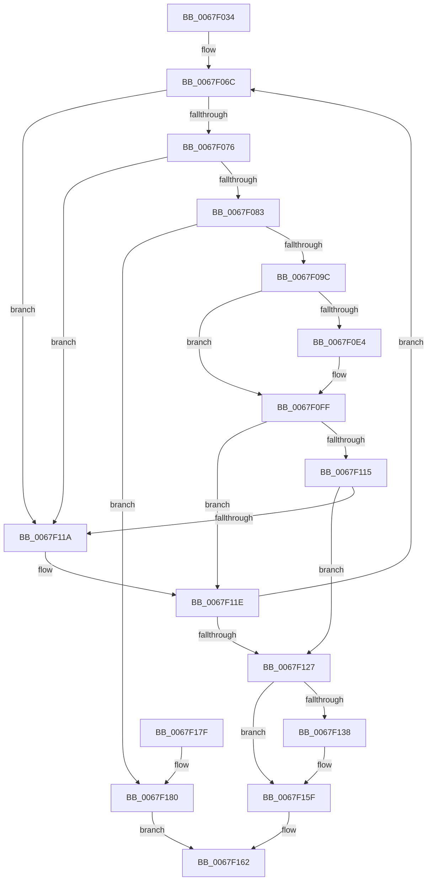

# MiUpdateActiveSubsection

- RVA: `0x0067F034`–`0x0067F189` (길이 `341` bytes)
- VA: `0x000000014067F034`
- 실행 섹션: `.text`
- PDB 이름 있음: `예`; PDB Function 태그: `아니요`
- unwind 정보 RVA: `0x000D8048`
- 디코드: `97`개 명령, `341/341` bytes 표시
- 미해석 바이트: `0` (있으면 어셈블리에 `.byte`로 보존)

> 이 문서는 커널 이미지의 기계어와 PDB 기호를 분석해 생성했습니다. 4번과 5번은 함수 원형과 자료형을 바이너리 사용 방식에서 추정한 C 해석이며 원본 소스 복구 결과는 아닙니다.

## 1. Dependencies

- 직접 호출 지점: **9**; 고유 호출 대상: **6**
- 직접 호출자로 확인된 함수: **1**
- RIP 상대 이미지 참조: **1**

### Outgoing calls
- `0x0067F064` → [ExAcquireSpinLockExclusive](../24/ExAcquireSpinLockExclusive_function_00248690.md) (function, `0x00248690`)
- `0x0067F088` → [MiReferenceSubsection](../24/MiReferenceSubsection_function_00249200.md) (function, `0x00249200`)
- `0x0067F0B0` → [MiReleaseSpinLockExclusive](../24/MiReleaseSpinLockExclusive_function_002482C0.md) (function, `0x002482C0`)
- `0x0067F0C9` → [MiAllocateFileExtents](../../page/AB/MiAllocateFileExtents_function_00ABDF54.md) (function, `0x00ABDF54`)
- `0x0067F0D7` → [ExAcquireSpinLockExclusive](../24/ExAcquireSpinLockExclusive_function_00248690.md) (function, `0x00248690`)
- `0x0067F108` → [MiDecrementSubsections](../29/MiDecrementSubsections_function_00298B50.md) (function, `0x00298B50`)
- `0x0067F12E` → [MiReleaseSpinLockExclusive](../24/MiReleaseSpinLockExclusive_function_002482C0.md) (function, `0x002482C0`)
- `0x0067F15A` → [MiReturnCrossPartitionSectionCharges](../4B/MiReturnCrossPartitionSectionCharges_function_004BA61C.md) (function, `0x004BA61C`)
- `0x0067F180` → [MiReleaseSpinLockExclusive](../24/MiReleaseSpinLockExclusive_function_002482C0.md) (function, `0x002482C0`)

### Direct callers
- [MmExtendSection](../../page/98/MmExtendSection_function_00982C38.md) at `0x00982FC7`

### Static image references
- `0x0067F13F` → RVA `0x00E30088` (`.data`; read)

## 2. Other-region calls and transfers

- 다른 실행 섹션으로 향하는 call: **1**
  - `0x0067F0C9` → [MiAllocateFileExtents](../../page/AB/MiAllocateFileExtents_function_00ABDF54.md) (`.text` → `PAGE`)
- 별도 외부 분기/꼬리 이동을 확인하지 못했습니다.

## 3. Assembly (complete function range)

```asm
0067F034  48 89 5C 24 10                  mov qword ptr [rsp + 0x10], rbx
0067F039  48 89 6C 24 18                  mov qword ptr [rsp + 0x18], rbp
0067F03E  48 89 74 24 20                  mov qword ptr [rsp + 0x20], rsi
0067F043  57                              push rdi
0067F044  41 54                           push r12
0067F046  41 55                           push r13
0067F048  41 56                           push r14
0067F04A  41 57                           push r15
0067F04C  48 83 EC 30                     sub rsp, 0x30
0067F050  48 8B 31                        mov rsi, qword ptr [rcx]
0067F053  33 FF                           xor edi, edi
0067F055  48 8B D9                        mov rbx, rcx
0067F058  44 8B FF                        mov r15d, edi
0067F05B  8B EF                           mov ebp, edi
0067F05D  4C 8D 6E 48                     lea r13, [rsi + 0x48]
0067F061  49 8B CD                        mov rcx, r13
0067F064  E8 27 96 BC FF                  call 0x140248690
0067F069  44 8A E0                        mov r12b, al
0067F06C  48 39 7B 08                     cmp qword ptr [rbx + 8], rdi
0067F070  0F 84 A4 00 00 00               je 0x14067f11a
0067F076  F7 43 34 00 00 00 40            test dword ptr [rbx + 0x34], 0x40000000
0067F07D  0F 84 97 00 00 00               je 0x14067f11a
0067F083  33 D2                           xor edx, edx
0067F085  48 8B CB                        mov rcx, rbx
0067F088  E8 73 A1 BC FF                  call 0x140249200
0067F08D  41 8A D4                        mov dl, r12b
0067F090  49 8B CD                        mov rcx, r13
0067F093  83 F8 02                        cmp eax, 2
0067F096  0F 8C E4 00 00 00               jl 0x14067f180
0067F09C  8B 43 34                        mov eax, dword ptr [rbx + 0x34]
0067F09F  44 8B 73 2C                     mov r14d, dword ptr [rbx + 0x2c]
0067F0A3  25 FF FF FF 3F                  and eax, 0x3fffffff
0067F0A8  44 2B F0                        sub r14d, eax
0067F0AB  44 89 74 24 60                  mov dword ptr [rsp + 0x60], r14d
0067F0B0  E8 0B 92 BC FF                  call 0x1402482c0
0067F0B5  4C 8B 43 08                     mov r8, qword ptr [rbx + 8]
0067F0B9  45 8B CE                        mov r9d, r14d
0067F0BC  33 D2                           xor edx, edx
0067F0BE  89 7C 24 28                     mov dword ptr [rsp + 0x28], edi
0067F0C2  48 8B CB                        mov rcx, rbx
0067F0C5  89 7C 24 20                     mov dword ptr [rsp + 0x20], edi
0067F0C9  E8 86 EE 43 00                  call 0x140abdf54
0067F0CE  49 8B CD                        mov rcx, r13
0067F0D1  44 8B F8                        mov r15d, eax
0067F0D4  44 8B F7                        mov r14d, edi
0067F0D7  E8 B4 95 BC FF                  call 0x140248690
0067F0DC  44 8A E0                        mov r12b, al
0067F0DF  45 85 FF                        test r15d, r15d
0067F0E2  78 1B                           js 0x14067f0ff
0067F0E4  8B 4B 34                        mov ecx, dword ptr [rbx + 0x34]
0067F0E7  B8 01 00 00 00                  mov eax, 1
0067F0EC  8B 53 2C                        mov edx, dword ptr [rbx + 0x2c]
0067F0EF  81 E1 FF FF FF 3F               and ecx, 0x3fffffff
0067F0F5  2B D1                           sub edx, ecx
0067F0F7  39 54 24 60                     cmp dword ptr [rsp + 0x60], edx
0067F0FB  44 0F 45 F0                     cmovne r14d, eax
0067F0FF  45 33 C0                        xor r8d, r8d
0067F102  48 8B D3                        mov rdx, rbx
0067F105  48 8B CB                        mov rcx, rbx
0067F108  E8 43 9A C1 FF                  call 0x140298b50
0067F10D  48 03 E8                        add rbp, rax
0067F110  45 85 F6                        test r14d, r14d
0067F113  75 09                           jne 0x14067f11e
0067F115  45 85 FF                        test r15d, r15d
0067F118  78 0D                           js 0x14067f127
0067F11A  48 8B 5B 10                     mov rbx, qword ptr [rbx + 0x10]
0067F11E  48 85 DB                        test rbx, rbx
0067F121  0F 85 45 FF FF FF               jne 0x14067f06c
0067F127  48 8D 4E 48                     lea rcx, [rsi + 0x48]
0067F12B  41 8A D4                        mov dl, r12b
0067F12E  E8 8D 91 BC FF                  call 0x1402482c0
0067F133  48 85 ED                        test rbp, rbp
0067F136  74 27                           je 0x14067f15f
0067F138  0F B7 4E 3C                     movzx ecx, word ptr [rsi + 0x3c]
0067F13C  4C 8B C5                        mov r8, rbp
0067F13F  48 8B 05 42 0F 7B 00            mov rax, qword ptr [rip + 0x7b0f42]
0067F146  81 E1 FF 03 00 00               and ecx, 0x3ff
0067F14C  48 39 7E 40                     cmp qword ptr [rsi + 0x40], rdi
0067F150  40 0F 95 C7                     setne dil
0067F154  48 8B 0C C8                     mov rcx, qword ptr [rax + rcx*8]
0067F158  8B D7                           mov edx, edi
0067F15A  E8 BD B4 E3 FF                  call 0x1404ba61c
0067F15F  41 8B C7                        mov eax, r15d
0067F162  48 8B 5C 24 68                  mov rbx, qword ptr [rsp + 0x68]
0067F167  48 8B 6C 24 70                  mov rbp, qword ptr [rsp + 0x70]
0067F16C  48 8B 74 24 78                  mov rsi, qword ptr [rsp + 0x78]
0067F171  48 83 C4 30                     add rsp, 0x30
0067F175  41 5F                           pop r15
0067F177  41 5E                           pop r14
0067F179  41 5D                           pop r13
0067F17B  41 5C                           pop r12
0067F17D  5F                              pop rdi
0067F17E  C3                              ret
0067F17F  CC                              int3
0067F180  E8 3B 91 BC FF                  call 0x1402482c0
0067F185  33 C0                           xor eax, eax
0067F187  EB D9                           jmp 0x14067f162
```

## 4. C-style interpretation (structured pseudocode)

```c
__int64 __fastcall MiUpdateActiveSubsection(__int64 a1, int a2)
{
    __int64 result;
    __int64 v_r14;
    __int64 v_rbp;
    __int64 v_rdi;
    __int64 v_rsp;
    unsigned int v_stack_m30;
    unsigned int v_stack_m38;
    unsigned __int64 v_stack_p10;
    unsigned __int64 v_stack_p18;
    unsigned __int64 v_stack_p20;
    unsigned int v_stack_p8;

    v_stack_p10 = v_rbx;
    v_stack_p18 = v_rbp;
    v_stack_p20 = v_rsi;
    v_rsp = (v_rsp) - (48);
    v_rdi = 0;
    result = ExAcquireSpinLockExclusive(*(unsigned __int64 *)(a1) + 72, a2, a3, a4);
loc_0067F06C:
    if ((*(unsigned __int64 *)(a1 + 8)) == 0) goto loc_0067F11A;
    if (((*(unsigned int *)(a1 + 52)) & (0x40000000ULL)) == 0) goto loc_0067F11A;
    a2 = 0;
    result = MiReferenceSubsection(a1, a2, a3, a4);
    if (((unsigned int)(result)) < 2) goto loc_0067F180;
    result = (unsigned int)(((unsigned int)(*(unsigned int *)(a1 + 52))) & (0x3FFFFFFFULL));
    v_r14 = (unsigned int)(((unsigned int)(*(unsigned int *)(a1 + 44))) - ((unsigned int)(result)));
    v_stack_p8 = (unsigned int)(v_r14);
    result = MiReleaseSpinLockExclusive(*(unsigned __int64 *)(a1) + 72, (unsigned __int8)((unsigned __int8)(result)), a3, a4);
    a2 = 0;
    v_stack_m30 = 0;
    v_stack_m38 = 0;
    result = MiAllocateFileExtents(a1, a2, *(unsigned __int64 *)(a1 + 8), (unsigned int)((unsigned int)(v_r14)));
    result = ExAcquireSpinLockExclusive(*(unsigned __int64 *)(a1) + 72, a2, *(unsigned __int64 *)(a1 + 8), (unsigned int)((unsigned int)(v_r14)));
    v_r14 = 0;
    if (!(sign_flag)) {
        a1 = *(unsigned int *)(a1 + 52);
        result = 1;
        a2 = *(unsigned int *)(a1 + 44);
        a1 = (unsigned int)((a1) & (0x3FFFFFFFULL));
        a2 = (unsigned int)((a2) - ((unsigned int)(a1)));
        v_r14 = 0;
        if (v_stack_p8 != a2) { v_r14 = (unsigned int)(result); }
    }
    a3 = 0;
    result = MiDecrementSubsections(a1, a1, a3, (unsigned int)((unsigned int)(v_r14)));
    v_rbp = (0) + (result);
    if ((unsigned int)(v_r14) != 0) goto loc_0067F11E;
    if (sign_flag) goto loc_0067F127;
loc_0067F11A:
loc_0067F11E:
    if (*(unsigned __int64 *)(a1 + 16) != 0) goto loc_0067F06C;
loc_0067F127:
    result = MiReleaseSpinLockExclusive(*(unsigned __int64 *)(a1) + 72, (unsigned __int8)((unsigned __int8)(result)), a3, (unsigned int)((unsigned int)(v_r14)));
    if (v_rbp != 0) {
        a1 = *(unsigned __int16 *)(*(unsigned __int64 *)(a1) + 60);
        a3 = v_rbp;
        result = *(unsigned __int64 *)(v_rip + 8064834);
        a1 = (unsigned int)((a1) & (0x3FFULL));
        v_rdi = ((*(unsigned __int64 *)(*(unsigned __int64 *)(a1) + 64)) != 0) ? 1 : 0;
        a1 = *(unsigned __int64 *)(result + a1 * 8);
        a2 = (unsigned int)(v_rdi);
        result = MiReturnCrossPartitionSectionCharges(a1, a2, a3, (unsigned int)((unsigned int)(v_r14)));
    }
loc_0067F162:
    v_rsp = (v_rsp) + (48);
    return (unsigned int)((unsigned int)((unsigned int)((unsigned int)(result))));
loc_0067F180:
    result = MiReleaseSpinLockExclusive(a1, a2, a3, (unsigned int)((unsigned int)(v_r14)));
    result = 0;
    goto loc_0067F162;
}
```

## 5. (Beta) C Style

```c
int64_t MiUpdateActiveSubsection(void *Arg1, int32_t Arg2)
{
    uint8_t *arg1 = (uint8_t *)Arg1;

    int64_t result;
    int64_t local_r14;
    int64_t local_rbp;
    int64_t local_rdi;
    int64_t local_rsp;
    uint32_t v_stack_m30;
    uint32_t v_stack_m38;
    uint64_t v_stack_p10;
    uint64_t v_stack_p18;
    uint64_t v_stack_p20;
    uint32_t v_stack_p8;

    v_stack_p10 = local_rbx;
    v_stack_p18 = local_rbp;
    v_stack_p20 = local_rsi;
    local_rsp = (local_rsp) - (48);
    local_rdi = 0;
    result = ExAcquireSpinLockExclusive(*(uint64_t *)(arg1) + 72, Arg2, a3, a4);
loc_0067F06C:
    if ((*(uint64_t *)(arg1 + 0x8)) == 0) goto loc_0067F11A;
    if (((*(uint32_t *)(arg1 + 0x34)) & (0x40000000ULL)) == 0) goto loc_0067F11A;
    Arg2 = 0;
    result = MiReferenceSubsection(Arg1, Arg2, a3, a4);
    if (((uint32_t)(result)) < 2) goto loc_0067F180;
    result = (uint32_t)(((uint32_t)(*(uint32_t *)(arg1 + 0x34))) & (0x3FFFFFFFULL));
    local_r14 = (uint32_t)(((uint32_t)(*(uint32_t *)(arg1 + 0x2C))) - ((uint32_t)(result)));
    v_stack_p8 = (uint32_t)(local_r14);
    result = MiReleaseSpinLockExclusive(*(uint64_t *)(arg1) + 72, (uint8_t)((uint8_t)(result)), a3, a4);
    Arg2 = 0;
    v_stack_m30 = 0;
    v_stack_m38 = 0;
    result = MiAllocateFileExtents(Arg1, Arg2, *(uint64_t *)(arg1 + 0x8), (uint32_t)((uint32_t)(local_r14)));
    result = ExAcquireSpinLockExclusive(*(uint64_t *)(arg1) + 72, Arg2, *(uint64_t *)(arg1 + 0x8), (uint32_t)((uint32_t)(local_r14)));
    local_r14 = 0;
    if (!(sign_flag)) {
        Arg1 = *(uint32_t *)(arg1 + 0x34);
        result = 1;
        Arg2 = *(uint32_t *)(arg1 + 0x2C);
        Arg1 = (uint32_t)((Arg1) & (0x3FFFFFFFULL));
        Arg2 = (uint32_t)((Arg2) - ((uint32_t)(Arg1)));
        local_r14 = 0;
        if (v_stack_p8 != Arg2) { local_r14 = (uint32_t)(result); }
    }
    a3 = 0;
    result = MiDecrementSubsections(Arg1, Arg1, a3, (uint32_t)((uint32_t)(local_r14)));
    local_rbp = (0) + (result);
    if ((uint32_t)(local_r14) != 0) goto loc_0067F11E;
    if (sign_flag) goto loc_0067F127;
loc_0067F11A:
loc_0067F11E:
    if (*(uint64_t *)(arg1 + 0x10) != 0) goto loc_0067F06C;
loc_0067F127:
    result = MiReleaseSpinLockExclusive(*(uint64_t *)(arg1) + 72, (uint8_t)((uint8_t)(result)), a3, (uint32_t)((uint32_t)(local_r14)));
    if (local_rbp != 0) {
        Arg1 = *(uint16_t *)(*(uint64_t *)(arg1) + 0x3C);
        a3 = local_rbp;
        result = *(uint64_t *)(v_rip + 0x7B0F42);
        Arg1 = (uint32_t)((Arg1) & (0x3FFULL));
        local_rdi = ((*(uint64_t *)(*(uint64_t *)(arg1) + 0x40)) != 0) ? 1 : 0;
        Arg1 = *(uint64_t *)(result + arg1 * 8);
        Arg2 = (uint32_t)(local_rdi);
        result = MiReturnCrossPartitionSectionCharges(Arg1, Arg2, a3, (uint32_t)((uint32_t)(local_r14)));
    }
loc_0067F162:
    local_rsp = (local_rsp) + (48);
    return (uint32_t)((uint32_t)((uint32_t)((uint32_t)(result))));
loc_0067F180:
    result = MiReleaseSpinLockExclusive(Arg1, Arg2, a3, (uint32_t)((uint32_t)(local_r14)));
    result = 0;
    goto loc_0067F162;
}
```

### 관측된 메모리 오프셋

구조체 형식이 확인되지 않은 접근은 인자 기준의 오프셋으로만 기록했습니다.

| 기준 인자 | 오프셋 표현 | 폭 (bit) | 접근 |
|---|---:|---:|---|
| `Arg1` | `+ 0x0` | `64` | `R` |

## 6. Execution-region graph

[열기: 2D/3D 그래프와 함수 탐색 컨트롤 패널](../../../control-panel.html?section=text&rva=0x0067F034&view=graph)

- 2D 그래프는 위에서 아래로 흐르고, 3D 그래프는 빈 공간을 드래그해 회전합니다. Shift+드래그는 이동, 휠은 확대·축소, 함수 노드 선택은 대상 보고서 이동입니다.

### Static fallback


