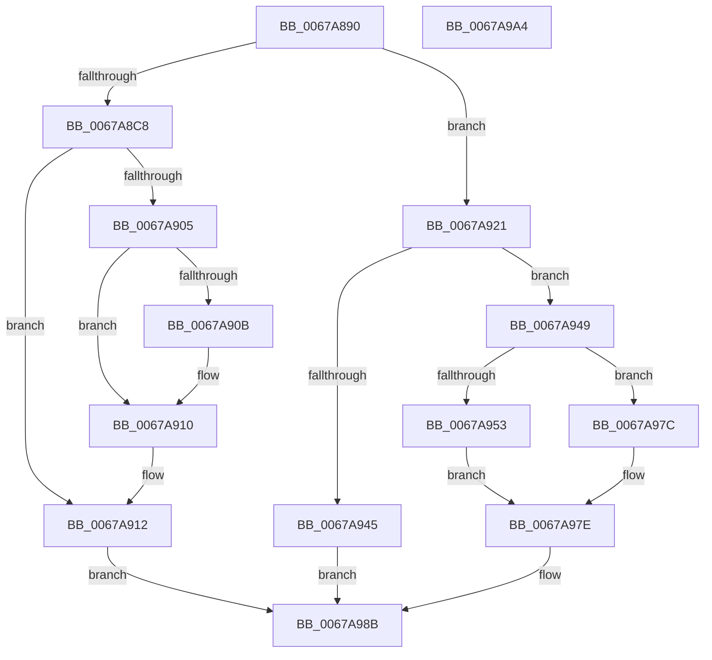

# MiUpdateBadPfnIdentity

- RVA: `0x0067A890`–`0x0067A9A5` (길이 `277` bytes)
- VA: `0x000000014067A890`
- 실행 섹션: `.text`
- PDB 이름 있음: `예`; PDB Function 태그: `아니요`
- unwind 정보 RVA: `0x000BEF48`
- 디코드: `83`개 명령, `277/277` bytes 표시
- 미해석 바이트: `0` (있으면 어셈블리에 `.byte`로 보존)

> 이 문서는 커널 이미지의 기계어와 PDB 기호를 분석해 생성했습니다. 4번과 5번은 함수 원형과 자료형을 바이너리 사용 방식에서 추정한 C 해석이며 원본 소스 복구 결과는 아닙니다.

## 1. Dependencies

- 직접 호출 지점: **7**; 고유 호출 대상: **7**
- 직접 호출자로 확인된 함수: **1**
- RIP 상대 이미지 참조: **1**

### Outgoing calls
- `0x0067A8BD` → [MiIsPageInHugePfn](../2A/MiIsPageInHugePfn_function_002AB770.md) (function, `0x002AB770`)
- `0x0067A8E7` → [MiLockHugePfn](MiLockHugePfn_function_006765FC.md) (function, `0x006765FC`)
- `0x0067A8F9` → [MiGetPageInHugePageBadStatus](MiGetPageInHugePageBadStatus_function_00675ADC.md) (function, `0x00675ADC`)
- `0x0067A918` → [MiUnlockHugePfn](../4D/MiUnlockHugePfn_function_004D90E4.md) (function, `0x004D90E4`)
- `0x0067A939` → [MiSafeLockPage](../32/MiSafeLockPage_function_00321620.md) (function, `0x00321620`)
- `0x0067A959` → [MiIdentifyPfn](../31/MiIdentifyPfn_function_0031CAC0.md) (function, `0x0031CAC0`)
- `0x0067A984` → [MiUnlockPage](../31/MiUnlockPage_function_0031A3E0.md) (function, `0x0031A3E0`)

### Direct callers
- [MmQueryBadAddresses](../../page/AD/MmQueryBadAddresses_function_00AD5430.md) at `0x00AD5597`

### Static image references
- `0x0067A8C8` → RVA `0x00E300C0` (`.data`; read)

## 2. Other-region calls and transfers

- 다른 실행 섹션으로 향하는 call: **0**
- 별도 외부 분기/꼬리 이동을 확인하지 못했습니다.

## 3. Assembly (complete function range)

```asm
0067A890  48 89 5C 24 08                  mov qword ptr [rsp + 8], rbx
0067A895  48 89 6C 24 10                  mov qword ptr [rsp + 0x10], rbp
0067A89A  48 89 74 24 20                  mov qword ptr [rsp + 0x20], rsi
0067A89F  57                              push rdi
0067A8A0  41 56                           push r14
0067A8A2  41 57                           push r15
0067A8A4  48 83 EC 20                     sub rsp, 0x20
0067A8A8  33 C0                           xor eax, eax
0067A8AA  0F 57 C0                        xorps xmm0, xmm0
0067A8AD  0F 11 02                        movups xmmword ptr [rdx], xmm0
0067A8B0  48 8B F2                        mov rsi, rdx
0067A8B3  48 89 42 10                     mov qword ptr [rdx + 0x10], rax
0067A8B7  4C 8B F1                        mov r14, rcx
0067A8BA  8D 68 01                        lea ebp, [rax + 1]
0067A8BD  E8 AE 0E C3 FF                  call 0x1402ab770
0067A8C2  33 DB                           xor ebx, ebx
0067A8C4  85 C0                           test eax, eax
0067A8C6  74 59                           je 0x14067a921
0067A8C8  48 8B 05 F1 57 7B 00            mov rax, qword ptr [rip + 0x7b57f1]
0067A8CF  49 8B CE                        mov rcx, r14
0067A8D2  48 C1 E9 12                     shr rcx, 0x12
0067A8D6  81 E1 FF FF 3F 00               and ecx, 0x3fffff
0067A8DC  89 5C 24 50                     mov dword ptr [rsp + 0x50], ebx
0067A8E0  48 8D 3C C8                     lea rdi, [rax + rcx*8]
0067A8E4  48 8B CF                        mov rcx, rdi
0067A8E7  E8 10 BD FF FF                  call 0x1406765fc
0067A8EC  4C 8D 44 24 50                  lea r8, [rsp + 0x50]
0067A8F1  8B D5                           mov edx, ebp
0067A8F3  49 8B CE                        mov rcx, r14
0067A8F6  44 8A F8                        mov r15b, al
0067A8F9  E8 DE B1 FF FF                  call 0x140675adc
0067A8FE  3D 03 01 00 00                  cmp eax, 0x103
0067A903  75 0D                           jne 0x14067a912
0067A905  39 5C 24 50                     cmp dword ptr [rsp + 0x50], ebx
0067A909  74 05                           je 0x14067a910
0067A90B  48 0F BA 2E 07                  bts qword ptr [rsi], 7
0067A910  8B DD                           mov ebx, ebp
0067A912  41 8A D7                        mov dl, r15b
0067A915  48 8B CF                        mov rcx, rdi
0067A918  E8 C7 E7 E5 FF                  call 0x1404d90e4
0067A91D  8B C3                           mov eax, ebx
0067A91F  EB 6A                           jmp 0x14067a98b
0067A921  4B 8D 3C 76                     lea rdi, [r14 + r14*2]
0067A925  48 C1 E7 04                     shl rdi, 4
0067A929  48 B8 00 00 00 00 00 DE FF FF   movabs rax, 0xffffde0000000000
0067A933  49 8B CE                        mov rcx, r14
0067A936  48 03 F8                        add rdi, rax
0067A939  E8 E2 6C CA FF                  call 0x140321620
0067A93E  44 8A F8                        mov r15b, al
0067A941  3C 11                           cmp al, 0x11
0067A943  75 04                           jne 0x14067a949
0067A945  33 C0                           xor eax, eax
0067A947  EB 42                           jmp 0x14067a98b
0067A949  8B 47 20                        mov eax, dword ptr [rdi + 0x20]
0067A94C  C1 E8 18                        shr eax, 0x18
0067A94F  A8 40                           test al, 0x40
0067A951  74 29                           je 0x14067a97c
0067A953  48 8B D6                        mov rdx, rsi
0067A956  49 8B CE                        mov rcx, r14
0067A959  E8 62 21 CA FF                  call 0x14031cac0
0067A95E  48 8B 16                        mov rdx, qword ptr [rsi]
0067A961  8A 47 23                        mov al, byte ptr [rdi + 0x23]
0067A964  48 8B CA                        mov rcx, rdx
0067A967  48 0F BA F1 07                  btr rcx, 7
0067A96C  48 0F BA EA 07                  bts rdx, 7
0067A971  84 C0                           test al, al
0067A973  48 0F 49 D1                     cmovns rdx, rcx
0067A977  48 89 16                        mov qword ptr [rsi], rdx
0067A97A  EB 02                           jmp 0x14067a97e
0067A97C  8B EB                           mov ebp, ebx
0067A97E  41 8A D7                        mov dl, r15b
0067A981  48 8B CF                        mov rcx, rdi
0067A984  E8 57 FA C9 FF                  call 0x14031a3e0
0067A989  8B C5                           mov eax, ebp
0067A98B  48 8B 5C 24 40                  mov rbx, qword ptr [rsp + 0x40]
0067A990  48 8B 6C 24 48                  mov rbp, qword ptr [rsp + 0x48]
0067A995  48 8B 74 24 58                  mov rsi, qword ptr [rsp + 0x58]
0067A99A  48 83 C4 20                     add rsp, 0x20
0067A99E  41 5F                           pop r15
0067A9A0  41 5E                           pop r14
0067A9A2  5F                              pop rdi
0067A9A3  C3                              ret
0067A9A4  CC                              int3
```

## 4. C-style interpretation (structured pseudocode)

```c
__int64 __fastcall MiUpdateBadPfnIdentity(__int64 a1, __int64 a2)
{
    __int64 result;
    __int64 v_rbx;
    __int64 v_rdi;
    __int64 v_rsp;
    unsigned __int64 v_stack_p10;
    unsigned int v_stack_p18;
    unsigned __int64 v_stack_p20;
    unsigned __int64 v_stack_p8;

    v_stack_p8 = v_rbx;
    v_stack_p10 = v_rbp;
    v_stack_p20 = v_rsi;
    v_rsp = (v_rsp) - (32);
    result = 0;
    *(unsigned __int64 *)(a2) = v_xmm0;
    *(unsigned __int64 *)(a2 + 16) = 0;
    result = MiIsPageInHugePfn(a1, a2, a3, a4);
    v_rbx = 0;
    if ((unsigned int)(result) == 0) goto loc_0067A921;
    a1 = (a1) >> (18);
    a1 = (unsigned int)((a1) & (0x3FFFFFULL));
    v_stack_p18 = 0;
    result = MiLockHugePfn(*(unsigned __int64 *)(v_rip + 8083441) + a1 * 8, a2, a3, a4);
    result = MiGetPageInHugePageBadStatus(a1, (unsigned int)((unsigned int)(result + 1)), v_stack_p18, a4);
    if (((unsigned int)(result)) != 259) goto loc_0067A912;
    if (v_stack_p18 != 0) {
    }
loc_0067A912:
    result = MiUnlockHugePfn(*(unsigned __int64 *)(v_rip + 8083441) + a1 * 8, (unsigned __int8)((unsigned __int8)(result)), v_stack_p18, a4);
    goto loc_0067A98B;
loc_0067A921:
    v_rdi = (a1 + a1 * 2) << (4);
    v_rdi = (v_rdi) + ((unsigned int)((unsigned int)((unsigned int)((unsigned int)(result + 1)))));
    result = MiSafeLockPage(a1, (unsigned __int8)((unsigned __int8)(result)), v_stack_p18, a4);
    if (((unsigned __int8)(result)) != 17) goto loc_0067A949;
    result = 0;
    goto loc_0067A98B;
loc_0067A949:
    result = (unsigned int)(((unsigned int)(*(unsigned int *)(v_rdi + 32))) >> (24));
    if ((((unsigned __int8)(result)) & (64)) == 0) goto loc_0067A97C;
    result = MiIdentifyPfn(a1, a2, v_stack_p18, a4);
    a2 = *(unsigned __int64 *)(a2);
    if (!sign_flag) { a2 = *(unsigned __int64 *)(a2); }
    *(unsigned __int64 *)(a2) = a2;
    goto loc_0067A97E;
loc_0067A97C:
loc_0067A97E:
    result = MiUnlockPage(v_rdi, (unsigned __int8)((unsigned __int8)(result)), v_stack_p18, a4);
loc_0067A98B:
    v_rsp = (v_rsp) + (32);
    return (unsigned int)((unsigned int)((unsigned int)((unsigned int)((unsigned int)((unsigned int)(result + 1))))));
}
```

## 5. (Beta) C Style

```c
int64_t MiUpdateBadPfnIdentity(void *Arg1, void *Arg2)
{
    uint8_t *arg1 = (uint8_t *)Arg1;
    uint8_t *arg2 = (uint8_t *)Arg2;

    int64_t result;
    int64_t local_rbx;
    int64_t local_rdi;
    int64_t local_rsp;
    uint64_t v_stack_p10;
    uint32_t v_stack_p18;
    uint64_t v_stack_p20;
    uint64_t v_stack_p8;

    v_stack_p8 = local_rbx;
    v_stack_p10 = local_rbp;
    v_stack_p20 = local_rsi;
    local_rsp = (local_rsp) - (32);
    result = 0;
    *(uint64_t *)(arg2) = v_xmm0;
    *(uint64_t *)(arg2 + 0x10) = 0;
    result = MiIsPageInHugePfn(Arg1, Arg2, a3, a4);
    local_rbx = 0;
    if ((uint32_t)(result) == 0) goto loc_0067A921;
    Arg1 = (Arg1) >> (18);
    Arg1 = (uint32_t)((Arg1) & (0x3FFFFFULL));
    v_stack_p18 = 0;
    result = MiLockHugePfn(*(uint64_t *)(v_rip + 0x7B57F1) + Arg1 * 8, Arg2, a3, a4);
    result = MiGetPageInHugePageBadStatus(Arg1, (uint32_t)((uint32_t)(result + 1)), v_stack_p18, a4);
    if (((uint32_t)(result)) != 259) goto loc_0067A912;
    if (v_stack_p18 != 0) {
    }
loc_0067A912:
    result = MiUnlockHugePfn(*(uint64_t *)(v_rip + 0x7B57F1) + Arg1 * 8, (uint8_t)((uint8_t)(result)), v_stack_p18, a4);
    goto loc_0067A98B;
loc_0067A921:
    local_rdi = (Arg1 + Arg1 * 2) << (4);
    local_rdi = (local_rdi) + ((uint32_t)((uint32_t)((uint32_t)((uint32_t)(result + 1)))));
    result = MiSafeLockPage(Arg1, (uint8_t)((uint8_t)(result)), v_stack_p18, a4);
    if (((uint8_t)(result)) != 17) goto loc_0067A949;
    result = 0;
    goto loc_0067A98B;
loc_0067A949:
    result = (uint32_t)(((uint32_t)(*(uint32_t *)(local_rdi + 0x20))) >> (24));
    if ((((uint8_t)(result)) & (64)) == 0) goto loc_0067A97C;
    result = MiIdentifyPfn(Arg1, Arg2, v_stack_p18, a4);
    Arg2 = *(uint64_t *)(arg2);
    if (!sign_flag) { Arg2 = *(uint64_t *)(arg2); }
    *(void **)(arg2) = Arg2;
    goto loc_0067A97E;
loc_0067A97C:
loc_0067A97E:
    result = MiUnlockPage(local_rdi, (uint8_t)((uint8_t)(result)), v_stack_p18, a4);
loc_0067A98B:
    local_rsp = (local_rsp) + (32);
    return (uint32_t)((uint32_t)((uint32_t)((uint32_t)((uint32_t)((uint32_t)(result + 1))))));
}
```

### 관측된 메모리 오프셋

구조체 형식이 확인되지 않은 접근은 인자 기준의 오프셋으로만 기록했습니다.

| 기준 인자 | 오프셋 표현 | 폭 (bit) | 접근 |
|---|---:|---:|---|
| `Arg1` | `+ 0x0 + r14*2` | `64` | `R` |
| `Arg2` | `+ 0x0` | `64` | `R` |
| `Arg2` | `+ 0x0` | `64` | `R/W` |
| `Arg2` | `+ 0x0` | `64` | `W` |
| `Arg2` | `+ 0x0` | `128` | `R` |
| `Arg2` | `+ 0x10` | `64` | `W` |

## 6. Execution-region graph

[열기: 2D/3D 그래프와 함수 탐색 컨트롤 패널](../../../control-panel.html?section=text&rva=0x0067A890&view=graph)

- 2D 그래프는 위에서 아래로 흐르고, 3D 그래프는 빈 공간을 드래그해 회전합니다. Shift+드래그는 이동, 휠은 확대·축소, 함수 노드 선택은 대상 보고서 이동입니다.

### Static fallback


