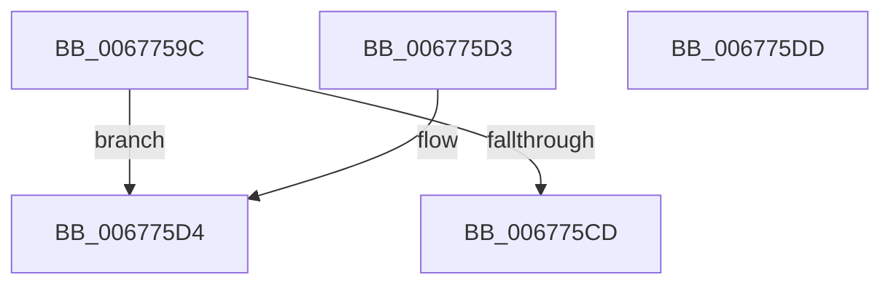

# MiUpdateHugeRangeZeroFreeBitmap

- RVA: `0x0067759C`–`0x006775DE` (길이 `66` bytes)
- VA: `0x000000014067759C`
- 실행 섹션: `.text`
- PDB 이름 있음: `예`; PDB Function 태그: `아니요`
- unwind 정보 RVA: `0x000DB714`
- 디코드: `20`개 명령, `66/66` bytes 표시
- 미해석 바이트: `0` (있으면 어셈블리에 `.byte`로 보존)

> 이 문서는 커널 이미지의 기계어와 PDB 기호를 분석해 생성했습니다. 4번과 5번은 함수 원형과 자료형을 바이너리 사용 방식에서 추정한 C 해석이며 원본 소스 복구 결과는 아닙니다.

## 1. Dependencies

- 직접 호출 지점: **0**; 고유 호출 대상: **0**
- 직접 호출자로 확인된 함수: **2**
- RIP 상대 이미지 참조: **0**

### Outgoing calls
- 직접 디코드된 call 명령이 없습니다.

### Direct callers
- [MiUnlinkHugeRange](../43/MiUnlinkHugeRange_function_00436EF0.md) at `0x0043707F`
- [MiInsertHugeRangeInList](../43/MiInsertHugeRangeInList_function_004371E8.md) at `0x004373ED`

### Static image references
- 디코드된 RIP-relative 메모리 참조가 없습니다.

## 2. Other-region calls and transfers

- 다른 실행 섹션으로 향하는 call: **0**
- 별도 외부 분기/꼬리 이동을 확인하지 못했습니다.

## 3. Assembly (complete function range)

```asm
0067759C  45 0F B6 D0                     movzx r10d, r8b
006775A0  48 8B D1                        mov rdx, rcx
006775A3  49 C1 E8 14                     shr r8, 0x14
006775A7  41 8A CA                        mov cl, r10b
006775AA  80 E1 3F                        and cl, 0x3f
006775AD  49 C1 EA 06                     shr r10, 6
006775B1  41 83 E0 01                     and r8d, 1
006775B5  B8 01 00 00 00                  mov eax, 1
006775BA  4D 03 C0                        add r8, r8
006775BD  48 D3 E0                        shl rax, cl
006775C0  4A 8B 8C C2 C8 3A 00 00         mov rcx, qword ptr [rdx + r8*8 + 0x3ac8]
006775C8  45 85 C9                        test r9d, r9d
006775CB  74 07                           je 0x1406775d4
006775CD  F0 4A 09 04 D1                  lock or qword ptr [rcx + r10*8], rax
006775D2  C3                              ret
006775D3  CC                              int3
006775D4  48 F7 D0                        not rax
006775D7  F0 4A 21 04 D1                  lock and qword ptr [rcx + r10*8], rax
006775DC  C3                              ret
006775DD  CC                              int3
```

## 4. C-style interpretation (structured pseudocode)

```c
__int64 __fastcall MiUpdateHugeRangeZeroFreeBitmap(__int64 a1, __int64 a2, __int64 a3, int a4)
{
    __int64 result;
    __int64 v_r10;

    a3 = (a3) >> (20);
    a1 = (unsigned __int8)(((unsigned __int8)((unsigned __int8)(a3))) & (63));
    v_r10 = ((unsigned __int8)(a3)) >> (6);
    a3 = (unsigned int)((a3) & (1));
    a3 = (a3) + (a3);
    result = (1) << ((unsigned __int8)(a1));
    if (a4 == 0) goto loc_006775D4;
    return result;
loc_006775D4:
    result = ~(result);
    return result;
}
```

## 5. (Beta) C Style

```c
int64_t MiUpdateHugeRangeZeroFreeBitmap(void *Arg1, int64_t Arg2, int64_t Arg3, int32_t Arg4)
{
    uint8_t *arg1 = (uint8_t *)Arg1;

    int64_t result;
    int64_t local_r10;

    Arg3 = (Arg3) >> (20);
    Arg1 = (uint8_t)(((uint8_t)((uint8_t)(Arg3))) & (63));
    local_r10 = ((uint8_t)(Arg3)) >> (6);
    Arg3 = (uint32_t)((Arg3) & (1));
    Arg3 = (Arg3) + (Arg3);
    result = (1) << ((uint8_t)(Arg1));
    if (Arg4 == 0) goto loc_006775D4;
    return result;
loc_006775D4:
    result = ~(result);
    return result;
}
```

### 관측된 메모리 오프셋

구조체 형식이 확인되지 않은 접근은 인자 기준의 오프셋으로만 기록했습니다.

| 기준 인자 | 오프셋 표현 | 폭 (bit) | 접근 |
|---|---:|---:|---|
| `Arg1` | `+ 0x3AC8 + r8*8` | `64` | `R` |

## 6. Execution-region graph

[열기: 2D/3D 그래프와 함수 탐색 컨트롤 패널](../../../control-panel.html?section=text&rva=0x0067759C&view=graph)

- 2D 그래프는 위에서 아래로 흐르고, 3D 그래프는 빈 공간을 드래그해 회전합니다. Shift+드래그는 이동, 휠은 확대·축소, 함수 노드 선택은 대상 보고서 이동입니다.

### Static fallback


