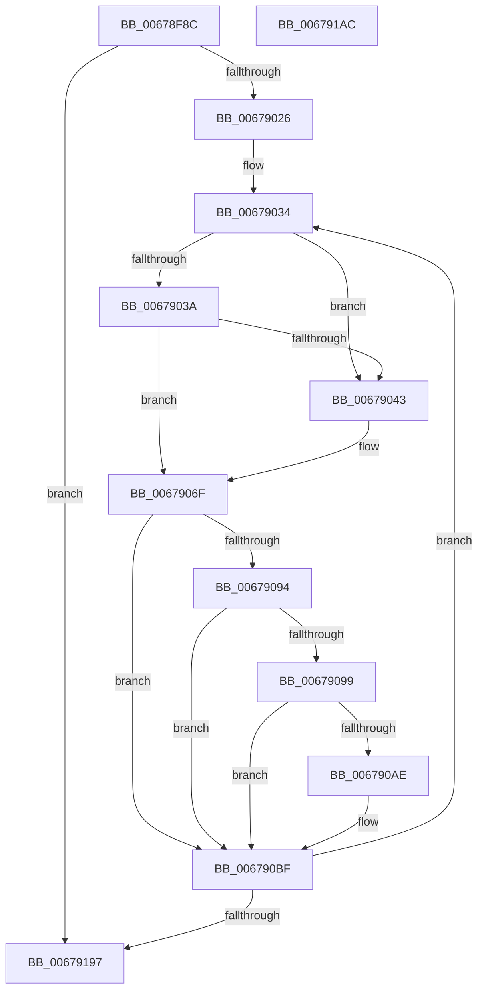

# MiUpdateLargePageSectionPfns

- RVA: `0x00678F8C`–`0x006791AD` (길이 `545` bytes)
- VA: `0x0000000140678F8C`
- 실행 섹션: `.text`
- PDB 이름 있음: `예`; PDB Function 태그: `아니요`
- unwind 정보 RVA: `0x000A9680`
- 디코드: `137`개 명령, `545/545` bytes 표시
- 미해석 바이트: `0` (있으면 어셈블리에 `.byte`로 보존)

> 이 문서는 커널 이미지의 기계어와 PDB 기호를 분석해 생성했습니다. 4번과 5번은 함수 원형과 자료형을 바이너리 사용 방식에서 추정한 C 해석이며 원본 소스 복구 결과는 아닙니다.

## 1. Dependencies

- 직접 호출 지점: **10**; 고유 호출 대상: **10**
- 직접 호출자로 확인된 함수: **1**
- RIP 상대 이미지 참조: **2**

### Outgoing calls
- `0x00678FDA` → [MiMakeValidPte](../2C/MiMakeValidPte_function_002C5590.md) (function, `0x002C5590`)
- `0x00678FE4` → [MiMakeDemandZeroPte](../33/MiMakeDemandZeroPte_function_00337A00.md) (function, `0x00337A00`)
- `0x00678FEF` → [MiGetPfnPageSizeIndex](../31/MiGetPfnPageSizeIndex_function_0031C710.md) (function, `0x0031C710`)
- `0x00679015` → [MiConvertActiveLargePageToSmall](../42/MiConvertActiveLargePageToSmall_function_00420AF8.md) (function, `0x00420AF8`)
- `0x006790BA` → [MiCheckLinearProtectedPteAccessedBit](../29/MiCheckLinearProtectedPteAccessedBit_function_00292D80.md) (function, `0x00292D80`)
- `0x006790C9` → [MiLockPageInline](../31/MiLockPageInline_function_0031A340.md) (function, `0x0031A340`)
- `0x006790DA` → [MiSetPfnTbFlushStamp](../2B/MiSetPfnTbFlushStamp_function_002B7A70.md) (function, `0x002B7A70`)
- `0x006790E4` → [MiSetPfnNodeBlinkLow](../2A/MiSetPfnNodeBlinkLow_function_002AF2A0.md) (function, `0x002AF2A0`)
- `0x00679143` → [MiSetPfnContainingFrame](../36/MiSetPfnContainingFrame_function_00363FC0.md) (function, `0x00363FC0`)
- `0x0067916D` → [MiUnlockPage](../31/MiUnlockPage_function_0031A3E0.md) (function, `0x0031A3E0`)

### Direct callers
- [sub_00B2AD32](../../page/B2/Unknown_function_00B2AD32.md) at `0x00B2AEF0`

### Static image references
- `0x00678FF6` → RVA `0x00011C60` (`.rdata`; read)
- `0x00679089` → RVA `0x00FC6A88` (`ALMOSTRO`; read)

## 2. Other-region calls and transfers

- 다른 실행 섹션으로 향하는 call: **0**
- 별도 외부 분기/꼬리 이동을 확인하지 못했습니다.

## 3. Assembly (complete function range)

```asm
00678F8C  48 89 5C 24 20                  mov qword ptr [rsp + 0x20], rbx
00678F91  48 89 54 24 10                  mov qword ptr [rsp + 0x10], rdx
00678F96  55                              push rbp
00678F97  56                              push rsi
00678F98  57                              push rdi
00678F99  41 54                           push r12
00678F9B  41 55                           push r13
00678F9D  41 56                           push r14
00678F9F  41 57                           push r15
00678FA1  48 83 EC 20                     sub rsp, 0x20
00678FA5  41 8B F8                        mov edi, r8d
00678FA8  48 8B F2                        mov rsi, rdx
00678FAB  4C 8B E9                        mov r13, rcx
00678FAE  48 B8 00 00 00 00 00 DE FF FF   movabs rax, 0xffffde0000000000
00678FB8  4C 8B E1                        mov r12, rcx
00678FBB  41 0F BA E8 1F                  bts r8d, 0x1f
00678FC0  4C 2B E0                        sub r12, rax
00678FC3  33 C9                           xor ecx, ecx
00678FC5  48 B8 AB AA AA AA AA AA AA AA   movabs rax, 0xaaaaaaaaaaaaaaab
00678FCF  49 C1 FC 04                     sar r12, 4
00678FD3  4C 0F AF E0                     imul r12, rax
00678FD7  49 8B D4                        mov rdx, r12
00678FDA  E8 B1 C5 C4 FF                  call 0x1402c5590
00678FDF  8B CF                           mov ecx, edi
00678FE1  48 8B D8                        mov rbx, rax
00678FE4  E8 17 EA CB FF                  call 0x140337a00
00678FE9  49 8B CD                        mov rcx, r13
00678FEC  48 8B F8                        mov rdi, rax
00678FEF  E8 1C 37 CA FF                  call 0x14031c710
00678FF4  8B C0                           mov eax, eax
00678FF6  48 8D 0D 63 8C 99 FF            lea rcx, [rip - 0x66739d]
00678FFD  49 83 CE FF                     or r14, 0xffffffffffffffff
00679001  48 8B 04 C1                     mov rax, qword ptr [rcx + rax*8]
00679005  49 8B CD                        mov rcx, r13
00679008  41 8D 56 02                     lea edx, [r14 + 2]
0067900C  48 8D 2C C6                     lea rbp, [rsi + rax*8]
00679010  48 89 6C 24 60                  mov qword ptr [rsp + 0x60], rbp
00679015  E8 DE 7A DA FF                  call 0x140420af8
0067901A  4C 8B FE                        mov r15, rsi
0067901D  48 3B F5                        cmp rsi, rbp
00679020  0F 83 71 01 00 00               jae 0x140679197
00679026  49 83 C5 18                     add r13, 0x18
0067902A  49 B8 00 00 00 00 80 F6 FF FF   movabs r8, 0xfffff68000000000
00679034  49 83 FE FF                     cmp r14, -1
00679038  74 09                           je 0x140679043
0067903A  49 F7 C7 FF 0F 00 00            test r15, 0xfff
00679041  75 2C                           jne 0x14067906f
00679043  48 8B CE                        mov rcx, rsi
00679046  48 B8 F8 FF FF FF 7F 00 00 00   movabs rax, 0x7ffffffff8
00679050  48 C1 E9 09                     shr rcx, 9
00679054  48 23 C8                        and rcx, rax
00679057  49 8B C0                        mov rax, r8
0067905A  4C 8B 34 01                     mov r14, qword ptr [rcx + rax]
0067905E  48 B8 FF FF FF FF FF 00 00 00   movabs rax, 0xffffffffff
00679068  49 C1 EE 0C                     shr r14, 0xc
0067906C  4C 23 F0                        and r14, rax
0067906F  49 8B CC                        mov rcx, r12
00679072  48 BA FF 0F 00 00 00 00 F0 FF   movabs rdx, 0xfff0000000000fff
0067907C  48 C1 E1 0C                     shl rcx, 0xc
00679080  48 33 D9                        xor rbx, rcx
00679083  48 23 DA                        and rbx, rdx
00679086  48 33 D9                        xor rbx, rcx
00679089  48 0F BA 25 F6 D9 94 00 24      bt qword ptr [rip + 0x94d9f6], 0x24
00679092  73 2B                           jae 0x1406790bf
00679094  F6 C3 20                        test bl, 0x20
00679097  75 26                           jne 0x1406790bf
00679099  49 8B C0                        mov rax, r8
0067909C  48 B9 00 00 00 00 40 00 00 00   movabs rcx, 0x4000000000
006790A6  48 03 C1                        add rax, rcx
006790A9  4C 3B F8                        cmp r15, rax
006790AC  72 11                           jb 0x1406790bf
006790AE  41 B8 80 00 00 00               mov r8d, 0x80
006790B4  48 8B D3                        mov rdx, rbx
006790B7  49 8B CF                        mov rcx, r15
006790BA  E8 C1 9C C1 FF                  call 0x140292d80
006790BF  49 8D 6D E8                     lea rbp, [r13 - 0x18]
006790C3  49 89 1F                        mov qword ptr [r15], rbx
006790C6  48 8B CD                        mov rcx, rbp
006790C9  E8 72 12 CA FF                  call 0x14031a340
006790CE  33 D2                           xor edx, edx
006790D0  48 8B CD                        mov rcx, rbp
006790D3  40 8A F0                        mov sil, al
006790D6  44 8D 42 01                     lea r8d, [rdx + 1]
006790DA  E8 91 E9 C3 FF                  call 0x1402b7a70
006790DF  33 D2                           xor edx, edx
006790E1  48 8B CD                        mov rcx, rbp
006790E4  E8 B7 61 C3 FF                  call 0x1402af2a0
006790E9  49 8B 4D 00                     mov rcx, qword ptr [r13]
006790ED  48 B8 01 00 00 00 00 00 00 C0   movabs rax, 0xc000000000000001
006790F7  48 23 C8                        and rcx, rax
006790FA  49 8B D6                        mov rdx, r14
006790FD  48 83 C9 01                     or rcx, 1
00679101  49 89 4D 00                     mov qword ptr [r13], rcx
00679105  48 B9 00 00 00 00 00 00 00 80   movabs rcx, 0x8000000000000000
0067910F  41 8B 45 08                     mov eax, dword ptr [r13 + 8]
00679113  89 44 24 70                     mov dword ptr [rsp + 0x70], eax
00679117  B8 02 00 00 00                  mov eax, 2
0067911C  66 89 44 24 70                  mov word ptr [rsp + 0x70], ax
00679121  8B 44 24 70                     mov eax, dword ptr [rsp + 0x70]
00679125  41 89 45 08                     mov dword ptr [r13 + 8], eax
00679129  49 89 7D F8                     mov qword ptr [r13 - 8], rdi
0067912D  49 C7 45 E8 00 00 00 00         mov qword ptr [r13 - 0x18], 0
00679135  49 8B 45 10                     mov rax, qword ptr [r13 + 0x10]
00679139  48 0B C1                        or rax, rcx
0067913C  48 8B CD                        mov rcx, rbp
0067913F  49 89 45 10                     mov qword ptr [r13 + 0x10], rax
00679143  E8 78 AE CE FF                  call 0x140363fc0
00679148  4D 89 7D F0                     mov qword ptr [r13 - 0x10], r15
0067914C  40 8A D6                        mov dl, sil
0067914F  41 8B 45 08                     mov eax, dword ptr [r13 + 8]
00679153  48 8B CD                        mov rcx, rbp
00679156  89 44 24 70                     mov dword ptr [rsp + 0x70], eax
0067915A  C1 E8 10                        shr eax, 0x10
0067915D  24 FE                           and al, 0xfe
0067915F  0C 06                           or al, 6
00679161  88 44 24 72                     mov byte ptr [rsp + 0x72], al
00679165  8B 44 24 70                     mov eax, dword ptr [rsp + 0x70]
00679169  41 89 45 08                     mov dword ptr [r13 + 8], eax
0067916D  E8 6E 12 CA FF                  call 0x14031a3e0
00679172  48 8B 74 24 68                  mov rsi, qword ptr [rsp + 0x68]
00679177  49 FF C4                        inc r12
0067917A  49 83 C5 30                     add r13, 0x30
0067917E  49 B8 00 00 00 00 80 F6 FF FF   movabs r8, 0xfffff68000000000
00679188  49 83 C7 08                     add r15, 8
0067918C  4C 3B 7C 24 60                  cmp r15, qword ptr [rsp + 0x60]
00679191  0F 82 9D FE FF FF               jb 0x140679034
00679197  48 8B 5C 24 78                  mov rbx, qword ptr [rsp + 0x78]
0067919C  48 83 C4 20                     add rsp, 0x20
006791A0  41 5F                           pop r15
006791A2  41 5E                           pop r14
006791A4  41 5D                           pop r13
006791A6  41 5C                           pop r12
006791A8  5F                              pop rdi
006791A9  5E                              pop rsi
006791AA  5D                              pop rbp
006791AB  C3                              ret
006791AC  CC                              int3
```

## 4. C-style interpretation (structured pseudocode)

```c
__int64 __fastcall MiUpdateLargePageSectionPfns(__int64 a1, __int64 a2, int a3)
{
    __int64 result;
    __int64 v_r12;
    __int64 v_r13;
    __int64 v_r14;
    __int64 v_r15;
    __int64 v_rbx;
    __int64 v_rsp;
    unsigned __int64 v_stack_p10;
    unsigned int v_stack_p18;
    unsigned __int8 v_stack_p1A;
    unsigned __int64 v_stack_p20;
    unsigned __int64 v_stack_p8;

    v_stack_p20 = v_rbx;
    v_stack_p10 = a2;
    v_rsp = (v_rsp) - (32);
    v_r12 = (a1) - (result);
    a1 = 0;
    v_r12 = (v_r12) >> (4);
    v_r12 = (v_r12) * (result);
    result = MiMakeValidPte(a1, v_r12, a3, a4);
    result = MiMakeDemandZeroPte((unsigned int)((unsigned int)((unsigned int)(a3))), v_r12, a3, a4);
    result = MiGetPfnPageSizeIndex(0, v_r12, a3, a4);
    v_r14 = (v_r14) | (-1);
    v_stack_p8 = a2 + *(unsigned __int64 *)(v_rip - 6714269 + (unsigned int)((unsigned int)(result)) * 8) * 8;
    result = MiConvertActiveLargePageToSmall(0, v_r14 + 2, a3, a4);
    if (a2 >= (a2 + *(unsigned __int64 *)(v_rip - 6714269 + (unsigned int)((unsigned int)(result)) * 8) * 8)) goto loc_00679197;
    v_r13 = (a1) + (24);
loc_00679034:
    if (v_r14 == -1) goto loc_00679043;
    if (((a2) & (0xFFFULL)) == 0) {
        a1 = a2;
        a1 = (a1) >> (9);
        a1 = (a1) & (result);
        result = a3;
        v_r14 = *(unsigned __int64 *)(a1 + result * 1);
        v_r14 = (v_r14) >> (12);
        v_r14 = (v_r14) & (result);
    }
    a1 = (v_r12) << (12);
    v_rbx = (result) ^ (a1);
    v_rbx = (v_rbx) & (v_r14 + 2);
    v_rbx = (v_rbx) ^ (a1);
    if (condition_is_above_or_equal) goto loc_006790BF;
    if ((((unsigned __int8)(v_rbx)) & (32)) != 0) goto loc_006790BF;
    result = (a3) + (a1);
    if (a2 >= result) {
        a3 = 128;
        a2 = v_rbx;
        a1 = a2;
        result = MiCheckLinearProtectedPteAccessedBit(a1, a2, a3, a4);
    }
    *(unsigned __int64 *)(a2) = v_rbx;
    result = MiLockPageInline(v_r13 - 24, a2, a3, a4);
    a2 = 0;
    result = MiSetPfnTbFlushStamp(v_r13 - 24, a2, a2 + 1, a4);
    a2 = 0;
    result = MiSetPfnNodeBlinkLow(v_r13 - 24, a2, a2 + 1, a4);
    a1 = (*(unsigned __int64 *)(v_r13)) & (result);
    a1 = (a1) | (1);
    *(unsigned __int64 *)(v_r13) = a1;
    v_stack_p18 = (unsigned int)((unsigned int)(*(unsigned int *)(v_r13 + 8)));
    v_stack_p18 = 2;
    *(unsigned int *)(v_r13 + 8) = (unsigned int)((unsigned int)(v_stack_p18));
    *(unsigned __int64 *)(v_r13 - 8) = result;
    *(unsigned __int64 *)(v_r13 - 24) = 0;
    result = (*(unsigned __int64 *)(v_r13 + 16)) | (a1);
    *(unsigned __int64 *)(v_r13 + 16) = result;
    result = MiSetPfnContainingFrame(v_r13 - 24, v_r14, a2 + 1, a4);
    *(unsigned __int64 *)(v_r13 - 16) = 0;
    v_stack_p18 = (unsigned int)((unsigned int)(*(unsigned int *)(v_r13 + 8)));
    result = (unsigned int)(((unsigned int)(*(unsigned int *)(v_r13 + 8))) >> (16));
    result = (unsigned __int8)((result) & (254));
    result = (unsigned __int8)((result) | (6));
    v_stack_p1A = (unsigned __int8)(result);
    *(unsigned int *)(v_r13 + 8) = (unsigned int)((unsigned int)(v_stack_p18));
    result = MiUnlockPage(v_r13 - 24, (unsigned __int8)((unsigned __int8)(result)), a2 + 1, a4);
    v_r12 = (v_r12) + 1;
    v_r13 = (v_r13) + (48);
    v_r15 = (a2) + (8);
    if (v_r15 < v_stack_p8) goto loc_00679034;
loc_00679197:
    v_rsp = (v_rsp) + (32);
    return result;
}
```

## 5. (Beta) C Style

```c
int64_t MiUpdateLargePageSectionPfns(void *Arg1, void *Arg2, int32_t Arg3)
{
    uint8_t *arg1 = (uint8_t *)Arg1;
    uint8_t *arg2 = (uint8_t *)Arg2;

    int64_t result;
    int64_t local_r12;
    int64_t local_r13;
    int64_t local_r14;
    int64_t local_r15;
    int64_t local_rbx;
    int64_t local_rsp;
    uint64_t v_stack_p10;
    uint32_t v_stack_p18;
    uint8_t v_stack_p1A;
    uint64_t v_stack_p20;
    uint64_t v_stack_p8;

    v_stack_p20 = local_rbx;
    v_stack_p10 = Arg2;
    local_rsp = (local_rsp) - (32);
    local_r12 = (Arg1) - (result);
    Arg1 = 0;
    local_r12 = (local_r12) >> (4);
    local_r12 = (local_r12) * (result);
    result = MiMakeValidPte(Arg1, local_r12, Arg3, a4);
    result = MiMakeDemandZeroPte((uint32_t)((uint32_t)((uint32_t)(Arg3))), local_r12, Arg3, a4);
    result = MiGetPfnPageSizeIndex(0, local_r12, Arg3, a4);
    local_r14 = (local_r14) | (-1);
    v_stack_p8 = Arg2 + *(uint64_t *)(v_rip - 0x66739D + (uint32_t)((uint32_t)(result)) * 8) * 8;
    result = MiConvertActiveLargePageToSmall(0, local_r14 + 2, Arg3, a4);
    if (Arg2 >= (Arg2 + *(uint64_t *)(v_rip - 0x66739D + (uint32_t)((uint32_t)(result)) * 8) * 8)) goto loc_00679197;
    local_r13 = (Arg1) + (24);
loc_00679034:
    if (local_r14 == -1) goto loc_00679043;
    if (((Arg2) & (0xFFFULL)) == 0) {
        Arg1 = Arg2;
        Arg1 = (Arg1) >> (9);
        Arg1 = (Arg1) & (result);
        result = Arg3;
        local_r14 = *(uint64_t *)(arg1 + result * 1);
        local_r14 = (local_r14) >> (12);
        local_r14 = (local_r14) & (result);
    }
    Arg1 = (local_r12) << (12);
    local_rbx = (result) ^ (Arg1);
    local_rbx = (local_rbx) & (local_r14 + 2);
    local_rbx = (local_rbx) ^ (Arg1);
    if (condition_is_above_or_equal) goto loc_006790BF;
    if ((((uint8_t)(local_rbx)) & (32)) != 0) goto loc_006790BF;
    result = (Arg3) + (Arg1);
    if (Arg2 >= result) {
        Arg3 = 128;
        Arg2 = local_rbx;
        Arg1 = Arg2;
        result = MiCheckLinearProtectedPteAccessedBit(Arg1, Arg2, Arg3, a4);
    }
    *(uint64_t *)(arg2) = local_rbx;
    result = MiLockPageInline(local_r13 - 24, Arg2, Arg3, a4);
    Arg2 = 0;
    result = MiSetPfnTbFlushStamp(local_r13 - 24, Arg2, Arg2 + 1, a4);
    Arg2 = 0;
    result = MiSetPfnNodeBlinkLow(local_r13 - 24, Arg2, Arg2 + 1, a4);
    Arg1 = (*(uint64_t *)(local_r13)) & (result);
    Arg1 = (Arg1) | (1);
    *(void **)(local_r13) = Arg1;
    v_stack_p18 = (uint32_t)((uint32_t)(*(uint32_t *)(local_r13 + 0x8)));
    v_stack_p18 = 2;
    *(uint32_t *)(local_r13 + 0x8) = (uint32_t)((uint32_t)(v_stack_p18));
    *(uint64_t *)(local_r13 - 0x8) = result;
    *(uint64_t *)(local_r13 - 0x18) = 0;
    result = (*(uint64_t *)(local_r13 + 0x10)) | (Arg1);
    *(uint64_t *)(local_r13 + 0x10) = result;
    result = MiSetPfnContainingFrame(local_r13 - 24, local_r14, Arg2 + 1, a4);
    *(uint64_t *)(local_r13 - 0x10) = 0;
    v_stack_p18 = (uint32_t)((uint32_t)(*(uint32_t *)(local_r13 + 0x8)));
    result = (uint32_t)(((uint32_t)(*(uint32_t *)(local_r13 + 0x8))) >> (16));
    result = (uint8_t)((result) & (254));
    result = (uint8_t)((result) | (6));
    v_stack_p1A = (uint8_t)(result);
    *(uint32_t *)(local_r13 + 0x8) = (uint32_t)((uint32_t)(v_stack_p18));
    result = MiUnlockPage(local_r13 - 24, (uint8_t)((uint8_t)(result)), Arg2 + 1, a4);
    local_r12 = (local_r12) + 1;
    local_r13 = (local_r13) + (48);
    local_r15 = (Arg2) + (8);
    if (local_r15 < v_stack_p8) goto loc_00679034;
loc_00679197:
    local_rsp = (local_rsp) + (32);
    return result;
}
```

### 관측된 메모리 오프셋

구조체 형식이 확인되지 않은 접근은 인자 기준의 오프셋으로만 기록했습니다.

| 기준 인자 | 오프셋 표현 | 폭 (bit) | 접근 |
|---|---:|---:|---|
| `Arg1` | `- 0x18` | `64` | `R` |
| `Arg1` | `- 0x18` | `64` | `W` |
| `Arg1` | `- 0x10` | `64` | `W` |
| `Arg1` | `- 0x8` | `64` | `W` |
| `Arg1` | `+ 0x0` | `64` | `R` |
| `Arg1` | `+ 0x0` | `64` | `W` |
| `Arg1` | `+ 0x8` | `32` | `R` |
| `Arg1` | `+ 0x8` | `32` | `W` |
| `Arg1` | `+ 0x10` | `64` | `R` |
| `Arg1` | `+ 0x10` | `64` | `W` |
| `Arg2` | `+ 0x0 + rax*8` | `64` | `R` |

## 6. Execution-region graph

[열기: 2D/3D 그래프와 함수 탐색 컨트롤 패널](../../../control-panel.html?section=text&rva=0x00678F8C&view=graph)

- 2D 그래프는 위에서 아래로 흐르고, 3D 그래프는 빈 공간을 드래그해 회전합니다. Shift+드래그는 이동, 휠은 확대·축소, 함수 노드 선택은 대상 보고서 이동입니다.

### Static fallback


