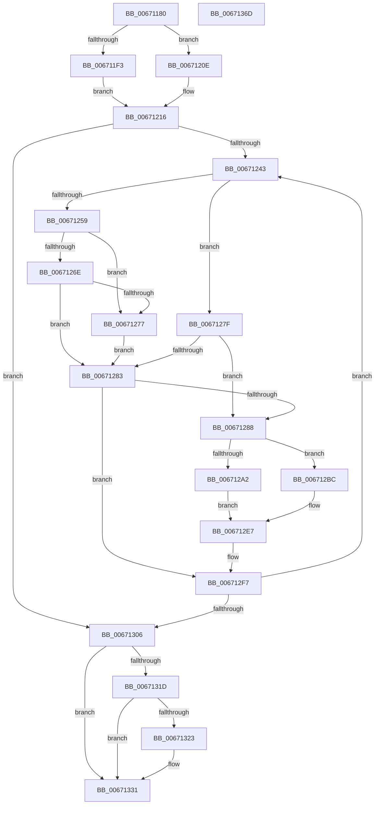

# MiZeroPageFile

- RVA: `0x00671180`–`0x0067136E` (길이 `494` bytes)
- VA: `0x0000000140671180`
- 실행 섹션: `.text`
- PDB 이름 있음: `예`; PDB Function 태그: `아니요`
- unwind 정보 RVA: `0x000CCBEC`
- 디코드: `132`개 명령, `494/494` bytes 표시
- 미해석 바이트: `0` (있으면 어셈블리에 `.byte`로 보존)

> 이 문서는 커널 이미지의 기계어와 PDB 기호를 분석해 생성했습니다. 4번과 5번은 함수 원형과 자료형을 바이너리 사용 방식에서 추정한 C 해석이며 원본 소스 복구 결과는 아닙니다.

## 1. Dependencies

- 직접 호출 지점: **11**; 고유 호출 대상: **9**
- 직접 호출자로 확인된 함수: **1**
- RIP 상대 이미지 참조: **2**

### Outgoing calls
- `0x006711C1` → [memset](../6C/memset_function_006C6C40.md) (function, `0x006C6C40`)
- `0x006711D8` → [ExFreePoolWithTag](../../poolcode/B8/ExFreePoolWithTag_function_00B82870.md) (function, `0x00B82870`)
- `0x00671229` → [ExAcquireSpinLockExclusive](../24/ExAcquireSpinLockExclusive_function_00248690.md) (function, `0x00248690`)
- `0x0067128E` → [MiReleaseSpinLockExclusive](../24/MiReleaseSpinLockExclusive_function_002482C0.md) (function, `0x002482C0`)
- `0x006712B5` → [MiTransferMemoryPagefileData](../4D/MiTransferMemoryPagefileData_function_004DB6FC.md) (function, `0x004DB6FC`)
- `0x006712E2` → [MmZeroPageWrite](../49/MmZeroPageWrite_function_0049E74C.md) (function, `0x0049E74C`)
- `0x006712ED` → [ExAcquireSpinLockExclusive](../24/ExAcquireSpinLockExclusive_function_00248690.md) (function, `0x00248690`)
- `0x0067130C` → [MiReleaseSpinLockExclusive](../24/MiReleaseSpinLockExclusive_function_002482C0.md) (function, `0x002482C0`)
- `0x0067132C` → [MmUnmapLockedPages](../24/MmUnmapLockedPages_function_00246E60.md) (function, `0x00246E60`)
- `0x0067133B` → [KeSetEvent](../33/KeSetEvent_function_0033F310.md) (function, `0x0033F310`)
- `0x00671347` → [_security_check_cookie](../6A/_security_check_cookie_function_006AC640.md) (function, `0x006AC640`)

### Direct callers
- [MiZeroAllPageFiles](../../pagelk/B7/MiZeroAllPageFiles_function_00B73B2C.md) at `0x00B73CE4`

### Static image references
- `0x006711A3` → RVA `0x00E0A740` (`.data`; read)
- `0x006711F3` → RVA `0x00E37440` (`.data`; read)

## 2. Other-region calls and transfers

- 다른 실행 섹션으로 향하는 call: **1**
  - `0x006711D8` → [ExFreePoolWithTag](../../poolcode/B8/ExFreePoolWithTag_function_00B82870.md) (`.text` → `POOLCODE`)
- 별도 외부 분기/꼬리 이동을 확인하지 못했습니다.

## 3. Assembly (complete function range)

```asm
00671180  48 8B C4                        mov rax, rsp
00671183  48 89 58 10                     mov qword ptr [rax + 0x10], rbx
00671187  48 89 70 18                     mov qword ptr [rax + 0x18], rsi
0067118B  48 89 78 20                     mov qword ptr [rax + 0x20], rdi
0067118F  55                              push rbp
00671190  41 54                           push r12
00671192  41 55                           push r13
00671194  41 56                           push r14
00671196  41 57                           push r15
00671198  48 8D 68 A1                     lea rbp, [rax - 0x5f]
0067119C  48 81 EC 00 01 00 00            sub rsp, 0x100
006711A3  48 8B 05 96 95 79 00            mov rax, qword ptr [rip + 0x799596]
006711AA  48 33 C4                        xor rax, rsp
006711AD  48 89 45 27                     mov qword ptr [rbp + 0x27], rax
006711B1  48 8B F9                        mov rdi, rcx
006711B4  33 D2                           xor edx, edx
006711B6  48 8D 4C 24 40                  lea rcx, [rsp + 0x40]
006711BB  41 B8 B0 00 00 00               mov r8d, 0xb0
006711C1  E8 7A 5A 05 00                  call 0x1406c6c40
006711C6  48 8B 47 28                     mov rax, qword ptr [rdi + 0x28]
006711CA  33 D2                           xor edx, edx
006711CC  4C 8B 77 20                     mov r14, qword ptr [rdi + 0x20]
006711D0  48 8B CF                        mov rcx, rdi
006711D3  48 89 44 24 38                  mov qword ptr [rsp + 0x38], rax
006711D8  E8 93 16 51 00                  call 0x140b82870
006711DD  33 DB                           xor ebx, ebx
006711DF  66 41 0F BA A6 AC 00 00 00 0B   bt word ptr [r14 + 0xac], 0xb
006711E9  48 89 5D 97                     mov qword ptr [rbp - 0x69], rbx
006711ED  48 89 5D 9F                     mov qword ptr [rbp - 0x61], rbx
006711F1  73 1B                           jae 0x14067120e
006711F3  48 8B 05 46 62 7C 00            mov rax, qword ptr [rip + 0x7c6246]
006711FA  48 8D 7D A7                     lea rdi, [rbp - 0x59]
006711FE  8D 4B 10                        lea ecx, [rbx + 0x10]
00671201  C7 44 24 48 30 00 02 00         mov dword ptr [rsp + 0x48], 0x20030
00671209  F3 48 AB                        rep stosq qword ptr [rdi], rax
0067120C  EB 08                           jmp 0x140671216
0067120E  C7 44 24 48 30 00 00 00         mov dword ptr [rsp + 0x48], 0x30
00671216  4D 8D A6 C8 00 00 00            lea r12, [r14 + 0xc8]
0067121D  89 5C 24 20                     mov dword ptr [rsp + 0x20], ebx
00671221  49 8B CC                        mov rcx, r12
00671224  8B F3                           mov esi, ebx
00671226  44 8B EB                        mov r13d, ebx
00671229  E8 62 74 BD FF                  call 0x140248690
0067122E  45 8B 06                        mov r8d, dword ptr [r14]
00671231  41 BF 01 00 00 00               mov r15d, 1
00671237  44 8A C8                        mov r9b, al
0067123A  45 3B C7                        cmp r8d, r15d
0067123D  0F 86 C3 00 00 00               jbe 0x140671306
00671243  49 8B 4E 50                     mov rcx, qword ptr [r14 + 0x50]
00671247  41 8B FF                        mov edi, r15d
0067124A  48 8B 51 10                     mov rdx, qword ptr [rcx + 0x10]
0067124E  48 0F A3 3A                     bt qword ptr [rdx], rdi
00671252  0F 92 C0                        setb al
00671255  84 C0                           test al, al
00671257  75 26                           jne 0x14067127f
00671259  85 F6                           test esi, esi
0067125B  41 8B C7                        mov eax, r15d
0067125E  0F 45 44 24 20                  cmovne eax, dword ptr [rsp + 0x20]
00671263  FF C6                           inc esi
00671265  89 44 24 20                     mov dword ptr [rsp + 0x20], eax
00671269  83 FE 10                        cmp esi, 0x10
0067126C  74 09                           je 0x140671277
0067126E  41 8D 40 FF                     lea eax, [r8 - 1]
00671272  44 3B F8                        cmp r15d, eax
00671275  75 0C                           jne 0x140671283
00671277  41 BD 01 00 00 00               mov r13d, 1
0067127D  EB 04                           jmp 0x140671283
0067127F  85 F6                           test esi, esi
00671281  75 05                           jne 0x140671288
00671283  45 85 ED                        test r13d, r13d
00671286  74 6F                           je 0x1406712f7
00671288  41 8A D1                        mov dl, r9b
0067128B  49 8B CC                        mov rcx, r12
0067128E  E8 2D 70 BD FF                  call 0x1402482c0
00671293  45 33 C9                        xor r9d, r9d
00671296  66 41 0F BA A6 AC 00 00 00 0B   bt word ptr [r14 + 0xac], 0xb
006712A0  73 1A                           jae 0x1406712bc
006712A2  44 8B 44 24 20                  mov r8d, dword ptr [rsp + 0x20]
006712A7  48 8D 54 24 40                  lea rdx, [rsp + 0x40]
006712AC  C1 E6 0C                        shl esi, 0xc
006712AF  49 8B CE                        mov rcx, r14
006712B2  89 75 9F                        mov dword ptr [rbp - 0x61], esi
006712B5  E8 42 A4 E6 FF                  call 0x1404db6fc
006712BA  EB 2B                           jmp 0x1406712e7
006712BC  8B 44 24 20                     mov eax, dword ptr [rsp + 0x20]
006712C0  4C 8D 44 24 28                  lea r8, [rsp + 0x28]
006712C5  49 8B 4E 18                     mov rcx, qword ptr [r14 + 0x18]
006712C9  48 8D 54 24 30                  lea rdx, [rsp + 0x30]
006712CE  48 C1 E0 0C                     shl rax, 0xc
006712D2  48 89 44 24 30                  mov qword ptr [rsp + 0x30], rax
006712D7  8B C6                           mov eax, esi
006712D9  48 C1 E0 0C                     shl rax, 0xc
006712DD  48 89 44 24 28                  mov qword ptr [rsp + 0x28], rax
006712E2  E8 65 D4 E2 FF                  call 0x14049e74c
006712E7  49 8B CC                        mov rcx, r12
006712EA  44 8B EB                        mov r13d, ebx
006712ED  E8 9E 73 BD FF                  call 0x140248690
006712F2  44 8A C8                        mov r9b, al
006712F5  8B F3                           mov esi, ebx
006712F7  45 8B 06                        mov r8d, dword ptr [r14]
006712FA  41 FF C7                        inc r15d
006712FD  45 3B F8                        cmp r15d, r8d
00671300  0F 82 3D FF FF FF               jb 0x140671243
00671306  41 8A D1                        mov dl, r9b
00671309  49 8B CC                        mov rcx, r12
0067130C  E8 AF 6F BD FF                  call 0x1402482c0
00671311  66 41 0F BA A6 AC 00 00 00 0B   bt word ptr [r14 + 0xac], 0xb
0067131B  73 14                           jae 0x140671331
0067131D  F6 45 81 01                     test byte ptr [rbp - 0x7f], 1
00671321  74 0E                           je 0x140671331
00671323  48 8B 4D 8F                     mov rcx, qword ptr [rbp - 0x71]
00671327  48 8D 54 24 40                  lea rdx, [rsp + 0x40]
0067132C  E8 2F 5B BD FF                  call 0x140246e60
00671331  48 8B 4C 24 38                  mov rcx, qword ptr [rsp + 0x38]
00671336  45 33 C0                        xor r8d, r8d
00671339  33 D2                           xor edx, edx
0067133B  E8 D0 DF CC FF                  call 0x14033f310
00671340  48 8B 4D 27                     mov rcx, qword ptr [rbp + 0x27]
00671344  48 33 CC                        xor rcx, rsp
00671347  E8 F4 B2 03 00                  call 0x1406ac640
0067134C  4C 8D 9C 24 00 01 00 00         lea r11, [rsp + 0x100]
00671354  49 8B 5B 38                     mov rbx, qword ptr [r11 + 0x38]
00671358  49 8B 73 40                     mov rsi, qword ptr [r11 + 0x40]
0067135C  49 8B 7B 48                     mov rdi, qword ptr [r11 + 0x48]
00671360  49 8B E3                        mov rsp, r11
00671363  41 5F                           pop r15
00671365  41 5E                           pop r14
00671367  41 5D                           pop r13
00671369  41 5C                           pop r12
0067136B  5D                              pop rbp
0067136C  C3                              ret
0067136D  CC                              int3
```

## 4. C-style interpretation (structured pseudocode)

```c
__int64 __fastcall MiZeroPageFile(__int64 a1, int a2)
{
    __int64 result;
    __int64 v_r15;
    __int64 v_rbx;
    __int64 v_rsi;
    __int64 v_rsp;
    unsigned __int64 v_stack_m100;
    unsigned int v_stack_m108;
    unsigned __int64 v_stack_m28;
    unsigned int v_stack_mE0;
    unsigned __int64 v_stack_mE8;
    unsigned __int64 v_stack_mF0;
    unsigned __int64 v_stack_mF8;

    *(unsigned __int64 *)(v_rsp + 16) = v_rbx;
    *(unsigned __int64 *)(v_rsp + 24) = v_rsi;
    *(unsigned __int64 *)(v_rsp + 32) = v_rdi;
    v_rsp = (v_rsp) - (256);
    result = (*(unsigned __int64 *)(v_rip + 7968150)) ^ (v_rsp);
    *(unsigned __int64 *)(v_rsp - 95 + 39) = result;
    a2 = 0;
    result = memset(v_stack_mE8, a2, 176, a4);
    a2 = 0;
    v_stack_mF0 = *(unsigned __int64 *)(a1 + 40);
    result = ExFreePoolWithTag(a1, a2, 176, a4);
    v_rbx = 0;
    *(unsigned __int64 *)(v_rsp - 95 - 105) = 0;
    *(unsigned __int64 *)(v_rsp - 95 - 97) = 0;
    if (condition_is_above_or_equal) goto loc_0067120E;
    v_stack_mE0 = 0x20030ULL;
    goto loc_00671216;
loc_0067120E:
    v_stack_mE0 = 48;
loc_00671216:
    v_stack_m108 = 0;
    result = ExAcquireSpinLockExclusive(*(unsigned __int64 *)(a1 + 32) + 200, a2, 176, a4);
    if (((unsigned int)((unsigned int)(*(unsigned int *)(*(unsigned __int64 *)(a1 + 32))))) <= 1) goto loc_00671306;
loc_00671243:
    result = (((unsigned int)((unsigned int)(*(unsigned int *)(*(unsigned __int64 *)(a1 + 32))))) < 1) ? 1 : 0;
    if ((unsigned __int8)(result) != 0) goto loc_0067127F;
    result = 1;
    if (0 != 0) { result = v_stack_m108; }
    v_rsi = (unsigned int)((0) + 1);
    v_stack_m108 = (unsigned int)(result);
    if (((unsigned int)(v_rsi)) == 16) goto loc_00671277;
    if (1 != ((unsigned int)((unsigned int)(*(unsigned int *)(*(unsigned __int64 *)(a1 + 32))) - 1))) goto loc_00671283;
loc_00671277:
    goto loc_00671283;
loc_0067127F:
    if ((unsigned int)(v_rsi) != 0) goto loc_00671288;
loc_00671283:
    if (1 == 0) goto loc_006712F7;
loc_00671288:
    result = MiReleaseSpinLockExclusive(*(unsigned __int64 *)(a1 + 32) + 200, (unsigned __int8)((unsigned __int8)(result)), (unsigned int)(*(unsigned int *)(*(unsigned __int64 *)(a1 + 32))), (unsigned __int8)(result));
    a4 = 0;
    if (condition_is_above_or_equal) goto loc_006712BC;
    v_rsi = (unsigned int)((v_rsi) << (12));
    *(unsigned int *)(v_rsp - 95 - 97) = (unsigned int)(v_rsi);
    result = MiTransferMemoryPagefileData(*(unsigned __int64 *)(a1 + 32), v_stack_mE8, (unsigned int)(v_stack_m108), a4);
    goto loc_006712E7;
loc_006712BC:
    result = ((unsigned int)(v_stack_m108)) << (12);
    v_stack_mF8 = result;
    result = ((unsigned int)((unsigned int)(v_rsi))) << (12);
    v_stack_m100 = result;
    result = MmZeroPageWrite(*(unsigned __int64 *)(*(unsigned __int64 *)(a1 + 32) + 24), v_stack_mF8, v_stack_m100, a4);
loc_006712E7:
    result = ExAcquireSpinLockExclusive(*(unsigned __int64 *)(a1 + 32) + 200, v_stack_mF8, v_stack_m100, a4);
loc_006712F7:
    v_r15 = (unsigned int)((1) + 1);
    if (((unsigned int)(v_r15)) < ((unsigned int)((unsigned int)(*(unsigned int *)(*(unsigned __int64 *)(a1 + 32)))))) goto loc_00671243;
loc_00671306:
    result = MiReleaseSpinLockExclusive(*(unsigned __int64 *)(a1 + 32) + 200, (unsigned __int8)((unsigned __int8)(result)), (unsigned int)(*(unsigned int *)(*(unsigned __int64 *)(a1 + 32))), (unsigned __int8)(result));
    if (((unsigned int)(v_r15)) >= ((unsigned int)((unsigned int)(*(unsigned int *)(*(unsigned __int64 *)(a1 + 32)))))) goto loc_00671331;
    if (((*(unsigned __int8 *)(v_rsp - 95 - 127)) & (1)) != 0) {
        a1 = *(unsigned __int64 *)(v_rsp - 95 - 113);
        a2 = v_stack_mE8;
        result = MmUnmapLockedPages(a1, a2, (unsigned int)(*(unsigned int *)(*(unsigned __int64 *)(a1 + 32))), (unsigned __int8)(result));
    }
    a3 = 0;
    a2 = 0;
    result = KeSetEvent(v_stack_mF0, a2, a3, (unsigned __int8)(result));
    a1 = (*(unsigned __int64 *)(v_rsp - 95 + 39)) ^ (v_rsp);
    result = _security_check_cookie(a1, a2, a3, (unsigned __int8)(result));
    return result;
}
```

## 5. (Beta) C Style

```c
int64_t MiZeroPageFile(void *Arg1, int32_t Arg2)
{
    uint8_t *arg1 = (uint8_t *)Arg1;

    int64_t result;
    int64_t local_r15;
    int64_t local_rbx;
    int64_t local_rsi;
    int64_t local_rsp;
    uint64_t v_stack_m100;
    uint32_t v_stack_m108;
    uint64_t v_stack_m28;
    uint32_t v_stack_mE0;
    uint64_t v_stack_mE8;
    uint64_t v_stack_mF0;
    uint64_t v_stack_mF8;

    *(uint64_t *)(local_rsp + 0x10) = local_rbx;
    *(uint64_t *)(local_rsp + 0x18) = local_rsi;
    *(uint64_t *)(local_rsp + 0x20) = local_rdi;
    local_rsp = (local_rsp) - (256);
    result = (*(uint64_t *)(v_rip + 0x799596)) ^ (local_rsp);
    *(uint64_t *)(local_rsp - 0x5F + 0x27) = result;
    Arg2 = 0;
    result = memset(v_stack_mE8, Arg2, 176, a4);
    Arg2 = 0;
    v_stack_mF0 = *(uint64_t *)(arg1 + 0x28);
    result = ExFreePoolWithTag(Arg1, Arg2, 176, a4);
    local_rbx = 0;
    *(uint64_t *)(local_rsp - 0x5F - 0x69) = 0;
    *(uint64_t *)(local_rsp - 0x5F - 0x61) = 0;
    if (condition_is_above_or_equal) goto loc_0067120E;
    v_stack_mE0 = 0x20030ULL;
    goto loc_00671216;
loc_0067120E:
    v_stack_mE0 = 48;
loc_00671216:
    v_stack_m108 = 0;
    result = ExAcquireSpinLockExclusive(*(uint64_t *)(arg1 + 0x20) + 200, Arg2, 176, a4);
    if (((uint32_t)((uint32_t)(*(uint32_t *)(*(uint64_t *)(arg1 + 0x20))))) <= 1) goto loc_00671306;
loc_00671243:
    result = (((uint32_t)((uint32_t)(*(uint32_t *)(*(uint64_t *)(arg1 + 0x20))))) < 1) ? 1 : 0;
    if ((uint8_t)(result) != 0) goto loc_0067127F;
    result = 1;
    if (0 != 0) { result = v_stack_m108; }
    local_rsi = (uint32_t)((0) + 1);
    v_stack_m108 = (uint32_t)(result);
    if (((uint32_t)(local_rsi)) == 16) goto loc_00671277;
    if (1 != ((uint32_t)((uint32_t)(*(uint32_t *)(*(uint64_t *)(arg1 + 0x20))) - 1))) goto loc_00671283;
loc_00671277:
    goto loc_00671283;
loc_0067127F:
    if ((uint32_t)(local_rsi) != 0) goto loc_00671288;
loc_00671283:
    if (1 == 0) goto loc_006712F7;
loc_00671288:
    result = MiReleaseSpinLockExclusive(*(uint64_t *)(arg1 + 0x20) + 200, (uint8_t)((uint8_t)(result)), (uint32_t)(*(uint32_t *)(*(uint64_t *)(arg1 + 0x20))), (uint8_t)(result));
    a4 = 0;
    if (condition_is_above_or_equal) goto loc_006712BC;
    local_rsi = (uint32_t)((local_rsi) << (12));
    *(uint32_t *)(local_rsp - 0x5F - 0x61) = (uint32_t)(local_rsi);
    result = MiTransferMemoryPagefileData(*(uint64_t *)(arg1 + 0x20), v_stack_mE8, (uint32_t)(v_stack_m108), a4);
    goto loc_006712E7;
loc_006712BC:
    result = ((uint32_t)(v_stack_m108)) << (12);
    v_stack_mF8 = result;
    result = ((uint32_t)((uint32_t)(local_rsi))) << (12);
    v_stack_m100 = result;
    result = MmZeroPageWrite(*(uint64_t *)(*(uint64_t *)(arg1 + 0x20) + 0x18), v_stack_mF8, v_stack_m100, a4);
loc_006712E7:
    result = ExAcquireSpinLockExclusive(*(uint64_t *)(arg1 + 0x20) + 200, v_stack_mF8, v_stack_m100, a4);
loc_006712F7:
    local_r15 = (uint32_t)((1) + 1);
    if (((uint32_t)(local_r15)) < ((uint32_t)((uint32_t)(*(uint32_t *)(*(uint64_t *)(arg1 + 0x20)))))) goto loc_00671243;
loc_00671306:
    result = MiReleaseSpinLockExclusive(*(uint64_t *)(arg1 + 0x20) + 200, (uint8_t)((uint8_t)(result)), (uint32_t)(*(uint32_t *)(*(uint64_t *)(arg1 + 0x20))), (uint8_t)(result));
    if (((uint32_t)(local_r15)) >= ((uint32_t)((uint32_t)(*(uint32_t *)(*(uint64_t *)(arg1 + 0x20)))))) goto loc_00671331;
    if (((*(uint8_t *)(local_rsp - 0x5F - 0x7F)) & (1)) != 0) {
        Arg1 = *(uint64_t *)(local_rsp - 0x5F - 0x71);
        Arg2 = v_stack_mE8;
        result = MmUnmapLockedPages(Arg1, Arg2, (uint32_t)(*(uint32_t *)(*(uint64_t *)(arg1 + 0x20))), (uint8_t)(result));
    }
    a3 = 0;
    Arg2 = 0;
    result = KeSetEvent(v_stack_mF0, Arg2, a3, (uint8_t)(result));
    Arg1 = (*(uint64_t *)(local_rsp - 0x5F + 0x27)) ^ (local_rsp);
    result = _security_check_cookie(Arg1, Arg2, a3, (uint8_t)(result));
    return result;
}
```

### 관측된 메모리 오프셋

구조체 형식이 확인되지 않은 접근은 인자 기준의 오프셋으로만 기록했습니다.

| 기준 인자 | 오프셋 표현 | 폭 (bit) | 접근 |
|---|---:|---:|---|
| `Arg1` | `+ 0x20` | `64` | `R` |
| `Arg1` | `+ 0x28` | `64` | `R` |

## 6. Execution-region graph

[열기: 2D/3D 그래프와 함수 탐색 컨트롤 패널](../../../control-panel.html?section=text&rva=0x00671180&view=graph)

- 2D 그래프는 위에서 아래로 흐르고, 3D 그래프는 빈 공간을 드래그해 회전합니다. Shift+드래그는 이동, 휠은 확대·축소, 함수 노드 선택은 대상 보고서 이동입니다.

### Static fallback


