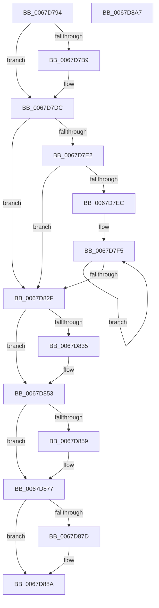

# MmAddPrivateDataToCrashDump

- RVA: `0x0067D794`–`0x0067D8A8` (길이 `276` bytes)
- VA: `0x000000014067D794`
- 실행 섹션: `.text`
- PDB 이름 있음: `예`; PDB Function 태그: `아니요`
- unwind 정보 RVA: `0x0005D7BC`
- 디코드: `75`개 명령, `276/276` bytes 표시
- 미해석 바이트: `0` (있으면 어셈블리에 `.byte`로 보존)

> 이 문서는 커널 이미지의 기계어와 PDB 기호를 분석해 생성했습니다. 4번과 5번은 함수 원형과 자료형을 바이너리 사용 방식에서 추정한 C 해석이며 원본 소스 복구 결과는 아닙니다.

## 1. Dependencies

- 직접 호출 지점: **5**; 고유 호출 대상: **3**
- 직접 호출자로 확인된 함수: **3**
- RIP 상대 이미지 참조: **8**

### Outgoing calls
- `0x0067D7D2` → [MmAddRangeToCrashDump](MmAddRangeToCrashDump_function_0067D8B0.md) (function, `0x0067D8B0`)
- `0x0067D81B` → [guard_dispatch_icall](../6B/guard_dispatch_icall_function_006BAAD0.md) (function, `0x006BAAD0`)
- `0x0067D849` → [MmAddRangeToCrashDump](MmAddRangeToCrashDump_function_0067D8B0.md) (function, `0x0067D8B0`)
- `0x0067D86D` → [MmAddRangeToCrashDump](MmAddRangeToCrashDump_function_0067D8B0.md) (function, `0x0067D8B0`)
- `0x0067D880` → [MiAddPartitionDataToCrashDump](MiAddPartitionDataToCrashDump_function_0067CEA8.md) (function, `0x0067CEA8`)

### Direct callers
- [IopLiveDumpAddPfnDatabase](../59/IopLiveDumpAddPfnDatabase_function_00598FD0.md) at `0x00598FDC`
- [IopLiveDumpMarkRequiredDumpData](../59/IopLiveDumpMarkRequiredDumpData_function_0059D070.md) at `0x0059D171`
- [IopLiveDumpMarkRequiredDumpData](../59/IopLiveDumpMarkRequiredDumpData_function_0059D070.md) at `0x0059D1A8`
- [IopLiveDumpMarkRequiredDumpData](../59/IopLiveDumpMarkRequiredDumpData_function_0059D070.md) at `0x0059D1BE`
- [IopAddLiveDumpPagesToPartialKernelDump](../5A/IopAddLiveDumpPagesToPartialKernelDump_function_005A13AC.md) at `0x005A14E6`
- [IopAddLiveDumpPagesToPartialKernelDump](../5A/IopAddLiveDumpPagesToPartialKernelDump_function_005A13AC.md) at `0x005A151D`
- [IopAddLiveDumpPagesToPartialKernelDump](../5A/IopAddLiveDumpPagesToPartialKernelDump_function_005A13AC.md) at `0x005A1533`
- [IopAddLiveDumpPagesToPartialKernelDump](../5A/IopAddLiveDumpPagesToPartialKernelDump_function_005A13AC.md) at `0x005A1574`
- [IopAddLiveDumpPagesToPartialKernelDump](../5A/IopAddLiveDumpPagesToPartialKernelDump_function_005A13AC.md) at `0x005A16D0`

### Static image references
- `0x0067D7B9` → RVA `0x00E2DCE0` (`.data`; read)
- `0x0067D7C0` → RVA `0x00FC6C38` (`ALMOSTRO`; read)
- `0x0067D7E2` → RVA `0x00FC6A80` (`ALMOSTRO`; read)
- `0x0067D7EC` → RVA `0x00FC8C40` (`ALMOSTRO`; read)
- `0x0067D835` → RVA `0x00FC6CB0` (`ALMOSTRO`; read)
- `0x0067D83F` → RVA `0x00FC6B28` (`ALMOSTRO`; read)
- `0x0067D859` → RVA `0x00FC6D90` (`ALMOSTRO`; read)
- `0x0067D863` → RVA `0x00FC6B98` (`ALMOSTRO`; read)

## 2. Other-region calls and transfers

- 다른 실행 섹션으로 향하는 call: **0**
- 별도 외부 분기/꼬리 이동을 확인하지 못했습니다.

## 3. Assembly (complete function range)

```asm
0067D794  48 8B C4                        mov rax, rsp
0067D797  48 89 58 08                     mov qword ptr [rax + 8], rbx
0067D79B  48 89 68 10                     mov qword ptr [rax + 0x10], rbp
0067D79F  48 89 70 18                     mov qword ptr [rax + 0x18], rsi
0067D7A3  48 89 78 20                     mov qword ptr [rax + 0x20], rdi
0067D7A7  41 56                           push r14
0067D7A9  48 83 EC 30                     sub rsp, 0x30
0067D7AD  33 DB                           xor ebx, ebx
0067D7AF  8B FA                           mov edi, edx
0067D7B1  48 8B F1                        mov rsi, rcx
0067D7B4  F6 C2 01                        test dl, 1
0067D7B7  74 23                           je 0x14067d7dc
0067D7B9  48 8B 05 20 05 7B 00            mov rax, qword ptr [rip + 0x7b0520]
0067D7C0  48 8B 15 71 94 94 00            mov rdx, qword ptr [rip + 0x949471]
0067D7C7  48 FF C0                        inc rax
0067D7CA  4C 8D 04 40                     lea r8, [rax + rax*2]
0067D7CE  49 C1 E0 04                     shl r8, 4
0067D7D2  E8 D9 00 00 00                  call 0x14067d8b0
0067D7D7  85 C0                           test eax, eax
0067D7D9  0F 48 D8                        cmovs ebx, eax
0067D7DC  40 F6 C7 02                     test dil, 2
0067D7E0  74 4D                           je 0x14067d82f
0067D7E2  8B 05 98 92 94 00               mov eax, dword ptr [rip + 0x949298]
0067D7E8  85 C0                           test eax, eax
0067D7EA  74 43                           je 0x14067d82f
0067D7EC  4C 8D 35 4D B4 94 00            lea r14, [rip + 0x94b44d]
0067D7F3  8B E8                           mov ebp, eax
0067D7F5  49 8B 06                        mov rax, qword ptr [r14]
0067D7F8  41 B9 02 00 00 00               mov r9d, 2
0067D7FE  48 8B 48 08                     mov rcx, qword ptr [rax + 8]
0067D802  45 8D 41 FF                     lea r8d, [r9 - 1]
0067D806  48 8B 81 B8 00 00 00            mov rax, qword ptr [rcx + 0xb8]
0067D80D  48 8B CE                        mov rcx, rsi
0067D810  48 8B 50 28                     mov rdx, qword ptr [rax + 0x28]
0067D814  48 8B 06                        mov rax, qword ptr [rsi]
0067D817  48 C1 EA 0C                     shr rdx, 0xc
0067D81B  E8 B0 D2 03 00                  call 0x1406baad0
0067D820  85 C0                           test eax, eax
0067D822  4D 8D 76 08                     lea r14, [r14 + 8]
0067D826  0F 48 D8                        cmovs ebx, eax
0067D829  48 83 ED 01                     sub rbp, 1
0067D82D  75 C6                           jne 0x14067d7f5
0067D82F  40 F6 C7 04                     test dil, 4
0067D833  74 1E                           je 0x14067d853
0067D835  4C 8B 05 74 94 94 00            mov r8, qword ptr [rip + 0x949474]
0067D83C  48 8B CE                        mov rcx, rsi
0067D83F  48 8B 15 E2 92 94 00            mov rdx, qword ptr [rip + 0x9492e2]
0067D846  4C 2B C2                        sub r8, rdx
0067D849  E8 62 00 00 00                  call 0x14067d8b0
0067D84E  85 C0                           test eax, eax
0067D850  0F 48 D8                        cmovs ebx, eax
0067D853  40 F6 C7 08                     test dil, 8
0067D857  74 1E                           je 0x14067d877
0067D859  4C 8B 05 30 95 94 00            mov r8, qword ptr [rip + 0x949530]
0067D860  48 8B CE                        mov rcx, rsi
0067D863  48 8B 15 2E 93 94 00            mov rdx, qword ptr [rip + 0x94932e]
0067D86A  4C 2B C2                        sub r8, rdx
0067D86D  E8 3E 00 00 00                  call 0x14067d8b0
0067D872  85 C0                           test eax, eax
0067D874  0F 48 D8                        cmovs ebx, eax
0067D877  40 F6 C7 10                     test dil, 0x10
0067D87B  74 0D                           je 0x14067d88a
0067D87D  48 8B CE                        mov rcx, rsi
0067D880  E8 23 F6 FF FF                  call 0x14067cea8
0067D885  85 C0                           test eax, eax
0067D887  0F 48 D8                        cmovs ebx, eax
0067D88A  48 8B 6C 24 48                  mov rbp, qword ptr [rsp + 0x48]
0067D88F  8B C3                           mov eax, ebx
0067D891  48 8B 5C 24 40                  mov rbx, qword ptr [rsp + 0x40]
0067D896  48 8B 74 24 50                  mov rsi, qword ptr [rsp + 0x50]
0067D89B  48 8B 7C 24 58                  mov rdi, qword ptr [rsp + 0x58]
0067D8A0  48 83 C4 30                     add rsp, 0x30
0067D8A4  41 5E                           pop r14
0067D8A6  C3                              ret
0067D8A7  CC                              int3
```

## 4. C-style interpretation (structured pseudocode)

```c
__int64 __fastcall MmAddPrivateDataToCrashDump(__int64 a1, int a2)
{
    __int64 result;
    __int64 v_rbp;
    __int64 v_rbx;
    __int64 v_rsp;
    unsigned __int64 v_stack_p10;
    unsigned __int64 v_stack_p18;
    unsigned __int64 v_stack_p20;
    unsigned __int64 v_stack_p8;

    *(unsigned __int64 *)(v_rsp + 8) = v_rbx;
    *(unsigned __int64 *)(v_rsp + 16) = v_rbp;
    *(unsigned __int64 *)(v_rsp + 24) = v_rsi;
    *(unsigned __int64 *)(v_rsp + 32) = v_rdi;
    v_rsp = (v_rsp) - (48);
    v_rbx = 0;
    result = v_rsp;
    if ((((unsigned __int8)(a2)) & (1)) != 0) {
        result = *(unsigned __int64 *)(v_rip + 8062240);
        a2 = *(unsigned __int64 *)(v_rip + 9737329);
        result = (result) + 1;
        a3 = result + result * 2;
        a3 = (a3) << (4);
        result = MmAddRangeToCrashDump(a1, a2, a3, a4);
        if (sign_flag) { v_rbx = (unsigned int)(result); }
    }
    if ((((unsigned __int8)((unsigned int)(a2))) & (2)) == 0) goto loc_0067D82F;
    if ((unsigned int)((unsigned int)(*(unsigned int *)(v_rip + 9736856))) == 0) goto loc_0067D82F;
loc_0067D7F5:
    a2 = (*(unsigned __int64 *)(*(unsigned __int64 *)(*(unsigned __int64 *)(*(unsigned __int64 *)(v_rip + 9745485) + 8) + 184) + 40)) >> (12);
    result = guard_dispatch_icall(a1, a2, 2 - 1, 2);
    if (sign_flag) { v_rbx = (unsigned int)(result); }
    v_rbp = ((unsigned int)((unsigned int)((unsigned int)(*(unsigned int *)(v_rip + 9736856))))) - (1);
    if (condition_is_not_equal) goto loc_0067D7F5;
loc_0067D82F:
    if ((((unsigned __int8)((unsigned int)(a2))) & (4)) != 0) {
        a3 = *(unsigned __int64 *)(v_rip + 9737332);
        a1 = a1;
        a2 = *(unsigned __int64 *)(v_rip + 9736930);
        a3 = (a3) - (a2);
        result = MmAddRangeToCrashDump(a1, a2, a3, 2);
        if (sign_flag) { v_rbx = (unsigned int)(result); }
    }
    if ((((unsigned __int8)((unsigned int)(a2))) & (8)) != 0) {
        a3 = *(unsigned __int64 *)(v_rip + 9737520);
        a1 = a1;
        a2 = *(unsigned __int64 *)(v_rip + 9737006);
        a3 = (a3) - (a2);
        result = MmAddRangeToCrashDump(a1, a2, a3, 2);
        if (sign_flag) { v_rbx = (unsigned int)(result); }
    }
    if ((((unsigned __int8)((unsigned int)(a2))) & (16)) != 0) {
        a1 = a1;
        result = MiAddPartitionDataToCrashDump(a1, a2, a3, 2);
        if (sign_flag) { v_rbx = (unsigned int)(result); }
    }
    v_rsp = (v_rsp) + (48);
    return (unsigned int)((unsigned int)(v_rbx));
}
```

## 5. (Beta) C Style

```c
int64_t MmAddPrivateDataToCrashDump(void *Arg1, int32_t Arg2)
{
    uint8_t *arg1 = (uint8_t *)Arg1;

    int64_t result;
    int64_t local_rbp;
    int64_t local_rbx;
    int64_t local_rsp;
    uint64_t v_stack_p10;
    uint64_t v_stack_p18;
    uint64_t v_stack_p20;
    uint64_t v_stack_p8;

    *(uint64_t *)(local_rsp + 0x8) = local_rbx;
    *(uint64_t *)(local_rsp + 0x10) = local_rbp;
    *(uint64_t *)(local_rsp + 0x18) = local_rsi;
    *(uint64_t *)(local_rsp + 0x20) = local_rdi;
    local_rsp = (local_rsp) - (48);
    local_rbx = 0;
    result = local_rsp;
    if ((((uint8_t)(Arg2)) & (1)) != 0) {
        result = *(uint64_t *)(v_rip + 0x7B0520);
        Arg2 = *(uint64_t *)(v_rip + 0x949471);
        result = (result) + 1;
        a3 = result + result * 2;
        a3 = (a3) << (4);
        result = MmAddRangeToCrashDump(Arg1, Arg2, a3, a4);
        if (sign_flag) { local_rbx = (uint32_t)(result); }
    }
    if ((((uint8_t)((uint32_t)(Arg2))) & (2)) == 0) goto loc_0067D82F;
    if ((uint32_t)((uint32_t)(*(uint32_t *)(v_rip + 0x949298))) == 0) goto loc_0067D82F;
loc_0067D7F5:
    Arg2 = (*(uint64_t *)(*(uint64_t *)(*(uint64_t *)(*(uint64_t *)(v_rip + 0x94B44D) + 0x8) + 0xB8) + 0x28)) >> (12);
    result = guard_dispatch_icall(Arg1, Arg2, 2 - 1, 2);
    if (sign_flag) { local_rbx = (uint32_t)(result); }
    local_rbp = ((uint32_t)((uint32_t)((uint32_t)(*(uint32_t *)(v_rip + 0x949298))))) - (1);
    if (condition_is_not_equal) goto loc_0067D7F5;
loc_0067D82F:
    if ((((uint8_t)((uint32_t)(Arg2))) & (4)) != 0) {
        a3 = *(uint64_t *)(v_rip + 0x949474);
        Arg1 = Arg1;
        Arg2 = *(uint64_t *)(v_rip + 0x9492E2);
        a3 = (a3) - (Arg2);
        result = MmAddRangeToCrashDump(Arg1, Arg2, a3, 2);
        if (sign_flag) { local_rbx = (uint32_t)(result); }
    }
    if ((((uint8_t)((uint32_t)(Arg2))) & (8)) != 0) {
        a3 = *(uint64_t *)(v_rip + 0x949530);
        Arg1 = Arg1;
        Arg2 = *(uint64_t *)(v_rip + 0x94932E);
        a3 = (a3) - (Arg2);
        result = MmAddRangeToCrashDump(Arg1, Arg2, a3, 2);
        if (sign_flag) { local_rbx = (uint32_t)(result); }
    }
    if ((((uint8_t)((uint32_t)(Arg2))) & (16)) != 0) {
        Arg1 = Arg1;
        result = MiAddPartitionDataToCrashDump(Arg1, Arg2, a3, 2);
        if (sign_flag) { local_rbx = (uint32_t)(result); }
    }
    local_rsp = (local_rsp) + (48);
    return (uint32_t)((uint32_t)(local_rbx));
}
```

### 관측된 메모리 오프셋

구조체 형식이 확인되지 않은 접근은 인자 기준의 오프셋으로만 기록했습니다.

| 기준 인자 | 오프셋 표현 | 폭 (bit) | 접근 |
|---|---:|---:|---|
| `Arg1` | `+ 0x0` | `64` | `R` |

## 6. Execution-region graph

[열기: 2D/3D 그래프와 함수 탐색 컨트롤 패널](../../../control-panel.html?section=text&rva=0x0067D794&view=graph)

- 2D 그래프는 위에서 아래로 흐르고, 3D 그래프는 빈 공간을 드래그해 회전합니다. Shift+드래그는 이동, 휠은 확대·축소, 함수 노드 선택은 대상 보고서 이동입니다.

### Static fallback


