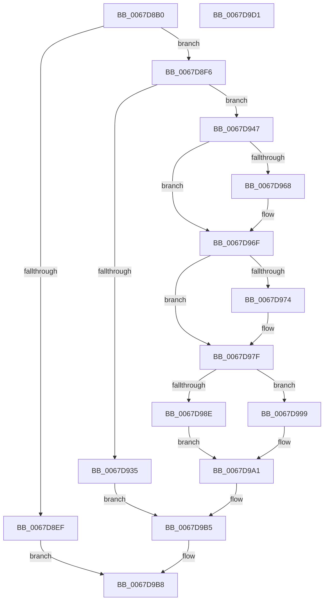

# MmAddRangeToCrashDump

- RVA: `0x0067D8B0`–`0x0067D9D2` (길이 `290` bytes)
- VA: `0x000000014067D8B0`
- 실행 섹션: `.text`
- PDB 이름 있음: `예`; PDB Function 태그: `아니요`
- unwind 정보 RVA: `0x000D7F20`
- 디코드: `76`개 명령, `290/290` bytes 표시
- 미해석 바이트: `0` (있으면 어셈블리에 `.byte`로 보존)

> 이 문서는 커널 이미지의 기계어와 PDB 기호를 분석해 생성했습니다. 4번과 5번은 함수 원형과 자료형을 바이너리 사용 방식에서 추정한 C 해석이며 원본 소스 복구 결과는 아닙니다.

## 1. Dependencies

- 직접 호출 지점: **10**; 고유 호출 대상: **9**
- 직접 호출자로 확인된 함수: **24**
- RIP 상대 이미지 참조: **1**

### Outgoing calls
- `0x0067D8E0` → [memset](../6C/memset_function_006C6C40.md) (function, `0x006C6C40`)
- `0x0067D92C` → [MiSystemInSingleProcessorMode](MiSystemInSingleProcessorMode_function_00673D40.md) (function, `0x00673D40`)
- `0x0067D940` → [MiWalkPageTables](../2C/MiWalkPageTables_function_002C2710.md) (function, `0x002C2710`)
- `0x0067D951` → [MiGetSystemRegionType](../28/MiGetSystemRegionType_function_0028EC80.md) (function, `0x0028EC80`)
- `0x0067D95B` → [MiSystemVaTypeToVm](../28/MiSystemVaTypeToVm_function_0028EB50.md) (function, `0x0028EB50`)
- `0x0067D977` → [MiGetAnyMultiplexedVm](../44/MiGetAnyMultiplexedVm_function_00448BD0.md) (function, `0x00448BD0`)
- `0x0067D992` → [MiLockWorkingSetSharedAtDpc](../23/MiLockWorkingSetSharedAtDpc_function_00239574.md) (function, `0x00239574`)
- `0x0067D999` → [MiLockWorkingSetShared](../27/MiLockWorkingSetShared_function_0027CBF0.md) (function, `0x0027CBF0`)
- `0x0067D9A5` → [MiWalkPageTables](../2C/MiWalkPageTables_function_002C2710.md) (function, `0x002C2710`)
- `0x0067D9B0` → [MiUnlockWorkingSetShared](../27/MiUnlockWorkingSetShared_function_0027D690.md) (function, `0x0027D690`)

### Direct callers
- [IopLiveDumpAddIptTraceBuffers](../59/IopLiveDumpAddIptTraceBuffers_function_00598EF0.md) at `0x00598F79`
- [IopLiveDumpAddTriageDumpData](../59/IopLiveDumpAddTriageDumpData_function_00599190.md) at `0x00599298`
- [IopLiveDumpAddTriageDumpData](../59/IopLiveDumpAddTriageDumpData_function_00599190.md) at `0x005992CB`
- [IopLiveDumpMarkDeviceNode](../59/IopLiveDumpMarkDeviceNode_function_0059CC44.md) at `0x0059CC5A`
- [IopLiveDumpMarkDeviceNode](../59/IopLiveDumpMarkDeviceNode_function_0059CC44.md) at `0x0059CC73`
- [IopLiveDumpMarkDeviceNode](../59/IopLiveDumpMarkDeviceNode_function_0059CC44.md) at `0x0059CC8C`
- [IopLiveDumpMarkLoadedModuleList](../59/IopLiveDumpMarkLoadedModuleList_function_0059CE1C.md) at `0x0059CE47`
- [IopLiveDumpMarkLoadedModuleList](../59/IopLiveDumpMarkLoadedModuleList_function_0059CE1C.md) at `0x0059CE72`
- [IopLiveDumpMarkLoadedModuleList](../59/IopLiveDumpMarkLoadedModuleList_function_0059CE1C.md) at `0x0059CE8B`
- [IopLiveDumpMarkLoadedModuleList](../59/IopLiveDumpMarkLoadedModuleList_function_0059CE1C.md) at `0x0059CEA4`
- [IopLiveDumpMarkLoadedModuleList](../59/IopLiveDumpMarkLoadedModuleList_function_0059CE1C.md) at `0x0059CEBC`
- [IopLiveDumpMarkLoadedModuleList](../59/IopLiveDumpMarkLoadedModuleList_function_0059CE1C.md) at `0x0059CEE4`
- [IopLiveDumpMarkProcessorData](../59/IopLiveDumpMarkProcessorData_function_0059CF5C.md) at `0x0059CF83`
- [IopLiveDumpMarkProcessorData](../59/IopLiveDumpMarkProcessorData_function_0059CF5C.md) at `0x0059CF9D`
- [IopLiveDumpMarkProcessorData](../59/IopLiveDumpMarkProcessorData_function_0059CF5C.md) at `0x0059CFBE`
- [IopLiveDumpMarkProcessorData](../59/IopLiveDumpMarkProcessorData_function_0059CF5C.md) at `0x0059CFDB`
- [IopLiveDumpMarkProcessorData](../59/IopLiveDumpMarkProcessorData_function_0059CF5C.md) at `0x0059CFFB`
- [IopLiveDumpMarkProcessorData](../59/IopLiveDumpMarkProcessorData_function_0059CF5C.md) at `0x0059D022`
- [IopLiveDumpMarkProcessorData](../59/IopLiveDumpMarkProcessorData_function_0059CF5C.md) at `0x0059D03D`
- [IopLiveDumpMarkProcessorData](../59/IopLiveDumpMarkProcessorData_function_0059CF5C.md) at `0x0059D058`
- [IopLiveDumpMarkRequiredDumpData](../59/IopLiveDumpMarkRequiredDumpData_function_0059D070.md) at `0x0059D0EA`
- [IopLiveDumpMarkRequiredDumpData](../59/IopLiveDumpMarkRequiredDumpData_function_0059D070.md) at `0x0059D10D`
- [IopLiveDumpMarkRequiredDumpData](../59/IopLiveDumpMarkRequiredDumpData_function_0059D070.md) at `0x0059D192`
- [IopLiveDumpMarkRequiredDumpData](../59/IopLiveDumpMarkRequiredDumpData_function_0059D070.md) at `0x0059D1E9`
- [IoAddProcessThreadsToDump](../5A/IoAddProcessThreadsToDump_function_005A10AC.md) at `0x005A10EA`
- [IoAddProcessesToDump](../5A/IoAddProcessesToDump_function_005A1150.md) at `0x005A1199`
- [IoAddProcessesToDump](../5A/IoAddProcessesToDump_function_005A1150.md) at `0x005A11B2`
- [IoAddThreadStackToDump](../5A/IoAddThreadStackToDump_function_005A1210.md) at `0x005A1234`
- [IopAddLiveDumpPagesToPartialKernelDump](../5A/IopAddLiveDumpPagesToPartialKernelDump_function_005A13AC.md) at `0x005A1447`
- [IopAddLiveDumpPagesToPartialKernelDump](../5A/IopAddLiveDumpPagesToPartialKernelDump_function_005A13AC.md) at `0x005A146D`
- [IopAddLiveDumpPagesToPartialKernelDump](../5A/IopAddLiveDumpPagesToPartialKernelDump_function_005A13AC.md) at `0x005A1494`
- [IopAddLiveDumpPagesToPartialKernelDump](../5A/IopAddLiveDumpPagesToPartialKernelDump_function_005A13AC.md) at `0x005A1507`
- [IopAddLiveDumpPagesToPartialKernelDump](../5A/IopAddLiveDumpPagesToPartialKernelDump_function_005A13AC.md) at `0x005A155E`
- [IopAddLiveDumpPagesToPartialKernelDump](../5A/IopAddLiveDumpPagesToPartialKernelDump_function_005A13AC.md) at `0x005A15A0`
- [IopAddLiveDumpPagesToPartialKernelDump](../5A/IopAddLiveDumpPagesToPartialKernelDump_function_005A13AC.md) at `0x005A1607`
- [IopAddMiniDumpPagesToPartialKernelDump](../5A/IopAddMiniDumpPagesToPartialKernelDump_function_005A16F8.md) at `0x005A181C`
- [IopAddMiniDumpPagesToPartialKernelDump](../5A/IopAddMiniDumpPagesToPartialKernelDump_function_005A16F8.md) at `0x005A1832`
- [IopAddMiniDumpPagesToPartialKernelDump](../5A/IopAddMiniDumpPagesToPartialKernelDump_function_005A16F8.md) at `0x005A1847`
- [IopAddStackSegmentKernelShadowStackToDump](../5A/IopAddStackSegmentKernelShadowStackToDump_function_005A1884.md) at `0x005A18A3`
- [IopAddTriageDumpDataToPartialKernelDump](../5A/IopAddTriageDumpDataToPartialKernelDump_function_005A18B8.md) at `0x005A18F0`
- [IopAddTriageDumpDataToPartialKernelDump](../5A/IopAddTriageDumpDataToPartialKernelDump_function_005A18B8.md) at `0x005A191E`
- [IopMarkPagesForDpcData](../5A/IopMarkPagesForDpcData_function_005A1C90.md) at `0x005A1CF1`
- [IopMarkPagesForDpcData](../5A/IopMarkPagesForDpcData_function_005A1C90.md) at `0x005A1D0E`
- [IopMarkPagesForDpcData](../5A/IopMarkPagesForDpcData_function_005A1C90.md) at `0x005A1D3F`
- [IopMarkPagesForDpcData](../5A/IopMarkPagesForDpcData_function_005A1C90.md) at `0x005A1D70`
- [IopMarkPagesForDpcData](../5A/IopMarkPagesForDpcData_function_005A1C90.md) at `0x005A1D9F`
- [IopMarkPagesForDpcData](../5A/IopMarkPagesForDpcData_function_005A1C90.md) at `0x005A1DE0`
- [IopMarkPagesForDpcData](../5A/IopMarkPagesForDpcData_function_005A1C90.md) at `0x005A1E08`
- [IopMarkPagesForDpcData](../5A/IopMarkPagesForDpcData_function_005A1C90.md) at `0x005A1E3E`
- [IopMarkPagesForDpcData](../5A/IopMarkPagesForDpcData_function_005A1C90.md) at `0x005A1E66`
- [IopMarkPagesForDpcData](../5A/IopMarkPagesForDpcData_function_005A1C90.md) at `0x005A1EAE`
- [IopMarkPagesForDpcData](../5A/IopMarkPagesForDpcData_function_005A1C90.md) at `0x005A1EC7`
- [IopMarkPagesForDpcData](../5A/IopMarkPagesForDpcData_function_005A1C90.md) at `0x005A1EE8`
- [IopMarkPagesForDpcData](../5A/IopMarkPagesForDpcData_function_005A1C90.md) at `0x005A1F69`
- [IopMarkPagesForDpcData](../5A/IopMarkPagesForDpcData_function_005A1C90.md) at `0x005A1FC1`
- [IopMarkPagesForDpcData](../5A/IopMarkPagesForDpcData_function_005A1C90.md) at `0x005A1FDD`
- [IopMarkPagesForDpcData](../5A/IopMarkPagesForDpcData_function_005A1C90.md) at `0x005A2008`
- [IopMarkPagesForDpcData](../5A/IopMarkPagesForDpcData_function_005A1C90.md) at `0x005A2049`
- [IopMarkPagesForDpcData](../5A/IopMarkPagesForDpcData_function_005A1C90.md) at `0x005A206E`
- [IopMarkPagesForDpcData](../5A/IopMarkPagesForDpcData_function_005A1C90.md) at `0x005A2093`
- [IopMarkPagesForLoadedDriverInformation](../5A/IopMarkPagesForLoadedDriverInformation_function_005A20DC.md) at `0x005A2105`
- [IopMarkPagesForLoadedDriverInformation](../5A/IopMarkPagesForLoadedDriverInformation_function_005A20DC.md) at `0x005A2130`
- [IopMarkPagesForLoadedDriverInformation](../5A/IopMarkPagesForLoadedDriverInformation_function_005A20DC.md) at `0x005A2145`
- [IopMarkPagesForLoadedDriverInformation](../5A/IopMarkPagesForLoadedDriverInformation_function_005A20DC.md) at `0x005A215A`
- [IopMarkPagesForLoadedDriverInformation](../5A/IopMarkPagesForLoadedDriverInformation_function_005A20DC.md) at `0x005A216E`
- [IopMarkPagesForLoadedDriverInformation](../5A/IopMarkPagesForLoadedDriverInformation_function_005A20DC.md) at `0x005A2196`
- [IopMarkPagesForProcessorData](../5A/IopMarkPagesForProcessorData_function_005A21C8.md) at `0x005A21F9`
- [IopMarkPagesForProcessorData](../5A/IopMarkPagesForProcessorData_function_005A21C8.md) at `0x005A222F`
- [IopMarkPagesForProcessorData](../5A/IopMarkPagesForProcessorData_function_005A21C8.md) at `0x005A2250`
- [IopMarkPagesForProcessorData](../5A/IopMarkPagesForProcessorData_function_005A21C8.md) at `0x005A22A6`
- [IopMarkPagesForProcessorData](../5A/IopMarkPagesForProcessorData_function_005A21C8.md) at `0x005A22F4`
- [IopMarkPagesForProcessorData](../5A/IopMarkPagesForProcessorData_function_005A21C8.md) at `0x005A2316`
- [IopMarkPagesForProcessorData](../5A/IopMarkPagesForProcessorData_function_005A21C8.md) at `0x005A233A`
- [IopMarkPagesForProcessorData](../5A/IopMarkPagesForProcessorData_function_005A21C8.md) at `0x005A2355`
- [IopMarkPagesForProcessorData](../5A/IopMarkPagesForProcessorData_function_005A21C8.md) at `0x005A2370`
- [IopMarkPagesForRunTimeTriageDataBlocks](../5A/IopMarkPagesForRunTimeTriageDataBlocks_function_005A2394.md) at `0x005A23E9`
- [IopMarkPagesForRunTimeTriageDataBlocks](../5A/IopMarkPagesForRunTimeTriageDataBlocks_function_005A2394.md) at `0x005A2426`
- [ExAddPrivateDataToCrashDump](../65/ExAddPrivateDataToCrashDump_function_00655D80.md) at `0x00655DBC`
- [MiAddPartitionDataToCrashDump](MiAddPartitionDataToCrashDump_function_0067CEA8.md) at `0x0067CECF`
- [MiAddPartitionDataToCrashDump](MiAddPartitionDataToCrashDump_function_0067CEA8.md) at `0x0067CEED`
- [MiAddPartitionDataToCrashDump](MiAddPartitionDataToCrashDump_function_0067CEA8.md) at `0x0067CF21`
- [MiAddPartitionDataToCrashDump](MiAddPartitionDataToCrashDump_function_0067CEA8.md) at `0x0067D064`
- [MiAddPartitionDataToCrashDump](MiAddPartitionDataToCrashDump_function_0067CEA8.md) at `0x0067D085`
- [MiAddPartitionToCrashDump](MiAddPartitionToCrashDump_function_0067D0B0.md) at `0x0067D0E8`
- [MiAddPartitionToCrashDump](MiAddPartitionToCrashDump_function_0067D0B0.md) at `0x0067D10B`
- [MiAddPartitionToCrashDump](MiAddPartitionToCrashDump_function_0067D0B0.md) at `0x0067D157`
- [MiAddPartitionToCrashDump](MiAddPartitionToCrashDump_function_0067D0B0.md) at `0x0067D169`
- [MiAddUnicodeStringToCrashDump](MiAddUnicodeStringToCrashDump_function_0067D378.md) at `0x0067D3F9`
- [MmAddPrivateDataToCrashDump](MmAddPrivateDataToCrashDump_function_0067D794.md) at `0x0067D7D2`
- [MmAddPrivateDataToCrashDump](MmAddPrivateDataToCrashDump_function_0067D794.md) at `0x0067D849`
- [MmAddPrivateDataToCrashDump](MmAddPrivateDataToCrashDump_function_0067D794.md) at `0x0067D86D`
- [MmAddUnloadedDriverInformationToCrashDump](MmAddUnloadedDriverInformationToCrashDump_function_0067D9D8.md) at `0x0067DA00`
- [MmAddUnloadedDriverInformationToCrashDump](MmAddUnloadedDriverInformationToCrashDump_function_0067D9D8.md) at `0x0067DA3B`
- [MmGetDumpRange](MmGetDumpRange_function_0067DA68.md) at `0x0067DAF0`
- [MmGetDumpRange](MmGetDumpRange_function_0067DA68.md) at `0x0067DB13`

### Static image references
- `0x0067D909` → RVA `0x0067D4D0` (`MiFilterCrashDumpPte`; read)

## 2. Other-region calls and transfers

- 다른 실행 섹션으로 향하는 call: **0**
- 별도 외부 분기/꼬리 이동을 확인하지 못했습니다.

## 3. Assembly (complete function range)

```asm
0067D8B0  48 8B C4                        mov rax, rsp
0067D8B3  48 89 58 08                     mov qword ptr [rax + 8], rbx
0067D8B7  48 89 70 10                     mov qword ptr [rax + 0x10], rsi
0067D8BB  48 89 78 18                     mov qword ptr [rax + 0x18], rdi
0067D8BF  55                              push rbp
0067D8C0  48 8D 68 A1                     lea rbp, [rax - 0x5f]
0067D8C4  48 81 EC F0 00 00 00            sub rsp, 0xf0
0067D8CB  49 8B F8                        mov rdi, r8
0067D8CE  48 8B DA                        mov rbx, rdx
0067D8D1  48 8B F1                        mov rsi, rcx
0067D8D4  33 D2                           xor edx, edx
0067D8D6  41 B8 C0 00 00 00               mov r8d, 0xc0
0067D8DC  48 8D 4D 97                     lea rcx, [rbp - 0x69]
0067D8E0  E8 5B 93 04 00                  call 0x1406c6c40
0067D8E5  48 83 65 8F 00                  and qword ptr [rbp - 0x71], 0
0067D8EA  48 85 FF                        test rdi, rdi
0067D8ED  75 07                           jne 0x14067d8f6
0067D8EF  33 C0                           xor eax, eax
0067D8F1  E9 C2 00 00 00                  jmp 0x14067d9b8
0067D8F6  48 89 5D BF                     mov qword ptr [rbp - 0x41], rbx
0067D8FA  48 8D 47 FF                     lea rax, [rdi - 1]
0067D8FE  48 03 C3                        add rax, rbx
0067D901  48 89 75 87                     mov qword ptr [rbp - 0x79], rsi
0067D905  48 89 45 C7                     mov qword ptr [rbp - 0x39], rax
0067D909  48 8D 05 C0 FB FF FF            lea rax, [rip - 0x440]
0067D910  48 89 45 3F                     mov qword ptr [rbp + 0x3f], rax
0067D914  65 48 8B 04 25 88 01 00 00      mov rax, qword ptr gs:[0x188]
0067D91D  48 8B B8 B8 00 00 00            mov rdi, qword ptr [rax + 0xb8]
0067D924  48 8D 45 87                     lea rax, [rbp - 0x79]
0067D928  48 89 45 4F                     mov qword ptr [rbp + 0x4f], rax
0067D92C  E8 0F 64 FF FF                  call 0x140673d40
0067D931  85 C0                           test eax, eax
0067D933  74 12                           je 0x14067d947
0067D935  48 8D 4D 97                     lea rcx, [rbp - 0x69]
0067D939  C7 45 97 00 26 02 00            mov dword ptr [rbp - 0x69], 0x22600
0067D940  E8 CB 4D C4 FF                  call 0x1402c2710
0067D945  EB 6E                           jmp 0x14067d9b5
0067D947  48 8B CB                        mov rcx, rbx
0067D94A  C7 45 97 07 00 00 00            mov dword ptr [rbp - 0x69], 7
0067D951  E8 2A 13 C1 FF                  call 0x14028ec80
0067D956  8B C8                           mov ecx, eax
0067D958  44 8B C8                        mov r9d, eax
0067D95B  E8 F0 11 C1 FF                  call 0x14028eb50
0067D960  48 8B D8                        mov rbx, rax
0067D963  45 85 C9                        test r9d, r9d
0067D966  75 07                           jne 0x14067d96f
0067D968  48 8D 9F 00 04 00 00            lea rbx, [rdi + 0x400]
0067D96F  48 85 DB                        test rbx, rbx
0067D972  75 0B                           jne 0x14067d97f
0067D974  8D 4B 06                        lea ecx, [rbx + 6]
0067D977  E8 54 B2 DC FF                  call 0x140448bd0
0067D97C  48 8B D8                        mov rbx, rax
0067D97F  48 89 5D B7                     mov qword ptr [rbp - 0x49], rbx
0067D983  44 0F 20 C0                     mov rax, cr8
0067D987  48 8B CB                        mov rcx, rbx
0067D98A  3C 02                           cmp al, 2
0067D98C  75 0B                           jne 0x14067d999
0067D98E  C6 45 A0 11                     mov byte ptr [rbp - 0x60], 0x11
0067D992  E8 DD BB BB FF                  call 0x140239574
0067D997  EB 08                           jmp 0x14067d9a1
0067D999  E8 52 F2 BF FF                  call 0x14027cbf0
0067D99E  88 45 A0                        mov byte ptr [rbp - 0x60], al
0067D9A1  48 8D 4D 97                     lea rcx, [rbp - 0x69]
0067D9A5  E8 66 4D C4 FF                  call 0x1402c2710
0067D9AA  8A 55 A0                        mov dl, byte ptr [rbp - 0x60]
0067D9AD  48 8B CB                        mov rcx, rbx
0067D9B0  E8 DB FC BF FF                  call 0x14027d690
0067D9B5  8B 45 8F                        mov eax, dword ptr [rbp - 0x71]
0067D9B8  4C 8D 9C 24 F0 00 00 00         lea r11, [rsp + 0xf0]
0067D9C0  49 8B 5B 10                     mov rbx, qword ptr [r11 + 0x10]
0067D9C4  49 8B 73 18                     mov rsi, qword ptr [r11 + 0x18]
0067D9C8  49 8B 7B 20                     mov rdi, qword ptr [r11 + 0x20]
0067D9CC  49 8B E3                        mov rsp, r11
0067D9CF  5D                              pop rbp
0067D9D0  C3                              ret
0067D9D1  CC                              int3
```

## 4. C-style interpretation (structured pseudocode)

```c
__int64 __fastcall MmAddRangeToCrashDump(__int64 a1, __int64 a2, __int64 a3)
{
    __int64 result;
    __int64 v_rbx;
    __int64 v_rsp;
    unsigned __int64 v_stack_m8;

    *(unsigned __int64 *)(v_rsp + 8) = v_rbx;
    *(unsigned __int64 *)(v_rsp + 16) = v_rsi;
    *(unsigned __int64 *)(v_rsp + 24) = v_rdi;
    v_rsp = (v_rsp) - (240);
    a2 = 0;
    result = memset(v_rsp - 95 - 105, a2, 192, a4);
    if (a3 != 0) goto loc_0067D8F6;
    result = 0;
    goto loc_0067D9B8;
loc_0067D8F6:
    *(unsigned __int64 *)(v_rsp - 95 - 65) = 0;
    result = (a3 - 1) + (0);
    *(unsigned __int64 *)(v_rsp - 95 - 121) = a1;
    *(unsigned __int64 *)(v_rsp - 95 - 57) = result;
    *(unsigned __int64 *)(v_rsp - 95 + 63) = v_rip - 1088;
    *(unsigned __int64 *)(v_rsp - 95 + 79) = v_rsp - 95 - 121;
    result = MiSystemInSingleProcessorMode(v_rsp - 95 - 105, a2, 192, a4);
    if ((unsigned int)(result) == 0) goto loc_0067D947;
    *(unsigned int *)(v_rsp - 95 - 105) = 0x22600ULL;
    result = MiWalkPageTables(v_rsp - 95 - 105, a2, 192, a4);
    goto loc_0067D9B5;
loc_0067D947:
    *(unsigned int *)(v_rsp - 95 - 105) = 7;
    result = MiGetSystemRegionType(0, a2, 192, a4);
    result = MiSystemVaTypeToVm((unsigned int)((unsigned int)(result)), a2, 192, (unsigned int)((unsigned int)(result)));
    v_rbx = result;
    if ((unsigned int)((unsigned int)((unsigned int)(result))) == 0) {
        v_rbx = *(unsigned __int64 *)(*(unsigned __int64 *)(gs_base + (0 + 392)) + 184) + 1024;
    }
    if (v_rbx == 0) {
        a1 = v_rbx + 6;
        result = MiGetAnyMultiplexedVm(a1, a2, 192, (unsigned int)((unsigned int)(result)));
        v_rbx = result;
    }
    *(unsigned __int64 *)(v_rsp - 95 - 73) = v_rbx;
    if (((unsigned __int8)(v_cr8)) != 2) goto loc_0067D999;
    *(unsigned __int8 *)(v_rsp - 95 - 96) = 17;
    result = MiLockWorkingSetSharedAtDpc(v_rbx, a2, 192, (unsigned int)((unsigned int)(result)));
    goto loc_0067D9A1;
loc_0067D999:
    result = MiLockWorkingSetShared(v_rbx, a2, 192, (unsigned int)((unsigned int)(result)));
    *(unsigned __int8 *)(v_rsp - 95 - 96) = (unsigned __int8)(result);
loc_0067D9A1:
    result = MiWalkPageTables(v_rsp - 95 - 105, a2, 192, (unsigned int)((unsigned int)(result)));
    result = MiUnlockWorkingSetShared(v_rbx, *(unsigned __int8 *)(v_rsp - 95 - 96), 192, (unsigned int)((unsigned int)(result)));
loc_0067D9B5:
loc_0067D9B8:
    return (unsigned int)(*(unsigned int *)(v_rsp - 95 - 113));
}
```

## 5. (Beta) C Style

```c
int64_t MmAddRangeToCrashDump(int64_t Arg1, int64_t Arg2, int64_t Arg3)
{
    int64_t result;
    int64_t local_rbx;
    int64_t local_rsp;
    uint64_t v_stack_m8;

    *(uint64_t *)(local_rsp + 0x8) = local_rbx;
    *(uint64_t *)(local_rsp + 0x10) = local_rsi;
    *(uint64_t *)(local_rsp + 0x18) = local_rdi;
    local_rsp = (local_rsp) - (240);
    Arg2 = 0;
    result = memset(local_rsp - 95 - 105, Arg2, 192, a4);
    if (Arg3 != 0) goto loc_0067D8F6;
    result = 0;
    goto loc_0067D9B8;
loc_0067D8F6:
    *(uint64_t *)(local_rsp - 0x5F - 0x41) = 0;
    result = (Arg3 - 1) + (0);
    *(uint64_t *)(local_rsp - 0x5F - 0x79) = Arg1;
    *(uint64_t *)(local_rsp - 0x5F - 0x39) = result;
    *(uint64_t *)(local_rsp - 0x5F + 0x3F) = v_rip - 1088;
    *(uint64_t *)(local_rsp - 0x5F + 0x4F) = local_rsp - 95 - 121;
    result = MiSystemInSingleProcessorMode(local_rsp - 95 - 105, Arg2, 192, a4);
    if ((uint32_t)(result) == 0) goto loc_0067D947;
    *(uint32_t *)(local_rsp - 0x5F - 0x69) = 0x22600ULL;
    result = MiWalkPageTables(local_rsp - 95 - 105, Arg2, 192, a4);
    goto loc_0067D9B5;
loc_0067D947:
    *(uint32_t *)(local_rsp - 0x5F - 0x69) = 7;
    result = MiGetSystemRegionType(0, Arg2, 192, a4);
    result = MiSystemVaTypeToVm((uint32_t)((uint32_t)(result)), Arg2, 192, (uint32_t)((uint32_t)(result)));
    local_rbx = result;
    if ((uint32_t)((uint32_t)((uint32_t)(result))) == 0) {
        local_rbx = *(uint64_t *)(*(uint64_t *)(gs_base + (0 + 0x188)) + 0xB8) + 1024;
    }
    if (local_rbx == 0) {
        Arg1 = local_rbx + 6;
        result = MiGetAnyMultiplexedVm(Arg1, Arg2, 192, (uint32_t)((uint32_t)(result)));
        local_rbx = result;
    }
    *(uint64_t *)(local_rsp - 0x5F - 0x49) = local_rbx;
    if (((uint8_t)(v_cr8)) != 2) goto loc_0067D999;
    *(uint8_t *)(local_rsp - 0x5F - 0x60) = 17;
    result = MiLockWorkingSetSharedAtDpc(local_rbx, Arg2, 192, (uint32_t)((uint32_t)(result)));
    goto loc_0067D9A1;
loc_0067D999:
    result = MiLockWorkingSetShared(local_rbx, Arg2, 192, (uint32_t)((uint32_t)(result)));
    *(uint8_t *)(local_rsp - 0x5F - 0x60) = (uint8_t)(result);
loc_0067D9A1:
    result = MiWalkPageTables(local_rsp - 95 - 105, Arg2, 192, (uint32_t)((uint32_t)(result)));
    result = MiUnlockWorkingSetShared(local_rbx, *(uint8_t *)(local_rsp - 0x5F - 0x60), 192, (uint32_t)((uint32_t)(result)));
loc_0067D9B5:
loc_0067D9B8:
    return (uint32_t)(*(uint32_t *)(local_rsp - 0x5F - 0x71));
}
```

## 6. Execution-region graph

[열기: 2D/3D 그래프와 함수 탐색 컨트롤 패널](../../../control-panel.html?section=text&rva=0x0067D8B0&view=graph)

- 2D 그래프는 위에서 아래로 흐르고, 3D 그래프는 빈 공간을 드래그해 회전합니다. Shift+드래그는 이동, 휠은 확대·축소, 함수 노드 선택은 대상 보고서 이동입니다.

### Static fallback


