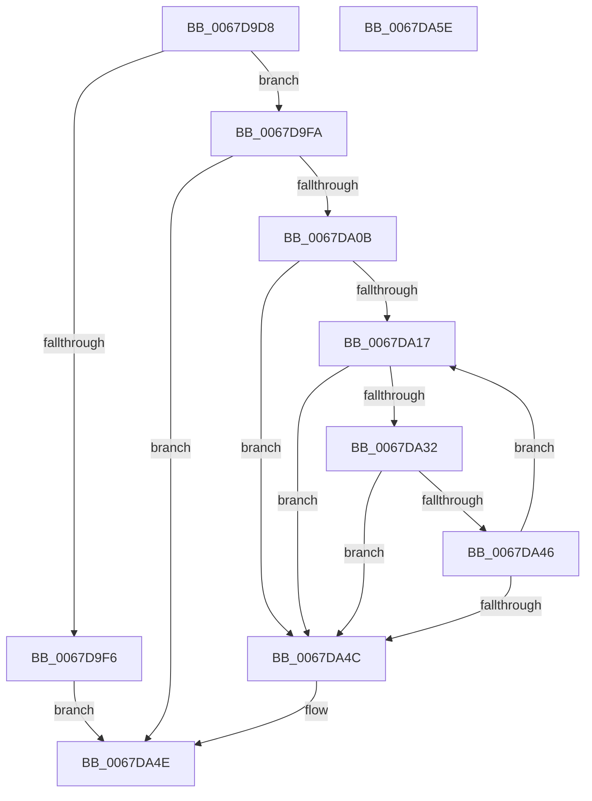

# MmAddUnloadedDriverInformationToCrashDump

- RVA: `0x0067D9D8`–`0x0067DA5F` (길이 `135` bytes)
- VA: `0x000000014067D9D8`
- 실행 섹션: `.text`
- PDB 이름 있음: `예`; PDB Function 태그: `아니요`
- unwind 정보 RVA: `0x00060BC4`
- 디코드: `43`개 명령, `135/135` bytes 표시
- 미해석 바이트: `0` (있으면 어셈블리에 `.byte`로 보존)

> 이 문서는 커널 이미지의 기계어와 PDB 기호를 분석해 생성했습니다. 4번과 5번은 함수 원형과 자료형을 바이너리 사용 방식에서 추정한 C 해석이며 원본 소스 복구 결과는 아닙니다.

## 1. Dependencies

- 직접 호출 지점: **2**; 고유 호출 대상: **1**
- 직접 호출자로 확인된 함수: **1**
- RIP 상대 이미지 참조: **2**

### Outgoing calls
- `0x0067DA00` → [MmAddRangeToCrashDump](MmAddRangeToCrashDump_function_0067D8B0.md) (function, `0x0067D8B0`)
- `0x0067DA3B` → [MmAddRangeToCrashDump](MmAddRangeToCrashDump_function_0067D8B0.md) (function, `0x0067D8B0`)

### Direct callers
- [IopAddMiniDumpPagesToPartialKernelDump](../5A/IopAddMiniDumpPagesToPartialKernelDump_function_005A16F8.md) at `0x005A17AD`

### Static image references
- `0x0067D9E7` → RVA `0x00EF54B0` (`.data`; read)
- `0x0067DA0B` → RVA `0x00EF54A8` (`.data`; read)

## 2. Other-region calls and transfers

- 다른 실행 섹션으로 향하는 call: **0**
- 별도 외부 분기/꼬리 이동을 확인하지 못했습니다.

## 3. Assembly (complete function range)

```asm
0067D9D8  48 89 5C 24 08                  mov qword ptr [rsp + 8], rbx
0067D9DD  48 89 74 24 10                  mov qword ptr [rsp + 0x10], rsi
0067D9E2  57                              push rdi
0067D9E3  48 83 EC 20                     sub rsp, 0x20
0067D9E7  48 8B 15 C2 7A 87 00            mov rdx, qword ptr [rip + 0x877ac2]
0067D9EE  48 8B F1                        mov rsi, rcx
0067D9F1  48 85 D2                        test rdx, rdx
0067D9F4  75 04                           jne 0x14067d9fa
0067D9F6  33 C0                           xor eax, eax
0067D9F8  EB 54                           jmp 0x14067da4e
0067D9FA  41 B8 D0 07 00 00               mov r8d, 0x7d0
0067DA00  E8 AB FE FF FF                  call 0x14067d8b0
0067DA05  8B C8                           mov ecx, eax
0067DA07  85 C0                           test eax, eax
0067DA09  78 43                           js 0x14067da4e
0067DA0B  8B 3D 97 7A 87 00               mov edi, dword ptr [rip + 0x877a97]
0067DA11  33 DB                           xor ebx, ebx
0067DA13  85 FF                           test edi, edi
0067DA15  74 35                           je 0x14067da4c
0067DA17  8B C7                           mov eax, edi
0067DA19  2B C3                           sub eax, ebx
0067DA1B  FF C8                           dec eax
0067DA1D  4C 8D 04 80                     lea r8, [rax + rax*4]
0067DA21  48 8B 05 88 7A 87 00            mov rax, qword ptr [rip + 0x877a88]
0067DA28  4A 8B 54 C0 08                  mov rdx, qword ptr [rax + r8*8 + 8]
0067DA2D  48 85 D2                        test rdx, rdx
0067DA30  74 1A                           je 0x14067da4c
0067DA32  46 0F B7 44 C0 02               movzx r8d, word ptr [rax + r8*8 + 2]
0067DA38  48 8B CE                        mov rcx, rsi
0067DA3B  E8 70 FE FF FF                  call 0x14067d8b0
0067DA40  8B C8                           mov ecx, eax
0067DA42  85 C0                           test eax, eax
0067DA44  78 06                           js 0x14067da4c
0067DA46  FF C3                           inc ebx
0067DA48  3B DF                           cmp ebx, edi
0067DA4A  72 CB                           jb 0x14067da17
0067DA4C  8B C1                           mov eax, ecx
0067DA4E  48 8B 5C 24 30                  mov rbx, qword ptr [rsp + 0x30]
0067DA53  48 8B 74 24 38                  mov rsi, qword ptr [rsp + 0x38]
0067DA58  48 83 C4 20                     add rsp, 0x20
0067DA5C  5F                              pop rdi
0067DA5D  C3                              ret
0067DA5E  CC                              int3
```

## 4. C-style interpretation (structured pseudocode)

```c
__int64 __fastcall MmAddUnloadedDriverInformationToCrashDump(__int64 a1)
{
    __int64 result;
    __int64 v_rbx;
    __int64 v_rsp;
    unsigned __int64 v_stack_p10;
    unsigned __int64 v_stack_p8;

    v_stack_p8 = v_rbx;
    v_stack_p10 = v_rsi;
    v_rsp = (v_rsp) - (32);
    if (*(unsigned __int64 *)(v_rip + 8878786) != 0) goto loc_0067D9FA;
    result = 0;
    goto loc_0067DA4E;
loc_0067D9FA:
    result = MmAddRangeToCrashDump(a1, *(unsigned __int64 *)(v_rip + 8878786), (unsigned int)(0x7D0ULL), a4);
    if (sign_flag) goto loc_0067DA4E;
    v_rbx = 0;
    if ((unsigned int)((unsigned int)(*(unsigned int *)(v_rip + 8878743))) == 0) goto loc_0067DA4C;
loc_0067DA17:
    result = (unsigned int)(((unsigned int)((unsigned int)((unsigned int)(*(unsigned int *)(v_rip + 8878743))))) - (0));
    result = (unsigned int)((result) - 1);
    if (*(unsigned __int64 *)(*(unsigned __int64 *)(v_rip + 8878728) + result + result * 4 * 8 + 8) == 0) goto loc_0067DA4C;
    result = MmAddRangeToCrashDump(a1, *(unsigned __int64 *)(*(unsigned __int64 *)(v_rip + 8878728) + result + result * 4 * 8 + 8), *(unsigned __int16 *)(*(unsigned __int64 *)(v_rip + 8878728) + result + result * 4 * 8 + 2), a4);
    if (sign_flag) goto loc_0067DA4C;
    v_rbx = (unsigned int)((v_rbx) + 1);
    if (((unsigned int)(v_rbx)) < ((unsigned int)((unsigned int)(*(unsigned int *)(v_rip + 8878743))))) goto loc_0067DA17;
loc_0067DA4C:
loc_0067DA4E:
    v_rsp = (v_rsp) + (32);
    return (unsigned int)((unsigned int)((unsigned int)((unsigned int)(result))));
}
```

## 5. (Beta) C Style

```c
int64_t MmAddUnloadedDriverInformationToCrashDump(int64_t Arg1)
{
    int64_t result;
    int64_t local_rbx;
    int64_t local_rsp;
    uint64_t v_stack_p10;
    uint64_t v_stack_p8;

    v_stack_p8 = local_rbx;
    v_stack_p10 = local_rsi;
    local_rsp = (local_rsp) - (32);
    if (*(uint64_t *)(v_rip + 0x877AC2) != 0) goto loc_0067D9FA;
    result = 0;
    goto loc_0067DA4E;
loc_0067D9FA:
    result = MmAddRangeToCrashDump(Arg1, *(uint64_t *)(v_rip + 0x877AC2), (uint32_t)(0x7D0ULL), a4);
    if (sign_flag) goto loc_0067DA4E;
    local_rbx = 0;
    if ((uint32_t)((uint32_t)(*(uint32_t *)(v_rip + 0x877A97))) == 0) goto loc_0067DA4C;
loc_0067DA17:
    result = (uint32_t)(((uint32_t)((uint32_t)((uint32_t)(*(uint32_t *)(v_rip + 0x877A97))))) - (0));
    result = (uint32_t)((result) - 1);
    if (*(uint64_t *)(*(uint64_t *)(v_rip + 0x877A88) + result + result * 4 * 8 + 0x8) == 0) goto loc_0067DA4C;
    result = MmAddRangeToCrashDump(Arg1, *(uint64_t *)(*(uint64_t *)(v_rip + 0x877A88) + result + result * 4 * 8 + 0x8), *(uint16_t *)(*(uint64_t *)(v_rip + 0x877A88) + result + result * 4 * 8 + 0x2), a4);
    if (sign_flag) goto loc_0067DA4C;
    local_rbx = (uint32_t)((local_rbx) + 1);
    if (((uint32_t)(local_rbx)) < ((uint32_t)((uint32_t)(*(uint32_t *)(v_rip + 0x877A97))))) goto loc_0067DA17;
loc_0067DA4C:
loc_0067DA4E:
    local_rsp = (local_rsp) + (32);
    return (uint32_t)((uint32_t)((uint32_t)((uint32_t)(result))));
}
```

## 6. Execution-region graph

[열기: 2D/3D 그래프와 함수 탐색 컨트롤 패널](../../../control-panel.html?section=text&rva=0x0067D9D8&view=graph)

- 2D 그래프는 위에서 아래로 흐르고, 3D 그래프는 빈 공간을 드래그해 회전합니다. Shift+드래그는 이동, 휠은 확대·축소, 함수 노드 선택은 대상 보고서 이동입니다.

### Static fallback


