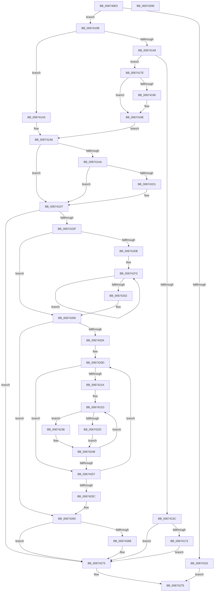

# MmAdvanceMdl

- RVA: `0x006740E0`–`0x00674291` (길이 `433` bytes)
- VA: `0x00000001406740E0`
- 실행 섹션: `.text`
- PDB 이름 있음: `예`; PDB Function 태그: `아니요`
- unwind 정보 RVA: `0x000D0D58`
- 디코드: `131`개 명령, `433/433` bytes 표시
- 미해석 바이트: `0` (있으면 어셈블리에 `.byte`로 보존)

> 이 문서는 커널 이미지의 기계어와 PDB 기호를 분석해 생성했습니다. 4번과 5번은 함수 원형과 자료형을 바이너리 사용 방식에서 추정한 C 해석이며 원본 소스 복구 결과는 아닙니다.

## 1. Dependencies

- 직접 호출 지점: **0**; 고유 호출 대상: **0**
- 직접 호출자로 확인된 함수: **0**
- RIP 상대 이미지 참조: **1**

### Outgoing calls
- 직접 디코드된 call 명령이 없습니다.

### Direct callers
- 이 함수 시작 RVA로 연결되는 직접 call은 확인되지 않았습니다. 간접 호출은 완전히 역산할 수 없습니다.

### Static image references
- `0x00674122` → RVA `0x00E3741C` (`.data`; write)

## 2. Other-region calls and transfers

- 다른 실행 섹션으로 향하는 call: **0**
- 별도 외부 분기/꼬리 이동을 확인하지 못했습니다.

## 3. Assembly (complete function range)

```asm
006740E0  48 8B C4                        mov rax, rsp
006740E3  48 89 58 08                     mov qword ptr [rax + 8], rbx
006740E7  48 89 68 10                     mov qword ptr [rax + 0x10], rbp
006740EB  48 89 70 18                     mov qword ptr [rax + 0x18], rsi
006740EF  48 89 78 20                     mov qword ptr [rax + 0x20], rdi
006740F3  41 54                           push r12
006740F5  41 56                           push r14
006740F7  41 57                           push r15
006740F9  4C 8B C1                        mov r8, rcx
006740FC  3B 51 28                        cmp edx, dword ptr [rcx + 0x28]
006740FF  72 0A                           jb 0x14067410b
00674101  B8 F0 00 00 C0                  mov eax, 0xc00000f0
00674106  E9 6A 01 00 00                  jmp 0x140674275
0067410B  45 33 F6                        xor r14d, r14d
0067410E  48 8D 71 20                     lea rsi, [rcx + 0x20]
00674112  BD FF 0F 00 00                  mov ebp, 0xfff
00674117  4D 8D 48 0A                     lea r9, [r8 + 0xa]
0067411B  41 8B DE                        mov ebx, r14d
0067411E  45 8D 7E 01                     lea r15d, [r14 + 1]
00674122  44 88 3D F3 32 7C 00            mov byte ptr [rip + 0x7c32f3], r15b
00674129  8B 79 2C                        mov edi, dword ptr [rcx + 0x2c]
0067412C  44 8B 51 28                     mov r10d, dword ptr [rcx + 0x28]
00674130  8B 0E                           mov ecx, dword ptr [rsi]
00674132  03 CF                           add ecx, edi
00674134  48 23 CD                        and rcx, rbp
00674137  4D 8D 9A FF 0F 00 00            lea r11, [r10 + 0xfff]
0067413E  4C 03 D9                        add r11, rcx
00674141  49 C1 EB 0C                     shr r11, 0xc
00674145  85 FF                           test edi, edi
00674147  74 5A                           je 0x1406741a3
00674149  41 0F B7 09                     movzx ecx, word ptr [r9]
0067414D  8D 5D 01                        lea ebx, [rbp + 1]
00674150  8B C3                           mov eax, ebx
00674152  66 41 23 CF                     and cx, r15w
00674156  2B C7                           sub eax, edi
00674158  3B D0                           cmp edx, eax
0067415A  73 22                           jae 0x14067417e
0067415C  44 2B D2                        sub r10d, edx
0067415F  8D 04 17                        lea eax, [rdi + rdx]
00674162  45 89 50 28                     mov dword ptr [r8 + 0x28], r10d
00674166  41 89 40 2C                     mov dword ptr [r8 + 0x2c], eax
0067416A  66 85 C9                        test cx, cx
0067416D  0F 84 00 01 00 00               je 0x140674273
00674173  8B C2                           mov eax, edx
00674175  49 01 40 18                     add qword ptr [r8 + 0x18], rax
00674179  E9 F5 00 00 00                  jmp 0x140674273
0067417E  48 01 1E                        add qword ptr [rsi], rbx
00674181  44 2B D0                        sub r10d, eax
00674184  2B D0                           sub edx, eax
00674186  45 89 70 2C                     mov dword ptr [r8 + 0x2c], r14d
0067418A  45 89 50 28                     mov dword ptr [r8 + 0x28], r10d
0067418E  48 8B FE                        mov rdi, rsi
00674191  66 85 C9                        test cx, cx
00674194  74 08                           je 0x14067419e
00674196  49 01 40 18                     add qword ptr [r8 + 0x18], rax
0067419A  49 8D 78 20                     lea rdi, [r8 + 0x20]
0067419E  41 8B DF                        mov ebx, r15d
006741A1  EB 03                           jmp 0x1406741a6
006741A3  48 8B FE                        mov rdi, rsi
006741A6  85 D2                           test edx, edx
006741A8  74 2D                           je 0x1406741d7
006741AA  8B C2                           mov eax, edx
006741AC  44 2B D2                        sub r10d, edx
006741AF  23 C5                           and eax, ebp
006741B1  45 89 50 28                     mov dword ptr [r8 + 0x28], r10d
006741B5  41 89 40 2C                     mov dword ptr [r8 + 0x2c], eax
006741B9  8B CA                           mov ecx, edx
006741BB  C1 E9 0C                        shr ecx, 0xc
006741BE  8B C1                           mov eax, ecx
006741C0  03 D9                           add ebx, ecx
006741C2  48 C1 E0 0C                     shl rax, 0xc
006741C6  48 03 06                        add rax, qword ptr [rsi]
006741C9  48 89 07                        mov qword ptr [rdi], rax
006741CC  45 84 39                        test byte ptr [r9], r15b
006741CF  74 06                           je 0x1406741d7
006741D1  8B C2                           mov eax, edx
006741D3  49 01 40 18                     add qword ptr [r8 + 0x18], rax
006741D7  85 DB                           test ebx, ebx
006741D9  0F 84 94 00 00 00               je 0x140674273
006741DF  41 BC 00 02 00 00               mov r12d, 0x200
006741E5  66 45 85 21                     test word ptr [r9], r12w
006741E9  74 1B                           je 0x140674206
006741EB  49 8D 48 30                     lea rcx, [r8 + 0x30]
006741EF  4A 8D 0C D9                     lea rcx, [rcx + r11*8]
006741F3  48 8B 01                        mov rax, qword ptr [rcx]
006741F6  4D 03 DF                        add r11, r15
006741F9  48 8D 49 08                     lea rcx, [rcx + 8]
006741FD  48 85 C0                        test rax, rax
00674200  79 F1                           jns 0x1406741f3
00674202  4D 8D 48 0A                     lea r9, [r8 + 0xa]
00674206  85 DB                           test ebx, ebx
00674208  74 56                           je 0x140674260
0067420A  44 8B D3                        mov r10d, ebx
0067420D  49 8B 70 30                     mov rsi, qword ptr [r8 + 0x30]
00674211  49 8D 48 30                     lea rcx, [r8 + 0x30]
00674215  4D 85 DB                        test r11, r11
00674218  74 3D                           je 0x140674257
0067421A  45 8B CF                        mov r9d, r15d
0067421D  41 8B D9                        mov ebx, r9d
00674220  49 3B DB                        cmp rbx, r11
00674223  74 13                           je 0x140674238
00674225  48 8B 41 08                     mov rax, qword ptr [rcx + 8]
00674229  48 BD FF FF FF FF FF FF FF 7F   movabs rbp, 0x7fffffffffffffff
00674233  48 23 C5                        and rax, rbp
00674236  EB 10                           jmp 0x140674248
00674238  48 BD 00 00 00 00 00 00 00 80   movabs rbp, 0x8000000000000000
00674242  48 8B C6                        mov rax, rsi
00674245  48 0B C5                        or rax, rbp
00674248  48 89 01                        mov qword ptr [rcx], rax
0067424B  45 03 CF                        add r9d, r15d
0067424E  48 83 C1 08                     add rcx, 8
00674252  49 3B DB                        cmp rbx, r11
00674255  72 C6                           jb 0x14067421d
00674257  4D 2B D7                        sub r10, r15
0067425A  75 B1                           jne 0x14067420d
0067425C  4D 8D 48 0A                     lea r9, [r8 + 0xa]
00674260  41 0F B7 40 0A                  movzx eax, word ptr [r8 + 0xa]
00674265  66 41 85 C4                     test r12w, ax
00674269  75 08                           jne 0x140674273
0067426B  66 41 0B C4                     or ax, r12w
0067426F  66 41 89 01                     mov word ptr [r9], ax
00674273  33 C0                           xor eax, eax
00674275  48 8B 5C 24 20                  mov rbx, qword ptr [rsp + 0x20]
0067427A  48 8B 6C 24 28                  mov rbp, qword ptr [rsp + 0x28]
0067427F  48 8B 74 24 30                  mov rsi, qword ptr [rsp + 0x30]
00674284  48 8B 7C 24 38                  mov rdi, qword ptr [rsp + 0x38]
00674289  41 5F                           pop r15
0067428B  41 5E                           pop r14
0067428D  41 5C                           pop r12
0067428F  C3                              ret
00674290  CC                              int3
```

## 4. C-style interpretation (structured pseudocode)

```c
__int64 __fastcall MmAdvanceMdl(__int64 a1, __int64 a2)
{
    __int64 result;
    __int64 v_r10;
    __int64 v_r11;
    __int64 v_r14;
    __int64 v_rbx;
    __int64 v_rdi;
    unsigned __int64 v_stack_p10;
    unsigned __int64 v_stack_p18;
    unsigned __int64 v_stack_p20;
    unsigned __int64 v_stack_p8;

    *(unsigned __int64 *)(v_rsp + 8) = v_rbx;
    *(unsigned __int64 *)(v_rsp + 16) = v_rbp;
    *(unsigned __int64 *)(v_rsp + 24) = v_rsi;
    *(unsigned __int64 *)(v_rsp + 32) = v_rdi;
    if (((unsigned int)(a2)) < (*(unsigned int *)(a1 + 40))) goto loc_0067410B;
    goto loc_00674275;
loc_0067410B:
    v_r14 = 0;
    *(unsigned __int8 *)(v_rip + 8139507) = (unsigned __int8)(v_r14 + 1);
    a1 = (unsigned int)(((unsigned int)(*(unsigned int *)(a1 + 32))) + ((unsigned int)((unsigned int)(*(unsigned int *)(a1 + 44)))));
    a1 = (a1) & ((unsigned int)(0xFFFULL));
    v_r11 = ((unsigned int)(*(unsigned int *)(a1 + 40)) + 4095) + (a1);
    v_r11 = (v_r11) >> (12);
    if ((unsigned int)((unsigned int)(*(unsigned int *)(a1 + 44))) == 0) goto loc_006741A3;
    a1 = (unsigned __int16)((*(unsigned __int16 *)(a1 + 10)) & ((unsigned __int16)(v_r14 + 1)));
    result = (unsigned int)(((unsigned int)((unsigned int)((unsigned int)(0xFFFULL) + 1))) - ((unsigned int)((unsigned int)(*(unsigned int *)(a1 + 44)))));
    if (((unsigned int)(a2)) >= ((unsigned int)(result))) goto loc_0067417E;
    v_r10 = (unsigned int)(((unsigned int)(*(unsigned int *)(a1 + 40))) - ((unsigned int)(a2)));
    *(unsigned int *)(a1 + 40) = (unsigned int)(v_r10);
    *(unsigned int *)(a1 + 44) = (unsigned int)((unsigned int)(*(unsigned int *)(a1 + 44)) + a2 * 1);
    if ((unsigned __int16)(a1) == 0) goto loc_00674273;
    goto loc_00674273;
loc_0067417E:
    v_r10 = (unsigned int)((v_r10) - ((unsigned int)((unsigned int)((unsigned int)(a2)))));
    a2 = (unsigned int)((a2) - ((unsigned int)((unsigned int)((unsigned int)(a2)))));
    *(unsigned int *)(a1 + 44) = 0;
    *(unsigned int *)(a1 + 40) = (unsigned int)(v_r10);
    v_rdi = a1 + 32;
    if ((unsigned __int16)(a1) != 0) {
        v_rdi = a1 + 32;
    }
    goto loc_006741A6;
loc_006741A3:
loc_006741A6:
    if ((unsigned int)(a2) == 0) goto loc_006741D7;
    v_r10 = (unsigned int)((v_r10) - ((unsigned int)(a2)));
    result = (unsigned int)(((unsigned int)((unsigned int)(a2))) & ((unsigned int)((unsigned int)(0xFFFULL))));
    *(unsigned int *)(a1 + 40) = (unsigned int)(v_r10);
    *(unsigned int *)(a1 + 44) = (unsigned int)(result);
    a1 = (unsigned int)(((unsigned int)((unsigned int)(a2))) >> (12));
    v_rbx = (unsigned int)(((unsigned int)((unsigned int)(v_r14 + 1))) + ((unsigned int)(a1)));
    result = ((unsigned int)((unsigned int)(a1))) << (12);
    result = (result) + (*(unsigned __int64 *)(a1 + 32));
    *(unsigned __int64 *)(a1 + 32) = result;
    if (((*(unsigned __int8 *)(a1 + 10)) & ((unsigned __int8)(v_r14 + 1))) != 0) {
        result = (unsigned int)(a2);
    }
    if ((unsigned int)(v_rbx) == 0) goto loc_00674273;
    if (((*(unsigned __int16 *)(a1 + 10)) & (512)) == 0) goto loc_00674206;
loc_006741F3:
    v_r11 = (v_r11) + (v_r14 + 1);
    if (!sign_flag) goto loc_006741F3;
loc_00674206:
    if ((unsigned int)(v_rbx) == 0) goto loc_00674260;
loc_0067420D:
    if (v_r11 == 0) goto loc_00674257;
loc_0067421D:
    if (((unsigned int)((unsigned int)((unsigned int)((unsigned int)(v_r14 + 1))))) == v_r11) goto loc_00674238;
    result = (*(unsigned __int64 *)(a1 + 48 + 8)) & ((unsigned int)(0xFFFULL));
    goto loc_00674248;
loc_00674238:
    result = (*(unsigned __int64 *)(a1 + 48)) | ((unsigned int)(0xFFFULL));
loc_00674248:
    *(unsigned __int64 *)(a1 + 48) = result;
    a4 = (unsigned int)(((unsigned int)((unsigned int)(v_r14 + 1))) + ((unsigned int)(v_r14 + 1)));
    a1 = (a1 + 48) + (8);
    if (((unsigned int)((unsigned int)((unsigned int)((unsigned int)(v_r14 + 1))))) < v_r11) goto loc_0067421D;
loc_00674257:
    v_r10 = ((unsigned int)((unsigned int)(v_rbx))) - (v_r14 + 1);
    if (condition_is_not_equal) goto loc_0067420D;
loc_00674260:
    result = *(unsigned __int16 *)(a1 + 10);
    if (((512) & ((unsigned __int16)(*(unsigned __int16 *)(a1 + 10)))) == 0) {
        result = (unsigned __int16)((*(unsigned __int16 *)(a1 + 10)) | (512));
        *(unsigned __int16 *)(a1 + 10) = (unsigned __int16)(result);
    }
    result = 0;
loc_00674275:
    return result;
}
```

## 5. (Beta) C Style

```c
int64_t MmAdvanceMdl(void *Arg1, int64_t Arg2)
{
    uint8_t *arg1 = (uint8_t *)Arg1;

    int64_t result;
    int64_t local_r10;
    int64_t local_r11;
    int64_t local_r14;
    int64_t local_rbx;
    int64_t local_rdi;
    uint64_t v_stack_p10;
    uint64_t v_stack_p18;
    uint64_t v_stack_p20;
    uint64_t v_stack_p8;

    *(uint64_t *)(local_rsp + 0x8) = local_rbx;
    *(uint64_t *)(local_rsp + 0x10) = local_rbp;
    *(uint64_t *)(local_rsp + 0x18) = local_rsi;
    *(uint64_t *)(local_rsp + 0x20) = local_rdi;
    if (((uint32_t)(Arg2)) < (*(uint32_t *)(arg1 + 0x28))) goto loc_0067410B;
    goto loc_00674275;
loc_0067410B:
    local_r14 = 0;
    *(uint8_t *)(v_rip + 0x7C32F3) = (uint8_t)(local_r14 + 1);
    Arg1 = (uint32_t)(((uint32_t)(*(uint32_t *)(arg1 + 0x20))) + ((uint32_t)((uint32_t)(*(uint32_t *)(arg1 + 0x2C)))));
    Arg1 = (Arg1) & ((uint32_t)(0xFFFULL));
    local_r11 = ((uint32_t)(*(uint32_t *)(arg1 + 0x28)) + 4095) + (Arg1);
    local_r11 = (local_r11) >> (12);
    if ((uint32_t)((uint32_t)(*(uint32_t *)(arg1 + 0x2C))) == 0) goto loc_006741A3;
    Arg1 = (uint16_t)((*(uint16_t *)(arg1 + 0xA)) & ((uint16_t)(local_r14 + 1)));
    result = (uint32_t)(((uint32_t)((uint32_t)((uint32_t)(0xFFFULL) + 1))) - ((uint32_t)((uint32_t)(*(uint32_t *)(arg1 + 0x2C)))));
    if (((uint32_t)(Arg2)) >= ((uint32_t)(result))) goto loc_0067417E;
    local_r10 = (uint32_t)(((uint32_t)(*(uint32_t *)(arg1 + 0x28))) - ((uint32_t)(Arg2)));
    *(uint32_t *)(arg1 + 0x28) = (uint32_t)(local_r10);
    *(uint32_t *)(arg1 + 0x2C) = (uint32_t)((uint32_t)(*(uint32_t *)(arg1 + 0x2C)) + Arg2 * 1);
    if ((uint16_t)(Arg1) == 0) goto loc_00674273;
    goto loc_00674273;
loc_0067417E:
    local_r10 = (uint32_t)((local_r10) - ((uint32_t)((uint32_t)((uint32_t)(Arg2)))));
    Arg2 = (uint32_t)((Arg2) - ((uint32_t)((uint32_t)((uint32_t)(Arg2)))));
    *(uint32_t *)(arg1 + 0x2C) = 0;
    *(uint32_t *)(arg1 + 0x28) = (uint32_t)(local_r10);
    local_rdi = Arg1 + 32;
    if ((uint16_t)(Arg1) != 0) {
        local_rdi = Arg1 + 32;
    }
    goto loc_006741A6;
loc_006741A3:
loc_006741A6:
    if ((uint32_t)(Arg2) == 0) goto loc_006741D7;
    local_r10 = (uint32_t)((local_r10) - ((uint32_t)(Arg2)));
    result = (uint32_t)(((uint32_t)((uint32_t)(Arg2))) & ((uint32_t)((uint32_t)(0xFFFULL))));
    *(uint32_t *)(arg1 + 0x28) = (uint32_t)(local_r10);
    *(uint32_t *)(arg1 + 0x2C) = (uint32_t)(result);
    Arg1 = (uint32_t)(((uint32_t)((uint32_t)(Arg2))) >> (12));
    local_rbx = (uint32_t)(((uint32_t)((uint32_t)(local_r14 + 1))) + ((uint32_t)(Arg1)));
    result = ((uint32_t)((uint32_t)(Arg1))) << (12);
    result = (result) + (*(uint64_t *)(arg1 + 0x20));
    *(uint64_t *)(arg1 + 0x20) = result;
    if (((*(uint8_t *)(arg1 + 0xA)) & ((uint8_t)(local_r14 + 1))) != 0) {
        result = (uint32_t)(Arg2);
    }
    if ((uint32_t)(local_rbx) == 0) goto loc_00674273;
    if (((*(uint16_t *)(arg1 + 0xA)) & (512)) == 0) goto loc_00674206;
loc_006741F3:
    local_r11 = (local_r11) + (local_r14 + 1);
    if (!sign_flag) goto loc_006741F3;
loc_00674206:
    if ((uint32_t)(local_rbx) == 0) goto loc_00674260;
loc_0067420D:
    if (local_r11 == 0) goto loc_00674257;
loc_0067421D:
    if (((uint32_t)((uint32_t)((uint32_t)((uint32_t)(local_r14 + 1))))) == local_r11) goto loc_00674238;
    result = (*(uint64_t *)(arg1 + 0x30 + 0x8)) & ((uint32_t)(0xFFFULL));
    goto loc_00674248;
loc_00674238:
    result = (*(uint64_t *)(arg1 + 0x30)) | ((uint32_t)(0xFFFULL));
loc_00674248:
    *(uint64_t *)(arg1 + 0x30) = result;
    a4 = (uint32_t)(((uint32_t)((uint32_t)(local_r14 + 1))) + ((uint32_t)(local_r14 + 1)));
    Arg1 = (Arg1 + 48) + (8);
    if (((uint32_t)((uint32_t)((uint32_t)((uint32_t)(local_r14 + 1))))) < local_r11) goto loc_0067421D;
loc_00674257:
    local_r10 = ((uint32_t)((uint32_t)(local_rbx))) - (local_r14 + 1);
    if (condition_is_not_equal) goto loc_0067420D;
loc_00674260:
    result = *(uint16_t *)(arg1 + 0xA);
    if (((512) & ((uint16_t)(*(uint16_t *)(arg1 + 0xA)))) == 0) {
        result = (uint16_t)((*(uint16_t *)(arg1 + 0xA)) | (512));
        *(uint16_t *)(arg1 + 0xA) = (uint16_t)(result);
    }
    result = 0;
loc_00674275:
    return result;
}
```

### 관측된 메모리 오프셋

구조체 형식이 확인되지 않은 접근은 인자 기준의 오프셋으로만 기록했습니다.

| 기준 인자 | 오프셋 표현 | 폭 (bit) | 접근 |
|---|---:|---:|---|
| `Arg1` | `+ 0x0` | `8` | `R` |
| `Arg1` | `+ 0x0` | `16` | `R` |
| `Arg1` | `+ 0x0` | `16` | `W` |
| `Arg1` | `+ 0x0` | `32` | `R` |
| `Arg1` | `+ 0x0` | `64` | `R` |
| `Arg1` | `+ 0x0` | `64` | `R/W` |
| `Arg1` | `+ 0x0` | `64` | `W` |
| `Arg1` | `+ 0x0 + r11*8` | `64` | `R` |
| `Arg1` | `+ 0x8` | `64` | `R` |
| `Arg1` | `+ 0xA` | `16` | `R` |
| `Arg1` | `+ 0xA` | `64` | `R` |
| `Arg1` | `+ 0x18` | `64` | `R/W` |
| `Arg1` | `+ 0x20` | `64` | `R` |
| `Arg1` | `+ 0x28` | `32` | `R` |
| `Arg1` | `+ 0x28` | `32` | `W` |
| `Arg1` | `+ 0x2C` | `32` | `R` |
| `Arg1` | `+ 0x2C` | `32` | `W` |
| `Arg1` | `+ 0x30` | `64` | `R` |

## 6. Execution-region graph

[열기: 2D/3D 그래프와 함수 탐색 컨트롤 패널](../../../control-panel.html?section=text&rva=0x006740E0&view=graph)

- 2D 그래프는 위에서 아래로 흐르고, 3D 그래프는 빈 공간을 드래그해 회전합니다. Shift+드래그는 이동, 휠은 확대·축소, 함수 노드 선택은 대상 보고서 이동입니다.

### Static fallback


