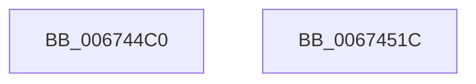

# MmAllocateContiguousMemory

- RVA: `0x006744C0`–`0x0067451D` (길이 `93` bytes)
- VA: `0x00000001406744C0`
- 실행 섹션: `.text`
- PDB 이름 있음: `예`; PDB Function 태그: `아니요`
- unwind 정보 RVA: `0x000D7BE4`
- 디코드: `19`개 명령, `93/93` bytes 표시
- 미해석 바이트: `0` (있으면 어셈블리에 `.byte`로 보존)

> 이 문서는 커널 이미지의 기계어와 PDB 기호를 분석해 생성했습니다. 4번과 5번은 함수 원형과 자료형을 바이너리 사용 방식에서 추정한 C 해석이며 원본 소스 복구 결과는 아닙니다.

## 1. Dependencies

- 직접 호출 지점: **1**; 고유 호출 대상: **1**
- 직접 호출자로 확인된 함수: **1**
- RIP 상대 이미지 참조: **2**

### Outgoing calls
- `0x00674512` → [MiAllocateContiguousMemory](../3E/MiAllocateContiguousMemory_function_003E9FDC.md) (function, `0x003E9FDC`)

### Direct callers
- [DifMmAllocateContiguousMemoryWrapper](../63/DifMmAllocateContiguousMemoryWrapper_function_00633F40.md) at `0x00634014`

### Static image references
- `0x006744CD` → RVA `0x00E38D00` (`.data`; read)
- `0x006744D4` → RVA `0x00E2DCE0` (`.data`; read)

## 2. Other-region calls and transfers

- 다른 실행 섹션으로 향하는 call: **0**
- 별도 외부 분기/꼬리 이동을 확인하지 못했습니다.

## 3. Assembly (complete function range)

```asm
006744C0  48 89 4C 24 08                  mov qword ptr [rsp + 8], rcx
006744C5  48 83 EC 58                     sub rsp, 0x58
006744C9  48 C1 EA 0C                     shr rdx, 0xc
006744CD  48 8D 05 2C 48 7C 00            lea rax, [rip + 0x7c482c]
006744D4  48 3B 15 05 98 7B 00            cmp rdx, qword ptr [rip + 0x7b9805]
006744DB  48 8D 4C 24 60                  lea rcx, [rsp + 0x60]
006744E0  48 0F 47 15 F8 97 7B 00         cmova rdx, qword ptr [rip + 0x7b97f8]
006744E8  45 33 C9                        xor r9d, r9d
006744EB  83 64 24 40 00                  and dword ptr [rsp + 0x40], 0
006744F0  4C 8B C2                        mov r8, rdx
006744F3  C7 44 24 38 43 6F 6E 54         mov dword ptr [rsp + 0x38], 0x546e6f43
006744FB  33 D2                           xor edx, edx
006744FD  48 89 44 24 30                  mov qword ptr [rsp + 0x30], rax
00674502  C7 44 24 28 00 00 00 80         mov dword ptr [rsp + 0x28], 0x80000000
0067450A  C7 44 24 20 06 00 00 00         mov dword ptr [rsp + 0x20], 6
00674512  E8 C5 5A D7 FF                  call 0x1403e9fdc
00674517  48 83 C4 58                     add rsp, 0x58
0067451B  C3                              ret
0067451C  CC                              int3
```

## 4. C-style interpretation (structured pseudocode)

```c
__int64 __fastcall MmAllocateContiguousMemory(__int64 a1, __int64 a2, __int64 a3, int a4)
{
    __int64 result;
    __int64 v_rsp;
    unsigned int v_stack_m18;
    unsigned int v_stack_m20;
    unsigned __int64 v_stack_m28;
    unsigned int v_stack_m30;
    unsigned int v_stack_m38;
    unsigned __int64 v_stack_p8;

    v_stack_p8 = a1;
    v_rsp = (v_rsp) - (88);
    a2 = (a2) >> (12);
    if (a2 > (*(unsigned __int64 *)(v_rip + 8099845))) { a2 = *(unsigned __int64 *)(v_rip + 8099832); }
    a4 = 0;
    v_stack_m20 = 0x546E6F43ULL;
    a2 = 0;
    v_stack_m28 = v_rip + 8144940;
    v_stack_m30 = 0x80000000ULL;
    v_stack_m38 = 6;
    result = MiAllocateContiguousMemory(v_stack_p8, a2, a2, a4);
    v_rsp = (v_rsp) + (88);
    return result;
}
```

## 5. (Beta) C Style

```c
int64_t MmAllocateContiguousMemory(int64_t Arg1, int64_t Arg2, int64_t Arg3, int32_t Arg4)
{
    int64_t result;
    int64_t local_rsp;
    uint32_t v_stack_m18;
    uint32_t v_stack_m20;
    uint64_t v_stack_m28;
    uint32_t v_stack_m30;
    uint32_t v_stack_m38;
    uint64_t v_stack_p8;

    v_stack_p8 = Arg1;
    local_rsp = (local_rsp) - (88);
    Arg2 = (Arg2) >> (12);
    if (Arg2 > (*(uint64_t *)(v_rip + 0x7B9805))) { Arg2 = *(uint64_t *)(v_rip + 0x7B97F8); }
    Arg4 = 0;
    v_stack_m20 = 0x546E6F43ULL;
    Arg2 = 0;
    v_stack_m28 = v_rip + 8144940;
    v_stack_m30 = 0x80000000ULL;
    v_stack_m38 = 6;
    result = MiAllocateContiguousMemory(v_stack_p8, Arg2, Arg2, Arg4);
    local_rsp = (local_rsp) + (88);
    return result;
}
```

## 6. Execution-region graph

[열기: 2D/3D 그래프와 함수 탐색 컨트롤 패널](../../../control-panel.html?section=text&rva=0x006744C0&view=graph)

- 2D 그래프는 위에서 아래로 흐르고, 3D 그래프는 빈 공간을 드래그해 회전합니다. Shift+드래그는 이동, 휠은 확대·축소, 함수 노드 선택은 대상 보고서 이동입니다.

### Static fallback


