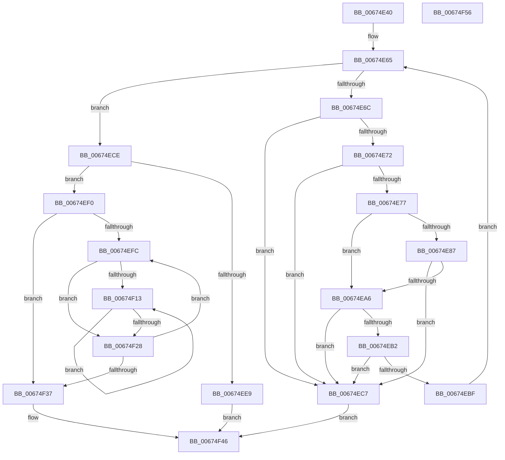

# MmAllocateMdlForIoSpace

- RVA: `0x00674E40`–`0x00674F57` (길이 `279` bytes)
- VA: `0x0000000140674E40`
- 실행 섹션: `.text`
- PDB 이름 있음: `예`; PDB Function 태그: `아니요`
- unwind 정보 RVA: `0x000717F8`
- 디코드: `85`개 명령, `279/279` bytes 표시
- 미해석 바이트: `0` (있으면 어셈블리에 `.byte`로 보존)

> 이 문서는 커널 이미지의 기계어와 PDB 기호를 분석해 생성했습니다. 4번과 5번은 함수 원형과 자료형을 바이너리 사용 방식에서 추정한 C 해석이며 원본 소스 복구 결과는 아닙니다.

## 1. Dependencies

- 직접 호출 지점: **1**; 고유 호출 대상: **1**
- 직접 호출자로 확인된 함수: **0**
- RIP 상대 이미지 참조: **1**

### Outgoing calls
- `0x00674EDC` → [IoAllocateMdl](../29/IoAllocateMdl_function_0029EBF0.md) (function, `0x0029EBF0`)

### Direct callers
- 이 함수 시작 RVA로 연결되는 직접 call은 확인되지 않았습니다. 간접 호출은 완전히 역산할 수 없습니다.

### Static image references
- `0x00674E7E` → RVA `0x00E2DCE0` (`.data`; read)

## 2. Other-region calls and transfers

- 다른 실행 섹션으로 향하는 call: **0**
- 별도 외부 분기/꼬리 이동을 확인하지 못했습니다.

## 3. Assembly (complete function range)

```asm
00674E40  48 89 5C 24 10                  mov qword ptr [rsp + 0x10], rbx
00674E45  48 89 74 24 18                  mov qword ptr [rsp + 0x18], rsi
00674E4A  57                              push rdi
00674E4B  48 83 EC 30                     sub rsp, 0x30
00674E4F  48 8B FA                        mov rdi, rdx
00674E52  48 8B D9                        mov rbx, rcx
00674E55  33 D2                           xor edx, edx
00674E57  4C 8B C9                        mov r9, rcx
00674E5A  33 C9                           xor ecx, ecx
00674E5C  49 8B F0                        mov rsi, r8
00674E5F  41 BA FF 0F 00 00               mov r10d, 0xfff
00674E65  8B C1                           mov eax, ecx
00674E67  48 3B C7                        cmp rax, rdi
00674E6A  73 62                           jae 0x140674ece
00674E6C  45 85 51 08                     test dword ptr [r9 + 8], r10d
00674E70  75 55                           jne 0x140674ec7
00674E72  45 85 11                        test dword ptr [r9], r10d
00674E75  75 50                           jne 0x140674ec7
00674E77  49 8B 01                        mov rax, qword ptr [r9]
00674E7A  48 C1 E8 0C                     shr rax, 0xc
00674E7E  48 3B 05 5B 8E 7B 00            cmp rax, qword ptr [rip + 0x7b8e5b]
00674E85  77 1F                           ja 0x140674ea6
00674E87  48 8D 04 40                     lea rax, [rax + rax*2]
00674E8B  48 03 C0                        add rax, rax
00674E8E  49 B8 28 00 00 00 00 DE FF FF   movabs r8, 0xffffde0000000028
00674E98  49 8B 04 C0                     mov rax, qword ptr [r8 + rax*8]
00674E9C  48 C1 E8 36                     shr rax, 0x36
00674EA0  0F BA E0 00                     bt eax, 0
00674EA4  72 21                           jb 0x140674ec7
00674EA6  4D 8B 41 08                     mov r8, qword ptr [r9 + 8]
00674EAA  4C 03 C2                        add r8, rdx
00674EAD  4C 3B C2                        cmp r8, rdx
00674EB0  72 15                           jb 0x140674ec7
00674EB2  B8 FF FF FF FF                  mov eax, 0xffffffff
00674EB7  49 8B D0                        mov rdx, r8
00674EBA  4C 3B C0                        cmp r8, rax
00674EBD  77 08                           ja 0x140674ec7
00674EBF  FF C1                           inc ecx
00674EC1  49 83 C1 10                     add r9, 0x10
00674EC5  EB 9E                           jmp 0x140674e65
00674EC7  B8 EF 00 00 C0                  mov eax, 0xc00000ef
00674ECC  EB 78                           jmp 0x140674f46
00674ECE  48 83 64 24 20 00               and qword ptr [rsp + 0x20], 0
00674ED4  45 33 C9                        xor r9d, r9d
00674ED7  45 33 C0                        xor r8d, r8d
00674EDA  33 C9                           xor ecx, ecx
00674EDC  E8 0F 9D C2 FF                  call 0x14029ebf0
00674EE1  48 8B C8                        mov rcx, rax
00674EE4  48 85 C0                        test rax, rax
00674EE7  75 07                           jne 0x140674ef0
00674EE9  B8 9A 00 00 C0                  mov eax, 0xc000009a
00674EEE  EB 56                           jmp 0x140674f46
00674EF0  45 33 C9                        xor r9d, r9d
00674EF3  4C 8D 58 30                     lea r11, [rax + 0x30]
00674EF7  48 85 FF                        test rdi, rdi
00674EFA  74 3B                           je 0x140674f37
00674EFC  4C 8B 43 08                     mov r8, qword ptr [rbx + 8]
00674F00  45 33 D2                        xor r10d, r10d
00674F03  48 8B 13                        mov rdx, qword ptr [rbx]
00674F06  49 C1 E8 0C                     shr r8, 0xc
00674F0A  48 C1 EA 0C                     shr rdx, 0xc
00674F0E  4D 85 C0                        test r8, r8
00674F11  74 15                           je 0x140674f28
00674F13  41 FF C2                        inc r10d
00674F16  49 89 13                        mov qword ptr [r11], rdx
00674F19  41 8B C2                        mov eax, r10d
00674F1C  49 83 C3 08                     add r11, 8
00674F20  48 FF C2                        inc rdx
00674F23  49 3B C0                        cmp rax, r8
00674F26  72 EB                           jb 0x140674f13
00674F28  41 FF C1                        inc r9d
00674F2B  48 83 C3 10                     add rbx, 0x10
00674F2F  41 8B C1                        mov eax, r9d
00674F32  48 3B C7                        cmp rax, rdi
00674F35  72 C5                           jb 0x140674efc
00674F37  66 83 49 0A 02                  or word ptr [rcx + 0xa], 2
00674F3C  48 83 61 10 00                  and qword ptr [rcx + 0x10], 0
00674F41  33 C0                           xor eax, eax
00674F43  48 89 0E                        mov qword ptr [rsi], rcx
00674F46  48 8B 5C 24 48                  mov rbx, qword ptr [rsp + 0x48]
00674F4B  48 8B 74 24 50                  mov rsi, qword ptr [rsp + 0x50]
00674F50  48 83 C4 30                     add rsp, 0x30
00674F54  5F                              pop rdi
00674F55  C3                              ret
00674F56  CC                              int3
```

## 4. C-style interpretation (structured pseudocode)

```c
__int64 __fastcall MmAllocateMdlForIoSpace(__int64 a1, __int64 a2, __int64 a3)
{
    __int64 result;
    __int64 v_r10;
    __int64 v_r11;
    __int64 v_rbx;
    __int64 v_rsp;
    unsigned __int64 v_stack_m18;
    unsigned __int64 v_stack_p10;
    unsigned __int64 v_stack_p18;

    v_stack_p10 = v_rbx;
    v_stack_p18 = v_rsi;
    v_rsp = (v_rsp) - (48);
    a2 = 0;
    a1 = 0;
loc_00674E65:
    if (0 >= 0) goto loc_00674ECE;
    if (((*(unsigned int *)(a1 + 8)) & ((unsigned int)((unsigned int)(0xFFFULL)))) != 0) goto loc_00674EC7;
    if (((*(unsigned int *)(a1)) & ((unsigned int)((unsigned int)(0xFFFULL)))) != 0) goto loc_00674EC7;
    result = (*(unsigned __int64 *)(a1)) >> (12);
    if (result > (*(unsigned __int64 *)(v_rip + 8097371))) goto loc_00674EA6;
    result = (result + result * 2) + (result + result * 2);
    result = (*(unsigned __int64 *)(a3 + result * 8)) >> (54);
    if (condition_is_below) goto loc_00674EC7;
loc_00674EA6:
    a3 = (*(unsigned __int64 *)(a1 + 8)) + (0);
    if (a3 < 0) goto loc_00674EC7;
    if (a3 > ((unsigned int)(0xFFFFFFFFULL))) goto loc_00674EC7;
    a1 = (unsigned int)((a1) + 1);
    a4 = (a1) + (16);
    goto loc_00674E65;
loc_00674EC7:
    goto loc_00674F46;
loc_00674ECE:
    a4 = 0;
    a3 = 0;
    a1 = 0;
    result = IoAllocateMdl(a1, a3, a3, a4);
    if (result != 0) goto loc_00674EF0;
    goto loc_00674F46;
loc_00674EF0:
    a4 = 0;
    if (0 == 0) goto loc_00674F37;
loc_00674EFC:
    v_r10 = 0;
    a3 = (*(unsigned __int64 *)(a1 + 8)) >> (12);
    a2 = (*(unsigned __int64 *)(a1)) >> (12);
    if (a3 == 0) goto loc_00674F28;
loc_00674F13:
    v_r10 = (unsigned int)((v_r10) + 1);
    *(unsigned __int64 *)((unsigned int)(0xC000009AULL) + 48) = a2;
    v_r11 = ((unsigned int)(0xC000009AULL) + 48) + (8);
    a2 = (a2) + 1;
    if (((unsigned int)((unsigned int)(v_r10))) < a3) goto loc_00674F13;
loc_00674F28:
    a4 = (unsigned int)((a4) + 1);
    v_rbx = (a1) + (16);
    if (((unsigned int)((unsigned int)(a4))) < a2) goto loc_00674EFC;
loc_00674F37:
    result = 0;
    *(unsigned __int64 *)(a3) = 0;
loc_00674F46:
    v_rsp = (v_rsp) + (48);
    return result;
}
```

## 5. (Beta) C Style

```c
int64_t MmAllocateMdlForIoSpace(void *Arg1, int64_t Arg2, void *Arg3)
{
    uint8_t *arg1 = (uint8_t *)Arg1;
    uint8_t *arg3 = (uint8_t *)Arg3;

    int64_t result;
    int64_t local_r10;
    int64_t local_r11;
    int64_t local_rbx;
    int64_t local_rsp;
    uint64_t v_stack_m18;
    uint64_t v_stack_p10;
    uint64_t v_stack_p18;

    v_stack_p10 = local_rbx;
    v_stack_p18 = local_rsi;
    local_rsp = (local_rsp) - (48);
    Arg2 = 0;
    Arg1 = 0;
loc_00674E65:
    if (0 >= 0) goto loc_00674ECE;
    if (((*(uint32_t *)(arg1 + 0x8)) & ((uint32_t)((uint32_t)(0xFFFULL)))) != 0) goto loc_00674EC7;
    if (((*(uint32_t *)(arg1)) & ((uint32_t)((uint32_t)(0xFFFULL)))) != 0) goto loc_00674EC7;
    result = (*(uint64_t *)(arg1)) >> (12);
    if (result > (*(uint64_t *)(v_rip + 0x7B8E5B))) goto loc_00674EA6;
    result = (result + result * 2) + (result + result * 2);
    result = (*(uint64_t *)(arg3 + result * 8)) >> (54);
    if (condition_is_below) goto loc_00674EC7;
loc_00674EA6:
    Arg3 = (*(uint64_t *)(arg1 + 0x8)) + (0);
    if (Arg3 < 0) goto loc_00674EC7;
    if (Arg3 > ((uint32_t)(0xFFFFFFFFULL))) goto loc_00674EC7;
    Arg1 = (uint32_t)((Arg1) + 1);
    a4 = (Arg1) + (16);
    goto loc_00674E65;
loc_00674EC7:
    goto loc_00674F46;
loc_00674ECE:
    a4 = 0;
    Arg3 = 0;
    Arg1 = 0;
    result = IoAllocateMdl(Arg1, Arg3, Arg3, a4);
    if (result != 0) goto loc_00674EF0;
    goto loc_00674F46;
loc_00674EF0:
    a4 = 0;
    if (0 == 0) goto loc_00674F37;
loc_00674EFC:
    local_r10 = 0;
    Arg3 = (*(uint64_t *)(arg1 + 0x8)) >> (12);
    Arg2 = (*(uint64_t *)(arg1)) >> (12);
    if (Arg3 == NULL) goto loc_00674F28;
loc_00674F13:
    local_r10 = (uint32_t)((local_r10) + 1);
    *(uint64_t *)((uint32_t)(0xC000009AULL) + 0x30) = Arg2;
    local_r11 = ((uint32_t)(0xC000009AULL) + 48) + (8);
    Arg2 = (Arg2) + 1;
    if (((uint32_t)((uint32_t)(local_r10))) < Arg3) goto loc_00674F13;
loc_00674F28:
    a4 = (uint32_t)((a4) + 1);
    local_rbx = (Arg1) + (16);
    if (((uint32_t)((uint32_t)(a4))) < Arg2) goto loc_00674EFC;
loc_00674F37:
    result = 0;
    *(uint64_t *)(arg3) = 0;
loc_00674F46:
    local_rsp = (local_rsp) + (48);
    return result;
}
```

### 관측된 메모리 오프셋

구조체 형식이 확인되지 않은 접근은 인자 기준의 오프셋으로만 기록했습니다.

| 기준 인자 | 오프셋 표현 | 폭 (bit) | 접근 |
|---|---:|---:|---|
| `Arg1` | `+ 0x0` | `32` | `R` |
| `Arg1` | `+ 0x0` | `64` | `R` |
| `Arg1` | `+ 0x8` | `32` | `R` |
| `Arg1` | `+ 0x8` | `64` | `R` |
| `Arg3` | `+ 0x0` | `64` | `W` |

## 6. Execution-region graph

[열기: 2D/3D 그래프와 함수 탐색 컨트롤 패널](../../../control-panel.html?section=text&rva=0x00674E40&view=graph)

- 2D 그래프는 위에서 아래로 흐르고, 3D 그래프는 빈 공간을 드래그해 회전합니다. Shift+드래그는 이동, 휠은 확대·축소, 함수 노드 선택은 대상 보고서 이동입니다.

### Static fallback


