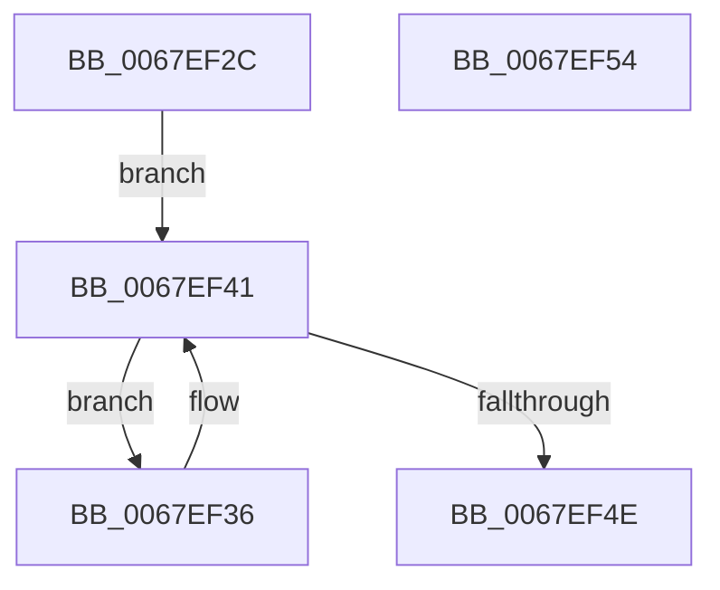

# MmEmptyAllWorkingSets

- RVA: `0x0067EF2C`–`0x0067EF55` (길이 `41` bytes)
- VA: `0x000000014067EF2C`
- 실행 섹션: `.text`
- PDB 이름 있음: `예`; PDB Function 태그: `아니요`
- unwind 정보 RVA: `0x0005CF00`
- 디코드: `15`개 명령, `41/41` bytes 표시
- 미해석 바이트: `0` (있으면 어셈블리에 `.byte`로 보존)

> 이 문서는 커널 이미지의 기계어와 PDB 기호를 분석해 생성했습니다. 4번과 5번은 함수 원형과 자료형을 바이너리 사용 방식에서 추정한 C 해석이며 원본 소스 복구 결과는 아닙니다.

## 1. Dependencies

- 직접 호출 지점: **2**; 고유 호출 대상: **2**
- 직접 호출자로 확인된 함수: **2**
- RIP 상대 이미지 참조: **0**

### Outgoing calls
- `0x0067EF39` → [MiEmptyAllWorkingSets](MiEmptyAllWorkingSets_function_0067E6C8.md) (function, `0x0067E6C8`)
- `0x0067EF41` → [PsGetNextPartition](../3B/PsGetNextPartition_function_003B9D5C.md) (function, `0x003B9D5C`)

### Direct callers
- [EtwpSetMark](../../page/7B/EtwpSetMark_function_007B878C.md) at `0x007B883B`
- [sub_00B8053E](../../pagelk/B8/Unknown_function_00B8053E.md) at `0x00B80590`
- [sub_00B8053E](../../pagelk/B8/Unknown_function_00B8053E.md) at `0x00B805CC`

### Static image references
- 디코드된 RIP-relative 메모리 참조가 없습니다.

## 2. Other-region calls and transfers

- 다른 실행 섹션으로 향하는 call: **0**
- 별도 외부 분기/꼬리 이동을 확인하지 못했습니다.

## 3. Assembly (complete function range)

```asm
0067EF2C  40 53                           push rbx
0067EF2E  48 83 EC 20                     sub rsp, 0x20
0067EF32  33 C9                           xor ecx, ecx
0067EF34  EB 0B                           jmp 0x14067ef41
0067EF36  48 8B 0B                        mov rcx, qword ptr [rbx]
0067EF39  E8 8A F7 FF FF                  call 0x14067e6c8
0067EF3E  48 8B CB                        mov rcx, rbx
0067EF41  E8 16 AE D3 FF                  call 0x1403b9d5c
0067EF46  48 8B D8                        mov rbx, rax
0067EF49  48 85 C0                        test rax, rax
0067EF4C  75 E8                           jne 0x14067ef36
0067EF4E  48 83 C4 20                     add rsp, 0x20
0067EF52  5B                              pop rbx
0067EF53  C3                              ret
0067EF54  CC                              int3
```

## 4. C-style interpretation (structured pseudocode)

```c
__int64 __fastcall MmEmptyAllWorkingSets(int a1)
{
    __int64 result;
    __int64 v_rsp;

    v_rsp = (v_rsp) - (32);
    a1 = 0;
    goto loc_0067EF41;
loc_0067EF36:
    result = MiEmptyAllWorkingSets(*(unsigned __int64 *)(v_rbx), a2, a3, a4);
loc_0067EF41:
    result = PsGetNextPartition(v_rbx, a2, a3, a4);
    if (result != 0) goto loc_0067EF36;
    v_rsp = (v_rsp) + (32);
    return result;
}
```

## 5. (Beta) C Style

```c
int64_t MmEmptyAllWorkingSets(int32_t Arg1)
{
    int64_t result;
    int64_t local_rsp;

    local_rsp = (local_rsp) - (32);
    Arg1 = 0;
    goto loc_0067EF41;
loc_0067EF36:
    result = MiEmptyAllWorkingSets(*(uint64_t *)(local_rbx), a2, a3, a4);
loc_0067EF41:
    result = PsGetNextPartition(local_rbx, a2, a3, a4);
    if (result != 0) goto loc_0067EF36;
    local_rsp = (local_rsp) + (32);
    return result;
}
```

## 6. Execution-region graph

[열기: 2D/3D 그래프와 함수 탐색 컨트롤 패널](../../../control-panel.html?section=text&rva=0x0067EF2C&view=graph)

- 2D 그래프는 위에서 아래로 흐르고, 3D 그래프는 빈 공간을 드래그해 회전합니다. Shift+드래그는 이동, 휠은 확대·축소, 함수 노드 선택은 대상 보고서 이동입니다.

### Static fallback


