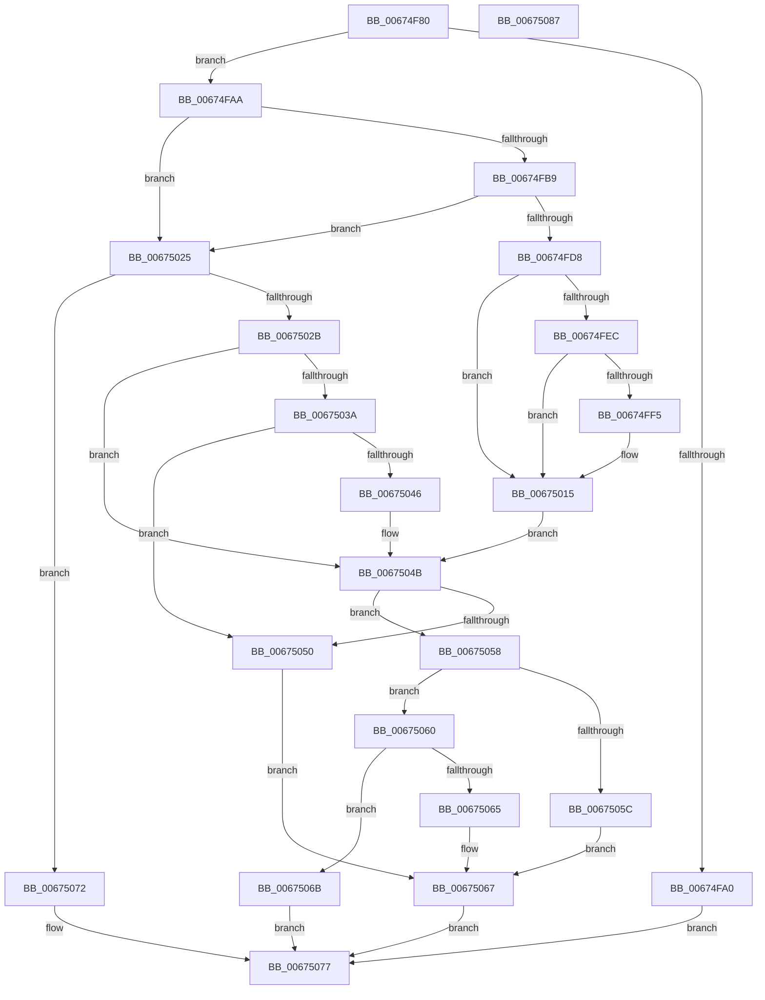

# MmGetCacheAttributeEx

- RVA: `0x00674F80`–`0x00675088` (길이 `264` bytes)
- VA: `0x0000000140674F80`
- 실행 섹션: `.text`
- PDB 이름 있음: `예`; PDB Function 태그: `아니요`
- unwind 정보 RVA: `0x0009A6A8`
- 디코드: `76`개 명령, `264/264` bytes 표시
- 미해석 바이트: `0` (있으면 어셈블리에 `.byte`로 보존)

> 이 문서는 커널 이미지의 기계어와 PDB 기호를 분석해 생성했습니다. 4번과 5번은 함수 원형과 자료형을 바이너리 사용 방식에서 추정한 C 해석이며 원본 소스 복구 결과는 아닙니다.

## 1. Dependencies

- 직접 호출 지점: **4**; 고유 호출 대상: **4**
- 직접 호출자로 확인된 함수: **2**
- RIP 상대 이미지 참조: **1**

### Outgoing calls
- `0x00674FEC` → [MiMirrorInSingleProcessorMode](../3B/MiMirrorInSingleProcessorMode_function_003B47A0.md) (function, `0x003B47A0`)
- `0x0067500F` → [KeBugCheckEx](../4F/KeBugCheckEx_function_004FD660.md) (function, `0x004FD660`)
- `0x00675030` → [MiLookupIoPageNode](../2A/MiLookupIoPageNode_function_002AC5C8.md) (function, `0x002AC5C8`)
- `0x0067503D` → [MiIsPageInHugePfn](../2A/MiIsPageInHugePfn_function_002AB770.md) (function, `0x002AB770`)

### Direct callers
- [HalCreateCommonBufferFromMdl](../55/HalCreateCommonBufferFromMdl_function_00551680.md) at `0x005517E9`
- [MmGetCacheAttribute](MmGetCacheAttribute_function_00674F60.md) at `0x00674F69`

### Static image references
- `0x00674FB0` → RVA `0x00E2DCE0` (`.data`; read)

## 2. Other-region calls and transfers

- 다른 실행 섹션으로 향하는 call: **0**
- 별도 외부 분기/꼬리 이동을 확인하지 못했습니다.

## 3. Assembly (complete function range)

```asm
00674F80  48 89 5C 24 08                  mov qword ptr [rsp + 8], rbx
00674F85  48 89 74 24 18                  mov qword ptr [rsp + 0x18], rsi
00674F8A  57                              push rdi
00674F8B  48 83 EC 30                     sub rsp, 0x30
00674F8F  49 8B F8                        mov rdi, r8
00674F92  44 8B C2                        mov r8d, edx
00674F95  48 8B D9                        mov rbx, rcx
00674F98  F7 C2 FE FF FF FF               test edx, 0xfffffffe
00674F9E  74 0A                           je 0x140674faa
00674FA0  B8 F0 00 00 C0                  mov eax, 0xc00000f0
00674FA5  E9 CD 00 00 00                  jmp 0x140675077
00674FAA  48 C1 EB 0C                     shr rbx, 0xc
00674FAE  33 F6                           xor esi, esi
00674FB0  48 3B 1D 29 8D 7B 00            cmp rbx, qword ptr [rip + 0x7b8d29]
00674FB7  77 6C                           ja 0x140675025
00674FB9  48 8D 14 5B                     lea rdx, [rbx + rbx*2]
00674FBD  48 03 D2                        add rdx, rdx
00674FC0  48 B8 28 00 00 00 00 DE FF FF   movabs rax, 0xffffde0000000028
00674FCA  48 8B 04 D0                     mov rax, qword ptr [rax + rdx*8]
00674FCE  48 C1 E8 36                     shr rax, 0x36
00674FD2  0F BA E0 00                     bt eax, 0
00674FD6  73 4D                           jae 0x140675025
00674FD8  49 B8 00 00 00 00 00 DE FF FF   movabs r8, 0xffffde0000000000
00674FE2  41 8B 44 D0 20                  mov eax, dword ptr [r8 + rdx*8 + 0x20]
00674FE7  66 85 C0                        test ax, ax
00674FEA  75 29                           jne 0x140675015
00674FEC  E8 AF F7 D3 FF                  call 0x1403b47a0
00674FF1  85 C0                           test eax, eax
00674FF3  75 20                           jne 0x140675015
00674FF5  45 0F B6 4C D0 22               movzx r9d, byte ptr [r8 + rdx*8 + 0x22]
00674FFB  8D 4E 1A                        lea ecx, [rsi + 0x1a]
00674FFE  41 83 E1 07                     and r9d, 7
00675002  48 89 74 24 20                  mov qword ptr [rsp + 0x20], rsi
00675007  4C 8B C3                        mov r8, rbx
0067500A  BA 32 12 00 00                  mov edx, 0x1232
0067500F  E8 4C 86 E8 FF                  call 0x1404fd660
00675014  CC                              int3
00675015  41 8B 44 D0 20                  mov eax, dword ptr [r8 + rdx*8 + 0x20]
0067501A  C1 E8 10                        shr eax, 0x10
0067501D  0F B6 C0                        movzx eax, al
00675020  C1 E8 06                        shr eax, 6
00675023  EB 26                           jmp 0x14067504b
00675025  41 F6 C0 01                     test r8b, 1
00675029  74 47                           je 0x140675072
0067502B  33 D2                           xor edx, edx
0067502D  48 8B CB                        mov rcx, rbx
00675030  E8 93 75 C3 FF                  call 0x1402ac5c8
00675035  83 F8 03                        cmp eax, 3
00675038  75 11                           jne 0x14067504b
0067503A  48 8B CB                        mov rcx, rbx
0067503D  E8 2E 67 C3 FF                  call 0x1402ab770
00675042  85 C0                           test eax, eax
00675044  75 0A                           jne 0x140675050
00675046  B8 03 00 00 00                  mov eax, 3
0067504B  83 F8 01                        cmp eax, 1
0067504E  75 08                           jne 0x140675058
00675050  C7 07 01 00 00 00               mov dword ptr [rdi], 1
00675056  EB 0F                           jmp 0x140675067
00675058  85 C0                           test eax, eax
0067505A  75 04                           jne 0x140675060
0067505C  89 37                           mov dword ptr [rdi], esi
0067505E  EB 07                           jmp 0x140675067
00675060  83 F8 02                        cmp eax, 2
00675063  75 06                           jne 0x14067506b
00675065  89 07                           mov dword ptr [rdi], eax
00675067  33 C0                           xor eax, eax
00675069  EB 0C                           jmp 0x140675077
0067506B  B8 EF 00 00 C0                  mov eax, 0xc00000ef
00675070  EB 05                           jmp 0x140675077
00675072  B8 41 01 00 C0                  mov eax, 0xc0000141
00675077  48 8B 5C 24 40                  mov rbx, qword ptr [rsp + 0x40]
0067507C  48 8B 74 24 50                  mov rsi, qword ptr [rsp + 0x50]
00675081  48 83 C4 30                     add rsp, 0x30
00675085  5F                              pop rdi
00675086  C3                              ret
00675087  CC                              int3
```

## 4. C-style interpretation (structured pseudocode)

```c
__int64 __fastcall MmGetCacheAttributeEx(__int64 a1, int a2, __int64 a3)
{
    __int64 result;
    __int64 v_rbx;
    __int64 v_rsi;
    __int64 v_rsp;
    unsigned __int64 v_stack_m18;
    unsigned __int64 v_stack_p18;
    unsigned __int64 v_stack_p8;

    v_stack_p8 = v_rbx;
    v_stack_p18 = v_rsi;
    v_rsp = (v_rsp) - (48);
    if (((a2) & (0xFFFFFFFEULL)) == 0) goto loc_00674FAA;
    goto loc_00675077;
loc_00674FAA:
    v_rbx = (a1) >> (12);
    v_rsi = 0;
    if (v_rbx > (*(unsigned __int64 *)(v_rip + 8097065))) goto loc_00675025;
    a2 = (v_rbx + v_rbx * 2) + (v_rbx + v_rbx * 2);
    result = (*(unsigned __int64 *)((unsigned int)(0xC00000F0ULL) + a2 * 8)) >> (54);
    if (condition_is_above_or_equal) goto loc_00675025;
    if ((unsigned __int16)((unsigned int)(*(unsigned int *)((unsigned int)(a2) + a2 * 8 + 32))) != 0) goto loc_00675015;
    result = MiMirrorInSingleProcessorMode(a1, a2, (unsigned int)(a2), a4);
    if ((unsigned int)(result) == 0) {
        a4 = *(unsigned __int8 *)((unsigned int)(a2) + a2 * 8 + 34);
        a1 = v_rsi + 26;
        a4 = (unsigned int)((a4) & (7));
        v_stack_m18 = 0;
        a3 = v_rbx;
        a2 = 0x1232ULL;
        result = KeBugCheckEx(a1, a2, a3, a4);
    }
    result = (unsigned int)(((unsigned int)(*(unsigned int *)(a3 + a2 * 8 + 32))) >> (16));
    result = (unsigned int)(((unsigned __int8)(result)) >> (6));
    goto loc_0067504B;
loc_00675025:
    if ((((unsigned __int8)(a3)) & (1)) == 0) goto loc_00675072;
    a2 = 0;
    result = MiLookupIoPageNode(v_rbx, a2, a3, a4);
    if (((unsigned int)(result)) != 3) goto loc_0067504B;
    result = MiIsPageInHugePfn(v_rbx, a2, a3, a4);
    if ((unsigned int)(result) != 0) goto loc_00675050;
loc_0067504B:
    if (3 != 1) goto loc_00675058;
loc_00675050:
    *(unsigned int *)(a3) = 1;
    goto loc_00675067;
loc_00675058:
    if (3 != 0) goto loc_00675060;
    *(unsigned int *)(a3) = 0;
    goto loc_00675067;
loc_00675060:
    if (3 != 2) goto loc_0067506B;
    *(unsigned int *)(a3) = 3;
loc_00675067:
    result = 0;
    goto loc_00675077;
loc_0067506B:
    goto loc_00675077;
loc_00675072:
loc_00675077:
    v_rsp = (v_rsp) + (48);
    return (unsigned int)(0xC0000141ULL);
}
```

## 5. (Beta) C Style

```c
int64_t MmGetCacheAttributeEx(int64_t Arg1, int32_t Arg2, void *Arg3)
{
    uint8_t *arg3 = (uint8_t *)Arg3;

    int64_t result;
    int64_t local_rbx;
    int64_t local_rsi;
    int64_t local_rsp;
    uint64_t v_stack_m18;
    uint64_t v_stack_p18;
    uint64_t v_stack_p8;

    v_stack_p8 = local_rbx;
    v_stack_p18 = local_rsi;
    local_rsp = (local_rsp) - (48);
    if (((Arg2) & (0xFFFFFFFEULL)) == 0) goto loc_00674FAA;
    goto loc_00675077;
loc_00674FAA:
    local_rbx = (Arg1) >> (12);
    local_rsi = 0;
    if (local_rbx > (*(uint64_t *)(v_rip + 0x7B8D29))) goto loc_00675025;
    Arg2 = (local_rbx + local_rbx * 2) + (local_rbx + local_rbx * 2);
    result = (*(uint64_t *)((uint32_t)(0xC00000F0ULL) + Arg2 * 8)) >> (54);
    if (condition_is_above_or_equal) goto loc_00675025;
    if ((uint16_t)((uint32_t)(*(uint32_t *)((uint32_t)(Arg2) + Arg2 * 8 + 0x20))) != 0) goto loc_00675015;
    result = MiMirrorInSingleProcessorMode(Arg1, Arg2, (uint32_t)(Arg2), a4);
    if ((uint32_t)(result) == 0) {
        a4 = *(uint8_t *)((uint32_t)(Arg2) + Arg2 * 8 + 0x22);
        Arg1 = local_rsi + 26;
        a4 = (uint32_t)((a4) & (7));
        v_stack_m18 = 0;
        Arg3 = local_rbx;
        Arg2 = 0x1232ULL;
        result = KeBugCheckEx(Arg1, Arg2, Arg3, a4);
    }
    result = (uint32_t)(((uint32_t)(*(uint32_t *)(arg3 + Arg2 * 8 + 0x20))) >> (16));
    result = (uint32_t)(((uint8_t)(result)) >> (6));
    goto loc_0067504B;
loc_00675025:
    if ((((uint8_t)(Arg3)) & (1)) == 0) goto loc_00675072;
    Arg2 = 0;
    result = MiLookupIoPageNode(local_rbx, Arg2, Arg3, a4);
    if (((uint32_t)(result)) != 3) goto loc_0067504B;
    result = MiIsPageInHugePfn(local_rbx, Arg2, Arg3, a4);
    if ((uint32_t)(result) != 0) goto loc_00675050;
loc_0067504B:
    if (3 != 1) goto loc_00675058;
loc_00675050:
    *(uint32_t *)(arg3) = 1;
    goto loc_00675067;
loc_00675058:
    if (3 != 0) goto loc_00675060;
    *(uint32_t *)(arg3) = 0;
    goto loc_00675067;
loc_00675060:
    if (3 != 2) goto loc_0067506B;
    *(uint32_t *)(arg3) = 3;
loc_00675067:
    result = 0;
    goto loc_00675077;
loc_0067506B:
    goto loc_00675077;
loc_00675072:
loc_00675077:
    local_rsp = (local_rsp) + (48);
    return (uint32_t)(0xC0000141ULL);
}
```

### 관측된 메모리 오프셋

구조체 형식이 확인되지 않은 접근은 인자 기준의 오프셋으로만 기록했습니다.

| 기준 인자 | 오프셋 표현 | 폭 (bit) | 접근 |
|---|---:|---:|---|
| `Arg3` | `+ 0x0` | `32` | `W` |

## 6. Execution-region graph

[열기: 2D/3D 그래프와 함수 탐색 컨트롤 패널](../../../control-panel.html?section=text&rva=0x00674F80&view=graph)

- 2D 그래프는 위에서 아래로 흐르고, 3D 그래프는 빈 공간을 드래그해 회전합니다. Shift+드래그는 이동, 휠은 확대·축소, 함수 노드 선택은 대상 보고서 이동입니다.

### Static fallback


