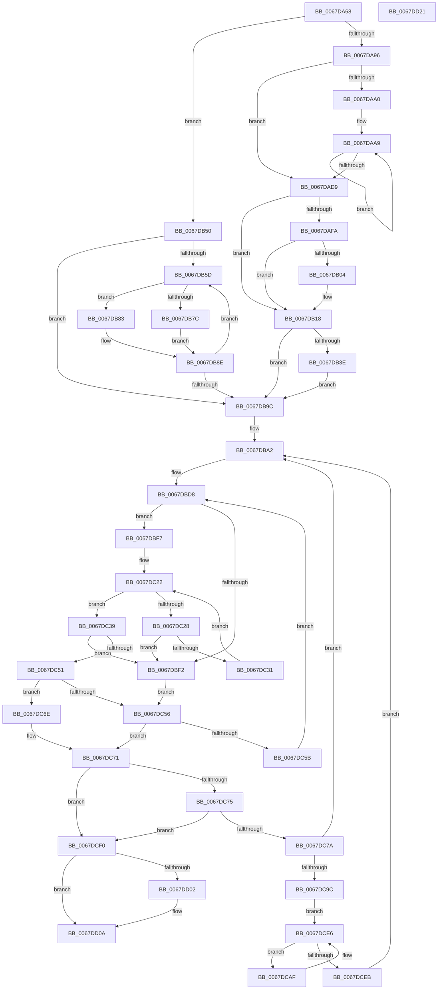

# MmGetDumpRange

- RVA: `0x0067DA68`–`0x0067DD22` (길이 `698` bytes)
- VA: `0x000000014067DA68`
- 실행 섹션: `.text`
- PDB 이름 있음: `예`; PDB Function 태그: `아니요`
- unwind 정보 RVA: `0x000D7F50`
- 디코드: `197`개 명령, `698/698` bytes 표시
- 미해석 바이트: `0` (있으면 어셈블리에 `.byte`로 보존)

> 이 문서는 커널 이미지의 기계어와 PDB 기호를 분석해 생성했습니다. 4번과 5번은 함수 원형과 자료형을 바이너리 사용 방식에서 추정한 C 해석이며 원본 소스 복구 결과는 아닙니다.

## 1. Dependencies

- 직접 호출 지점: **11**; 고유 호출 대상: **7**
- 직접 호출자로 확인된 함수: **2**
- RIP 상대 이미지 참조: **8**

### Outgoing calls
- `0x0067DACB` → [guard_dispatch_icall](../6B/guard_dispatch_icall_function_006BAAD0.md) (function, `0x006BAAD0`)
- `0x0067DAF0` → [MmAddRangeToCrashDump](MmAddRangeToCrashDump_function_0067D8B0.md) (function, `0x0067D8B0`)
- `0x0067DB13` → [MmAddRangeToCrashDump](MmAddRangeToCrashDump_function_0067D8B0.md) (function, `0x0067D8B0`)
- `0x0067DB34` → [guard_dispatch_icall](../6B/guard_dispatch_icall_function_006BAAD0.md) (function, `0x006BAAD0`)
- `0x0067DB41` → [MiAddPhysicalPagesToCrashDump](MiAddPhysicalPagesToCrashDump_function_0067D1B4.md) (function, `0x0067D1B4`)
- `0x0067DB49` → [MmRemoveSystemCacheFromDump](MmRemoveSystemCacheFromDump_function_0067DD58.md) (function, `0x0067DD58`)
- `0x0067DB7C` → [MiAddNonSecuredPagesToDump](MiAddNonSecuredPagesToDump_function_0067CDDC.md) (function, `0x0067CDDC`)
- `0x0067DB89` → [guard_dispatch_icall](../6B/guard_dispatch_icall_function_006BAAD0.md) (function, `0x006BAAD0`)
- `0x0067DCBF` → [guard_dispatch_icall](../6B/guard_dispatch_icall_function_006BAAD0.md) (function, `0x006BAAD0`)
- `0x0067DCF3` → [MiRemovePendingBadPagesFromDump](MiRemovePendingBadPagesFromDump_function_0067A1DC.md) (function, `0x0067A1DC`)
- `0x0067DD05` → [MiRemoveEnclavePagesFromDump](../68/MiRemoveEnclavePagesFromDump_function_00687098.md) (function, `0x00687098`)

### Direct callers
- [IoWriteCrashDump](../59/IoWriteCrashDump_function_005936D8.md) at `0x00593BF8`
- [IopAddLiveDumpPagesToPartialKernelDump](../5A/IopAddLiveDumpPagesToPartialKernelDump_function_005A13AC.md) at `0x005A16AA`

### Static image references
- `0x0067DA96` → RVA `0x00FC6A80` (`ALMOSTRO`; read)
- `0x0067DAA0` → RVA `0x00FC8C40` (`ALMOSTRO`; read)
- `0x0067DAFA` → RVA `0x00F4754C` (`.data`; read)
- `0x0067DB50` → RVA `0x00FC6B88` (`ALMOSTRO`; read)
- `0x0067DB62` → RVA `0x00FC6A88` (`ALMOSTRO`; read)
- `0x0067DBA2` → RVA `0x00E30068` (`.data`; read)
- `0x0067DC7A` → RVA `0x00E30088` (`.data`; read)
- `0x0067DCF8` → RVA `0x00E375B8` (`.data`; read)

## 2. Other-region calls and transfers

- 다른 실행 섹션으로 향하는 call: **0**
- 별도 외부 분기/꼬리 이동을 확인하지 못했습니다.

## 3. Assembly (complete function range)

```asm
0067DA68  48 89 5C 24 08                  mov qword ptr [rsp + 8], rbx
0067DA6D  48 89 6C 24 18                  mov qword ptr [rsp + 0x18], rbp
0067DA72  56                              push rsi
0067DA73  57                              push rdi
0067DA74  41 54                           push r12
0067DA76  41 55                           push r13
0067DA78  41 56                           push r14
0067DA7A  48 83 EC 30                     sub rsp, 0x30
0067DA7E  41 BE 02 00 00 00               mov r14d, 2
0067DA84  41 8B E8                        mov ebp, r8d
0067DA87  48 8B D9                        mov rbx, rcx
0067DA8A  45 8D 6E FF                     lea r13d, [r14 - 1]
0067DA8E  85 D2                           test edx, edx
0067DA90  0F 85 BA 00 00 00               jne 0x14067db50
0067DA96  8B 05 E4 8F 94 00               mov eax, dword ptr [rip + 0x948fe4]
0067DA9C  85 C0                           test eax, eax
0067DA9E  74 39                           je 0x14067dad9
0067DAA0  48 8D 3D 99 B1 94 00            lea rdi, [rip + 0x94b199]
0067DAA7  8B F0                           mov esi, eax
0067DAA9  48 8B 07                        mov rax, qword ptr [rdi]
0067DAAC  45 8B CE                        mov r9d, r14d
0067DAAF  4D 8B C5                        mov r8, r13
0067DAB2  48 8B 48 08                     mov rcx, qword ptr [rax + 8]
0067DAB6  48 8B 81 B8 00 00 00            mov rax, qword ptr [rcx + 0xb8]
0067DABD  48 8B CB                        mov rcx, rbx
0067DAC0  48 8B 50 28                     mov rdx, qword ptr [rax + 0x28]
0067DAC4  48 8B 03                        mov rax, qword ptr [rbx]
0067DAC7  48 C1 EA 0C                     shr rdx, 0xc
0067DACB  E8 00 D0 03 00                  call 0x1406baad0
0067DAD0  48 8D 7F 08                     lea rdi, [rdi + 8]
0067DAD4  49 2B F5                        sub rsi, r13
0067DAD7  75 D0                           jne 0x14067daa9
0067DAD9  48 BA 00 00 00 00 00 80 FF FF   movabs rdx, 0xffff800000000000
0067DAE3  49 B8 00 00 00 00 00 80 00 00   movabs r8, 0x800000000000
0067DAED  48 8B CB                        mov rcx, rbx
0067DAF0  E8 BB FD FF FF                  call 0x14067d8b0
0067DAF5  41 84 ED                        test r13b, bpl
0067DAF8  74 1E                           je 0x14067db18
0067DAFA  8B 05 4C 9A 8C 00               mov eax, dword ptr [rip + 0x8c9a4c]
0067DB00  A8 03                           test al, 3
0067DB02  74 14                           je 0x14067db18
0067DB04  33 D2                           xor edx, edx
0067DB06  49 B8 00 00 FF FF FF 7F 00 00   movabs r8, 0x7fffffff0000
0067DB10  48 8B CB                        mov rcx, rbx
0067DB13  E8 98 FD FF FF                  call 0x14067d8b0
0067DB18  0F 20 D8                        mov rax, cr3
0067DB1B  48 99                           cqo
0067DB1D  B9 00 10 00 00                  mov ecx, 0x1000
0067DB22  48 F7 F9                        idiv rcx
0067DB25  45 8B CE                        mov r9d, r14d
0067DB28  4D 8B C5                        mov r8, r13
0067DB2B  48 8B D0                        mov rdx, rax
0067DB2E  48 8B CB                        mov rcx, rbx
0067DB31  48 8B 03                        mov rax, qword ptr [rbx]
0067DB34  E8 97 CF 03 00                  call 0x1406baad0
0067DB39  41 84 EE                        test r14b, bpl
0067DB3C  74 5E                           je 0x14067db9c
0067DB3E  48 8B CB                        mov rcx, rbx
0067DB41  E8 6E F6 FF FF                  call 0x14067d1b4
0067DB46  48 8B CB                        mov rcx, rbx
0067DB49  E8 0A 02 00 00                  call 0x14067dd58
0067DB4E  EB 4C                           jmp 0x14067db9c
0067DB50  48 8B 0D 31 90 94 00            mov rcx, qword ptr [rip + 0x949031]
0067DB57  33 FF                           xor edi, edi
0067DB59  39 39                           cmp dword ptr [rcx], edi
0067DB5B  76 3F                           jbe 0x14067db9c
0067DB5D  8B D7                           mov edx, edi
0067DB5F  48 03 D2                        add rdx, rdx
0067DB62  48 F7 05 1B 8F 94 00 00 40 00 00  test qword ptr [rip + 0x948f1b], 0x4000
0067DB6D  4C 8B 44 D1 18                  mov r8, qword ptr [rcx + rdx*8 + 0x18]
0067DB72  48 8B 54 D1 10                  mov rdx, qword ptr [rcx + rdx*8 + 0x10]
0067DB77  48 8B CB                        mov rcx, rbx
0067DB7A  74 07                           je 0x14067db83
0067DB7C  E8 5B F2 FF FF                  call 0x14067cddc
0067DB81  EB 0B                           jmp 0x14067db8e
0067DB83  48 8B 03                        mov rax, qword ptr [rbx]
0067DB86  45 8B CE                        mov r9d, r14d
0067DB89  E8 42 CF 03 00                  call 0x1406baad0
0067DB8E  48 8B 0D F3 8F 94 00            mov rcx, qword ptr [rip + 0x948ff3]
0067DB95  41 03 FD                        add edi, r13d
0067DB98  3B 39                           cmp edi, dword ptr [rcx]
0067DB9A  72 C1                           jb 0x14067db5d
0067DB9C  33 F6                           xor esi, esi
0067DB9E  41 83 CC FF                     or r12d, 0xffffffff
0067DBA2  48 8B 05 BF 24 7B 00            mov rax, qword ptr [rip + 0x7b24bf]
0067DBA9  8B 28                           mov ebp, dword ptr [rax]
0067DBAB  48 8B 78 08                     mov rdi, qword ptr [rax + 8]
0067DBAF  48 8B CF                        mov rcx, rdi
0067DBB2  83 E1 04                        and ecx, 4
0067DBB5  8B C1                           mov eax, ecx
0067DBB7  8D 55 FF                        lea edx, [rbp - 1]
0067DBBA  48 F7 D8                        neg rax
0067DBBD  45 1B D2                        sbb r10d, r10d
0067DBC0  41 83 E2 20                     and r10d, 0x20
0067DBC4  3B F5                           cmp esi, ebp
0067DBC6  45 1B C9                        sbb r9d, r9d
0067DBC9  44 23 CE                        and r9d, esi
0067DBCC  48 F7 D9                        neg rcx
0067DBCF  48 1B C0                        sbb rax, rax
0067DBD2  83 E0 04                        and eax, 4
0067DBD5  48 2B F8                        sub rdi, rax
0067DBD8  83 64 24 68 00                  and dword ptr [rsp + 0x68], 0
0067DBDD  45 8D 1C 12                     lea r11d, [r10 + rdx]
0067DBE1  41 8B C3                        mov eax, r11d
0067DBE4  43 8D 0C 0A                     lea ecx, [r10 + r9]
0067DBE8  2B C1                           sub eax, ecx
0067DBEA  41 03 C5                        add eax, r13d
0067DBED  41 3B C5                        cmp eax, r13d
0067DBF0  73 05                           jae 0x14067dbf7
0067DBF2  41 8B D4                        mov edx, r12d
0067DBF5  EB 5F                           jmp 0x14067dc56
0067DBF7  41 8B C3                        mov eax, r11d
0067DBFA  4D 8B C5                        mov r8, r13
0067DBFD  48 C1 E8 06                     shr rax, 6
0067DC01  4C 8D 34 C7                     lea r14, [rdi + rax*8]
0067DC05  48 8B C1                        mov rax, rcx
0067DC08  48 C1 E8 06                     shr rax, 6
0067DC0C  80 E1 3F                        and cl, 0x3f
0067DC0F  49 D3 E0                        shl r8, cl
0067DC12  4D 2B C5                        sub r8, r13
0067DC15  48 8D 14 C7                     lea rdx, [rdi + rax*8]
0067DC19  48 8B 02                        mov rax, qword ptr [rdx]
0067DC1C  48 F7 D0                        not rax
0067DC1F  4C 0B C0                        or r8, rax
0067DC22  49 83 F8 FF                     cmp r8, -1
0067DC26  75 11                           jne 0x14067dc39
0067DC28  48 83 C2 08                     add rdx, 8
0067DC2C  49 3B D6                        cmp rdx, r14
0067DC2F  77 C1                           ja 0x14067dbf2
0067DC31  4C 8B 02                        mov r8, qword ptr [rdx]
0067DC34  49 F7 D0                        not r8
0067DC37  EB E9                           jmp 0x14067dc22
0067DC39  48 2B D7                        sub rdx, rdi
0067DC3C  49 F7 D0                        not r8
0067DC3F  48 C1 FA 03                     sar rdx, 3
0067DC43  49 0F BC C0                     bsf rax, r8
0067DC47  C1 E2 06                        shl edx, 6
0067DC4A  03 D0                           add edx, eax
0067DC4C  41 3B D3                        cmp edx, r11d
0067DC4F  77 A1                           ja 0x14067dbf2
0067DC51  41 3B D4                        cmp edx, r12d
0067DC54  75 18                           jne 0x14067dc6e
0067DC56  45 85 C9                        test r9d, r9d
0067DC59  74 16                           je 0x14067dc71
0067DC5B  8D 56 01                        lea edx, [rsi + 1]
0067DC5E  3B D5                           cmp edx, ebp
0067DC60  0F 47 D5                        cmova edx, ebp
0067DC63  41 03 D4                        add edx, r12d
0067DC66  45 33 C9                        xor r9d, r9d
0067DC69  E9 6A FF FF FF                  jmp 0x14067dbd8
0067DC6E  41 2B D2                        sub edx, r10d
0067DC71  3B D6                           cmp edx, esi
0067DC73  72 7B                           jb 0x14067dcf0
0067DC75  41 3B D4                        cmp edx, r12d
0067DC78  74 76                           je 0x14067dcf0
0067DC7A  48 8B 05 07 24 7B 00            mov rax, qword ptr [rip + 0x7b2407]
0067DC81  8D 72 01                        lea esi, [rdx + 1]
0067DC84  8B CA                           mov ecx, edx
0067DC86  41 BE 02 00 00 00               mov r14d, 2
0067DC8C  48 8B 3C C8                     mov rdi, qword ptr [rax + rcx*8]
0067DC90  8B 47 04                        mov eax, dword ptr [rdi + 4]
0067DC93  41 84 C6                        test r14b, al
0067DC96  0F 84 06 FF FF FF               je 0x14067dba2
0067DC9C  48 8B BF 90 1B 00 00            mov rdi, qword ptr [rdi + 0x1b90]
0067DCA3  48 BD FF FF FF FF 3F 00 00 00   movabs rbp, 0x3fffffffff
0067DCAD  EB 37                           jmp 0x14067dce6
0067DCAF  48 8B 43 08                     mov rax, qword ptr [rbx + 8]
0067DCB3  45 8B CE                        mov r9d, r14d
0067DCB6  4D 8B C5                        mov r8, r13
0067DCB9  48 8B D7                        mov rdx, rdi
0067DCBC  48 8B CB                        mov rcx, rbx
0067DCBF  E8 0C CE 03 00                  call 0x1406baad0
0067DCC4  48 8D 04 7F                     lea rax, [rdi + rdi*2]
0067DCC8  48 03 C0                        add rax, rax
0067DCCB  48 BF 00 00 00 00 00 DE FF FF   movabs rdi, 0xffffde0000000000
0067DCD5  48 8B 3C C7                     mov rdi, qword ptr [rdi + rax*8]
0067DCD9  48 B8 FF FF FF FF FF 00 00 00   movabs rax, 0xffffffffff
0067DCE3  48 23 F8                        and rdi, rax
0067DCE6  48 3B FD                        cmp rdi, rbp
0067DCE9  75 C4                           jne 0x14067dcaf
0067DCEB  E9 B2 FE FF FF                  jmp 0x14067dba2
0067DCF0  48 8B CB                        mov rcx, rbx
0067DCF3  E8 E4 C4 FF FF                  call 0x14067a1dc
0067DCF8  48 83 3D B8 98 7B 00 00         cmp qword ptr [rip + 0x7b98b8], 0
0067DD00  74 08                           je 0x14067dd0a
0067DD02  48 8B CB                        mov rcx, rbx
0067DD05  E8 8E 93 00 00                  call 0x140687098
0067DD0A  48 8B 5C 24 60                  mov rbx, qword ptr [rsp + 0x60]
0067DD0F  48 8B 6C 24 70                  mov rbp, qword ptr [rsp + 0x70]
0067DD14  48 83 C4 30                     add rsp, 0x30
0067DD18  41 5E                           pop r14
0067DD1A  41 5D                           pop r13
0067DD1C  41 5C                           pop r12
0067DD1E  5F                              pop rdi
0067DD1F  5E                              pop rsi
0067DD20  C3                              ret
0067DD21  CC                              int3
```

## 4. C-style interpretation (structured pseudocode)

```c
__int64 __fastcall MmGetDumpRange(__int64 a1, int a2, int a3)
{
    __int64 result;
    __int64 v_r10;
    __int64 v_r12;
    __int64 v_rdi;
    __int64 v_rsi;
    __int64 v_rsp;
    unsigned int v_stack_p10;
    unsigned __int64 v_stack_p18;
    unsigned __int64 v_stack_p8;

    v_stack_p8 = v_rbx;
    v_stack_p18 = v_rbp;
    v_rsp = (v_rsp) - (48);
    if (a2 != 0) goto loc_0067DB50;
    if ((unsigned int)((unsigned int)(*(unsigned int *)(v_rip + 9736164))) == 0) goto loc_0067DAD9;
loc_0067DAA9:
    a2 = (*(unsigned __int64 *)(*(unsigned __int64 *)(*(unsigned __int64 *)(*(unsigned __int64 *)(v_rip + 9744793) + 8) + 184) + 40)) >> (12);
    result = guard_dispatch_icall(a1, a2, 2 - 1, 2);
    v_rsi = ((unsigned int)((unsigned int)((unsigned int)(*(unsigned int *)(v_rip + 9736164))))) - (2 - 1);
    if (condition_is_not_equal) goto loc_0067DAA9;
loc_0067DAD9:
    result = MmAddRangeToCrashDump(a1, a2, 2 - 1, 2);
    if ((((unsigned __int8)(2 - 1)) & ((unsigned __int8)((unsigned int)(a3)))) == 0) goto loc_0067DB18;
    result = (unsigned int)(*(unsigned int *)(v_rip + 9214540));
    if ((((unsigned __int8)((unsigned int)(*(unsigned int *)(v_rip + 9214540)))) & (3)) != 0) {
        a2 = 0;
        a1 = a1;
        result = MmAddRangeToCrashDump(a1, a2, 2 - 1, 2);
    }
    result = guard_dispatch_icall(a1, v_cr3, 2 - 1, 2);
    if (((2) & ((unsigned __int8)((unsigned int)(a3)))) == 0) goto loc_0067DB9C;
    result = MiAddPhysicalPagesToCrashDump(a1, v_cr3, 2 - 1, 2);
    result = MmRemoveSystemCacheFromDump(a1, v_cr3, 2 - 1, 2);
    goto loc_0067DB9C;
loc_0067DB50:
    v_rdi = 0;
    if ((*(unsigned int *)(*(unsigned __int64 *)(v_rip + 9736241))) <= 0) goto loc_0067DB9C;
loc_0067DB5D:
    a2 = (0) + (0);
    if (((*(unsigned __int64 *)(v_rip + 9735963)) & (0x4000ULL)) == 0) goto loc_0067DB83;
    result = MiAddNonSecuredPagesToDump(a1, *(unsigned __int64 *)(*(unsigned __int64 *)(v_rip + 9736241) + a2 * 8 + 16), *(unsigned __int64 *)(*(unsigned __int64 *)(v_rip + 9736241) + a2 * 8 + 24), 2);
    goto loc_0067DB8E;
loc_0067DB83:
    result = guard_dispatch_icall(a1, *(unsigned __int64 *)(*(unsigned __int64 *)(v_rip + 9736241) + a2 * 8 + 16), *(unsigned __int64 *)(*(unsigned __int64 *)(v_rip + 9736241) + a2 * 8 + 24), 2);
loc_0067DB8E:
    v_rdi = (unsigned int)((v_rdi) + ((unsigned int)(2 - 1)));
    if (((unsigned int)(v_rdi)) < (*(unsigned int *)(*(unsigned __int64 *)(v_rip + 9736179)))) goto loc_0067DB5D;
loc_0067DB9C:
    v_rsi = 0;
    v_r12 = (unsigned int)((v_r12) | (0xFFFFFFFFULL));
loc_0067DBA2:
    a1 = (unsigned int)((*(unsigned __int64 *)(*(unsigned __int64 *)(v_rip + 8070335) + 8)) & (4));
    result = -((unsigned int)((unsigned int)(a1)));
    v_r10 = (unsigned int)((v_r10) & (32));
    a4 = (unsigned int)((2) & (0));
    a1 = -(a1);
    result = (unsigned int)((result) & (4));
    v_rdi = (*(unsigned __int64 *)(*(unsigned __int64 *)(v_rip + 8070335) + 8)) - (result);
loc_0067DBD8:
    result = (unsigned int)(((unsigned int)((unsigned int)(v_r10 + (unsigned int)(*(unsigned int *)(*(unsigned __int64 *)(v_rip + 8070335))) - 1 * 1))) - ((unsigned int)(v_r10 + a4 * 1)));
    result = (unsigned int)((result) + ((unsigned int)(2 - 1)));
    if (((unsigned int)(result)) >= ((unsigned int)(2 - 1))) goto loc_0067DBF7;
loc_0067DBF2:
    goto loc_0067DC56;
loc_0067DBF7:
    result = ((unsigned int)((unsigned int)(v_r10 + (unsigned int)(*(unsigned int *)(*(unsigned __int64 *)(v_rip + 8070335))) - 1 * 1))) >> (6);
    result = (v_r10 + a4 * 1) >> (6);
    a1 = (unsigned __int8)((v_r10 + a4 * 1) & (63));
    a3 = (2 - 1) << ((unsigned __int8)(a1));
    a3 = (a3) - (2 - 1);
    result = ~(*(unsigned __int64 *)(v_rdi + result * 8));
    a3 = (a3) | (result);
loc_0067DC22:
    if (a3 != -1) goto loc_0067DC39;
    a2 = (v_rdi + result * 8) + (8);
    if (a2 > (v_rdi + result * 8)) goto loc_0067DBF2;
    a3 = ~(*(unsigned __int64 *)(a2));
    goto loc_0067DC22;
loc_0067DC39:
    a2 = (a2) - (v_rdi);
    a3 = ~(a3);
    a2 = (a2) >> (3);
    a2 = (unsigned int)((a2) << (6));
    a2 = (unsigned int)((a2) + ((unsigned int)(result)));
    if (a2 > ((unsigned int)(v_r10 + (unsigned int)(*(unsigned int *)(*(unsigned __int64 *)(v_rip + 8070335))) - 1 * 1))) goto loc_0067DBF2;
    if (a2 != ((unsigned int)(v_r12))) goto loc_0067DC6E;
loc_0067DC56:
    if ((unsigned int)(a4) == 0) goto loc_0067DC71;
    a2 = v_rsi + 1;
    if (((unsigned int)(v_rsi + 1)) > ((unsigned int)((unsigned int)(*(unsigned int *)(*(unsigned __int64 *)(v_rip + 8070335)))))) { a2 = (unsigned int)((unsigned int)(*(unsigned int *)(*(unsigned __int64 *)(v_rip + 8070335)))); }
    a2 = (unsigned int)((a2) + ((unsigned int)(v_r12)));
    a4 = 0;
    goto loc_0067DBD8;
loc_0067DC6E:
    a2 = (unsigned int)((a2) - ((unsigned int)(v_r10)));
loc_0067DC71:
    if (a2 < 0) goto loc_0067DCF0;
    if (a2 == ((unsigned int)(v_r12))) goto loc_0067DCF0;
    if (((2) & ((unsigned __int8)((unsigned int)(*(unsigned int *)(*(unsigned __int64 *)(*(unsigned __int64 *)(v_rip + 8070151) + (unsigned int)(a2) * 8) + 4))))) == 0) goto loc_0067DBA2;
    goto loc_0067DCE6;
loc_0067DCAF:
    result = guard_dispatch_icall(a1, *(unsigned __int64 *)(*(unsigned __int64 *)(*(unsigned __int64 *)(v_rip + 8070151) + (unsigned int)(a2) * 8) + 7056), 2 - 1, 2);
    result = (*(unsigned __int64 *)(*(unsigned __int64 *)(*(unsigned __int64 *)(v_rip + 8070151) + (unsigned int)(a2) * 8) + 7056) + *(unsigned __int64 *)(*(unsigned __int64 *)(*(unsigned __int64 *)(v_rip + 8070151) + (unsigned int)(a2) * 8) + 7056) * 2) + (*(unsigned __int64 *)(*(unsigned __int64 *)(*(unsigned __int64 *)(v_rip + 8070151) + (unsigned int)(a2) * 8) + 7056) + *(unsigned __int64 *)(*(unsigned __int64 *)(*(unsigned __int64 *)(v_rip + 8070151) + (unsigned int)(a2) * 8) + 7056) * 2);
    v_rdi = (*(unsigned __int64 *)(*(unsigned __int64 *)(*(unsigned __int64 *)(*(unsigned __int64 *)(v_rip + 8070151) + (unsigned int)(a2) * 8) + 7056) + result * 8)) & (result);
loc_0067DCE6:
    if (v_rdi != ((unsigned int)(*(unsigned int *)(*(unsigned __int64 *)(v_rip + 8070335))))) goto loc_0067DCAF;
    goto loc_0067DBA2;
loc_0067DCF0:
    result = MiRemovePendingBadPagesFromDump(a1, *(unsigned __int64 *)(*(unsigned __int64 *)(*(unsigned __int64 *)(v_rip + 8070151) + (unsigned int)(a2) * 8) + 7056), 2 - 1, 2);
    if ((*(unsigned __int64 *)(v_rip + 8100024)) != 0) {
        a1 = a1;
        result = MiRemoveEnclavePagesFromDump(a1, *(unsigned __int64 *)(*(unsigned __int64 *)(*(unsigned __int64 *)(v_rip + 8070151) + (unsigned int)(a2) * 8) + 7056), 2 - 1, 2);
    }
    v_rsp = (v_rsp) + (48);
    return result;
}
```

## 5. (Beta) C Style

```c
int64_t MmGetDumpRange(void *Arg1, int32_t Arg2, int32_t Arg3)
{
    uint8_t *arg1 = (uint8_t *)Arg1;

    int64_t result;
    int64_t local_r10;
    int64_t local_r12;
    int64_t local_rdi;
    int64_t local_rsi;
    int64_t local_rsp;
    uint32_t v_stack_p10;
    uint64_t v_stack_p18;
    uint64_t v_stack_p8;

    v_stack_p8 = local_rbx;
    v_stack_p18 = local_rbp;
    local_rsp = (local_rsp) - (48);
    if (Arg2 != 0) goto loc_0067DB50;
    if ((uint32_t)((uint32_t)(*(uint32_t *)(v_rip + 0x948FE4))) == 0) goto loc_0067DAD9;
loc_0067DAA9:
    Arg2 = (*(uint64_t *)(*(uint64_t *)(*(uint64_t *)(*(uint64_t *)(v_rip + 0x94B199) + 0x8) + 0xB8) + 0x28)) >> (12);
    result = guard_dispatch_icall(Arg1, Arg2, 2 - 1, 2);
    local_rsi = ((uint32_t)((uint32_t)((uint32_t)(*(uint32_t *)(v_rip + 0x948FE4))))) - (2 - 1);
    if (condition_is_not_equal) goto loc_0067DAA9;
loc_0067DAD9:
    result = MmAddRangeToCrashDump(Arg1, Arg2, 2 - 1, 2);
    if ((((uint8_t)(2 - 1)) & ((uint8_t)((uint32_t)(Arg3)))) == 0) goto loc_0067DB18;
    result = (uint32_t)(*(uint32_t *)(v_rip + 0x8C9A4C));
    if ((((uint8_t)((uint32_t)(*(uint32_t *)(v_rip + 0x8C9A4C)))) & (3)) != 0) {
        Arg2 = 0;
        Arg1 = Arg1;
        result = MmAddRangeToCrashDump(Arg1, Arg2, 2 - 1, 2);
    }
    result = guard_dispatch_icall(Arg1, v_cr3, 2 - 1, 2);
    if (((2) & ((uint8_t)((uint32_t)(Arg3)))) == 0) goto loc_0067DB9C;
    result = MiAddPhysicalPagesToCrashDump(Arg1, v_cr3, 2 - 1, 2);
    result = MmRemoveSystemCacheFromDump(Arg1, v_cr3, 2 - 1, 2);
    goto loc_0067DB9C;
loc_0067DB50:
    local_rdi = 0;
    if ((*(uint32_t *)(*(uint64_t *)(v_rip + 0x949031))) <= 0) goto loc_0067DB9C;
loc_0067DB5D:
    Arg2 = (0) + (0);
    if (((*(uint64_t *)(v_rip + 0x948F1B)) & (0x4000ULL)) == 0) goto loc_0067DB83;
    result = MiAddNonSecuredPagesToDump(Arg1, *(uint64_t *)(*(uint64_t *)(v_rip + 0x949031) + Arg2 * 8 + 0x10), *(uint64_t *)(*(uint64_t *)(v_rip + 0x949031) + Arg2 * 8 + 0x18), 2);
    goto loc_0067DB8E;
loc_0067DB83:
    result = guard_dispatch_icall(Arg1, *(uint64_t *)(*(uint64_t *)(v_rip + 0x949031) + Arg2 * 8 + 0x10), *(uint64_t *)(*(uint64_t *)(v_rip + 0x949031) + Arg2 * 8 + 0x18), 2);
loc_0067DB8E:
    local_rdi = (uint32_t)((local_rdi) + ((uint32_t)(2 - 1)));
    if (((uint32_t)(local_rdi)) < (*(uint32_t *)(*(uint64_t *)(v_rip + 0x948FF3)))) goto loc_0067DB5D;
loc_0067DB9C:
    local_rsi = 0;
    local_r12 = (uint32_t)((local_r12) | (0xFFFFFFFFULL));
loc_0067DBA2:
    Arg1 = (uint32_t)((*(uint64_t *)(*(uint64_t *)(v_rip + 0x7B24BF) + 0x8)) & (4));
    result = -((uint32_t)((uint32_t)(Arg1)));
    local_r10 = (uint32_t)((local_r10) & (32));
    a4 = (uint32_t)((2) & (0));
    Arg1 = -(Arg1);
    result = (uint32_t)((result) & (4));
    local_rdi = (*(uint64_t *)(*(uint64_t *)(v_rip + 0x7B24BF) + 0x8)) - (result);
loc_0067DBD8:
    result = (uint32_t)(((uint32_t)((uint32_t)(local_r10 + (uint32_t)(*(uint32_t *)(*(uint64_t *)(v_rip + 0x7B24BF))) - 1 * 1))) - ((uint32_t)(local_r10 + a4 * 1)));
    result = (uint32_t)((result) + ((uint32_t)(2 - 1)));
    if (((uint32_t)(result)) >= ((uint32_t)(2 - 1))) goto loc_0067DBF7;
loc_0067DBF2:
    goto loc_0067DC56;
loc_0067DBF7:
    result = ((uint32_t)((uint32_t)(local_r10 + (uint32_t)(*(uint32_t *)(*(uint64_t *)(v_rip + 0x7B24BF))) - 1 * 1))) >> (6);
    result = (local_r10 + a4 * 1) >> (6);
    Arg1 = (uint8_t)((local_r10 + a4 * 1) & (63));
    Arg3 = (2 - 1) << ((uint8_t)(Arg1));
    Arg3 = (Arg3) - (2 - 1);
    result = ~(*(uint64_t *)(local_rdi + result * 8));
    Arg3 = (Arg3) | (result);
loc_0067DC22:
    if (Arg3 != -1) goto loc_0067DC39;
    Arg2 = (local_rdi + result * 8) + (8);
    if (Arg2 > (local_rdi + result * 8)) goto loc_0067DBF2;
    Arg3 = ~(*(uint64_t *)(Arg2));
    goto loc_0067DC22;
loc_0067DC39:
    Arg2 = (Arg2) - (local_rdi);
    Arg3 = ~(Arg3);
    Arg2 = (Arg2) >> (3);
    Arg2 = (uint32_t)((Arg2) << (6));
    Arg2 = (uint32_t)((Arg2) + ((uint32_t)(result)));
    if (Arg2 > ((uint32_t)(local_r10 + (uint32_t)(*(uint32_t *)(*(uint64_t *)(v_rip + 0x7B24BF))) - 1 * 1))) goto loc_0067DBF2;
    if (Arg2 != ((uint32_t)(local_r12))) goto loc_0067DC6E;
loc_0067DC56:
    if ((uint32_t)(a4) == 0) goto loc_0067DC71;
    Arg2 = local_rsi + 1;
    if (((uint32_t)(local_rsi + 1)) > ((uint32_t)((uint32_t)(*(uint32_t *)(*(uint64_t *)(v_rip + 0x7B24BF)))))) { Arg2 = (uint32_t)((uint32_t)(*(uint32_t *)(*(uint64_t *)(v_rip + 0x7B24BF)))); }
    Arg2 = (uint32_t)((Arg2) + ((uint32_t)(local_r12)));
    a4 = 0;
    goto loc_0067DBD8;
loc_0067DC6E:
    Arg2 = (uint32_t)((Arg2) - ((uint32_t)(local_r10)));
loc_0067DC71:
    if (Arg2 < 0) goto loc_0067DCF0;
    if (Arg2 == ((uint32_t)(local_r12))) goto loc_0067DCF0;
    if (((2) & ((uint8_t)((uint32_t)(*(uint32_t *)(*(uint64_t *)(*(uint64_t *)(v_rip + 0x7B2407) + (uint32_t)(Arg2) * 8) + 0x4))))) == 0) goto loc_0067DBA2;
    goto loc_0067DCE6;
loc_0067DCAF:
    result = guard_dispatch_icall(Arg1, *(uint64_t *)(*(uint64_t *)(*(uint64_t *)(v_rip + 0x7B2407) + (uint32_t)(Arg2) * 8) + 0x1B90), 2 - 1, 2);
    result = (*(uint64_t *)(*(uint64_t *)(*(uint64_t *)(v_rip + 0x7B2407) + (uint32_t)(Arg2) * 8) + 0x1B90) + *(uint64_t *)(*(uint64_t *)(*(uint64_t *)(v_rip + 0x7B2407) + (uint32_t)(Arg2) * 8) + 0x1B90) * 2) + (*(uint64_t *)(*(uint64_t *)(*(uint64_t *)(v_rip + 0x7B2407) + (uint32_t)(Arg2) * 8) + 0x1B90) + *(uint64_t *)(*(uint64_t *)(*(uint64_t *)(v_rip + 0x7B2407) + (uint32_t)(Arg2) * 8) + 0x1B90) * 2);
    local_rdi = (*(uint64_t *)(*(uint64_t *)(*(uint64_t *)(*(uint64_t *)(v_rip + 0x7B2407) + (uint32_t)(Arg2) * 8) + 0x1B90) + result * 8)) & (result);
loc_0067DCE6:
    if (local_rdi != ((uint32_t)(*(uint32_t *)(*(uint64_t *)(v_rip + 0x7B24BF))))) goto loc_0067DCAF;
    goto loc_0067DBA2;
loc_0067DCF0:
    result = MiRemovePendingBadPagesFromDump(Arg1, *(uint64_t *)(*(uint64_t *)(*(uint64_t *)(v_rip + 0x7B2407) + (uint32_t)(Arg2) * 8) + 0x1B90), 2 - 1, 2);
    if ((*(uint64_t *)(v_rip + 0x7B98B8)) != 0) {
        Arg1 = Arg1;
        result = MiRemoveEnclavePagesFromDump(Arg1, *(uint64_t *)(*(uint64_t *)(*(uint64_t *)(v_rip + 0x7B2407) + (uint32_t)(Arg2) * 8) + 0x1B90), 2 - 1, 2);
    }
    local_rsp = (local_rsp) + (48);
    return result;
}
```

### 관측된 메모리 오프셋

구조체 형식이 확인되지 않은 접근은 인자 기준의 오프셋으로만 기록했습니다.

| 기준 인자 | 오프셋 표현 | 폭 (bit) | 접근 |
|---|---:|---:|---|
| `Arg1` | `+ 0x0` | `64` | `R` |
| `Arg1` | `+ 0x8` | `64` | `R` |

## 6. Execution-region graph

[열기: 2D/3D 그래프와 함수 탐색 컨트롤 패널](../../../control-panel.html?section=text&rva=0x0067DA68&view=graph)

- 2D 그래프는 위에서 아래로 흐르고, 3D 그래프는 빈 공간을 드래그해 회전합니다. Shift+드래그는 이동, 휠은 확대·축소, 함수 노드 선택은 대상 보고서 이동입니다.

### Static fallback


