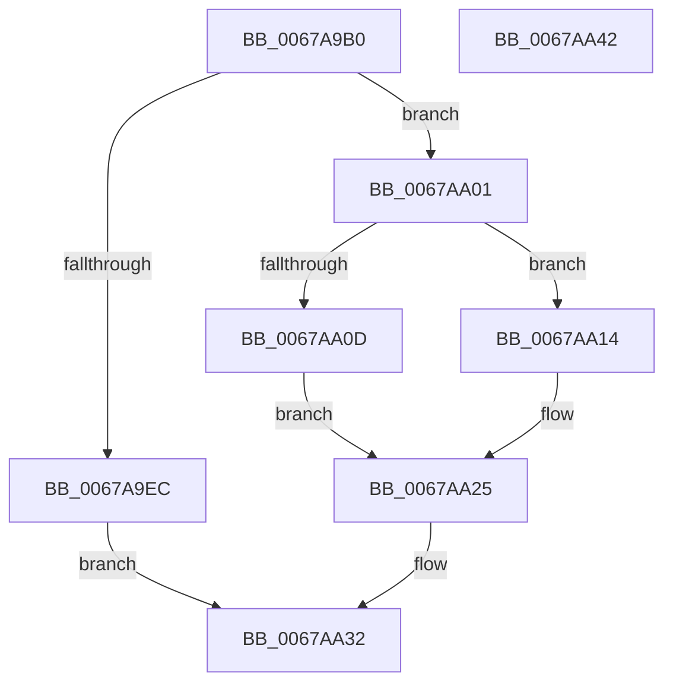

# MmGetPageBadStatus

- RVA: `0x0067A9B0`–`0x0067AA43` (길이 `147` bytes)
- VA: `0x000000014067A9B0`
- 실행 섹션: `.text`
- PDB 이름 있음: `예`; PDB Function 태그: `아니요`
- unwind 정보 RVA: `0x0005FD94`
- 디코드: `43`개 명령, `147/147` bytes 표시
- 미해석 바이트: `0` (있으면 어셈블리에 `.byte`로 보존)

> 이 문서는 커널 이미지의 기계어와 PDB 기호를 분석해 생성했습니다. 4번과 5번은 함수 원형과 자료형을 바이너리 사용 방식에서 추정한 C 해석이며 원본 소스 복구 결과는 아닙니다.

## 1. Dependencies

- 직접 호출 지점: **4**; 고유 호출 대상: **4**
- 직접 호출자로 확인된 함수: **5**
- RIP 상대 이미지 참조: **0**

### Outgoing calls
- `0x0067A9E0` → [MiSafeLockPage](../32/MiSafeLockPage_function_00321620.md) (function, `0x00321620`)
- `0x0067A9FA` → [MiGetPageInHugePageBadStatus](MiGetPageInHugePageBadStatus_function_00675ADC.md) (function, `0x00675ADC`)
- `0x0067AA04` → [MiIsPageOnBadList](../2B/MiIsPageOnBadList_function_002B1018.md) (function, `0x002B1018`)
- `0x0067AA2B` → [MiUnlockPage](../31/MiUnlockPage_function_0031A3E0.md) (function, `0x0031A3E0`)

### Direct callers
- [HalpPmemErrorDeferredHandler](../55/HalpPmemErrorDeferredHandler_function_00556A30.md) at `0x00556A9A`
- [WheaAttemptRowOffline](../65/WheaAttemptRowOffline_function_0065F050.md) at `0x0065F0C9`
- [WheapProcessOfflineList](../66/WheapProcessOfflineList_function_00661D70.md) at `0x00661DED`
- [WheapExecuteRowFailureCheck](../../page/7D/WheapExecuteRowFailureCheck_function_007D8ED8.md) at `0x007D9112`
- [WheapPfaMemoryCheck](../../page/7D/WheapPfaMemoryCheck_function_007D9214.md) at `0x007D925A`

### Static image references
- 디코드된 RIP-relative 메모리 참조가 없습니다.

## 2. Other-region calls and transfers

- 다른 실행 섹션으로 향하는 call: **0**
- 별도 외부 분기/꼬리 이동을 확인하지 못했습니다.

## 3. Assembly (complete function range)

```asm
0067A9B0  48 89 5C 24 10                  mov qword ptr [rsp + 0x10], rbx
0067A9B5  48 89 74 24 18                  mov qword ptr [rsp + 0x18], rsi
0067A9BA  57                              push rdi
0067A9BB  48 83 EC 20                     sub rsp, 0x20
0067A9BF  48 8B 31                        mov rsi, qword ptr [rcx]
0067A9C2  33 DB                           xor ebx, ebx
0067A9C4  48 C1 EE 0C                     shr rsi, 0xc
0067A9C8  48 8D 3C 76                     lea rdi, [rsi + rsi*2]
0067A9CC  48 C1 E7 04                     shl rdi, 4
0067A9D0  48 B8 00 00 00 00 00 DE FF FF   movabs rax, 0xffffde0000000000
0067A9DA  48 8B CE                        mov rcx, rsi
0067A9DD  48 03 F8                        add rdi, rax
0067A9E0  E8 3B 6C CA FF                  call 0x140321620
0067A9E5  44 8A C0                        mov r8b, al
0067A9E8  3C 11                           cmp al, 0x11
0067A9EA  75 15                           jne 0x14067aa01
0067A9EC  4C 8D 44 24 30                  lea r8, [rsp + 0x30]
0067A9F1  89 5C 24 30                     mov dword ptr [rsp + 0x30], ebx
0067A9F5  33 D2                           xor edx, edx
0067A9F7  48 8B CE                        mov rcx, rsi
0067A9FA  E8 DD B0 FF FF                  call 0x140675adc
0067A9FF  EB 31                           jmp 0x14067aa32
0067AA01  48 8B CF                        mov rcx, rdi
0067AA04  E8 0F 66 C3 FF                  call 0x1402b1018
0067AA09  85 C0                           test eax, eax
0067AA0B  74 07                           je 0x14067aa14
0067AA0D  BB 09 07 00 C0                  mov ebx, 0xc0000709
0067AA12  EB 11                           jmp 0x14067aa25
0067AA14  8B 57 20                        mov edx, dword ptr [rdi + 0x20]
0067AA17  B8 03 01 00 00                  mov eax, 0x103
0067AA1C  C1 EA 18                        shr edx, 0x18
0067AA1F  F6 C2 40                        test dl, 0x40
0067AA22  0F 45 D8                        cmovne ebx, eax
0067AA25  41 8A D0                        mov dl, r8b
0067AA28  48 8B CF                        mov rcx, rdi
0067AA2B  E8 B0 F9 C9 FF                  call 0x14031a3e0
0067AA30  8B C3                           mov eax, ebx
0067AA32  48 8B 5C 24 38                  mov rbx, qword ptr [rsp + 0x38]
0067AA37  48 8B 74 24 40                  mov rsi, qword ptr [rsp + 0x40]
0067AA3C  48 83 C4 20                     add rsp, 0x20
0067AA40  5F                              pop rdi
0067AA41  C3                              ret
0067AA42  CC                              int3
```

## 4. C-style interpretation (structured pseudocode)

```c
__int64 __fastcall MmGetPageBadStatus(__int64 a1, int a2)
{
    __int64 result;
    __int64 v_rbx;
    __int64 v_rdi;
    __int64 v_rsi;
    __int64 v_rsp;
    unsigned __int64 v_stack_p10;
    unsigned __int64 v_stack_p18;
    unsigned __int64 v_stack_p8;

    v_stack_p10 = v_rbx;
    v_stack_p18 = v_rsi;
    v_rsp = (v_rsp) - (32);
    v_rbx = 0;
    v_rsi = (*(unsigned __int64 *)(a1)) >> (12);
    v_rdi = (v_rsi + v_rsi * 2) << (4);
    v_rdi = (v_rdi) + (result);
    result = MiSafeLockPage(v_rsi, a2, a3, a4);
    if (((unsigned __int8)(result)) != 17) goto loc_0067AA01;
    v_stack_p8 = 0;
    a2 = 0;
    result = MiGetPageInHugePageBadStatus(v_rsi, a2, v_stack_p8, a4);
    goto loc_0067AA32;
loc_0067AA01:
    result = MiIsPageOnBadList(v_rdi, a2, v_stack_p8, a4);
    if ((unsigned int)(result) == 0) goto loc_0067AA14;
    goto loc_0067AA25;
loc_0067AA14:
    a2 = (unsigned int)(((unsigned int)(*(unsigned int *)(v_rdi + 32))) >> (24));
    v_rbx = (unsigned int)(0xC0000709ULL);
    if ((((unsigned __int8)(a2)) & (64)) != 0) { v_rbx = 259; }
loc_0067AA25:
    result = MiUnlockPage(v_rdi, (unsigned __int8)(v_stack_p8), v_stack_p8, a4);
loc_0067AA32:
    v_rsp = (v_rsp) + (32);
    return (unsigned int)((unsigned int)(v_rbx));
}
```

## 5. (Beta) C Style

```c
int64_t MmGetPageBadStatus(void *Arg1, int32_t Arg2)
{
    uint8_t *arg1 = (uint8_t *)Arg1;

    int64_t result;
    int64_t local_rbx;
    int64_t local_rdi;
    int64_t local_rsi;
    int64_t local_rsp;
    uint64_t v_stack_p10;
    uint64_t v_stack_p18;
    uint64_t v_stack_p8;

    v_stack_p10 = local_rbx;
    v_stack_p18 = local_rsi;
    local_rsp = (local_rsp) - (32);
    local_rbx = 0;
    local_rsi = (*(uint64_t *)(arg1)) >> (12);
    local_rdi = (local_rsi + local_rsi * 2) << (4);
    local_rdi = (local_rdi) + (result);
    result = MiSafeLockPage(local_rsi, Arg2, a3, a4);
    if (((uint8_t)(result)) != 17) goto loc_0067AA01;
    v_stack_p8 = 0;
    Arg2 = 0;
    result = MiGetPageInHugePageBadStatus(local_rsi, Arg2, v_stack_p8, a4);
    goto loc_0067AA32;
loc_0067AA01:
    result = MiIsPageOnBadList(local_rdi, Arg2, v_stack_p8, a4);
    if ((uint32_t)(result) == 0) goto loc_0067AA14;
    goto loc_0067AA25;
loc_0067AA14:
    Arg2 = (uint32_t)(((uint32_t)(*(uint32_t *)(local_rdi + 0x20))) >> (24));
    local_rbx = (uint32_t)(0xC0000709ULL);
    if ((((uint8_t)(Arg2)) & (64)) != 0) { local_rbx = 259; }
loc_0067AA25:
    result = MiUnlockPage(local_rdi, (uint8_t)(v_stack_p8), v_stack_p8, a4);
loc_0067AA32:
    local_rsp = (local_rsp) + (32);
    return (uint32_t)((uint32_t)(local_rbx));
}
```

### 관측된 메모리 오프셋

구조체 형식이 확인되지 않은 접근은 인자 기준의 오프셋으로만 기록했습니다.

| 기준 인자 | 오프셋 표현 | 폭 (bit) | 접근 |
|---|---:|---:|---|
| `Arg1` | `+ 0x0` | `64` | `R` |

## 6. Execution-region graph

[열기: 2D/3D 그래프와 함수 탐색 컨트롤 패널](../../../control-panel.html?section=text&rva=0x0067A9B0&view=graph)

- 2D 그래프는 위에서 아래로 흐르고, 3D 그래프는 빈 공간을 드래그해 회전합니다. Shift+드래그는 이동, 휠은 확대·축소, 함수 노드 선택은 대상 보고서 이동입니다.

### Static fallback


