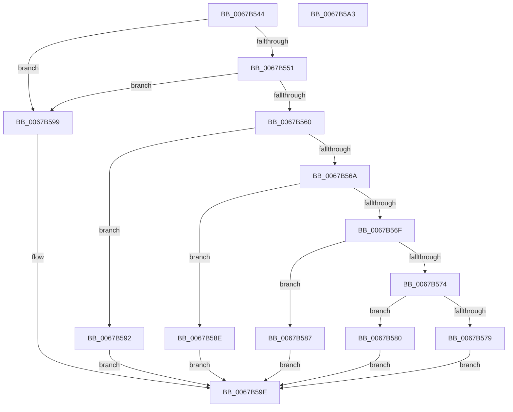

# MmGetVaTypeForVerifier

- RVA: `0x0067B544`–`0x0067B5A4` (길이 `96` bytes)
- VA: `0x000000014067B544`
- 실행 섹션: `.text`
- PDB 이름 있음: `예`; PDB Function 태그: `아니요`
- unwind 정보 RVA: `0x0005C788`
- 디코드: `29`개 명령, `96/96` bytes 표시
- 미해석 바이트: `0` (있으면 어셈블리에 `.byte`로 보존)

> 이 문서는 커널 이미지의 기계어와 PDB 기호를 분석해 생성했습니다. 4번과 5번은 함수 원형과 자료형을 바이너리 사용 방식에서 추정한 C 해석이며 원본 소스 복구 결과는 아닙니다.

## 1. Dependencies

- 직접 호출 지점: **1**; 고유 호출 대상: **1**
- 직접 호출자로 확인된 함수: **3**
- RIP 상대 이미지 참조: **1**

### Outgoing calls
- `0x0067B560` → [MiGetSystemRegionType](../28/MiGetSystemRegionType_function_0028EC80.md) (function, `0x0028EC80`)

### Direct callers
- [DifObjTrkInsertItem](../61/DifObjTrkInsertItem_function_00619D00.md) at `0x00619D86`
- [DifObjTrkQeuryInvokeDeleteRange](../61/DifObjTrkQeuryInvokeDeleteRange_function_00619EA0.md) at `0x00619F1F`
- [DifObjTrkRemoveItem](../61/DifObjTrkRemoveItem_function_0061A1D0.md) at `0x0061A22D`

### Static image references
- `0x0067B548` → RVA `0x00F04A20` (`.data`; read)

## 2. Other-region calls and transfers

- 다른 실행 섹션으로 향하는 call: **0**
- 별도 외부 분기/꼬리 이동을 확인하지 못했습니다.

## 3. Assembly (complete function range)

```asm
0067B544  48 83 EC 28                     sub rsp, 0x28
0067B548  83 3D D1 94 88 00 00            cmp dword ptr [rip + 0x8894d1], 0
0067B54F  74 48                           je 0x14067b599
0067B551  48 B8 00 00 00 00 00 80 FF FF   movabs rax, 0xffff800000000000
0067B55B  48 3B C8                        cmp rcx, rax
0067B55E  72 39                           jb 0x14067b599
0067B560  E8 1B 37 C1 FF                  call 0x14028ec80
0067B565  83 E8 04                        sub eax, 4
0067B568  74 28                           je 0x14067b592
0067B56A  83 E8 01                        sub eax, 1
0067B56D  74 1F                           je 0x14067b58e
0067B56F  83 E8 06                        sub eax, 6
0067B572  74 13                           je 0x14067b587
0067B574  83 F8 02                        cmp eax, 2
0067B577  74 07                           je 0x14067b580
0067B579  B8 04 00 00 00                  mov eax, 4
0067B57E  EB 1E                           jmp 0x14067b59e
0067B580  B8 02 00 00 00                  mov eax, 2
0067B585  EB 17                           jmp 0x14067b59e
0067B587  B8 03 00 00 00                  mov eax, 3
0067B58C  EB 10                           jmp 0x14067b59e
0067B58E  33 C0                           xor eax, eax
0067B590  EB 0C                           jmp 0x14067b59e
0067B592  B8 01 00 00 00                  mov eax, 1
0067B597  EB 05                           jmp 0x14067b59e
0067B599  B8 05 00 00 00                  mov eax, 5
0067B59E  48 83 C4 28                     add rsp, 0x28
0067B5A2  C3                              ret
0067B5A3  CC                              int3
```

## 4. C-style interpretation (structured pseudocode)

```c
__int64 __fastcall MmGetVaTypeForVerifier(__int64 a1)
{
    __int64 result;
    __int64 v_rsp;

    v_rsp = (v_rsp) - (40);
    if ((*(unsigned int *)(v_rip + 8950993)) == 0) goto loc_0067B599;
    if (a1 < result) goto loc_0067B599;
    result = MiGetSystemRegionType(a1, a2, a3, a4);
    result = (unsigned int)((result) - (4));
    if (condition_is_equal) goto loc_0067B592;
    result = (unsigned int)((result) - (1));
    if (condition_is_equal) goto loc_0067B58E;
    result = (unsigned int)((result) - (6));
    if (condition_is_equal) goto loc_0067B587;
    if (((unsigned int)(result)) == 2) goto loc_0067B580;
    goto loc_0067B59E;
loc_0067B580:
    goto loc_0067B59E;
loc_0067B587:
    goto loc_0067B59E;
loc_0067B58E:
    result = 0;
    goto loc_0067B59E;
loc_0067B592:
    goto loc_0067B59E;
loc_0067B599:
loc_0067B59E:
    v_rsp = (v_rsp) + (40);
    return 5;
}
```

## 5. (Beta) C Style

```c
int64_t MmGetVaTypeForVerifier(int64_t Arg1)
{
    int64_t result;
    int64_t local_rsp;

    local_rsp = (local_rsp) - (40);
    if ((*(uint32_t *)(v_rip + 0x8894D1)) == 0) goto loc_0067B599;
    if (Arg1 < result) goto loc_0067B599;
    result = MiGetSystemRegionType(Arg1, a2, a3, a4);
    result = (uint32_t)((result) - (4));
    if (condition_is_equal) goto loc_0067B592;
    result = (uint32_t)((result) - (1));
    if (condition_is_equal) goto loc_0067B58E;
    result = (uint32_t)((result) - (6));
    if (condition_is_equal) goto loc_0067B587;
    if (((uint32_t)(result)) == 2) goto loc_0067B580;
    goto loc_0067B59E;
loc_0067B580:
    goto loc_0067B59E;
loc_0067B587:
    goto loc_0067B59E;
loc_0067B58E:
    result = 0;
    goto loc_0067B59E;
loc_0067B592:
    goto loc_0067B59E;
loc_0067B599:
loc_0067B59E:
    local_rsp = (local_rsp) + (40);
    return 5;
}
```

## 6. Execution-region graph

[열기: 2D/3D 그래프와 함수 탐색 컨트롤 패널](../../../control-panel.html?section=text&rva=0x0067B544&view=graph)

- 2D 그래프는 위에서 아래로 흐르고, 3D 그래프는 빈 공간을 드래그해 회전합니다. Shift+드래그는 이동, 휠은 확대·축소, 함수 노드 선택은 대상 보고서 이동입니다.

### Static fallback


