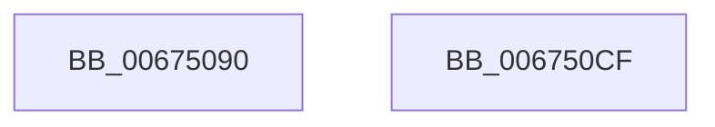

# MmGetVirtualForPhysical

- RVA: `0x00675090`–`0x006750D0` (길이 `64` bytes)
- VA: `0x0000000140675090`
- 실행 섹션: `.text`
- PDB 이름 있음: `예`; PDB Function 태그: `아니요`
- unwind 정보 RVA: `0x000DB714`
- 디코드: `15`개 명령, `64/64` bytes 표시
- 미해석 바이트: `0` (있으면 어셈블리에 `.byte`로 보존)

> 이 문서는 커널 이미지의 기계어와 PDB 기호를 분석해 생성했습니다. 4번과 5번은 함수 원형과 자료형을 바이너리 사용 방식에서 추정한 C 해석이며 원본 소스 복구 결과는 아닙니다.

## 1. Dependencies

- 직접 호출 지점: **0**; 고유 호출 대상: **0**
- 직접 호출자로 확인된 함수: **0**
- RIP 상대 이미지 참조: **0**

### Outgoing calls
- 직접 디코드된 call 명령이 없습니다.

### Direct callers
- 이 함수 시작 RVA로 연결되는 직접 call은 확인되지 않았습니다. 간접 호출은 완전히 역산할 수 없습니다.

### Static image references
- 디코드된 RIP-relative 메모리 참조가 없습니다.

## 2. Other-region calls and transfers

- 다른 실행 섹션으로 향하는 call: **0**
- 별도 외부 분기/꼬리 이동을 확인하지 못했습니다.

## 3. Assembly (complete function range)

```asm
00675090  48 8B C1                        mov rax, rcx
00675093  48 C1 E8 0C                     shr rax, 0xc
00675097  48 8D 14 40                     lea rdx, [rax + rax*2]
0067509B  48 03 D2                        add rdx, rdx
0067509E  48 B8 08 00 00 00 00 DE FF FF   movabs rax, 0xffffde0000000008
006750A8  48 8B 04 D0                     mov rax, qword ptr [rax + rdx*8]
006750AC  48 C1 E0 19                     shl rax, 0x19
006750B0  48 BA 00 00 00 00 80 F6 FF FF   movabs rdx, 0xfffff68000000000
006750BA  48 C1 E2 19                     shl rdx, 0x19
006750BE  81 E1 FF 0F 00 00               and ecx, 0xfff
006750C4  48 2B C2                        sub rax, rdx
006750C7  48 C1 F8 10                     sar rax, 0x10
006750CB  48 03 C1                        add rax, rcx
006750CE  C3                              ret
006750CF  CC                              int3
```

## 4. C-style interpretation (structured pseudocode)

```c
__int64 __fastcall MmGetVirtualForPhysical(__int64 a1)
{
    __int64 result;

    result = (a1) >> (12);
    a2 = (result + result * 2) + (result + result * 2);
    result = (*(unsigned __int64 *)(result + a2 * 8)) << (25);
    a2 = (a2) << (25);
    a1 = (unsigned int)((a1) & (0xFFFULL));
    result = (result) - (a2);
    result = (result) >> (16);
    result = (result) + (a1);
    return result;
}
```

## 5. (Beta) C Style

```c
int64_t MmGetVirtualForPhysical(int64_t Arg1)
{
    int64_t result;

    result = (Arg1) >> (12);
    a2 = (result + result * 2) + (result + result * 2);
    result = (*(uint64_t *)(result + a2 * 8)) << (25);
    a2 = (a2) << (25);
    Arg1 = (uint32_t)((Arg1) & (0xFFFULL));
    result = (result) - (a2);
    result = (result) >> (16);
    result = (result) + (Arg1);
    return result;
}
```

## 6. Execution-region graph

[열기: 2D/3D 그래프와 함수 탐색 컨트롤 패널](../../../control-panel.html?section=text&rva=0x00675090&view=graph)

- 2D 그래프는 위에서 아래로 흐르고, 3D 그래프는 빈 공간을 드래그해 회전합니다. Shift+드래그는 이동, 휠은 확대·축소, 함수 노드 선택은 대상 보고서 이동입니다.

### Static fallback


