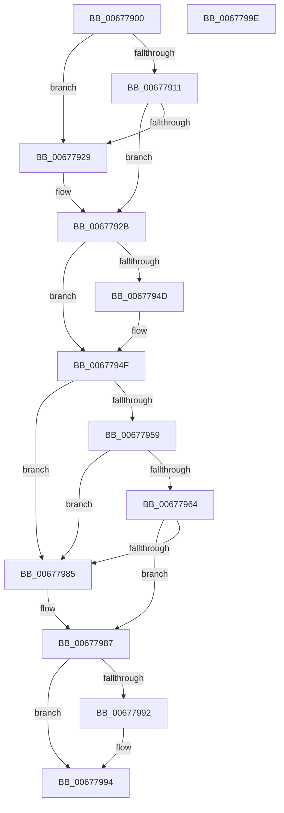

# MmIsMdlPageDanging

- RVA: `0x00677900`–`0x0067799F` (길이 `159` bytes)
- VA: `0x0000000140677900`
- 실행 섹션: `.text`
- PDB 이름 있음: `예`; PDB Function 태그: `아니요`
- unwind 정보 RVA: `0x000DB714`
- 디코드: `40`개 명령, `159/159` bytes 표시
- 미해석 바이트: `0` (있으면 어셈블리에 `.byte`로 보존)

> 이 문서는 커널 이미지의 기계어와 PDB 기호를 분석해 생성했습니다. 4번과 5번은 함수 원형과 자료형을 바이너리 사용 방식에서 추정한 C 해석이며 원본 소스 복구 결과는 아닙니다.

## 1. Dependencies

- 직접 호출 지점: **0**; 고유 호출 대상: **0**
- 직접 호출자로 확인된 함수: **0**
- RIP 상대 이미지 참조: **1**

### Outgoing calls
- 직접 디코드된 call 명령이 없습니다.

### Direct callers
- 이 함수 시작 RVA로 연결되는 직접 call은 확인되지 않았습니다. 간접 호출은 완전히 역산할 수 없습니다.

### Static image references
- `0x00677908` → RVA `0x00E2DCE0` (`.data`; read)

## 2. Other-region calls and transfers

- 다른 실행 섹션으로 향하는 call: **0**
- 별도 외부 분기/꼬리 이동을 확인하지 못했습니다.

## 3. Assembly (complete function range)

```asm
00677900  48 8D 14 49                     lea rdx, [rcx + rcx*2]
00677904  48 C1 E2 04                     shl rdx, 4
00677908  48 3B 0D D1 63 7B 00            cmp rcx, qword ptr [rip + 0x7b63d1]
0067790F  77 18                           ja 0x140677929
00677911  48 B8 28 00 00 00 00 DE FF FF   movabs rax, 0xffffde0000000028
0067791B  48 8B 04 02                     mov rax, qword ptr [rdx + rax]
0067791F  48 C1 E8 36                     shr rax, 0x36
00677923  0F BA E0 00                     bt eax, 0
00677927  72 02                           jb 0x14067792b
00677929  CD 2C                           int 0x2c
0067792B  49 B8 00 00 00 00 00 DE FF FF   movabs r8, 0xffffde0000000000
00677935  4A 8B 44 02 18                  mov rax, qword ptr [rdx + r8 + 0x18]
0067793A  48 B9 FF FF FF FF FF FF FF 3F   movabs rcx, 0x3fffffffffffffff
00677944  48 23 C1                        and rax, rcx
00677947  48 83 F8 01                     cmp rax, 1
0067794B  74 02                           je 0x14067794f
0067794D  CD 2C                           int 0x2c
0067794F  4A 8B 44 02 18                  mov rax, qword ptr [rdx + r8 + 0x18]
00677954  48 85 C1                        test rcx, rax
00677957  74 2C                           je 0x140677985
00677959  42 8A 44 02 22                  mov al, byte ptr [rdx + r8 + 0x22]
0067795E  24 07                           and al, 7
00677960  3C 06                           cmp al, 6
00677962  75 21                           jne 0x140677985
00677964  4A 8B 44 02 28                  mov rax, qword ptr [rdx + r8 + 0x28]
00677969  48 B9 FF FF FF FF FF 00 00 00   movabs rcx, 0xffffffffff
00677973  48 23 C1                        and rax, rcx
00677976  48 B9 FE FF FF FF 3F 00 00 00   movabs rcx, 0x3ffffffffe
00677980  48 3B C1                        cmp rax, rcx
00677983  74 02                           je 0x140677987
00677985  CD 2C                           int 0x2c
00677987  42 8B 4C 02 20                  mov ecx, dword ptr [rdx + r8 + 0x20]
0067798C  66 83 F9 02                     cmp cx, 2
00677990  73 02                           jae 0x140677994
00677992  CD 2C                           int 0x2c
00677994  33 C0                           xor eax, eax
00677996  66 83 F9 02                     cmp cx, 2
0067799A  0F 97 C0                        seta al
0067799D  C3                              ret
0067799E  CC                              int3
```

## 4. C-style interpretation (structured pseudocode)

```c
__int64 __fastcall MmIsMdlPageDanging(__int64 a1)
{
    __int64 result;

    a2 = (a1 + a1 * 2) << (4);
    if (a1 > (*(unsigned __int64 *)(v_rip + 8086481))) goto loc_00677929;
    result = (*(unsigned __int64 *)(a2 + result * 1)) >> (54);
    if (!(condition_is_below)) {
    }
    result = (*(unsigned __int64 *)(a2 + a3 * 1 + 24)) & (a1);
    if (result != 1) {
    }
    if (((a1) & (*(unsigned __int64 *)(a2 + a3 * 1 + 24))) == 0) goto loc_00677985;
    result = (unsigned __int8)((*(unsigned __int8 *)(a2 + a3 * 1 + 34)) & (7));
    if (((unsigned __int8)(result)) != 6) goto loc_00677985;
    result = (*(unsigned __int64 *)(a2 + a3 * 1 + 40)) & (a1);
    if (result != a1) {
    }
    if (((unsigned __int16)((unsigned int)(*(unsigned int *)(a2 + a3 * 1 + 32)))) < 2) {
    }
    result = 0;
    result = (((unsigned __int16)((unsigned int)(*(unsigned int *)(a2 + a3 * 1 + 32)))) > 2) ? 1 : 0;
    return result;
}
```

## 5. (Beta) C Style

```c
int64_t MmIsMdlPageDanging(void *Arg1)
{
    uint8_t *arg1 = (uint8_t *)Arg1;

    int64_t result;

    a2 = (Arg1 + Arg1 * 2) << (4);
    if (Arg1 > (*(uint64_t *)(v_rip + 0x7B63D1))) goto loc_00677929;
    result = (*(uint64_t *)(a2 + result * 1)) >> (54);
    if (!(condition_is_below)) {
    }
    result = (*(uint64_t *)(a2 + a3 * 1 + 0x18)) & (Arg1);
    if (result != 1) {
    }
    if (((Arg1) & (*(uint64_t *)(a2 + a3 * 1 + 0x18))) == 0) goto loc_00677985;
    result = (uint8_t)((*(uint8_t *)(a2 + a3 * 1 + 0x22)) & (7));
    if (((uint8_t)(result)) != 6) goto loc_00677985;
    result = (*(uint64_t *)(a2 + a3 * 1 + 0x28)) & (Arg1);
    if (result != Arg1) {
    }
    if (((uint16_t)((uint32_t)(*(uint32_t *)(a2 + a3 * 1 + 0x20)))) < 2) {
    }
    result = 0;
    result = (((uint16_t)((uint32_t)(*(uint32_t *)(a2 + a3 * 1 + 0x20)))) > 2) ? 1 : 0;
    return result;
}
```

### 관측된 메모리 오프셋

구조체 형식이 확인되지 않은 접근은 인자 기준의 오프셋으로만 기록했습니다.

| 기준 인자 | 오프셋 표현 | 폭 (bit) | 접근 |
|---|---:|---:|---|
| `Arg1` | `+ 0x0 + rcx*2` | `64` | `R` |

## 6. Execution-region graph

[열기: 2D/3D 그래프와 함수 탐색 컨트롤 패널](../../../control-panel.html?section=text&rva=0x00677900&view=graph)

- 2D 그래프는 위에서 아래로 흐르고, 3D 그래프는 빈 공간을 드래그해 회전합니다. Shift+드래그는 이동, 휠은 확대·축소, 함수 노드 선택은 대상 보고서 이동입니다.

### Static fallback


