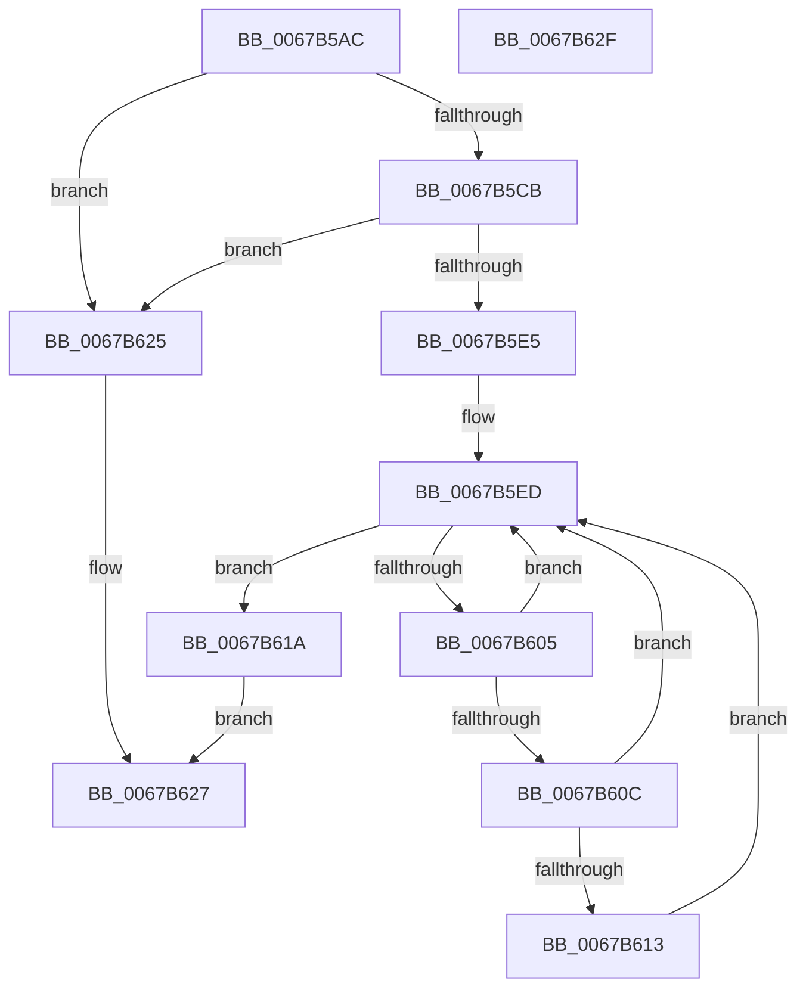

# MmIsVerifierApplicableToImage

- RVA: `0x0067B5AC`–`0x0067B630` (길이 `132` bytes)
- VA: `0x000000014067B5AC`
- 실행 섹션: `.text`
- PDB 이름 있음: `예`; PDB Function 태그: `아니요`
- unwind 정보 RVA: `0x000C3DE4`
- 디코드: `40`개 명령, `132/132` bytes 표시
- 미해석 바이트: `0` (있으면 어셈블리에 `.byte`로 보존)

> 이 문서는 커널 이미지의 기계어와 PDB 기호를 분석해 생성했습니다. 4번과 5번은 함수 원형과 자료형을 바이너리 사용 방식에서 추정한 C 해석이며 원본 소스 복구 결과는 아닙니다.

## 1. Dependencies

- 직접 호출 지점: **1**; 고유 호출 대상: **1**
- 직접 호출자로 확인된 함수: **4**
- RIP 상대 이미지 참조: **2**

### Outgoing calls
- `0x0067B5FC` → [KiEnumerateNmiSxCallback](../5B/KiEnumerateNmiSxCallback_function_005B1E48.md) (function, `0x005B1E48`)

### Direct callers
- [MiReapplyImportOptimizationWorker](../68/MiReapplyImportOptimizationWorker_function_00682720.md) at `0x006827C3`
- [VfDriverApplyDifVerification](../../pagevrfy/B9/VfDriverApplyDifVerification_function_00B9A028.md) at `0x00B9A0FC`
- [VfDriverEnableVerifier](../../pagevrfy/B9/VfDriverEnableVerifier_function_00B9A240.md) at `0x00B9A303`
- [MmApplyVerifierToRunningImage](../../pagevrfy/BB/MmApplyVerifierToRunningImage_function_00BB4780.md) at `0x00BB4798`

### Static image references
- `0x0067B5BE` → RVA `0x00FC6A88` (`ALMOSTRO`; read)
- `0x0067B5D1` → RVA `0x00F475A8` (`.data`; read)

## 2. Other-region calls and transfers

- 다른 실행 섹션으로 향하는 call: **0**
- 별도 외부 분기/꼬리 이동을 확인하지 못했습니다.

## 3. Assembly (complete function range)

```asm
0067B5AC  40 53                           push rbx
0067B5AE  56                              push rsi
0067B5AF  57                              push rdi
0067B5B0  48 83 EC 20                     sub rsp, 0x20
0067B5B4  48 8B 71 30                     mov rsi, qword ptr [rcx + 0x30]
0067B5B8  8B 79 40                        mov edi, dword ptr [rcx + 0x40]
0067B5BB  48 03 FE                        add rdi, rsi
0067B5BE  48 F7 05 BF B4 94 00 00 80 00 00  test qword ptr [rip + 0x94b4bf], 0x8000
0067B5C9  75 5A                           jne 0x14067b625
0067B5CB  48 83 64 24 48 00               and qword ptr [rsp + 0x48], 0
0067B5D1  48 8B 0D D0 BF 8C 00            mov rcx, qword ptr [rip + 0x8cbfd0]
0067B5D8  44 0F 20 C0                     mov rax, cr8
0067B5DC  88 44 24 40                     mov byte ptr [rsp + 0x40], al
0067B5E0  48 85 C9                        test rcx, rcx
0067B5E3  74 40                           je 0x14067b625
0067B5E5  48 83 64 24 50 00               and qword ptr [rsp + 0x50], 0
0067B5EB  33 DB                           xor ebx, ebx
0067B5ED  4C 8D 44 24 48                  lea r8, [rsp + 0x48]
0067B5F2  48 8D 54 24 40                  lea rdx, [rsp + 0x40]
0067B5F7  48 8D 4C 24 50                  lea rcx, [rsp + 0x50]
0067B5FC  E8 47 68 F3 FF                  call 0x1405b1e48
0067B601  85 C0                           test eax, eax
0067B603  74 15                           je 0x14067b61a
0067B605  48 39 74 24 48                  cmp qword ptr [rsp + 0x48], rsi
0067B60A  72 E1                           jb 0x14067b5ed
0067B60C  48 39 7C 24 48                  cmp qword ptr [rsp + 0x48], rdi
0067B611  73 DA                           jae 0x14067b5ed
0067B613  BB 01 00 00 00                  mov ebx, 1
0067B618  EB D3                           jmp 0x14067b5ed
0067B61A  F7 DB                           neg ebx
0067B61C  1B C0                           sbb eax, eax
0067B61E  25 0E 0C 00 C0                  and eax, 0xc0000c0e
0067B623  EB 02                           jmp 0x14067b627
0067B625  33 C0                           xor eax, eax
0067B627  48 83 C4 20                     add rsp, 0x20
0067B62B  5F                              pop rdi
0067B62C  5E                              pop rsi
0067B62D  5B                              pop rbx
0067B62E  C3                              ret
0067B62F  CC                              int3
```

## 4. C-style interpretation (structured pseudocode)

```c
__int64 __fastcall MmIsVerifierApplicableToImage(__int64 a1)
{
    __int64 result;
    __int64 v_rbx;
    __int64 v_rdi;
    __int64 v_rsp;
    unsigned __int64 v_stack_p10;
    unsigned __int64 v_stack_p18;
    unsigned __int8 v_stack_p8;

    v_rsp = (v_rsp) - (32);
    v_rdi = ((unsigned int)(*(unsigned int *)(a1 + 64))) + (*(unsigned __int64 *)(a1 + 48));
    if (((*(unsigned __int64 *)(v_rip + 9745599)) & (0x8000ULL)) != 0) goto loc_0067B625;
    v_stack_p8 = (unsigned __int8)(v_cr8);
    if (*(unsigned __int64 *)(v_rip + 9224144) == 0) goto loc_0067B625;
    v_rbx = 0;
loc_0067B5ED:
    result = KiEnumerateNmiSxCallback(v_stack_p18, v_stack_p8, v_stack_p10, a4);
    if ((unsigned int)(result) == 0) goto loc_0067B61A;
    if (v_stack_p10 < (*(unsigned __int64 *)(a1 + 48))) goto loc_0067B5ED;
    if (v_stack_p10 >= v_rdi) goto loc_0067B5ED;
    goto loc_0067B5ED;
loc_0067B61A:
    v_rbx = (unsigned int)(-(1));
    result = (unsigned int)((result) & (0xC0000C0EULL));
    goto loc_0067B627;
loc_0067B625:
    result = 0;
loc_0067B627:
    v_rsp = (v_rsp) + (32);
    return result;
}
```

## 5. (Beta) C Style

```c
int64_t MmIsVerifierApplicableToImage(void *Arg1)
{
    uint8_t *arg1 = (uint8_t *)Arg1;

    int64_t result;
    int64_t local_rbx;
    int64_t local_rdi;
    int64_t local_rsp;
    uint64_t v_stack_p10;
    uint64_t v_stack_p18;
    uint8_t v_stack_p8;

    local_rsp = (local_rsp) - (32);
    local_rdi = ((uint32_t)(*(uint32_t *)(arg1 + 0x40))) + (*(uint64_t *)(arg1 + 0x30));
    if (((*(uint64_t *)(v_rip + 0x94B4BF)) & (0x8000ULL)) != 0) goto loc_0067B625;
    v_stack_p8 = (uint8_t)(v_cr8);
    if (*(uint64_t *)(v_rip + 0x8CBFD0) == 0) goto loc_0067B625;
    local_rbx = 0;
loc_0067B5ED:
    result = KiEnumerateNmiSxCallback(v_stack_p18, v_stack_p8, v_stack_p10, a4);
    if ((uint32_t)(result) == 0) goto loc_0067B61A;
    if (v_stack_p10 < (*(uint64_t *)(arg1 + 0x30))) goto loc_0067B5ED;
    if (v_stack_p10 >= local_rdi) goto loc_0067B5ED;
    goto loc_0067B5ED;
loc_0067B61A:
    local_rbx = (uint32_t)(-(1));
    result = (uint32_t)((result) & (0xC0000C0EULL));
    goto loc_0067B627;
loc_0067B625:
    result = 0;
loc_0067B627:
    local_rsp = (local_rsp) + (32);
    return result;
}
```

### 관측된 메모리 오프셋

구조체 형식이 확인되지 않은 접근은 인자 기준의 오프셋으로만 기록했습니다.

| 기준 인자 | 오프셋 표현 | 폭 (bit) | 접근 |
|---|---:|---:|---|
| `Arg1` | `+ 0x30` | `64` | `R` |
| `Arg1` | `+ 0x40` | `32` | `R` |

## 6. Execution-region graph

[열기: 2D/3D 그래프와 함수 탐색 컨트롤 패널](../../../control-panel.html?section=text&rva=0x0067B5AC&view=graph)

- 2D 그래프는 위에서 아래로 흐르고, 3D 그래프는 빈 공간을 드래그해 회전합니다. Shift+드래그는 이동, 휠은 확대·축소, 함수 노드 선택은 대상 보고서 이동입니다.

### Static fallback


