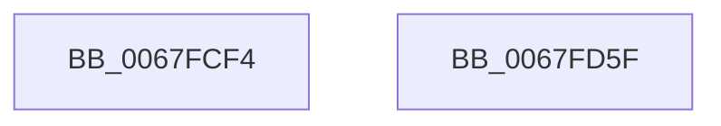

# MmKasanCommitRegion

- RVA: `0x0067FCF4`–`0x0067FD60` (길이 `108` bytes)
- VA: `0x000000014067FCF4`
- 실행 섹션: `.text`
- PDB 이름 있음: `예`; PDB Function 태그: `아니요`
- unwind 정보 RVA: `0x0005D2F4`
- 디코드: `27`개 명령, `108/108` bytes 표시
- 미해석 바이트: `0` (있으면 어셈블리에 `.byte`로 보존)

> 이 문서는 커널 이미지의 기계어와 PDB 기호를 분석해 생성했습니다. 4번과 5번은 함수 원형과 자료형을 바이너리 사용 방식에서 추정한 C 해석이며 원본 소스 복구 결과는 아닙니다.

## 1. Dependencies

- 직접 호출 지점: **1**; 고유 호출 대상: **1**
- 직접 호출자로 확인된 함수: **3**
- RIP 상대 이미지 참조: **0**

### Outgoing calls
- `0x0067FD4A` → [MiMakeZeroedPageTablesEx](../3B/MiMakeZeroedPageTablesEx_function_003B59FC.md) (function, `0x003B59FC`)

### Direct callers
- [sub_00328FA3](../32/Unknown_function_00328FA3.md) at `0x003293EC`
- [sub_0033827F](../33/Unknown_function_0033827F.md) at `0x00338641`
- [sub_006F269E](../6F/Unknown_function_006F269E.md) at `0x006F2704`

### Static image references
- 디코드된 RIP-relative 메모리 참조가 없습니다.

## 2. Other-region calls and transfers

- 다른 실행 섹션으로 향하는 call: **0**
- 별도 외부 분기/꼬리 이동을 확인하지 못했습니다.

## 3. Assembly (complete function range)

```asm
0067FCF4  48 83 EC 38                     sub rsp, 0x38
0067FCF8  45 8B C8                        mov r9d, r8d
0067FCFB  44 0F 20 C0                     mov rax, cr8
0067FCFF  41 BA 30 02 00 00               mov r10d, 0x230
0067FD05  3C 02                           cmp al, 2
0067FD07  41 B8 30 12 00 00               mov r8d, 0x1230
0067FD0D  49 BB F8 FF FF FF 7F 00 00 00   movabs r11, 0x7ffffffff8
0067FD17  45 0F 45 C2                     cmovne r8d, r10d
0067FD1B  48 C1 EA 09                     shr rdx, 9
0067FD1F  49 23 D3                        and rdx, r11
0067FD22  49 BA 00 00 00 00 80 F6 FF FF   movabs r10, 0xfffff68000000000
0067FD2C  49 8B C2                        mov rax, r10
0067FD2F  48 C1 E9 09                     shr rcx, 9
0067FD33  48 03 D0                        add rdx, rax
0067FD36  49 23 CB                        and rcx, r11
0067FD39  49 8B C2                        mov rax, r10
0067FD3C  44 89 4C 24 20                  mov dword ptr [rsp + 0x20], r9d
0067FD41  48 03 C8                        add rcx, rax
0067FD44  41 B9 13 00 00 00               mov r9d, 0x13
0067FD4A  E8 AD 5C D3 FF                  call 0x1403b59fc
0067FD4F  F7 D8                           neg eax
0067FD51  1B C0                           sbb eax, eax
0067FD53  F7 D0                           not eax
0067FD55  25 9A 00 00 C0                  and eax, 0xc000009a
0067FD5A  48 83 C4 38                     add rsp, 0x38
0067FD5E  C3                              ret
0067FD5F  CC                              int3
```

## 4. C-style interpretation (structured pseudocode)

```c
__int64 __fastcall MmKasanCommitRegion(__int64 a1, __int64 a2, int a3)
{
    __int64 result;
    __int64 v_rsp;
    unsigned int v_stack_m18;

    v_rsp = (v_rsp) - (56);
    a3 = (unsigned int)(0x1230ULL);
    if (((unsigned __int8)(v_cr8)) != 2) { a3 = 560; }
    a2 = (a2) >> (9);
    a2 = (a2) & (v_r11);
    a1 = (a1) >> (9);
    a2 = (a2) + (560);
    a1 = (a1) & (v_r11);
    v_stack_m18 = (unsigned int)((unsigned int)(a3));
    a1 = (a1) + (560);
    result = MiMakeZeroedPageTablesEx(a1, a2, a3, 19);
    result = (unsigned int)(-(result));
    result = (unsigned int)(~(result));
    result = (unsigned int)((result) & (0xC000009AULL));
    v_rsp = (v_rsp) + (56);
    return result;
}
```

## 5. (Beta) C Style

```c
int64_t MmKasanCommitRegion(int64_t Arg1, int64_t Arg2, int32_t Arg3)
{
    int64_t result;
    int64_t local_rsp;
    uint32_t v_stack_m18;

    local_rsp = (local_rsp) - (56);
    Arg3 = (uint32_t)(0x1230ULL);
    if (((uint8_t)(v_cr8)) != 2) { Arg3 = 560; }
    Arg2 = (Arg2) >> (9);
    Arg2 = (Arg2) & (local_r11);
    Arg1 = (Arg1) >> (9);
    Arg2 = (Arg2) + (560);
    Arg1 = (Arg1) & (local_r11);
    v_stack_m18 = (uint32_t)((uint32_t)(Arg3));
    Arg1 = (Arg1) + (560);
    result = MiMakeZeroedPageTablesEx(Arg1, Arg2, Arg3, 19);
    result = (uint32_t)(-(result));
    result = (uint32_t)(~(result));
    result = (uint32_t)((result) & (0xC000009AULL));
    local_rsp = (local_rsp) + (56);
    return result;
}
```

## 6. Execution-region graph

[열기: 2D/3D 그래프와 함수 탐색 컨트롤 패널](../../../control-panel.html?section=text&rva=0x0067FCF4&view=graph)

- 2D 그래프는 위에서 아래로 흐르고, 3D 그래프는 빈 공간을 드래그해 회전합니다. Shift+드래그는 이동, 휠은 확대·축소, 함수 노드 선택은 대상 보고서 이동입니다.

### Static fallback


