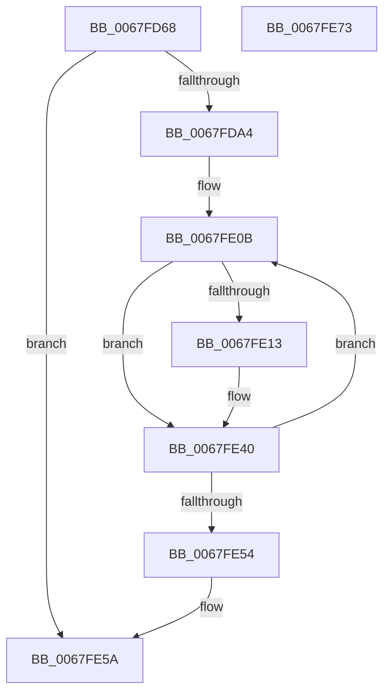

# MmKcsanGetIgnoredRangeList

- RVA: `0x0067FD68`–`0x0067FE74` (길이 `268` bytes)
- VA: `0x000000014067FD68`
- 실행 섹션: `.text`
- PDB 이름 있음: `예`; PDB Function 태그: `아니요`
- unwind 정보 RVA: `0x00060300`
- 디코드: `70`개 명령, `268/268` bytes 표시
- 미해석 바이트: `0` (있으면 어셈블리에 `.byte`로 보존)

> 이 문서는 커널 이미지의 기계어와 PDB 기호를 분석해 생성했습니다. 4번과 5번은 함수 원형과 자료형을 바이너리 사용 방식에서 추정한 C 해석이며 원본 소스 복구 결과는 아닙니다.

## 1. Dependencies

- 직접 호출 지점: **5**; 고유 호출 대상: **4**
- 직접 호출자로 확인된 함수: **1**
- RIP 상대 이미지 참조: **3**

### Outgoing calls
- `0x0067FD93` → [ExAllocatePool2](../../poolcode/B8/ExAllocatePool2_function_00B820F0.md) (function, `0x00B820F0`)
- `0x0067FDB7` → [MiKcsanPopulateHierarchy](MiKcsanPopulateHierarchy_function_0067FB0C.md) (function, `0x0067FB0C`)
- `0x0067FDDC` → [MiKcsanPopulateHierarchy](MiKcsanPopulateHierarchy_function_0067FB0C.md) (function, `0x0067FB0C`)
- `0x0067FDF5` → [qsort](../50/qsort_function_005009F0.md) (function, `0x005009F0`)
- `0x0067FE29` → [memcpy](../6C/memcpy_function_006C6840.md) (function, `0x006C6840`)

### Direct callers
- [KcsanInitSystem](../5A/KcsanInitSystem_function_005AF2A0.md) at `0x005AF2C5`

### Static image references
- `0x0067FDBC` → RVA `0x00E38C30` (`.data`; read)
- `0x0067FDC7` → RVA `0x00E38C28` (`.data`; read)
- `0x0067FDE1` → RVA `0x00558EA0` (`HalpNodeCostSort`; read)

## 2. Other-region calls and transfers

- 다른 실행 섹션으로 향하는 call: **1**
  - `0x0067FD93` → [ExAllocatePool2](../../poolcode/B8/ExAllocatePool2_function_00B820F0.md) (`.text` → `POOLCODE`)
- 별도 외부 분기/꼬리 이동을 확인하지 못했습니다.

## 3. Assembly (complete function range)

```asm
0067FD68  48 89 5C 24 08                  mov qword ptr [rsp + 8], rbx
0067FD6D  48 89 6C 24 10                  mov qword ptr [rsp + 0x10], rbp
0067FD72  48 89 74 24 18                  mov qword ptr [rsp + 0x18], rsi
0067FD77  57                              push rdi
0067FD78  41 56                           push r14
0067FD7A  41 57                           push r15
0067FD7C  48 83 EC 20                     sub rsp, 0x20
0067FD80  BE 09 00 00 00                  mov esi, 9
0067FD85  BA 98 00 00 00                  mov edx, 0x98
0067FD8A  41 B8 4B 63 52 61               mov r8d, 0x6152634b
0067FD90  8D 4E 3F                        lea ecx, [rsi + 0x3f]
0067FD93  E8 58 23 50 00                  call 0x140b820f0
0067FD98  48 8B F8                        mov rdi, rax
0067FD9B  48 85 C0                        test rax, rax
0067FD9E  0F 84 B6 00 00 00               je 0x14067fe5a
0067FDA4  33 D2                           xor edx, edx
0067FDA6  48 89 30                        mov qword ptr [rax], rsi
0067FDA9  49 B8 FF FF FF FF FF 7F FF FF   movabs r8, 0xffff7fffffffffff
0067FDB3  48 8D 48 08                     lea rcx, [rax + 8]
0067FDB7  E8 50 FD FF FF                  call 0x14067fb0c
0067FDBC  4C 8B 05 6D 8E 7B 00            mov r8, qword ptr [rip + 0x7b8e6d]
0067FDC3  48 8D 4F 58                     lea rcx, [rdi + 0x58]
0067FDC7  48 8B 15 5A 8E 7B 00            mov rdx, qword ptr [rip + 0x7b8e5a]
0067FDCE  49 FF C8                        dec r8
0067FDD1  4C 03 C2                        add r8, rdx
0067FDD4  48 89 57 48                     mov qword ptr [rdi + 0x48], rdx
0067FDD8  4C 89 47 50                     mov qword ptr [rdi + 0x50], r8
0067FDDC  E8 2B FD FF FF                  call 0x14067fb0c
0067FDE1  4C 8D 0D B8 90 ED FF            lea r9, [rip - 0x126f48]
0067FDE8  41 B8 10 00 00 00               mov r8d, 0x10
0067FDEE  48 8B D6                        mov rdx, rsi
0067FDF1  48 8D 4F 08                     lea rcx, [rdi + 8]
0067FDF5  E8 F6 0B E8 FF                  call 0x1405009f0
0067FDFA  BD 01 00 00 00                  mov ebp, 1
0067FDFF  4C 8D 77 10                     lea r14, [rdi + 0x10]
0067FE03  48 8D 5F 18                     lea rbx, [rdi + 0x18]
0067FE07  4C 8D 7F 28                     lea r15, [rdi + 0x28]
0067FE0B  48 8B 03                        mov rax, qword ptr [rbx]
0067FE0E  49 39 06                        cmp qword ptr [r14], rax
0067FE11  75 2D                           jne 0x14067fe40
0067FE13  48 8B 43 08                     mov rax, qword ptr [rbx + 8]
0067FE17  4C 8B C6                        mov r8, rsi
0067FE1A  4C 2B C5                        sub r8, rbp
0067FE1D  49 89 06                        mov qword ptr [r14], rax
0067FE20  49 FF C8                        dec r8
0067FE23  49 8B D7                        mov rdx, r15
0067FE26  48 8B CB                        mov rcx, rbx
0067FE29  E8 12 6A 04 00                  call 0x1406c6840
0067FE2E  48 FF CE                        dec rsi
0067FE31  48 FF CD                        dec rbp
0067FE34  49 83 EE 10                     sub r14, 0x10
0067FE38  48 83 EB 10                     sub rbx, 0x10
0067FE3C  49 83 EF 10                     sub r15, 0x10
0067FE40  48 FF C5                        inc rbp
0067FE43  49 83 C6 10                     add r14, 0x10
0067FE47  48 83 C3 10                     add rbx, 0x10
0067FE4B  49 83 C7 10                     add r15, 0x10
0067FE4F  48 3B EE                        cmp rbp, rsi
0067FE52  72 B7                           jb 0x14067fe0b
0067FE54  48 89 37                        mov qword ptr [rdi], rsi
0067FE57  48 8B C7                        mov rax, rdi
0067FE5A  48 8B 5C 24 40                  mov rbx, qword ptr [rsp + 0x40]
0067FE5F  48 8B 6C 24 48                  mov rbp, qword ptr [rsp + 0x48]
0067FE64  48 8B 74 24 50                  mov rsi, qword ptr [rsp + 0x50]
0067FE69  48 83 C4 20                     add rsp, 0x20
0067FE6D  41 5F                           pop r15
0067FE6F  41 5E                           pop r14
0067FE71  5F                              pop rdi
0067FE72  C3                              ret
0067FE73  CC                              int3
```

## 4. C-style interpretation (structured pseudocode)

```c
__int64 __fastcall MmKcsanGetIgnoredRangeList(void)
{
    __int64 result;
    __int64 v_r14;
    __int64 v_r15;
    __int64 v_rbp;
    __int64 v_rbx;
    __int64 v_rsi;
    __int64 v_rsp;
    unsigned __int64 v_stack_p10;
    unsigned __int64 v_stack_p18;
    unsigned __int64 v_stack_p8;

    v_stack_p8 = v_rbx;
    v_stack_p10 = v_rbp;
    v_stack_p18 = v_rsi;
    v_rsp = (v_rsp) - (32);
    result = ExAllocatePool2(9 + 63, 152, (unsigned int)(0x6152634BULL), a4);
    if (result == 0) goto loc_0067FE5A;
    a2 = 0;
    *(unsigned __int64 *)(result) = 9;
    result = MiKcsanPopulateHierarchy(result + 8, a2, (unsigned int)(0x6152634BULL), a4);
    a3 = (*(unsigned __int64 *)(v_rip + 8097389)) - 1;
    a3 = (a3) + (*(unsigned __int64 *)(v_rip + 8097370));
    *(unsigned __int64 *)(result + 72) = *(unsigned __int64 *)(v_rip + 8097370);
    *(unsigned __int64 *)(result + 80) = a3;
    result = MiKcsanPopulateHierarchy(result + 88, *(unsigned __int64 *)(v_rip + 8097370), a3, a4);
    result = qsort(result + 8, 9, 16, v_rip - 1208136);
loc_0067FE0B:
    result = *(unsigned __int64 *)(result + 24);
    v_rbx = result + 24;
    v_rsi = 9;
    v_rbp = 1;
    v_r14 = result + 16;
    v_r15 = result + 40;
    if ((*(unsigned __int64 *)(result + 16)) == (*(unsigned __int64 *)(result + 24))) {
        result = *(unsigned __int64 *)(result + 24 + 8);
        a3 = 9;
        a3 = (a3) - (1);
        *(unsigned __int64 *)(result + 16) = result;
        a3 = (a3) - 1;
        a2 = result + 40;
        a1 = result + 24;
        result = memcpy(a1, a2, a3, v_rip - 1208136);
        v_rsi = (9) - 1;
        v_rbp = (1) - 1;
        v_r14 = (result + 16) - (16);
        v_rbx = (result + 24) - (16);
        v_r15 = (result + 40) - (16);
    }
    v_rbp = (v_rbp) + 1;
    v_r14 = (v_r14) + (16);
    v_rbx = (v_rbx) + (16);
    v_r15 = (v_r15) + (16);
    if (v_rbp < v_rsi) goto loc_0067FE0B;
    *(unsigned __int64 *)(result) = v_rsi;
loc_0067FE5A:
    v_rsp = (v_rsp) + (32);
    return result;
}
```

## 5. (Beta) C Style

```c
void MmKcsanGetIgnoredRangeList(void)
{
    int64_t result;
    int64_t local_r14;
    int64_t local_r15;
    int64_t local_rbp;
    int64_t local_rbx;
    int64_t local_rsi;
    int64_t local_rsp;
    uint64_t v_stack_p10;
    uint64_t v_stack_p18;
    uint64_t v_stack_p8;

    v_stack_p8 = local_rbx;
    v_stack_p10 = local_rbp;
    v_stack_p18 = local_rsi;
    local_rsp = (local_rsp) - (32);
    result = ExAllocatePool2(9 + 63, 152, (uint32_t)(0x6152634BULL), a4);
    if (result == 0) goto loc_0067FE5A;
    a2 = 0;
    *(uint64_t *)(result) = 9;
    result = MiKcsanPopulateHierarchy(result + 8, a2, (uint32_t)(0x6152634BULL), a4);
    a3 = (*(uint64_t *)(v_rip + 0x7B8E6D)) - 1;
    a3 = (a3) + (*(uint64_t *)(v_rip + 0x7B8E5A));
    *(uint64_t *)(result + 0x48) = *(uint64_t *)(v_rip + 0x7B8E5A);
    *(uint64_t *)(result + 0x50) = a3;
    result = MiKcsanPopulateHierarchy(result + 88, *(uint64_t *)(v_rip + 0x7B8E5A), a3, a4);
    result = qsort(result + 8, 9, 16, v_rip - 1208136);
loc_0067FE0B:
    result = *(uint64_t *)(result + 0x18);
    local_rbx = result + 24;
    local_rsi = 9;
    local_rbp = 1;
    local_r14 = result + 16;
    local_r15 = result + 40;
    if ((*(uint64_t *)(result + 0x10)) == (*(uint64_t *)(result + 0x18))) {
        result = *(uint64_t *)(result + 0x18 + 0x8);
        a3 = 9;
        a3 = (a3) - (1);
        *(uint64_t *)(result + 0x10) = result;
        a3 = (a3) - 1;
        a2 = result + 40;
        a1 = result + 24;
        result = memcpy(a1, a2, a3, v_rip - 1208136);
        local_rsi = (9) - 1;
        local_rbp = (1) - 1;
        local_r14 = (result + 16) - (16);
        local_rbx = (result + 24) - (16);
        local_r15 = (result + 40) - (16);
    }
    local_rbp = (local_rbp) + 1;
    local_r14 = (local_r14) + (16);
    local_rbx = (local_rbx) + (16);
    local_r15 = (local_r15) + (16);
    if (local_rbp < local_rsi) goto loc_0067FE0B;
    *(uint64_t *)(result) = local_rsi;
loc_0067FE5A:
    local_rsp = (local_rsp) + (32);
    return result;
}
```

## 6. Execution-region graph

[열기: 2D/3D 그래프와 함수 탐색 컨트롤 패널](../../../control-panel.html?section=text&rva=0x0067FD68&view=graph)

- 2D 그래프는 위에서 아래로 흐르고, 3D 그래프는 빈 공간을 드래그해 회전합니다. Shift+드래그는 이동, 휠은 확대·축소, 함수 노드 선택은 대상 보고서 이동입니다.

### Static fallback


