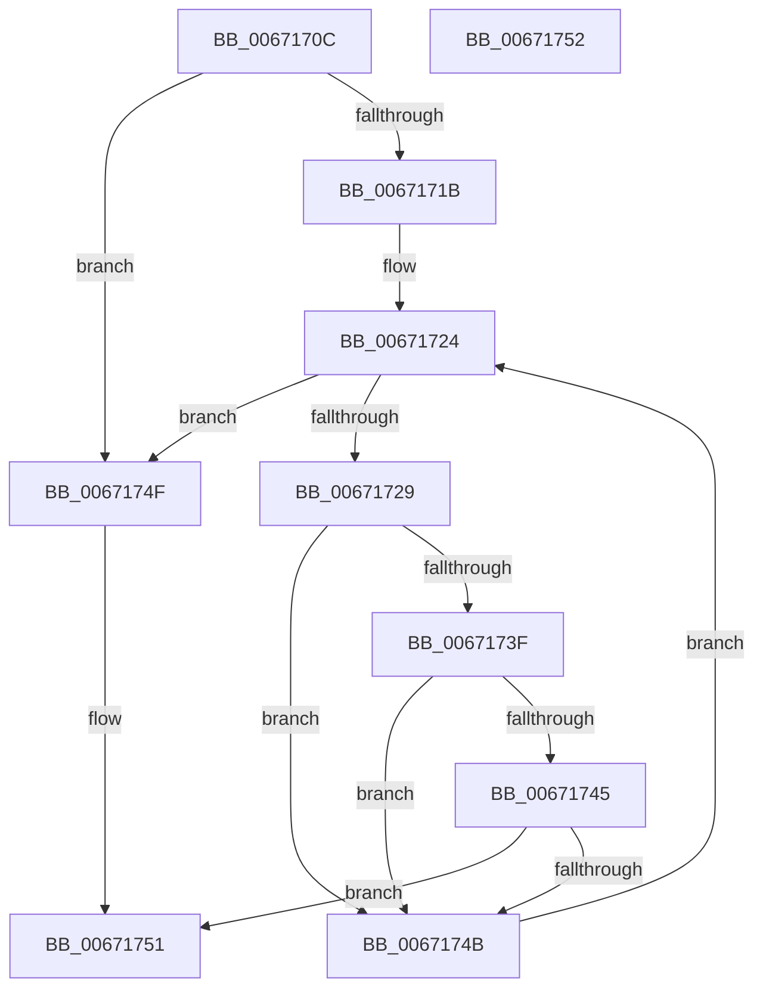

# MmLocateUnloadedDriver

- RVA: `0x0067170C`–`0x00671753` (길이 `71` bytes)
- VA: `0x000000014067170C`
- 실행 섹션: `.text`
- PDB 이름 있음: `예`; PDB Function 태그: `아니요`
- unwind 정보 RVA: `0x000DB714`
- 디코드: `24`개 명령, `71/71` bytes 표시
- 미해석 바이트: `0` (있으면 어셈블리에 `.byte`로 보존)

> 이 문서는 커널 이미지의 기계어와 PDB 기호를 분석해 생성했습니다. 4번과 5번은 함수 원형과 자료형을 바이너리 사용 방식에서 추정한 C 해석이며 원본 소스 복구 결과는 아닙니다.

## 1. Dependencies

- 직접 호출 지점: **0**; 고유 호출 대상: **0**
- 직접 호출자로 확인된 함수: **2**
- RIP 상대 이미지 참조: **2**

### Outgoing calls
- 직접 디코드된 call 명령이 없습니다.

### Direct callers
- [KeBugCheck2](../5B/KeBugCheck2_function_005B27D0.md) at `0x005B2DB5`
- [KeBugCheck2](../5B/KeBugCheck2_function_005B27D0.md) at `0x005B2EDC`
- [KiDumpParameterImages](../5B/KiDumpParameterImages_function_005B4CE0.md) at `0x005B4D62`
- [KiDumpParameterImages](../5B/KiDumpParameterImages_function_005B4CE0.md) at `0x005B4E60`

### Static image references
- `0x0067170C` → RVA `0x00EF54B0` (`.data`; read)
- `0x0067171B` → RVA `0x00EF54A8` (`.data`; read)

## 2. Other-region calls and transfers

- 다른 실행 섹션으로 향하는 call: **0**
- 별도 외부 분기/꼬리 이동을 확인하지 못했습니다.

## 3. Assembly (complete function range)

```asm
0067170C  4C 8B 0D 9D 3D 88 00            mov r9, qword ptr [rip + 0x883d9d]
00671713  4C 8B C1                        mov r8, rcx
00671716  4D 85 C9                        test r9, r9
00671719  74 34                           je 0x14067174f
0067171B  44 8B 15 86 3D 88 00            mov r10d, dword ptr [rip + 0x883d86]
00671722  33 D2                           xor edx, edx
00671724  41 3B D2                        cmp edx, r10d
00671727  73 26                           jae 0x14067174f
00671729  41 8B C2                        mov eax, r10d
0067172C  2B C2                           sub eax, edx
0067172E  FF C8                           dec eax
00671730  48 8D 0C 80                     lea rcx, [rax + rax*4]
00671734  49 8D 04 C9                     lea rax, [r9 + rcx*8]
00671738  48 83 78 08 00                  cmp qword ptr [rax + 8], 0
0067173D  74 0C                           je 0x14067174b
0067173F  4C 3B 40 10                     cmp r8, qword ptr [rax + 0x10]
00671743  72 06                           jb 0x14067174b
00671745  4C 3B 40 18                     cmp r8, qword ptr [rax + 0x18]
00671749  72 06                           jb 0x140671751
0067174B  FF C2                           inc edx
0067174D  EB D5                           jmp 0x140671724
0067174F  33 C0                           xor eax, eax
00671751  C3                              ret
00671752  CC                              int3
```

## 4. C-style interpretation (structured pseudocode)

```c
__int64 __fastcall MmLocateUnloadedDriver(__int64 a1, int a2)
{
    __int64 result;

    if (*(unsigned __int64 *)(v_rip + 8928669) == 0) goto loc_0067174F;
    a2 = 0;
loc_00671724:
    if (0 >= ((unsigned int)((unsigned int)(*(unsigned int *)(v_rip + 8928646))))) goto loc_0067174F;
    result = (unsigned int)(((unsigned int)((unsigned int)((unsigned int)(*(unsigned int *)(v_rip + 8928646))))) - (0));
    result = (unsigned int)((result) - 1);
    if ((*(unsigned __int64 *)(*(unsigned __int64 *)(v_rip + 8928669) + result + result * 4 * 8 + 8)) == 0) goto loc_0067174B;
    if (a1 < (*(unsigned __int64 *)(*(unsigned __int64 *)(v_rip + 8928669) + result + result * 4 * 8 + 16))) goto loc_0067174B;
    if (a1 < (*(unsigned __int64 *)(*(unsigned __int64 *)(v_rip + 8928669) + result + result * 4 * 8 + 24))) goto loc_00671751;
loc_0067174B:
    a2 = (unsigned int)((a2) + 1);
    goto loc_00671724;
loc_0067174F:
    result = 0;
loc_00671751:
    return result;
}
```

## 5. (Beta) C Style

```c
int64_t MmLocateUnloadedDriver(int64_t Arg1, int32_t Arg2)
{
    int64_t result;

    if (*(uint64_t *)(v_rip + 0x883D9D) == 0) goto loc_0067174F;
    Arg2 = 0;
loc_00671724:
    if (0 >= ((uint32_t)((uint32_t)(*(uint32_t *)(v_rip + 0x883D86))))) goto loc_0067174F;
    result = (uint32_t)(((uint32_t)((uint32_t)((uint32_t)(*(uint32_t *)(v_rip + 0x883D86))))) - (0));
    result = (uint32_t)((result) - 1);
    if ((*(uint64_t *)(*(uint64_t *)(v_rip + 0x883D9D) + result + result * 4 * 8 + 0x8)) == 0) goto loc_0067174B;
    if (Arg1 < (*(uint64_t *)(*(uint64_t *)(v_rip + 0x883D9D) + result + result * 4 * 8 + 0x10))) goto loc_0067174B;
    if (Arg1 < (*(uint64_t *)(*(uint64_t *)(v_rip + 0x883D9D) + result + result * 4 * 8 + 0x18))) goto loc_00671751;
loc_0067174B:
    Arg2 = (uint32_t)((Arg2) + 1);
    goto loc_00671724;
loc_0067174F:
    result = 0;
loc_00671751:
    return result;
}
```

## 6. Execution-region graph

[열기: 2D/3D 그래프와 함수 탐색 컨트롤 패널](../../../control-panel.html?section=text&rva=0x0067170C&view=graph)

- 2D 그래프는 위에서 아래로 흐르고, 3D 그래프는 빈 공간을 드래그해 회전합니다. Shift+드래그는 이동, 휠은 확대·축소, 함수 노드 선택은 대상 보고서 이동입니다.

### Static fallback


