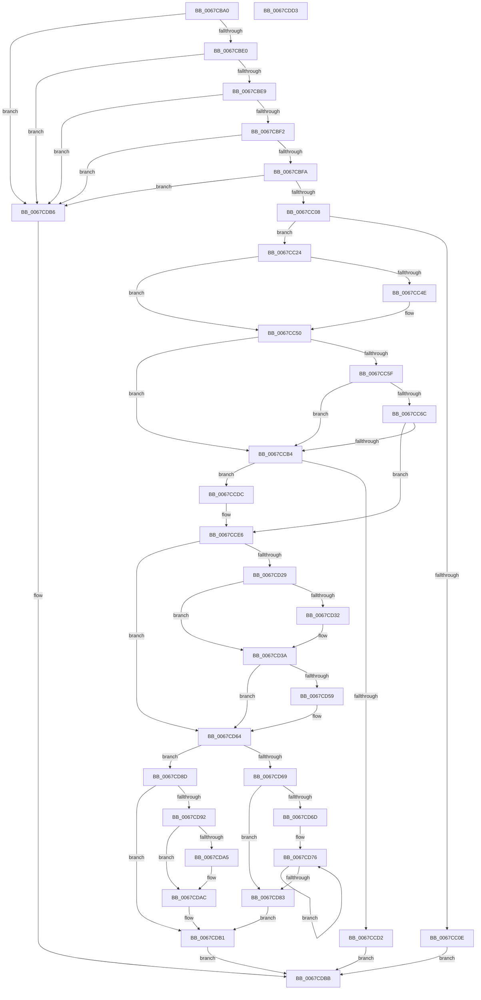

# MmMapMdl

- RVA: `0x0067CBA0`–`0x0067CDD4` (길이 `564` bytes)
- VA: `0x000000014067CBA0`
- 실행 섹션: `.text`
- PDB 이름 있음: `예`; PDB Function 태그: `아니요`
- unwind 정보 RVA: `0x000AFEC4`
- 디코드: `155`개 명령, `564/564` bytes 표시
- 미해석 바이트: `0` (있으면 어셈블리에 `.byte`로 보존)

> 이 문서는 커널 이미지의 기계어와 PDB 기호를 분석해 생성했습니다. 4번과 5번은 함수 원형과 자료형을 바이너리 사용 방식에서 추정한 C 해석이며 원본 소스 복구 결과는 아닙니다.

## 1. Dependencies

- 직접 호출 지점: **11**; 고유 호출 대상: **10**
- 직접 호출자로 확인된 함수: **0**
- RIP 상대 이미지 참조: **4**

### Outgoing calls
- `0x0067CBCD` → [MiMakeProtectionMask](../32/MiMakeProtectionMask_function_00329480.md) (function, `0x00329480`)
- `0x0067CC18` → [guard_dispatch_icall](../6B/guard_dispatch_icall_function_006BAAD0.md) (function, `0x006BAAD0`)
- `0x0067CC5F` → [MiGetUltraMdlContext](../4A/MiGetUltraMdlContext_function_004A3AAC.md) (function, `0x004A3AAC`)
- `0x0067CC89` → [MiGetUltraMapping](../32/MiGetUltraMapping_function_00323270.md) (function, `0x00323270`)
- `0x0067CCC5` → [MiReservePtes](../31/MiReservePtes_function_00318D20.md) (function, `0x00318D20`)
- `0x0067CD1D` → [MiFillSystemPtes](../31/MiFillSystemPtes_function_00319850.md) (function, `0x00319850`)
- `0x0067CD35` → [MiMappingHasIoReferences](../46/MiMappingHasIoReferences_function_00460934.md) (function, `0x00460934`)
- `0x0067CD50` → [guard_dispatch_icall](../6B/guard_dispatch_icall_function_006BAAD0.md) (function, `0x006BAAD0`)
- `0x0067CD5F` → [MiClearMappingAndDereferenceIoSpace](../24/MiClearMappingAndDereferenceIoSpace_function_00247DF0.md) (function, `0x00247DF0`)
- `0x0067CD86` → [MiFreeUltraMdlContext](../4A/MiFreeUltraMdlContext_function_004A32E0.md) (function, `0x004A32E0`)
- `0x0067CDAC` → [MiReleasePtes](../24/MiReleasePtes_function_00247240.md) (function, `0x00247240`)

### Direct callers
- 이 함수 시작 RVA로 연결되는 직접 call은 확인되지 않았습니다. 간접 호출은 완전히 역산할 수 없습니다.

### Static image references
- `0x0067CC42` → RVA `0x00FC6C14` (`ALMOSTRO`; read)
- `0x0067CC50` → RVA `0x00E37668` (`.data`; read)
- `0x0067CCB8` → RVA `0x00E35E80` (`.data`; read)
- `0x0067CD6D` → RVA `0x00010880` (`.rdata`; read)

## 2. Other-region calls and transfers

- 다른 실행 섹션으로 향하는 call: **0**
- 별도 외부 분기/꼬리 이동을 확인하지 못했습니다.

## 3. Assembly (complete function range)

```asm
0067CBA0  48 8B C4                        mov rax, rsp
0067CBA3  48 89 58 08                     mov qword ptr [rax + 8], rbx
0067CBA7  4C 89 48 20                     mov qword ptr [rax + 0x20], r9
0067CBAB  4C 89 40 18                     mov qword ptr [rax + 0x18], r8
0067CBAF  55                              push rbp
0067CBB0  56                              push rsi
0067CBB1  57                              push rdi
0067CBB2  41 54                           push r12
0067CBB4  41 55                           push r13
0067CBB6  41 56                           push r14
0067CBB8  41 57                           push r15
0067CBBA  48 83 EC 40                     sub rsp, 0x40
0067CBBE  45 33 ED                        xor r13d, r13d
0067CBC1  48 8B E9                        mov rbp, rcx
0067CBC4  8B CA                           mov ecx, edx
0067CBC6  44 89 68 B8                     mov dword ptr [rax - 0x48], r13d
0067CBCA  45 8B F5                        mov r14d, r13d
0067CBCD  E8 AE C8 CA FF                  call 0x140329480
0067CBD2  8B F0                           mov esi, eax
0067CBD4  83 E0 07                        and eax, 7
0067CBD7  83 FE FF                        cmp esi, -1
0067CBDA  0F 84 D6 01 00 00               je 0x14067cdb6
0067CBE0  83 FE 18                        cmp esi, 0x18
0067CBE3  0F 84 CD 01 00 00               je 0x14067cdb6
0067CBE9  83 F8 05                        cmp eax, 5
0067CBEC  0F 84 C4 01 00 00               je 0x14067cdb6
0067CBF2  A8 02                           test al, 2
0067CBF4  0F 85 BC 01 00 00               jne 0x14067cdb6
0067CBFA  8B C6                           mov eax, esi
0067CBFC  83 E0 F8                        and eax, 0xfffffff8
0067CBFF  83 F8 10                        cmp eax, 0x10
0067CC02  0F 84 AE 01 00 00               je 0x14067cdb6
0067CC08  F6 45 0A 05                     test byte ptr [rbp + 0xa], 5
0067CC0C  74 16                           je 0x14067cc24
0067CC0E  48 8B 55 18                     mov rdx, qword ptr [rbp + 0x18]
0067CC12  49 8B C9                        mov rcx, r9
0067CC15  49 8B C0                        mov rax, r8
0067CC18  E8 B3 DE 03 00                  call 0x1406baad0
0067CC1D  33 C0                           xor eax, eax
0067CC1F  E9 97 01 00 00                  jmp 0x14067cdbb
0067CC24  8B 4D 20                        mov ecx, dword ptr [rbp + 0x20]
0067CC27  03 4D 2C                        add ecx, dword ptr [rbp + 0x2c]
0067CC2A  44 8B 65 28                     mov r12d, dword ptr [rbp + 0x28]
0067CC2E  81 E1 FF 0F 00 00               and ecx, 0xfff
0067CC34  49 81 C4 FF 0F 00 00            add r12, 0xfff
0067CC3B  4C 03 E1                        add r12, rcx
0067CC3E  49 C1 EC 0C                     shr r12, 0xc
0067CC42  44 39 2D CB 9F 94 00            cmp dword ptr [rip + 0x949fcb], r13d
0067CC49  41 8B FC                        mov edi, r12d
0067CC4C  74 02                           je 0x14067cc50
0067CC4E  FF C7                           inc edi
0067CC50  4C 8D 3D 11 AA 7B 00            lea r15, [rip + 0x7baa11]
0067CC57  81 FF 00 02 00 00               cmp edi, 0x200
0067CC5D  77 55                           ja 0x14067ccb4
0067CC5F  E8 48 6E E2 FF                  call 0x1404a3aac
0067CC64  4C 8B F0                        mov r14, rax
0067CC67  48 85 C0                        test rax, rax
0067CC6A  74 48                           je 0x14067ccb4
0067CC6C  44 0F 20 C1                     mov rcx, cr8
0067CC70  80 F9 02                        cmp cl, 2
0067CC73  44 8B C7                        mov r8d, edi
0067CC76  41 B9 04 00 00 00               mov r9d, 4
0067CC7C  48 8D 48 08                     lea rcx, [rax + 8]
0067CC80  45 0F 45 CD                     cmovne r9d, r13d
0067CC84  BA 03 00 00 00                  mov edx, 3
0067CC89  E8 E2 65 CA FF                  call 0x140323270
0067CC8E  48 8B D8                        mov rbx, rax
0067CC91  48 B8 F8 FF FF FF 7F 00 00 00   movabs rax, 0x7ffffffff8
0067CC9B  48 C1 EB 09                     shr rbx, 9
0067CC9F  48 23 D8                        and rbx, rax
0067CCA2  48 B8 00 00 00 00 80 F6 FF FF   movabs rax, 0xfffff68000000000
0067CCAC  48 8B C8                        mov rcx, rax
0067CCAF  48 03 D9                        add rbx, rcx
0067CCB2  75 32                           jne 0x14067cce6
0067CCB4  40 F6 C6 18                     test sil, 0x18
0067CCB8  48 8D 0D C1 91 7B 00            lea rcx, [rip + 0x7b91c1]
0067CCBF  8B D7                           mov edx, edi
0067CCC1  49 0F 44 CF                     cmove rcx, r15
0067CCC5  E8 56 C0 C9 FF                  call 0x140318d20
0067CCCA  48 8B D8                        mov rbx, rax
0067CCCD  48 85 C0                        test rax, rax
0067CCD0  75 0A                           jne 0x14067ccdc
0067CCD2  B8 9A 00 00 C0                  mov eax, 0xc000009a
0067CCD7  E9 DF 00 00 00                  jmp 0x14067cdbb
0067CCDC  48 B8 00 00 00 00 80 F6 FF FF   movabs rax, 0xfffff68000000000
0067CCE6  4C 8B FB                        mov r15, rbx
0067CCE9  49 C1 E7 19                     shl r15, 0x19
0067CCED  48 8B C0                        mov rax, rax
0067CCF0  48 C1 E0 19                     shl rax, 0x19
0067CCF4  4C 8D 45 30                     lea r8, [rbp + 0x30]
0067CCF8  4C 2B F8                        sub r15, rax
0067CCFB  44 8B CE                        mov r9d, esi
0067CCFE  8B 45 2C                        mov eax, dword ptr [rbp + 0x2c]
0067CD01  49 8B D4                        mov rdx, r12
0067CD04  49 C1 FF 10                     sar r15, 0x10
0067CD08  48 8B CB                        mov rcx, rbx
0067CD0B  4C 03 F8                        add r15, rax
0067CD0E  48 8D 44 24 30                  lea rax, [rsp + 0x30]
0067CD13  48 89 44 24 28                  mov qword ptr [rsp + 0x28], rax
0067CD18  44 89 6C 24 20                  mov dword ptr [rsp + 0x20], r13d
0067CD1D  E8 2E CB C9 FF                  call 0x140319850
0067CD22  44 8B E8                        mov r13d, eax
0067CD25  85 C0                           test eax, eax
0067CD27  78 3B                           js 0x14067cd64
0067CD29  8B 6C 24 30                     mov ebp, dword ptr [rsp + 0x30]
0067CD2D  83 E5 01                        and ebp, 1
0067CD30  74 08                           je 0x14067cd3a
0067CD32  49 8B CF                        mov rcx, r15
0067CD35  E8 FA 3B DE FF                  call 0x140460934
0067CD3A  48 8B 8C 24 98 00 00 00         mov rcx, qword ptr [rsp + 0x98]
0067CD42  49 8B D7                        mov rdx, r15
0067CD45  48 8B 84 24 90 00 00 00         mov rax, qword ptr [rsp + 0x90]
0067CD4D  45 33 ED                        xor r13d, r13d
0067CD50  E8 7B DD 03 00                  call 0x1406baad0
0067CD55  85 ED                           test ebp, ebp
0067CD57  74 0B                           je 0x14067cd64
0067CD59  49 8B D4                        mov rdx, r12
0067CD5C  49 8B CF                        mov rcx, r15
0067CD5F  E8 8C B0 BC FF                  call 0x140247df0
0067CD64  4D 85 F6                        test r14, r14
0067CD67  74 24                           je 0x14067cd8d
0067CD69  85 FF                           test edi, edi
0067CD6B  74 16                           je 0x14067cd83
0067CD6D  48 8B 05 0C 3B 99 FF            mov rax, qword ptr [rip - 0x66c4f4]
0067CD74  8B CF                           mov ecx, edi
0067CD76  48 89 03                        mov qword ptr [rbx], rax
0067CD79  48 8D 5B 08                     lea rbx, [rbx + 8]
0067CD7D  48 83 E9 01                     sub rcx, 1
0067CD81  75 F3                           jne 0x14067cd76
0067CD83  49 8B CE                        mov rcx, r14
0067CD86  E8 55 65 E2 FF                  call 0x1404a32e0
0067CD8B  EB 24                           jmp 0x14067cdb1
0067CD8D  48 85 DB                        test rbx, rbx
0067CD90  74 1F                           je 0x14067cdb1
0067CD92  48 8D 0D E7 90 7B 00            lea rcx, [rip + 0x7b90e7]
0067CD99  44 8B C7                        mov r8d, edi
0067CD9C  48 8B D3                        mov rdx, rbx
0067CD9F  40 F6 C6 18                     test sil, 0x18
0067CDA3  75 07                           jne 0x14067cdac
0067CDA5  48 8D 0D BC A8 7B 00            lea rcx, [rip + 0x7ba8bc]
0067CDAC  E8 8F A4 BC FF                  call 0x140247240
0067CDB1  41 8B C5                        mov eax, r13d
0067CDB4  EB 05                           jmp 0x14067cdbb
0067CDB6  B8 45 00 00 C0                  mov eax, 0xc0000045
0067CDBB  48 8B 9C 24 80 00 00 00         mov rbx, qword ptr [rsp + 0x80]
0067CDC3  48 83 C4 40                     add rsp, 0x40
0067CDC7  41 5F                           pop r15
0067CDC9  41 5E                           pop r14
0067CDCB  41 5D                           pop r13
0067CDCD  41 5C                           pop r12
0067CDCF  5F                              pop rdi
0067CDD0  5E                              pop rsi
0067CDD1  5D                              pop rbp
0067CDD2  C3                              ret
0067CDD3  CC                              int3
```

## 4. C-style interpretation (structured pseudocode)

```c
__int64 __fastcall MmMapMdl(__int64 a1, int a2, __int64 a3, __int64 a4)
{
    __int64 result;
    __int64 v_r12;
    __int64 v_r13;
    __int64 v_r15;
    __int64 v_rbp;
    __int64 v_rbx;
    __int64 v_rdi;
    __int64 v_rsp;
    unsigned __int64 v_stack_m48;
    unsigned __int64 v_stack_m50;
    unsigned int v_stack_m58;
    unsigned __int64 v_stack_p18;
    unsigned __int64 v_stack_p20;
    unsigned __int64 v_stack_p8;

    *(unsigned __int64 *)(v_rsp + 8) = v_rbx;
    *(unsigned __int64 *)(v_rsp + 32) = a4;
    *(unsigned __int64 *)(v_rsp + 24) = a3;
    v_rsp = (v_rsp) - (64);
    v_r13 = 0;
    *(unsigned int *)(v_rsp - 72) = 0;
    result = MiMakeProtectionMask((unsigned int)(a2), a2, a3, a4);
    result = (unsigned int)((result) & (7));
    if (((unsigned int)((unsigned int)((unsigned int)(result)))) == -1) goto loc_0067CDB6;
    if (((unsigned int)((unsigned int)((unsigned int)(result)))) == 24) goto loc_0067CDB6;
    if (((unsigned int)(result)) == 5) goto loc_0067CDB6;
    if ((((unsigned __int8)(result)) & (2)) != 0) goto loc_0067CDB6;
    result = (unsigned int)(((unsigned int)((unsigned int)((unsigned int)((unsigned int)(result))))) & (0xFFFFFFF8ULL));
    if (((unsigned int)(result)) == 16) goto loc_0067CDB6;
    if (((*(unsigned __int8 *)(a1 + 10)) & (5)) == 0) goto loc_0067CC24;
    result = guard_dispatch_icall(a4, *(unsigned __int64 *)(a1 + 24), a3, a4);
    result = 0;
    goto loc_0067CDBB;
loc_0067CC24:
    a1 = (unsigned int)(((unsigned int)(*(unsigned int *)(a1 + 32))) + (*(unsigned int *)(a1 + 44)));
    a1 = (unsigned int)((a1) & (0xFFFULL));
    v_r12 = ((unsigned int)(*(unsigned int *)(a1 + 40))) + (0xFFFULL);
    v_r12 = (v_r12) + (a1);
    v_r12 = (v_r12) >> (12);
    v_rdi = (unsigned int)((unsigned int)(v_r12));
    if ((*(unsigned int *)(v_rip + 9740235)) != 0) {
        v_rdi = (unsigned int)(((unsigned int)((unsigned int)(v_r12))) + 1);
    }
    if (((unsigned int)(v_rdi)) > 512) goto loc_0067CCB4;
    result = MiGetUltraMdlContext(a1, *(unsigned __int64 *)(a1 + 24), a3, a4);
    if (result == 0) goto loc_0067CCB4;
    a4 = 4;
    if (((unsigned __int8)(v_cr8)) != 2) { a4 = 0; }
    result = MiGetUltraMapping(result + 8, 3, (unsigned int)((unsigned int)(v_rdi)), a4);
    v_rbx = (result) >> (9);
    v_rbx = (v_rbx) & (result);
    v_rbx = (v_rbx) + (result);
    if (condition_is_not_equal) goto loc_0067CCE6;
loc_0067CCB4:
    a1 = v_rip + 8098241;
    if ((((unsigned __int8)((unsigned int)((unsigned int)(result)))) & (24)) == 0) { a1 = v_rip + 8104465; }
    result = MiReservePtes(a1, (unsigned int)((unsigned int)(v_rdi)), (unsigned int)((unsigned int)(v_rdi)), a4);
    if (result != 0) goto loc_0067CCDC;
    goto loc_0067CDBB;
loc_0067CCDC:
loc_0067CCE6:
    v_r15 = (result) << (25);
    result = ((unsigned int)(0xC000009AULL)) << (25);
    v_r15 = (v_r15) - (result);
    v_r15 = (v_r15) >> (16);
    v_r15 = (v_r15) + ((unsigned int)(*(unsigned int *)(a1 + 44)));
    v_stack_m50 = v_stack_m48;
    v_stack_m58 = 0;
    result = MiFillSystemPtes(result, v_r12, a1 + 48, (unsigned int)((unsigned int)((unsigned int)((unsigned int)(result)))));
    if (sign_flag) goto loc_0067CD64;
    v_rbp = (unsigned int)(((unsigned int)(v_stack_m48)) & (1));
    if (!(condition_is_equal)) {
        a1 = v_r15;
        result = MiMappingHasIoReferences(a1, v_r12, a1 + 48, (unsigned int)((unsigned int)((unsigned int)((unsigned int)(result)))));
    }
    v_r13 = 0;
    result = guard_dispatch_icall(v_stack_p20, v_r15, a1 + 48, (unsigned int)((unsigned int)((unsigned int)((unsigned int)(result)))));
    if ((unsigned int)(v_rbp) != 0) {
        a2 = v_r12;
        a1 = v_r15;
        result = MiClearMappingAndDereferenceIoSpace(a1, a2, a1 + 48, (unsigned int)((unsigned int)((unsigned int)((unsigned int)(result)))));
    }
    if (result == 0) goto loc_0067CD8D;
    if ((unsigned int)(v_rdi) == 0) goto loc_0067CD83;
loc_0067CD76:
    *(unsigned __int64 *)(result) = *(unsigned __int64 *)(v_rip - 6735092);
    a1 = ((unsigned int)((unsigned int)(v_rdi))) - (1);
    if (condition_is_not_equal) goto loc_0067CD76;
loc_0067CD83:
    result = MiFreeUltraMdlContext(result, a2, a1 + 48, (unsigned int)((unsigned int)((unsigned int)((unsigned int)(result)))));
    goto loc_0067CDB1;
loc_0067CD8D:
    if (result + 8 == 0) goto loc_0067CDB1;
    if ((((unsigned __int8)((unsigned int)((unsigned int)(result)))) & (24)) == 0) {
        a1 = v_rip + 8104124;
    }
    result = MiReleasePtes(a1, result + 8, (unsigned int)((unsigned int)(v_rdi)), (unsigned int)((unsigned int)((unsigned int)((unsigned int)(result)))));
loc_0067CDB1:
    goto loc_0067CDBB;
loc_0067CDB6:
loc_0067CDBB:
    v_rsp = (v_rsp) + (64);
    return (unsigned int)(0xC0000045ULL);
}
```

## 5. (Beta) C Style

```c
int64_t MmMapMdl(void *Arg1, int32_t Arg2, int64_t Arg3, int64_t Arg4)
{
    uint8_t *arg1 = (uint8_t *)Arg1;

    int64_t result;
    int64_t local_r12;
    int64_t local_r13;
    int64_t local_r15;
    int64_t local_rbp;
    int64_t local_rbx;
    int64_t local_rdi;
    int64_t local_rsp;
    uint64_t v_stack_m48;
    uint64_t v_stack_m50;
    uint32_t v_stack_m58;
    uint64_t v_stack_p18;
    uint64_t v_stack_p20;
    uint64_t v_stack_p8;

    *(uint64_t *)(local_rsp + 0x8) = local_rbx;
    *(uint64_t *)(local_rsp + 0x20) = Arg4;
    *(uint64_t *)(local_rsp + 0x18) = Arg3;
    local_rsp = (local_rsp) - (64);
    local_r13 = 0;
    *(uint32_t *)(local_rsp - 0x48) = 0;
    result = MiMakeProtectionMask((uint32_t)(Arg2), Arg2, Arg3, Arg4);
    result = (uint32_t)((result) & (7));
    if (((uint32_t)((uint32_t)((uint32_t)(result)))) == -1) goto loc_0067CDB6;
    if (((uint32_t)((uint32_t)((uint32_t)(result)))) == 24) goto loc_0067CDB6;
    if (((uint32_t)(result)) == 5) goto loc_0067CDB6;
    if ((((uint8_t)(result)) & (2)) != 0) goto loc_0067CDB6;
    result = (uint32_t)(((uint32_t)((uint32_t)((uint32_t)((uint32_t)(result))))) & (0xFFFFFFF8ULL));
    if (((uint32_t)(result)) == 16) goto loc_0067CDB6;
    if (((*(uint8_t *)(arg1 + 0xA)) & (5)) == 0) goto loc_0067CC24;
    result = guard_dispatch_icall(Arg4, *(uint64_t *)(arg1 + 0x18), Arg3, Arg4);
    result = 0;
    goto loc_0067CDBB;
loc_0067CC24:
    Arg1 = (uint32_t)(((uint32_t)(*(uint32_t *)(arg1 + 0x20))) + (*(uint32_t *)(arg1 + 0x2C)));
    Arg1 = (uint32_t)((Arg1) & (0xFFFULL));
    local_r12 = ((uint32_t)(*(uint32_t *)(arg1 + 0x28))) + (0xFFFULL);
    local_r12 = (local_r12) + (Arg1);
    local_r12 = (local_r12) >> (12);
    local_rdi = (uint32_t)((uint32_t)(local_r12));
    if ((*(uint32_t *)(v_rip + 0x949FCB)) != 0) {
        local_rdi = (uint32_t)(((uint32_t)((uint32_t)(local_r12))) + 1);
    }
    if (((uint32_t)(local_rdi)) > 512) goto loc_0067CCB4;
    result = MiGetUltraMdlContext(Arg1, *(uint64_t *)(arg1 + 0x18), Arg3, Arg4);
    if (result == 0) goto loc_0067CCB4;
    Arg4 = 4;
    if (((uint8_t)(v_cr8)) != 2) { Arg4 = 0; }
    result = MiGetUltraMapping(result + 8, 3, (uint32_t)((uint32_t)(local_rdi)), Arg4);
    local_rbx = (result) >> (9);
    local_rbx = (local_rbx) & (result);
    local_rbx = (local_rbx) + (result);
    if (condition_is_not_equal) goto loc_0067CCE6;
loc_0067CCB4:
    Arg1 = v_rip + 8098241;
    if ((((uint8_t)((uint32_t)((uint32_t)(result)))) & (24)) == 0) { Arg1 = v_rip + 8104465; }
    result = MiReservePtes(Arg1, (uint32_t)((uint32_t)(local_rdi)), (uint32_t)((uint32_t)(local_rdi)), Arg4);
    if (result != 0) goto loc_0067CCDC;
    goto loc_0067CDBB;
loc_0067CCDC:
loc_0067CCE6:
    local_r15 = (result) << (25);
    result = ((uint32_t)(0xC000009AULL)) << (25);
    local_r15 = (local_r15) - (result);
    local_r15 = (local_r15) >> (16);
    local_r15 = (local_r15) + ((uint32_t)(*(uint32_t *)(arg1 + 0x2C)));
    v_stack_m50 = v_stack_m48;
    v_stack_m58 = 0;
    result = MiFillSystemPtes(result, local_r12, Arg1 + 48, (uint32_t)((uint32_t)((uint32_t)((uint32_t)(result)))));
    if (sign_flag) goto loc_0067CD64;
    local_rbp = (uint32_t)(((uint32_t)(v_stack_m48)) & (1));
    if (!(condition_is_equal)) {
        Arg1 = local_r15;
        result = MiMappingHasIoReferences(Arg1, local_r12, Arg1 + 48, (uint32_t)((uint32_t)((uint32_t)((uint32_t)(result)))));
    }
    local_r13 = 0;
    result = guard_dispatch_icall(v_stack_p20, local_r15, Arg1 + 48, (uint32_t)((uint32_t)((uint32_t)((uint32_t)(result)))));
    if ((uint32_t)(local_rbp) != 0) {
        Arg2 = local_r12;
        Arg1 = local_r15;
        result = MiClearMappingAndDereferenceIoSpace(Arg1, Arg2, Arg1 + 48, (uint32_t)((uint32_t)((uint32_t)((uint32_t)(result)))));
    }
    if (result == 0) goto loc_0067CD8D;
    if ((uint32_t)(local_rdi) == 0) goto loc_0067CD83;
loc_0067CD76:
    *(uint64_t *)(result) = *(uint64_t *)(v_rip - 0x66C4F4);
    Arg1 = ((uint32_t)((uint32_t)(local_rdi))) - (1);
    if (condition_is_not_equal) goto loc_0067CD76;
loc_0067CD83:
    result = MiFreeUltraMdlContext(result, Arg2, Arg1 + 48, (uint32_t)((uint32_t)((uint32_t)((uint32_t)(result)))));
    goto loc_0067CDB1;
loc_0067CD8D:
    if (result + 8 == 0) goto loc_0067CDB1;
    if ((((uint8_t)((uint32_t)((uint32_t)(result)))) & (24)) == 0) {
        Arg1 = v_rip + 8104124;
    }
    result = MiReleasePtes(Arg1, result + 8, (uint32_t)((uint32_t)(local_rdi)), (uint32_t)((uint32_t)((uint32_t)((uint32_t)(result)))));
loc_0067CDB1:
    goto loc_0067CDBB;
loc_0067CDB6:
loc_0067CDBB:
    local_rsp = (local_rsp) + (64);
    return (uint32_t)(0xC0000045ULL);
}
```

### 관측된 메모리 오프셋

구조체 형식이 확인되지 않은 접근은 인자 기준의 오프셋으로만 기록했습니다.

| 기준 인자 | 오프셋 표현 | 폭 (bit) | 접근 |
|---|---:|---:|---|
| `Arg1` | `+ 0xA` | `8` | `R` |
| `Arg1` | `+ 0x18` | `64` | `R` |
| `Arg1` | `+ 0x20` | `32` | `R` |
| `Arg1` | `+ 0x28` | `32` | `R` |
| `Arg1` | `+ 0x2C` | `32` | `R` |
| `Arg1` | `+ 0x30` | `64` | `R` |

## 6. Execution-region graph

[열기: 2D/3D 그래프와 함수 탐색 컨트롤 패널](../../../control-panel.html?section=text&rva=0x0067CBA0&view=graph)

- 2D 그래프는 위에서 아래로 흐르고, 3D 그래프는 빈 공간을 드래그해 회전합니다. Shift+드래그는 이동, 휠은 확대·축소, 함수 노드 선택은 대상 보고서 이동입니다.

### Static fallback


