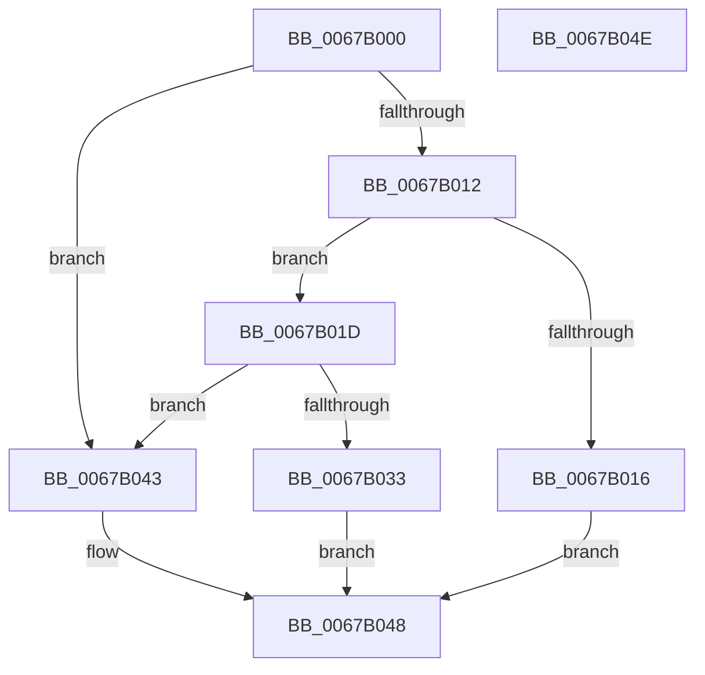

# MmMarkPhysicalMemoryAsGood

- RVA: `0x0067B000`–`0x0067B04F` (길이 `79` bytes)
- VA: `0x000000014067B000`
- 실행 섹션: `.text`
- PDB 이름 있음: `예`; PDB Function 태그: `아니요`
- unwind 정보 RVA: `0x0005CF00`
- 디코드: `27`개 명령, `79/79` bytes 표시
- 미해석 바이트: `0` (있으면 어셈블리에 `.byte`로 보존)

> 이 문서는 커널 이미지의 기계어와 PDB 기호를 분석해 생성했습니다. 4번과 5번은 함수 원형과 자료형을 바이너리 사용 방식에서 추정한 C 해석이며 원본 소스 복구 결과는 아닙니다.

## 1. Dependencies

- 직접 호출 지점: **1**; 고유 호출 대상: **1**
- 직접 호출자로 확인된 함수: **0**
- RIP 상대 이미지 참조: **0**

### Outgoing calls
- `0x0067B033` → [MiUnlinkBadPages](MiUnlinkBadPages_function_0067A6FC.md) (function, `0x0067A6FC`)

### Direct callers
- 이 함수 시작 RVA로 연결되는 직접 call은 확인되지 않았습니다. 간접 호출은 완전히 역산할 수 없습니다.

### Static image references
- 디코드된 RIP-relative 메모리 참조가 없습니다.

## 2. Other-region calls and transfers

- 다른 실행 섹션으로 향하는 call: **0**
- 별도 외부 분기/꼬리 이동을 확인하지 못했습니다.

## 3. Assembly (complete function range)

```asm
0067B000  40 53                           push rbx
0067B002  48 83 EC 20                     sub rsp, 0x20
0067B006  48 8B DA                        mov rbx, rdx
0067B009  BA FF 0F 00 00                  mov edx, 0xfff
0067B00E  85 11                           test dword ptr [rcx], edx
0067B010  75 31                           jne 0x14067b043
0067B012  85 13                           test dword ptr [rbx], edx
0067B014  74 07                           je 0x14067b01d
0067B016  B8 F0 00 00 C0                  mov eax, 0xc00000f0
0067B01B  EB 2B                           jmp 0x14067b048
0067B01D  48 8B 09                        mov rcx, qword ptr [rcx]
0067B020  48 8B 13                        mov rdx, qword ptr [rbx]
0067B023  48 C1 E9 0C                     shr rcx, 0xc
0067B027  48 C1 EA 0C                     shr rdx, 0xc
0067B02B  48 03 D1                        add rdx, rcx
0067B02E  48 3B CA                        cmp rcx, rdx
0067B031  73 10                           jae 0x14067b043
0067B033  E8 C4 F6 FF FF                  call 0x14067a6fc
0067B038  48 C1 E0 0C                     shl rax, 0xc
0067B03C  48 89 03                        mov qword ptr [rbx], rax
0067B03F  33 C0                           xor eax, eax
0067B041  EB 05                           jmp 0x14067b048
0067B043  B8 EF 00 00 C0                  mov eax, 0xc00000ef
0067B048  48 83 C4 20                     add rsp, 0x20
0067B04C  5B                              pop rbx
0067B04D  C3                              ret
0067B04E  CC                              int3
```

## 4. C-style interpretation (structured pseudocode)

```c
__int64 __fastcall MmMarkPhysicalMemoryAsGood(__int64 a1, __int64 a2)
{
    __int64 result;
    __int64 v_rsp;

    v_rsp = (v_rsp) - (32);
    if (((*(unsigned int *)(a1)) & ((unsigned int)((unsigned int)(0xFFFULL)))) != 0) goto loc_0067B043;
    if (((*(unsigned int *)(a2)) & ((unsigned int)((unsigned int)(0xFFFULL)))) == 0) goto loc_0067B01D;
    goto loc_0067B048;
loc_0067B01D:
    a1 = (*(unsigned __int64 *)(a1)) >> (12);
    a2 = (*(unsigned __int64 *)(a2)) >> (12);
    a2 = (a2) + (a1);
    if (a1 >= a2) goto loc_0067B043;
    result = MiUnlinkBadPages(a1, a2, a3, a4);
    result = (result) << (12);
    *(unsigned __int64 *)(a2) = result;
    result = 0;
    goto loc_0067B048;
loc_0067B043:
loc_0067B048:
    v_rsp = (v_rsp) + (32);
    return (unsigned int)(0xC00000EFULL);
}
```

## 5. (Beta) C Style

```c
int64_t MmMarkPhysicalMemoryAsGood(void *Arg1, void *Arg2)
{
    uint8_t *arg1 = (uint8_t *)Arg1;
    uint8_t *arg2 = (uint8_t *)Arg2;

    int64_t result;
    int64_t local_rsp;

    local_rsp = (local_rsp) - (32);
    if (((*(uint32_t *)(arg1)) & ((uint32_t)((uint32_t)(0xFFFULL)))) != 0) goto loc_0067B043;
    if (((*(uint32_t *)(arg2)) & ((uint32_t)((uint32_t)(0xFFFULL)))) == 0) goto loc_0067B01D;
    goto loc_0067B048;
loc_0067B01D:
    Arg1 = (*(uint64_t *)(arg1)) >> (12);
    Arg2 = (*(uint64_t *)(arg2)) >> (12);
    Arg2 = (Arg2) + (Arg1);
    if (Arg1 >= Arg2) goto loc_0067B043;
    result = MiUnlinkBadPages(Arg1, Arg2, a3, a4);
    result = (result) << (12);
    *(uint64_t *)(arg2) = result;
    result = 0;
    goto loc_0067B048;
loc_0067B043:
loc_0067B048:
    local_rsp = (local_rsp) + (32);
    return (uint32_t)(0xC00000EFULL);
}
```

### 관측된 메모리 오프셋

구조체 형식이 확인되지 않은 접근은 인자 기준의 오프셋으로만 기록했습니다.

| 기준 인자 | 오프셋 표현 | 폭 (bit) | 접근 |
|---|---:|---:|---|
| `Arg1` | `+ 0x0` | `32` | `R` |
| `Arg1` | `+ 0x0` | `64` | `R` |
| `Arg2` | `+ 0x0` | `32` | `R` |
| `Arg2` | `+ 0x0` | `64` | `R` |
| `Arg2` | `+ 0x0` | `64` | `W` |

## 6. Execution-region graph

[열기: 2D/3D 그래프와 함수 탐색 컨트롤 패널](../../../control-panel.html?section=text&rva=0x0067B000&view=graph)

- 2D 그래프는 위에서 아래로 흐르고, 3D 그래프는 빈 공간을 드래그해 회전합니다. Shift+드래그는 이동, 휠은 확대·축소, 함수 노드 선택은 대상 보고서 이동입니다.

### Static fallback


