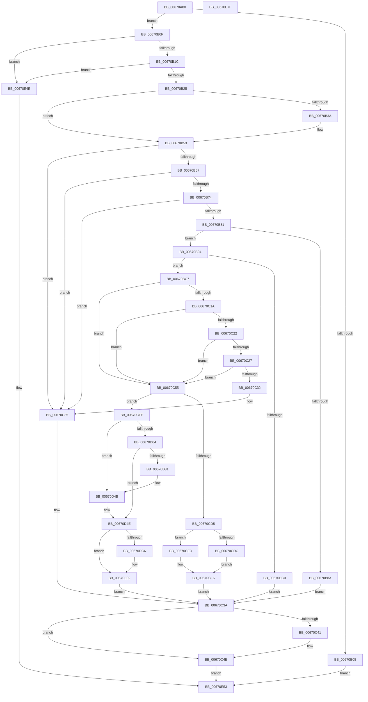

# MmProtectDriverSection

- RVA: `0x00670A80`–`0x00670E80` (길이 `1,024` bytes)
- VA: `0x0000000140670A80`
- 실행 섹션: `.text`
- PDB 이름 있음: `예`; PDB Function 태그: `아니요`
- unwind 정보 RVA: `0x000D778C`
- 디코드: `243`개 명령, `1,024/1,024` bytes 표시
- 미해석 바이트: `0` (있으면 어셈블리에 `.byte`로 보존)

> 이 문서는 커널 이미지의 기계어와 PDB 기호를 분석해 생성했습니다. 4번과 5번은 함수 원형과 자료형을 바이너리 사용 방식에서 추정한 C 해석이며 원본 소스 복구 결과는 아닙니다.

## 1. Dependencies

- 직접 호출 지점: **26**; 고유 호출 대상: **15**
- 직접 호출자로 확인된 함수: **1**
- RIP 상대 이미지 참조: **6**

### Outgoing calls
- `0x00670AD6` → [memset](../6C/memset_function_006C6C40.md) (function, `0x006C6C40`)
- `0x00670B2D` → [MiLockLoadedDataTableEntryIfNecessary](../2A/MiLockLoadedDataTableEntryIfNecessary_function_002A38B4.md) (function, `0x002A38B4`)
- `0x00670B4D` → [KeBugCheckEx](../4F/KeBugCheckEx_function_004FD660.md) (function, `0x004FD660`)
- `0x00670B5A` → [MI_IS_PHYSICAL_ADDRESS](../23/MI_IS_PHYSICAL_ADDRESS_function_0023B3A0.md) (function, `0x0023B3A0`)
- `0x00670BB4` → [MiSnapDriverRange](../../page/A4/MiSnapDriverRange_function_00A4B328.md) (function, `0x00A4B328`)
- `0x00670C0D` → [RtlImageDirectoryEntryToData](../43/RtlImageDirectoryEntryToData_function_004328D0.md) (function, `0x004328D0`)
- `0x00670C49` → [MiUnlockLoadedDataTableEntry](../2A/MiUnlockLoadedDataTableEntry_function_002A385C.md) (function, `0x002A385C`)
- `0x00670C82` → [MiGetAnyMultiplexedVm](../44/MiGetAnyMultiplexedVm_function_00448BD0.md) (function, `0x00448BD0`)
- `0x00670C9E` → [MiLockWorkingSetShared](../27/MiLockWorkingSetShared_function_0027CBF0.md) (function, `0x0027CBF0`)
- `0x00670CAC` → [MiWalkPageTables](../2C/MiWalkPageTables_function_002C2710.md) (function, `0x002C2710`)
- `0x00670CB9` → [MiUnlockWorkingSetShared](../27/MiUnlockWorkingSetShared_function_0027D690.md) (function, `0x0027D690`)
- `0x00670D0E` → [memset](../6C/memset_function_006C6C40.md) (function, `0x006C6C40`)
- `0x00670D25` → [VslpEnterIumSecureMode](../23/VslpEnterIumSecureMode_function_00235E50.md) (function, `0x00235E50`)
- `0x00670D45` → [KeBugCheckEx](../4F/KeBugCheckEx_function_004FD660.md) (function, `0x004FD660`)
- `0x00670D5E` → [MiMakeDriverPagesPrivate](../38/MiMakeDriverPagesPrivate_function_00384C60.md) (function, `0x00384C60`)
- `0x00670D7F` → [MiLockWorkingSetShared](../27/MiLockWorkingSetShared_function_0027CBF0.md) (function, `0x0027CBF0`)
- `0x00670D8D` → [MiWalkPageTables](../2C/MiWalkPageTables_function_002C2710.md) (function, `0x002C2710`)
- `0x00670D9A` → [MiUnlockWorkingSetShared](../27/MiUnlockWorkingSetShared_function_0027D690.md) (function, `0x0027D690`)
- `0x00670DB7` → [MiSetSystemCodeProtection](../38/MiSetSystemCodeProtection_function_00384420.md) (function, `0x00384420`)
- `0x00670DE2` → [MiLockWorkingSetShared](../27/MiLockWorkingSetShared_function_0027CBF0.md) (function, `0x0027CBF0`)
- `0x00670DF0` → [MiWalkPageTables](../2C/MiWalkPageTables_function_002C2710.md) (function, `0x002C2710`)
- `0x00670DFD` → [MiUnlockWorkingSetShared](../27/MiUnlockWorkingSetShared_function_0027D690.md) (function, `0x0027D690`)
- `0x00670E1E` → [MiLockWorkingSetShared](../27/MiLockWorkingSetShared_function_0027CBF0.md) (function, `0x0027CBF0`)
- `0x00670E2C` → [MiWalkPageTables](../2C/MiWalkPageTables_function_002C2710.md) (function, `0x002C2710`)
- `0x00670E39` → [MiUnlockWorkingSetShared](../27/MiUnlockWorkingSetShared_function_0027D690.md) (function, `0x0027D690`)
- `0x00670E5D` → [_security_check_cookie](../6A/_security_check_cookie_function_006AC640.md) (function, `0x006AC640`)

### Direct callers
- [PsInitializeWin32kServiceTable](../../init/C4/PsInitializeWin32kServiceTable_function_00C44C08.md) at `0x00C44CFF`

### Static image references
- `0x00670AA2` → RVA `0x00E0A740` (`.data`; read)
- `0x00670AE2` → RVA `0x00FC6A88` (`ALMOSTRO`; read)
- `0x00670B67` → RVA `0x00FC6B28` (`ALMOSTRO`; read)
- `0x00670B74` → RVA `0x00FC6B98` (`ALMOSTRO`; read)
- `0x00670C55` → RVA `0x006706C0` (`MiProtectDriverSectionPte`; read)
- `0x00670DBC` → RVA `0x00E38D04` (`.data`; read)

## 2. Other-region calls and transfers

- 다른 실행 섹션으로 향하는 call: **1**
  - `0x00670BB4` → [MiSnapDriverRange](../../page/A4/MiSnapDriverRange_function_00A4B328.md) (`.text` → `PAGE`)
- 별도 외부 분기/꼬리 이동을 확인하지 못했습니다.

## 3. Assembly (complete function range)

```asm
00670A80  48 8B C4                        mov rax, rsp
00670A83  48 89 58 10                     mov qword ptr [rax + 0x10], rbx
00670A87  48 89 70 18                     mov qword ptr [rax + 0x18], rsi
00670A8B  48 89 78 20                     mov qword ptr [rax + 0x20], rdi
00670A8F  55                              push rbp
00670A90  41 54                           push r12
00670A92  41 57                           push r15
00670A94  48 8D A8 38 FF FF FF            lea rbp, [rax - 0xc8]
00670A9B  48 81 EC B0 01 00 00            sub rsp, 0x1b0
00670AA2  48 8B 05 97 9C 79 00            mov rax, qword ptr [rip + 0x799c97]
00670AA9  48 33 C4                        xor rax, rsp
00670AAC  48 89 85 A0 00 00 00            mov qword ptr [rbp + 0xa0], rax
00670AB3  45 8B E0                        mov r12d, r8d
00670AB6  48 8B DA                        mov rbx, rdx
00670AB9  48 8B F1                        mov rsi, rcx
00670ABC  45 33 FF                        xor r15d, r15d
00670ABF  33 D2                           xor edx, edx
00670AC1  4C 89 7C 24 30                  mov qword ptr [rsp + 0x30], r15
00670AC6  41 B8 C0 00 00 00               mov r8d, 0xc0
00670ACC  4C 89 7C 24 60                  mov qword ptr [rsp + 0x60], r15
00670AD1  48 8D 4C 24 70                  lea rcx, [rsp + 0x70]
00670AD6  E8 65 61 05 00                  call 0x1406c6c40
00670ADB  33 C0                           xor eax, eax
00670ADD  44 89 7C 24 58                  mov dword ptr [rsp + 0x58], r15d
00670AE2  48 F7 05 9B 5F 95 00 00 40 00 00  test qword ptr [rip + 0x955f9b], 0x4000
00670AED  0F 57 C0                        xorps xmm0, xmm0
00670AF0  0F 11 44 24 38                  movups xmmword ptr [rsp + 0x38], xmm0
00670AF5  48 89 44 24 48                  mov qword ptr [rsp + 0x48], rax
00670AFA  89 44 24 50                     mov dword ptr [rsp + 0x50], eax
00670AFE  44 89 7C 24 5C                  mov dword ptr [rsp + 0x5c], r15d
00670B03  75 0A                           jne 0x140670b0f
00670B05  B8 84 01 00 C0                  mov eax, 0xc0000184
00670B0A  E9 44 03 00 00                  jmp 0x140670e53
00670B0F  41 F7 C4 FE FF FF FF            test r12d, 0xfffffffe
00670B16  0F 85 32 03 00 00               jne 0x140670e4e
00670B1C  48 85 DB                        test rbx, rbx
00670B1F  0F 85 29 03 00 00               jne 0x140670e4e
00670B25  48 8D 54 24 5C                  lea rdx, [rsp + 0x5c]
00670B2A  48 8B CE                        mov rcx, rsi
00670B2D  E8 82 2D C3 FF                  call 0x1402a38b4
00670B32  48 8B F8                        mov rdi, rax
00670B35  48 85 C0                        test rax, rax
00670B38  75 19                           jne 0x140670b53
00670B3A  45 33 C9                        xor r9d, r9d
00670B3D  4C 89 7C 24 20                  mov qword ptr [rsp + 0x20], r15
00670B42  4C 8B C6                        mov r8, rsi
00670B45  8D 4B 1A                        lea ecx, [rbx + 0x1a]
00670B48  BA 00 09 00 00                  mov edx, 0x900
00670B4D  E8 0E CB E8 FF                  call 0x1404fd660
00670B52  CC                              int3
00670B53  48 8B 58 30                     mov rbx, qword ptr [rax + 0x30]
00670B57  48 8B CB                        mov rcx, rbx
00670B5A  E8 41 A8 BC FF                  call 0x14023b3a0
00670B5F  85 C0                           test eax, eax
00670B61  0F 85 CE 00 00 00               jne 0x140670c35
00670B67  48 3B 1D BA 5F 95 00            cmp rbx, qword ptr [rip + 0x955fba]
00670B6E  0F 84 C1 00 00 00               je 0x140670c35
00670B74  48 3B 1D 1D 60 95 00            cmp rbx, qword ptr [rip + 0x95601d]
00670B7B  0F 84 B4 00 00 00               je 0x140670c35
00670B81  F7 47 68 00 00 08 00            test dword ptr [rdi + 0x68], 0x80000
00670B88  74 0A                           je 0x140670b94
00670B8A  BB 43 00 00 C0                  mov ebx, 0xc0000043
00670B8F  E9 A6 00 00 00                  jmp 0x140670c3a
00670B94  33 D2                           xor edx, edx
00670B96  48 8D 44 24 60                  lea rax, [rsp + 0x60]
00670B9B  48 89 44 24 28                  mov qword ptr [rsp + 0x28], rax
00670BA0  4C 8B CE                        mov r9, rsi
00670BA3  48 8D 44 24 30                  lea rax, [rsp + 0x30]
00670BA8  48 8B CF                        mov rcx, rdi
00670BAB  48 89 44 24 20                  mov qword ptr [rsp + 0x20], rax
00670BB0  44 8D 42 40                     lea r8d, [rdx + 0x40]
00670BB4  E8 6F A7 3D 00                  call 0x140a4b328
00670BB9  4C 39 7C 24 30                  cmp qword ptr [rsp + 0x30], r15
00670BBE  75 07                           jne 0x140670bc7
00670BC0  BB 41 01 00 C0                  mov ebx, 0xc0000141
00670BC5  EB 73                           jmp 0x140670c3a
00670BC7  48 B8 00 00 00 00 80 F6 FF FF   movabs rax, 0xfffff68000000000
00670BD1  48 8B 74 24 60                  mov rsi, qword ptr [rsp + 0x60]
00670BD6  4C 8D 4C 24 58                  lea r9, [rsp + 0x58]
00670BDB  4C 8B 7C 24 30                  mov r15, qword ptr [rsp + 0x30]
00670BE0  41 B8 0C 00 00 00               mov r8d, 0xc
00670BE6  48 8B 4F 30                     mov rcx, qword ptr [rdi + 0x30]
00670BEA  B2 01                           mov dl, 1
00670BEC  48 C1 E6 19                     shl rsi, 0x19
00670BF0  48 C1 E0 19                     shl rax, 0x19
00670BF4  48 2B F0                        sub rsi, rax
00670BF7  49 C1 E7 19                     shl r15, 0x19
00670BFB  4C 2B F8                        sub r15, rax
00670BFE  48 C1 FE 10                     sar rsi, 0x10
00670C02  48 81 C6 FF 0F 00 00            add rsi, 0xfff
00670C09  49 C1 FF 10                     sar r15, 0x10
00670C0D  E8 BE 1C DC FF                  call 0x1404328d0
00670C12  45 33 C0                        xor r8d, r8d
00670C15  48 85 C0                        test rax, rax
00670C18  74 3B                           je 0x140670c55
00670C1A  8B 4C 24 58                     mov ecx, dword ptr [rsp + 0x58]
00670C1E  85 C9                           test ecx, ecx
00670C20  74 33                           je 0x140670c55
00670C22  48 3B C6                        cmp rax, rsi
00670C25  77 2E                           ja 0x140670c55
00670C27  8D 51 FF                        lea edx, [rcx - 1]
00670C2A  48 03 D0                        add rdx, rax
00670C2D  49 3B D7                        cmp rdx, r15
00670C30  72 23                           jb 0x140670c55
00670C32  45 33 FF                        xor r15d, r15d
00670C35  BB BB 00 00 C0                  mov ebx, 0xc00000bb
00670C3A  44 39 7C 24 5C                  cmp dword ptr [rsp + 0x5c], r15d
00670C3F  74 0D                           je 0x140670c4e
00670C41  BA 01 00 00 00                  mov edx, 1
00670C46  48 8B CF                        mov rcx, rdi
00670C49  E8 0E 2C C3 FF                  call 0x1402a385c
00670C4E  8B C3                           mov eax, ebx
00670C50  E9 FE 01 00 00                  jmp 0x140670e53
00670C55  48 8D 05 64 FA FF FF            lea rax, [rip - 0x59c]
00670C5C  44 89 44 24 3C                  mov dword ptr [rsp + 0x3c], r8d
00670C61  48 89 45 18                     mov qword ptr [rbp + 0x18], rax
00670C65  B9 01 00 00 00                  mov ecx, 1
00670C6A  48 8D 44 24 38                  lea rax, [rsp + 0x38]
00670C6F  4C 89 44 24 48                  mov qword ptr [rsp + 0x48], r8
00670C74  48 89 45 28                     mov qword ptr [rbp + 0x28], rax
00670C78  4C 89 44 24 50                  mov qword ptr [rsp + 0x50], r8
00670C7D  48 89 7C 24 40                  mov qword ptr [rsp + 0x40], rdi
00670C82  E8 49 7F DD FF                  call 0x140448bd0
00670C87  48 8B C8                        mov rcx, rax
00670C8A  48 89 45 90                     mov qword ptr [rbp - 0x70], rax
00670C8E  4C 89 7D 98                     mov qword ptr [rbp - 0x68], r15
00670C92  48 89 75 A0                     mov qword ptr [rbp - 0x60], rsi
00670C96  C7 44 24 70 27 00 00 00         mov dword ptr [rsp + 0x70], 0x27
00670C9E  E8 4D BF C0 FF                  call 0x14027cbf0
00670CA3  48 8D 4C 24 70                  lea rcx, [rsp + 0x70]
00670CA8  88 44 24 79                     mov byte ptr [rsp + 0x79], al
00670CAC  E8 5F 1A C5 FF                  call 0x1402c2710
00670CB1  8A 54 24 79                     mov dl, byte ptr [rsp + 0x79]
00670CB5  48 8B 4D 90                     mov rcx, qword ptr [rbp - 0x70]
00670CB9  E8 D2 C9 C0 FF                  call 0x14027d690
00670CBE  48 8B 44 24 60                  mov rax, qword ptr [rsp + 0x60]
00670CC3  48 2B 44 24 30                  sub rax, qword ptr [rsp + 0x30]
00670CC8  48 C1 F8 03                     sar rax, 3
00670CCC  FF C0                           inc eax
00670CCE  48 39 44 24 48                  cmp qword ptr [rsp + 0x48], rax
00670CD3  74 29                           je 0x140670cfe
00670CD5  F6 44 24 50 01                  test byte ptr [rsp + 0x50], 1
00670CDA  74 07                           je 0x140670ce3
00670CDC  BB 45 00 00 C0                  mov ebx, 0xc0000045
00670CE1  EB 13                           jmp 0x140670cf6
00670CE3  8A 44 24 50                     mov al, byte ptr [rsp + 0x50]
00670CE7  24 02                           and al, 2
00670CE9  F6 D8                           neg al
00670CEB  1B DB                           sbb ebx, ebx
00670CED  83 E3 1C                        and ebx, 0x1c
00670CF0  81 C3 05 00 00 C0               add ebx, 0xc0000005
00670CF6  45 33 FF                        xor r15d, r15d
00670CF9  E9 3C FF FF FF                  jmp 0x140670c3a
00670CFE  41 F6 C4 01                     test r12b, 1
00670D02  75 47                           jne 0x140670d4b
00670D04  33 D2                           xor edx, edx
00670D06  48 8D 4D 30                     lea rcx, [rbp + 0x30]
00670D0A  44 8D 42 68                     lea r8d, [rdx + 0x68]
00670D0E  E8 2D 5F 05 00                  call 0x1406c6c40
00670D13  BA 2E 00 00 00                  mov edx, 0x2e
00670D18  48 89 5D 38                     mov qword ptr [rbp + 0x38], rbx
00670D1C  4C 8D 4D 30                     lea r9, [rbp + 0x30]
00670D20  45 33 C0                        xor r8d, r8d
00670D23  B1 02                           mov cl, 2
00670D25  E8 26 51 BC FF                  call 0x140235e50
00670D2A  45 33 FF                        xor r15d, r15d
00670D2D  85 C0                           test eax, eax
00670D2F  79 1D                           jns 0x140670d4e
00670D31  45 33 C9                        xor r9d, r9d
00670D34  4C 89 7C 24 20                  mov qword ptr [rsp + 0x20], r15
00670D39  4C 8B C3                        mov r8, rbx
00670D3C  41 8D 4F 1A                     lea ecx, [r15 + 0x1a]
00670D40  BA 01 09 00 00                  mov edx, 0x901
00670D45  E8 16 C9 E8 FF                  call 0x1404fd660
00670D4A  CC                              int3
00670D4B  45 33 FF                        xor r15d, r15d
00670D4E  4C 8B 44 24 60                  mov r8, qword ptr [rsp + 0x60]
00670D53  45 33 C9                        xor r9d, r9d
00670D56  48 8B 54 24 30                  mov rdx, qword ptr [rsp + 0x30]
00670D5B  48 8B CF                        mov rcx, rdi
00670D5E  E8 FD 3E D1 FF                  call 0x140384c60
00670D63  48 8B 4D 90                     mov rcx, qword ptr [rbp - 0x70]
00670D67  48 C7 44 24 38 01 00 00 00      mov qword ptr [rsp + 0x38], 1
00670D70  4C 89 7C 24 48                  mov qword ptr [rsp + 0x48], r15
00670D75  4C 89 7C 24 50                  mov qword ptr [rsp + 0x50], r15
00670D7A  48 89 7C 24 40                  mov qword ptr [rsp + 0x40], rdi
00670D7F  E8 6C BE C0 FF                  call 0x14027cbf0
00670D84  48 8D 4C 24 70                  lea rcx, [rsp + 0x70]
00670D89  88 44 24 79                     mov byte ptr [rsp + 0x79], al
00670D8D  E8 7E 19 C5 FF                  call 0x1402c2710
00670D92  8A 54 24 79                     mov dl, byte ptr [rsp + 0x79]
00670D96  48 8B 4D 90                     mov rcx, qword ptr [rbp - 0x70]
00670D9A  E8 F1 C8 C0 FF                  call 0x14027d690
00670D9F  4C 8B 44 24 60                  mov r8, qword ptr [rsp + 0x60]
00670DA4  41 B9 01 00 00 00               mov r9d, 1
00670DAA  48 8B 54 24 30                  mov rdx, qword ptr [rsp + 0x30]
00670DAF  48 8B CF                        mov rcx, rdi
00670DB2  44 89 7C 24 20                  mov dword ptr [rsp + 0x20], r15d
00670DB7  E8 64 36 D1 FF                  call 0x140384420
00670DBC  8B 05 42 7F 7C 00               mov eax, dword ptr [rip + 0x7c7f42]
00670DC2  A8 08                           test al, 8
00670DC4  74 3C                           je 0x140670e02
00670DC6  48 8B 4D 90                     mov rcx, qword ptr [rbp - 0x70]
00670DCA  48 C7 44 24 38 02 00 00 00      mov qword ptr [rsp + 0x38], 2
00670DD3  4C 89 7C 24 48                  mov qword ptr [rsp + 0x48], r15
00670DD8  4C 89 7C 24 50                  mov qword ptr [rsp + 0x50], r15
00670DDD  48 89 7C 24 40                  mov qword ptr [rsp + 0x40], rdi
00670DE2  E8 09 BE C0 FF                  call 0x14027cbf0
00670DE7  48 8D 4C 24 70                  lea rcx, [rsp + 0x70]
00670DEC  88 44 24 79                     mov byte ptr [rsp + 0x79], al
00670DF0  E8 1B 19 C5 FF                  call 0x1402c2710
00670DF5  8A 54 24 79                     mov dl, byte ptr [rsp + 0x79]
00670DF9  48 8B 4D 90                     mov rcx, qword ptr [rbp - 0x70]
00670DFD  E8 8E C8 C0 FF                  call 0x14027d690
00670E02  48 8B 4D 90                     mov rcx, qword ptr [rbp - 0x70]
00670E06  48 C7 44 24 38 03 00 00 00      mov qword ptr [rsp + 0x38], 3
00670E0F  4C 89 7C 24 48                  mov qword ptr [rsp + 0x48], r15
00670E14  4C 89 7C 24 50                  mov qword ptr [rsp + 0x50], r15
00670E19  48 89 7C 24 40                  mov qword ptr [rsp + 0x40], rdi
00670E1E  E8 CD BD C0 FF                  call 0x14027cbf0
00670E23  48 8D 4C 24 70                  lea rcx, [rsp + 0x70]
00670E28  88 44 24 79                     mov byte ptr [rsp + 0x79], al
00670E2C  E8 DF 18 C5 FF                  call 0x1402c2710
00670E31  8A 54 24 79                     mov dl, byte ptr [rsp + 0x79]
00670E35  48 8B 4D 90                     mov rcx, qword ptr [rbp - 0x70]
00670E39  E8 52 C8 C0 FF                  call 0x14027d690
00670E3E  0F BA AF B8 00 00 00 0C         bts dword ptr [rdi + 0xb8], 0xc
00670E46  41 8B DF                        mov ebx, r15d
00670E49  E9 EC FD FF FF                  jmp 0x140670c3a
00670E4E  B8 0D 00 00 C0                  mov eax, 0xc000000d
00670E53  48 8B 8D A0 00 00 00            mov rcx, qword ptr [rbp + 0xa0]
00670E5A  48 33 CC                        xor rcx, rsp
00670E5D  E8 DE B7 03 00                  call 0x1406ac640
00670E62  4C 8D 9C 24 B0 01 00 00         lea r11, [rsp + 0x1b0]
00670E6A  49 8B 5B 28                     mov rbx, qword ptr [r11 + 0x28]
00670E6E  49 8B 73 30                     mov rsi, qword ptr [r11 + 0x30]
00670E72  49 8B 7B 38                     mov rdi, qword ptr [r11 + 0x38]
00670E76  49 8B E3                        mov rsp, r11
00670E79  41 5F                           pop r15
00670E7B  41 5C                           pop r12
00670E7D  5D                              pop rbp
00670E7E  C3                              ret
00670E7F  CC                              int3
```

## 4. C-style interpretation (structured pseudocode)

```c
__int64 __fastcall MmProtectDriverSection(__int64 a1, __int64 a2, int a3, int a4)
{
    __int64 result;
    __int64 v_r15;
    __int64 v_rbx;
    __int64 v_rsi;
    __int64 v_rsp;
    unsigned __int8 v_stack_m14F;
    unsigned __int64 v_stack_m158;
    unsigned __int64 v_stack_m168;
    unsigned int v_stack_m16C;
    unsigned int v_stack_m170;
    unsigned int v_stack_m178;
    unsigned __int64 v_stack_m18;
    unsigned __int64 v_stack_m180;
    unsigned __int64 v_stack_m188;
    unsigned int v_stack_m18C;
    unsigned __int64 v_stack_m190;
    unsigned __int64 v_stack_m198;
    unsigned __int64 v_stack_m1A0;
    unsigned __int64 v_stack_m1A8;

    *(unsigned __int64 *)(v_rsp + 16) = v_rbx;
    *(unsigned __int64 *)(v_rsp + 24) = v_rsi;
    *(unsigned __int64 *)(v_rsp + 32) = v_rdi;
    v_rsp = (v_rsp) - (432);
    result = (*(unsigned __int64 *)(v_rip + 7969943)) ^ (v_rsp);
    *(unsigned __int64 *)(v_rsp - 200 + 160) = result;
    v_r15 = 0;
    a2 = 0;
    v_stack_m198 = 0;
    v_stack_m168 = 0;
    result = memset(v_stack_m158, a2, 192, a4);
    result = 0;
    v_stack_m170 = 0;
    v_stack_m190 = v_xmm0;
    v_stack_m180 = 0;
    v_stack_m178 = 0;
    v_stack_m16C = 0;
    if (((*(unsigned __int64 *)(v_rip + 9789339)) & (0x4000ULL)) != 0) goto loc_00670B0F;
    goto loc_00670E53;
loc_00670B0F:
    if ((((unsigned int)((unsigned int)(a3))) & (0xFFFFFFFEULL)) != 0) goto loc_00670E4E;
    if (0 != 0) goto loc_00670E4E;
    result = MiLockLoadedDataTableEntryIfNecessary(a1, v_stack_m16C, 192, a4);
    if (result == 0) {
        a4 = 0;
        v_stack_m1A8 = 0;
        a3 = a1;
        a1 = a2 + 26;
        a2 = 0x900ULL;
        result = KeBugCheckEx(a1, a2, a3, a4);
    }
    result = MI_IS_PHYSICAL_ADDRESS(*(unsigned __int64 *)(result + 48), a2, a3, a4);
    if ((unsigned int)(result) != 0) goto loc_00670C35;
    if ((*(unsigned __int64 *)(result + 48)) == (*(unsigned __int64 *)(v_rip + 9789370))) goto loc_00670C35;
    if ((*(unsigned __int64 *)(result + 48)) == (*(unsigned __int64 *)(v_rip + 9789469))) goto loc_00670C35;
    if (((*(unsigned int *)(result + 104)) & (0x80000ULL)) == 0) goto loc_00670B94;
    goto loc_00670C3A;
loc_00670B94:
    a2 = 0;
    v_stack_m1A0 = v_stack_m168;
    v_stack_m1A8 = v_stack_m198;
    result = MiSnapDriverRange(result, a2, a2 + 64, a1);
    if (v_stack_m198 != 0) goto loc_00670BC7;
    goto loc_00670C3A;
loc_00670BC7:
    v_rsi = (v_stack_m168) << (25);
    result = (result) << (25);
    v_rsi = (v_rsi) - (result);
    v_r15 = (v_stack_m198) << (25);
    v_r15 = (v_r15) - (result);
    v_rsi = (v_rsi) >> (16);
    v_rsi = (v_rsi) + (0xFFFULL);
    v_r15 = (v_r15) >> (16);
    result = RtlImageDirectoryEntryToData(*(unsigned __int64 *)(result + 48), 1, 12, v_stack_m170);
    a3 = 0;
    if (result == 0) goto loc_00670C55;
    if ((unsigned int)((unsigned int)(v_stack_m170)) == 0) goto loc_00670C55;
    if (result > v_rsi) goto loc_00670C55;
    a2 = ((unsigned int)(v_stack_m170) - 1) + (result);
    if (a2 < v_r15) goto loc_00670C55;
    v_r15 = 0;
loc_00670C35:
loc_00670C3A:
    if (v_stack_m16C != 0) {
        a2 = 1;
        a1 = result;
        result = MiUnlockLoadedDataTableEntry(a1, a2, a3, v_stack_m170);
    }
    goto loc_00670E53;
loc_00670C55:
    v_stack_m18C = 0;
    *(unsigned __int64 *)(v_rsp - 200 + 24) = v_rip - 1436;
    v_stack_m180 = 0;
    *(unsigned __int64 *)(v_rsp - 200 + 40) = v_stack_m190;
    v_stack_m178 = 0;
    v_stack_m188 = result;
    result = MiGetAnyMultiplexedVm(1, a2, a3, v_stack_m170);
    *(unsigned __int64 *)(v_rsp - 200 - 112) = result;
    *(unsigned __int64 *)(v_rsp - 200 - 104) = 0;
    *(unsigned __int64 *)(v_rsp - 200 - 96) = v_rsi;
    v_stack_m158 = 39;
    result = MiLockWorkingSetShared(result, a2, a3, v_stack_m170);
    v_stack_m14F = (unsigned __int8)(result);
    result = MiWalkPageTables(v_stack_m158, a2, a3, v_stack_m170);
    result = MiUnlockWorkingSetShared(*(unsigned __int64 *)(v_rsp - 200 - 112), v_stack_m14F, a3, v_stack_m170);
    result = (v_stack_m168) - (v_stack_m198);
    result = (result) >> (3);
    result = (unsigned int)((result) + 1);
    if (v_stack_m180 == result) goto loc_00670CFE;
    if (((v_stack_m178) & (1)) == 0) goto loc_00670CE3;
    goto loc_00670CF6;
loc_00670CE3:
    result = (unsigned __int8)((v_stack_m178) & (2));
    result = (unsigned __int8)(-(result));
    v_rbx = (unsigned int)(((unsigned int)(0xC0000045ULL)) & (28));
    v_rbx = (unsigned int)((v_rbx) + (0xC0000005ULL));
loc_00670CF6:
    v_r15 = 0;
    goto loc_00670C3A;
loc_00670CFE:
    if ((((unsigned __int8)((unsigned int)(a3))) & (1)) != 0) goto loc_00670D4B;
    a2 = 0;
    result = memset(v_rsp - 200 + 48, a2, a2 + 104, v_stack_m170);
    *(unsigned __int64 *)(v_rsp - 200 + 56) = v_rbx;
    a3 = 0;
    result = VslpEnterIumSecureMode(2, 46, a3, v_rsp - 200 + 48);
    v_r15 = 0;
    if (!sign_flag) goto loc_00670D4E;
    a4 = 0;
    v_stack_m1A8 = 0;
    result = KeBugCheckEx(v_r15 + 26, (unsigned int)(0x901ULL), v_rbx, a4);
loc_00670D4B:
    v_r15 = 0;
loc_00670D4E:
    a4 = 0;
    result = MiMakeDriverPagesPrivate(result, v_stack_m198, v_stack_m168, a4);
    v_stack_m190 = 1;
    v_stack_m180 = 0;
    v_stack_m178 = 0;
    v_stack_m188 = result;
    result = MiLockWorkingSetShared(*(unsigned __int64 *)(v_rsp - 200 - 112), v_stack_m198, v_stack_m168, a4);
    v_stack_m14F = (unsigned __int8)(result);
    result = MiWalkPageTables(v_stack_m158, v_stack_m198, v_stack_m168, a4);
    result = MiUnlockWorkingSetShared(*(unsigned __int64 *)(v_rsp - 200 - 112), v_stack_m14F, v_stack_m168, a4);
    v_stack_m1A8 = 0;
    result = MiSetSystemCodeProtection(result, v_stack_m198, v_stack_m168, 1);
    result = (unsigned int)(*(unsigned int *)(v_rip + 8159042));
    if ((((unsigned __int8)((unsigned int)(*(unsigned int *)(v_rip + 8159042)))) & (8)) != 0) {
        a1 = *(unsigned __int64 *)(v_rsp - 200 - 112);
        v_stack_m190 = 2;
        v_stack_m180 = 0;
        v_stack_m178 = 0;
        v_stack_m188 = result;
        result = MiLockWorkingSetShared(a1, v_stack_m198, v_stack_m168, 1);
        a1 = v_stack_m158;
        v_stack_m14F = (unsigned __int8)(result);
        result = MiWalkPageTables(a1, v_stack_m198, v_stack_m168, 1);
        a2 = v_stack_m14F;
        a1 = *(unsigned __int64 *)(v_rsp - 200 - 112);
        result = MiUnlockWorkingSetShared(a1, a2, v_stack_m168, 1);
    }
    v_stack_m190 = 3;
    v_stack_m180 = 0;
    v_stack_m178 = 0;
    v_stack_m188 = result;
    result = MiLockWorkingSetShared(*(unsigned __int64 *)(v_rsp - 200 - 112), a2, v_stack_m168, 1);
    v_stack_m14F = (unsigned __int8)(result);
    result = MiWalkPageTables(v_stack_m158, a2, v_stack_m168, 1);
    result = MiUnlockWorkingSetShared(*(unsigned __int64 *)(v_rsp - 200 - 112), v_stack_m14F, v_stack_m168, 1);
    goto loc_00670C3A;
loc_00670E4E:
loc_00670E53:
    a1 = (*(unsigned __int64 *)(v_rsp - 200 + 160)) ^ (v_rsp);
    result = _security_check_cookie(a1, v_stack_m14F, v_stack_m168, 1);
    return result;
}
```

## 5. (Beta) C Style

```c
int64_t MmProtectDriverSection(int64_t Arg1, int64_t Arg2, int32_t Arg3, int32_t Arg4)
{
    int64_t result;
    int64_t local_r15;
    int64_t local_rbx;
    int64_t local_rsi;
    int64_t local_rsp;
    uint8_t v_stack_m14F;
    uint64_t v_stack_m158;
    uint64_t v_stack_m168;
    uint32_t v_stack_m16C;
    uint32_t v_stack_m170;
    uint32_t v_stack_m178;
    uint64_t v_stack_m18;
    uint64_t v_stack_m180;
    uint64_t v_stack_m188;
    uint32_t v_stack_m18C;
    uint64_t v_stack_m190;
    uint64_t v_stack_m198;
    uint64_t v_stack_m1A0;
    uint64_t v_stack_m1A8;

    *(uint64_t *)(local_rsp + 0x10) = local_rbx;
    *(uint64_t *)(local_rsp + 0x18) = local_rsi;
    *(uint64_t *)(local_rsp + 0x20) = local_rdi;
    local_rsp = (local_rsp) - (432);
    result = (*(uint64_t *)(v_rip + 0x799C97)) ^ (local_rsp);
    *(uint64_t *)(local_rsp - 0xC8 + 0xA0) = result;
    local_r15 = 0;
    Arg2 = 0;
    v_stack_m198 = 0;
    v_stack_m168 = 0;
    result = memset(v_stack_m158, Arg2, 192, Arg4);
    result = 0;
    v_stack_m170 = 0;
    v_stack_m190 = v_xmm0;
    v_stack_m180 = 0;
    v_stack_m178 = 0;
    v_stack_m16C = 0;
    if (((*(uint64_t *)(v_rip + 0x955F9B)) & (0x4000ULL)) != 0) goto loc_00670B0F;
    goto loc_00670E53;
loc_00670B0F:
    if ((((uint32_t)((uint32_t)(Arg3))) & (0xFFFFFFFEULL)) != 0) goto loc_00670E4E;
    if (0 != 0) goto loc_00670E4E;
    result = MiLockLoadedDataTableEntryIfNecessary(Arg1, v_stack_m16C, 192, Arg4);
    if (result == 0) {
        Arg4 = 0;
        v_stack_m1A8 = 0;
        Arg3 = Arg1;
        Arg1 = Arg2 + 26;
        Arg2 = 0x900ULL;
        result = KeBugCheckEx(Arg1, Arg2, Arg3, Arg4);
    }
    result = MI_IS_PHYSICAL_ADDRESS(*(uint64_t *)(result + 0x30), Arg2, Arg3, Arg4);
    if ((uint32_t)(result) != 0) goto loc_00670C35;
    if ((*(uint64_t *)(result + 0x30)) == (*(uint64_t *)(v_rip + 0x955FBA))) goto loc_00670C35;
    if ((*(uint64_t *)(result + 0x30)) == (*(uint64_t *)(v_rip + 0x95601D))) goto loc_00670C35;
    if (((*(uint32_t *)(result + 0x68)) & (0x80000ULL)) == 0) goto loc_00670B94;
    goto loc_00670C3A;
loc_00670B94:
    Arg2 = 0;
    v_stack_m1A0 = v_stack_m168;
    v_stack_m1A8 = v_stack_m198;
    result = MiSnapDriverRange(result, Arg2, Arg2 + 64, Arg1);
    if (v_stack_m198 != 0) goto loc_00670BC7;
    goto loc_00670C3A;
loc_00670BC7:
    local_rsi = (v_stack_m168) << (25);
    result = (result) << (25);
    local_rsi = (local_rsi) - (result);
    local_r15 = (v_stack_m198) << (25);
    local_r15 = (local_r15) - (result);
    local_rsi = (local_rsi) >> (16);
    local_rsi = (local_rsi) + (0xFFFULL);
    local_r15 = (local_r15) >> (16);
    result = RtlImageDirectoryEntryToData(*(uint64_t *)(result + 0x30), 1, 12, v_stack_m170);
    Arg3 = 0;
    if (result == 0) goto loc_00670C55;
    if ((uint32_t)((uint32_t)(v_stack_m170)) == 0) goto loc_00670C55;
    if (result > local_rsi) goto loc_00670C55;
    Arg2 = ((uint32_t)(v_stack_m170) - 1) + (result);
    if (Arg2 < local_r15) goto loc_00670C55;
    local_r15 = 0;
loc_00670C35:
loc_00670C3A:
    if (v_stack_m16C != 0) {
        Arg2 = 1;
        Arg1 = result;
        result = MiUnlockLoadedDataTableEntry(Arg1, Arg2, Arg3, v_stack_m170);
    }
    goto loc_00670E53;
loc_00670C55:
    v_stack_m18C = 0;
    *(uint64_t *)(local_rsp - 0xC8 + 0x18) = v_rip - 1436;
    v_stack_m180 = 0;
    *(uint64_t *)(local_rsp - 0xC8 + 0x28) = v_stack_m190;
    v_stack_m178 = 0;
    v_stack_m188 = result;
    result = MiGetAnyMultiplexedVm(1, Arg2, Arg3, v_stack_m170);
    *(uint64_t *)(local_rsp - 0xC8 - 0x70) = result;
    *(uint64_t *)(local_rsp - 0xC8 - 0x68) = 0;
    *(uint64_t *)(local_rsp - 0xC8 - 0x60) = local_rsi;
    v_stack_m158 = 39;
    result = MiLockWorkingSetShared(result, Arg2, Arg3, v_stack_m170);
    v_stack_m14F = (uint8_t)(result);
    result = MiWalkPageTables(v_stack_m158, Arg2, Arg3, v_stack_m170);
    result = MiUnlockWorkingSetShared(*(uint64_t *)(local_rsp - 0xC8 - 0x70), v_stack_m14F, Arg3, v_stack_m170);
    result = (v_stack_m168) - (v_stack_m198);
    result = (result) >> (3);
    result = (uint32_t)((result) + 1);
    if (v_stack_m180 == result) goto loc_00670CFE;
    if (((v_stack_m178) & (1)) == 0) goto loc_00670CE3;
    goto loc_00670CF6;
loc_00670CE3:
    result = (uint8_t)((v_stack_m178) & (2));
    result = (uint8_t)(-(result));
    local_rbx = (uint32_t)(((uint32_t)(0xC0000045ULL)) & (28));
    local_rbx = (uint32_t)((local_rbx) + (0xC0000005ULL));
loc_00670CF6:
    local_r15 = 0;
    goto loc_00670C3A;
loc_00670CFE:
    if ((((uint8_t)((uint32_t)(Arg3))) & (1)) != 0) goto loc_00670D4B;
    Arg2 = 0;
    result = memset(local_rsp - 200 + 48, Arg2, Arg2 + 104, v_stack_m170);
    *(uint64_t *)(local_rsp - 0xC8 + 0x38) = local_rbx;
    Arg3 = 0;
    result = VslpEnterIumSecureMode(2, 46, Arg3, local_rsp - 200 + 48);
    local_r15 = 0;
    if (!sign_flag) goto loc_00670D4E;
    Arg4 = 0;
    v_stack_m1A8 = 0;
    result = KeBugCheckEx(local_r15 + 26, (uint32_t)(0x901ULL), local_rbx, Arg4);
loc_00670D4B:
    local_r15 = 0;
loc_00670D4E:
    Arg4 = 0;
    result = MiMakeDriverPagesPrivate(result, v_stack_m198, v_stack_m168, Arg4);
    v_stack_m190 = 1;
    v_stack_m180 = 0;
    v_stack_m178 = 0;
    v_stack_m188 = result;
    result = MiLockWorkingSetShared(*(uint64_t *)(local_rsp - 0xC8 - 0x70), v_stack_m198, v_stack_m168, Arg4);
    v_stack_m14F = (uint8_t)(result);
    result = MiWalkPageTables(v_stack_m158, v_stack_m198, v_stack_m168, Arg4);
    result = MiUnlockWorkingSetShared(*(uint64_t *)(local_rsp - 0xC8 - 0x70), v_stack_m14F, v_stack_m168, Arg4);
    v_stack_m1A8 = 0;
    result = MiSetSystemCodeProtection(result, v_stack_m198, v_stack_m168, 1);
    result = (uint32_t)(*(uint32_t *)(v_rip + 0x7C7F42));
    if ((((uint8_t)((uint32_t)(*(uint32_t *)(v_rip + 0x7C7F42)))) & (8)) != 0) {
        Arg1 = *(uint64_t *)(local_rsp - 0xC8 - 0x70);
        v_stack_m190 = 2;
        v_stack_m180 = 0;
        v_stack_m178 = 0;
        v_stack_m188 = result;
        result = MiLockWorkingSetShared(Arg1, v_stack_m198, v_stack_m168, 1);
        Arg1 = v_stack_m158;
        v_stack_m14F = (uint8_t)(result);
        result = MiWalkPageTables(Arg1, v_stack_m198, v_stack_m168, 1);
        Arg2 = v_stack_m14F;
        Arg1 = *(uint64_t *)(local_rsp - 0xC8 - 0x70);
        result = MiUnlockWorkingSetShared(Arg1, Arg2, v_stack_m168, 1);
    }
    v_stack_m190 = 3;
    v_stack_m180 = 0;
    v_stack_m178 = 0;
    v_stack_m188 = result;
    result = MiLockWorkingSetShared(*(uint64_t *)(local_rsp - 0xC8 - 0x70), Arg2, v_stack_m168, 1);
    v_stack_m14F = (uint8_t)(result);
    result = MiWalkPageTables(v_stack_m158, Arg2, v_stack_m168, 1);
    result = MiUnlockWorkingSetShared(*(uint64_t *)(local_rsp - 0xC8 - 0x70), v_stack_m14F, v_stack_m168, 1);
    goto loc_00670C3A;
loc_00670E4E:
loc_00670E53:
    Arg1 = (*(uint64_t *)(local_rsp - 0xC8 + 0xA0)) ^ (local_rsp);
    result = _security_check_cookie(Arg1, v_stack_m14F, v_stack_m168, 1);
    return result;
}
```

## 6. Execution-region graph

[열기: 2D/3D 그래프와 함수 탐색 컨트롤 패널](../../../control-panel.html?section=text&rva=0x00670A80&view=graph)

- 2D 그래프는 위에서 아래로 흐르고, 3D 그래프는 빈 공간을 드래그해 회전합니다. Shift+드래그는 이동, 휠은 확대·축소, 함수 노드 선택은 대상 보고서 이동입니다.

### Static fallback


